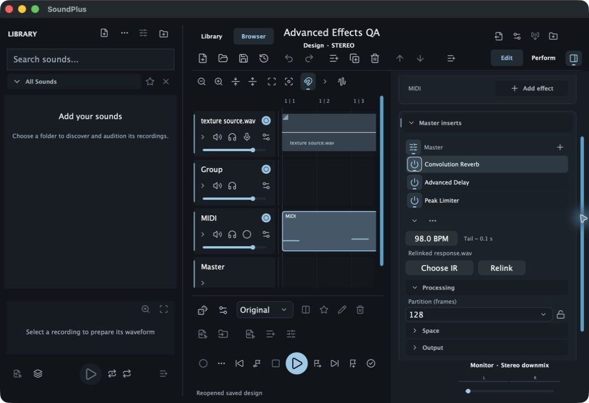
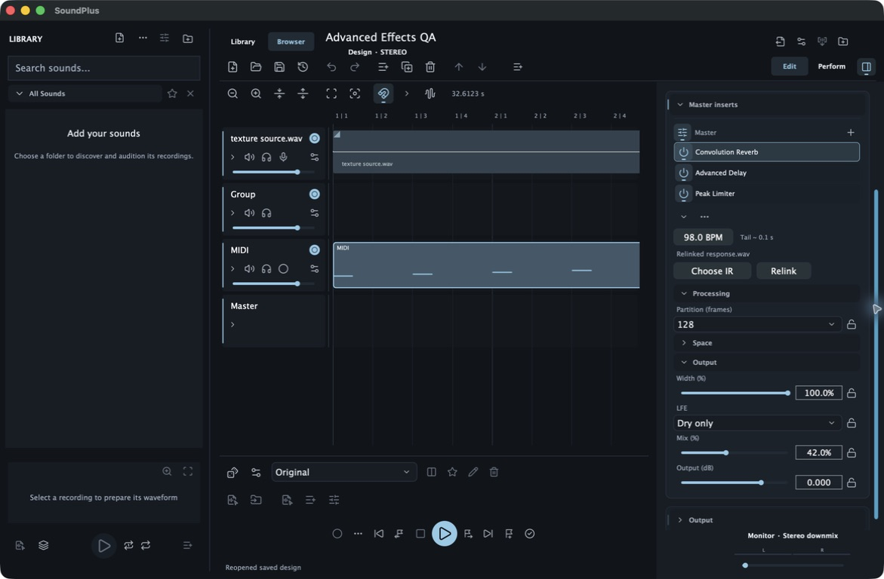

# Professional Advanced Delay and Reverb v1

November 22, 2026, US Eastern. Reviewed/start HEAD `c2c3f6b84fc2ec1d56e0aa03889bc756fe2ba941`. It was the current clean HEAD with origin/main equal; no later implementation was discarded. Read the complete supplied review plus AGENTS, native-effect, automation, MIDI and take contracts. Preserve the accepted Lucide/theme and Perform layout.

## Delivered scope

Three additional, independently versioned processors: Advanced Delay (four free/synced taps, bounded role-pair feedback, modulation, damping and independent ducking); Algorithmic Reverb (Room/Plate/Hall early reflections and8-line FDN, pre-delay/geometry/RT60/diffusion/damping/width/ducking); Convolution Reverb (referenced SHA-256 local IRs, explicit maps, uniform partition FFT, deterministic rate conversion and actual graph PDC). Existing legacy Delay/Reverb and all six native v1 processors retain their processing/identities. Old manifests1–15 and recipes1–6 are not migrated or rehashed. Advanced documents use manifest16, frozen takes recipe7.

Definitions drive the existing compact Inspector groups, units/numeric fields, locks, ordered insert racks and editable factory/user presets. The shared project/MIDI tempo is editable from the Inspector; no tempo map. Per-effect tail estimates warn when longer than the requested export tail, without extending output. Convolution Choose IR/Relink hash/inspect on the session worker. Factory settings and Reset retain a deliberately selected IR; user presets store their reference/map, never IR audio. Missing/changed IRs fail closed with recovery text; identical-content relink changes the path without changing content identity. A prepared audition can finish from its in-memory verified IR; future preparation/publication verifies again.

Every definition parameter appears by stable instance/parameter ID in the **same single automation lane**. Live parameters are writable, structural controls are explicitly read-only targets. Volume remains the default collapsed display. Selecting/collapsing a displayed curve does not disable other read-enabled curves. Existing Perform mappings/precedence and fixed-state hosted plugins are preserved; this milestone does not add hosted parameter automation.

Staged commits: A `ca68fcb`, B `97cd411`, C `84b52cc`, D `2519cf8`, all pushed. The final verified implementation/evidence commit and publication receipt are recorded in the repository log.

[Exact DSP/schema/resource/tail policy](ADVANCED_EFFECTS_CONTRACT.md). Implementation: [definitions](../src/AdvancedEffects.cpp), [delay adapter](../src/AdvancedEffectsDSP.cpp), [FDN](../src/AdvancedReverb.inc), [partitioned convolution](../src/AdvancedConvolution.inc), [IR preparation/integrity](../src/AdvancedIR.cpp), [ordered processing](../src/OrderedRack.inc), [Inspector](../src/NativeParameterPanel.h), [worker/session command](../src/DesignSession.cpp), [take and PDC history](../src/PerformTake.cpp), [graph/render publication](../src/DesignAudio.cpp).

## Numerical and command evidence

Independent references, rather than two uses of production DSP:

| Check | Actual evidence |
|---|---|
| Delay recurrence, damping/duck transfer | Max direct error1.862645149230957e-9; [Stage B](verification/advanced-effects/stage-b-delay-evidence.json) |
| Room/Plate/Hall full-history8×8-matrix reference | Tested float PCM max error0.0; [Stage C](verification/advanced-effects/stage-c-reverb-evidence.json) |
| Defined undamped late-only1.2s decay | T20-extrapolated RT60 1.17747–1.20286s across3modes ×44.1/48/96k. Declared tolerance25%; no unconditional acoustic RT60 claim |
| Short IR naive time-domain convolution | Max error7.450580596923828e-9 |
| Long IR independent whole-signal double FFT | Max error3.259629011154175e-9 |
| Unequal-rate absolute-time sinc oracle | Max error2.147769497410261e-17; includes causal support, group delay and filter-area scaling |
| Audible Perform macro through unequal-rate IR/PDC | Actual consumed pre-monitor PCM equals frozen replay at44.1/48/96k output and all128/256/512 partitions, max error0.0; full finalized body/tail WAV matches replay; [receipt](verification/advanced-effects/stage-e-capture-evidence.json) |
| Defined16-channel multi-owner/MIDI/automation workload | [Block-time/CPU/RSS receipt](verification/advanced-effects/stage-e-stress-evidence.json); separate from device result below |

[Convolution oracle receipt](verification/advanced-effects/stage-e-convolution-evidence.json). Required process partitions1/32/61/257/512 and44.1/48/96k; partition sizes128/256/512; zero/integral/fractional/max delay; feedback bounds; bypass/history; pre-delay; explicit front/side/rear/LFE/discrete16 routing; accurate seek; source split/tail-once; repeat render; Save/Reopen; frozen source fingerprints and identical-content relocation; hidden concurrent curves all tested. IR same-size/inode/exact-timestamp mutation still rejects by content hash. Missing/different/relink, unsupported maps/header masks, cancellation and resource admission reject deliberately. No original IR is modified.

Advanced export tests compare finalized32-bit PCM and WAV physical channel order for every named layout plus discrete16, normalized and unnormalized, with complete mono split sets. Existing real vendor regression passed OldSkoolVerb2.14 and LV50A1.0.0 (VST3,8 mono/stereo Track/Master numerical cases); Apple AUDelay1.6.0 AUv2 qualification passed mono/stereo/5.1 Side/5.1 Rear. [Vendor receipt](verification/advanced-effects/vendor-receipt.json), [AU receipt](verification/advanced-effects/au-receipt.json). Existing regression suites retain native+hosted ordered/PDC, MIDI instrument, source/microphone recording, source pools, collections, Perform, Library and historical processing coverage. Native fixture and independent new source tests are in [AdvancedEffectsTests](../tests/AdvancedEffectsTests.cpp), [delay](../tests/AdvancedDelayTests.inc), [reverb](../tests/AdvancedReverbTests.inc), [IR](../tests/AdvancedConvolutionTests.inc), [workflow/export/capture/stress](../tests/AdvancedWorkflowTests.inc); actual Inspector/session commands in [NativeIntegrationTests](../tests/NativeIntegrationTests.inc).

A stronger audible-event test exposed a recipe7 end dependency: source cutoff at bodyEnd removed samples needed by compensated lookahead/causalized resampling. Recipe7 now retains bounded input through bodyEnd + prepared inputDependencyFrames; published consumed body length stays fixed, only requested tail is emitted. Historical recipes are unchanged. An initial comparison also incorrectly compared mono monitor fold-down to raw mono PCM; the corrected test selects the direct source channel. Retained failed attempts are diagnostic evidence, not passes. Earlier delay Save/Reopen exposed a fractional-ring epsilon wrap; ASan reproduced and the fix/regressions pass.

## Native macOS qualification

Native application built and launched on Apple M5 Pro, macOS26.3.2 (25D2150), SDK26.5. Hardware/OS/compiler/SDK and exact328 source/resource plus9 executable identities are in the [before manifest](verification/advanced-effects/final/release/identity-before.json). The continuous device rerun uses the final compiled implementation; native Inspector sources are identical to those inspected before the final numerical endpoint/dependency correction. Final-build native checks repeated desktop/minimum screenshots after the gate and confirmed the saved42% Mix,98 BPM and relinked IR in revision7. AI disabled for isolated QA; user catalog/design is separate.

Native Inspector checks: shared tempo120→98 BPM, native IR chooser + explicit mono map, preset save/load, actual Mix100%→42%, preset Undo, Save/quit/reopen with42% and98 BPM retained, simulated missing IR retained visibly, identical-content Relink to a new path, saved revision7 reopened. Generated IR and QA files remain under `build/advanced-effect-tests/Native-QA-270f4ef04d044da0abed8ba0a24a327b`; no user media moved. `normal/QA IR.soundplus-effect` stores the selected reference/map. `normal/local response.wav` was renamed only within this generated fixture for the offline check and restored. `normal/Relinked response.wav` is its identical copy. Popup menu observation is limited by native control tooling: keyboard selection was verified through the resulting model/file/Inspector state; menu artwork itself is not claimed visually verified.

At1040×680 content and1360×860 requested desktop content, Browser + Inspector stay visible. Compact toolbar/transport/output/track controls and focus outlines are usable. Inspector uses its existing outer scrolling with collapsible parameter groups, without a second effects/automation viewport. The tail text encoding defect observed during native inspection was corrected before final qualification. Screenshot API downsizes tall captures to768px; the minimum capture is1040×712 including titlebar. This is native Retina output with screenshot resampling, not a separate1× display qualification.



The minimum keeps the existing sidebars, timeline and independent monitor transport; structural/IR controls fit the Inspector width, and vertical content uses the established outer disclosure/scroll behavior.



The desktop uses the same component hierarchy and spacing; secondary groups collapse and long source/hash details are in tooltips. Native AX evidence accompanies each screenshot, including [offline recovery](verification/advanced-effects/native/convolution-minimum-offline-ax.txt).

Continuous final native-device editing: **MacBook Pro Speakers,48k/512,450 inputs,363 observed edits,0 underruns, same graph/helper**,13s playback while searching and editing6 real Inspector controls across the new effects. Input→prepared-callback latency p50 **64.21ms**,p95 **80.68ms**,max **85.98ms** (346 distinct observations). Producer maximum9.11ms; audio-helper CPU4.43s, peak RSS98,910,208bytes; main app CPU4.83s, peak RSS157,483,008bytes. [Summary](verification/advanced-effects/native-device-summary.json), [full status/time samples](verification/advanced-effects/native-device-result.json). Meters report prepared audio and can lead device playback. These are not physical knob-to-DAC or acoustic measurements; no human listening judgement is inferred.

## Final Release gate and preservation

The earlier pre-endpoint full gate passed42/42 in406.50s; [retained attempt](verification/advanced-effects/final/pre-endpoint-gate/ctest.log). **Final unchanged Release gate:42/42 passed in408.23s**, including the new ASan suite and existing vendor/AUv2/device qualifications. [CTest log](verification/advanced-effects/final/release/ctest.log), [after manifest](verification/advanced-effects/final/release/identity-after.json): all328 source/resource hashes and9 executable hashes equal the before manifest. No implementation or binary changes followed this gate.

The initial audit confirms all103 protected source/final-output/journal/media hashes,18 SQLite table contents,196 retained non-database state files and latest Workflow demonstration document0403deec259f4169857b336246f201da revision4478 unchanged. [Pre-reopen audit](verification/advanced-effects/workspace-before-reopen.json). After the gate, the original in-place application was reopened and visibly showed **Workflow demonstration r4478**, unsaved edits retained, Perform/Browser, Blend X.321/Y.485, Macro1.491 enabled and monitor.25. [Final audit](verification/advanced-effects/workspace-final.json) confirms media,18 logical SQLite tables,196 state files and latest payload retained. SQLite WAL/shared-memory bytes are transient storage machinery, excluded from static-state comparisons; table contents are compared to the consistent protection copy. No protection copy was restored. Original in-place workspace is `build/gain-hover-native`; the task protection copy is `build/advanced-effects/protected-1795394641182959000`. It is a protection copy, never restored over newer work.

## Review closure1–31

| Finding | Status and evidence |
|---|---|
|1 New identities, preserve old DSP | Fixed; definitions + native/historical regression gate |
|2 Stable versioned parameters | Fixed; definition-ID persistence/reorder tests |
|3 Structural/live/latency | Fixed; read-only structural targets, update rejection, safe graph preparation, IR worker |
|4 Constant clock | Fixed; audio-only/MIDI shared clock, sync subdivisions, tempo/rate/seek/frozen tests |
|5 Bounded tails | Fixed; explicit requested tail, estimates/warnings, body/tail/split tests |
|6 Immutable epoch | Fixed; manifest16/recipe7 only for new effects; old contracts preserved |
|7 Foundation tests/commit | Fixed;7/7 Stage A, `ca68fcb` pushed |
|8 Free/synced delay | Fixed; direct subdivisions/BPM oracle |
|9 Multitap/filter/modulation/duck | Fixed; independent recurrences and automation |
|10 Feedback role/stability/LFE | Fixed; bounded matrix/energy, named/discrete/LFE tests |
|11 Preallocation/bypass/extremes | Fixed; prepared histories, max-feedback/denormal/nonfinite/history tests + ASan |
|12 Required rates/partitions | Fixed;44.1/48/96k,1/32/61/257/512 exact internal clock |
|13 Stage B commit | Fixed;6/6 targeted, `97cd411` pushed |
|14 Room/Plate/Hall | Fixed; mode geometries/early-late/FDN and exact controls documented |
|15 Reverb roles | Fixed; independent role networks/front width/LFE; physical speakers unverified |
|16 Prepared resources/history | Fixed; bounded state, bypass history; measured workload/device evidence |
|17 Reverb response/history/takes | Fixed; independent matrix/RT60, partition/seek/save/split/frozen PCM |
|18 Stage C commit | Fixed;6/6 targeted, `84b52cc` pushed |
|19 Referenced IR/integrity/relink | Fixed; stamps+SHA, missing/changed/same-stamp mutation, native recovery |
|20 Partition/PDC/memory | Fixed; uniform OLA, independent oracles, prepared resource rejection |
|21 Explicit IR matrices/roles | Fixed; mono/stereo/true-stereo/role-diagonal, ambiguous/incompatible rejection |
|22 IR PCM/history/provenance | Fixed; naive/FFT/sinc, required rates/blocks, channels, bypass/seek/save/takes |
|23 Stage D commit | Fixed;7/7 targeted, `2519cf8` pushed |
|24 Compact UI/presets/locks/Undo | Fixed; shared dynamic panel, factory metadata, actual command/native checks |
|25 ONE lane/hidden curves/stable identity | Fixed; unchanged lane architecture, new target/control/hidden PCM tests; structural reprepare and audible Perform boundary test |
|26 Existing ordered owners/MIDI/recording/collections | Preserved; new four-owner/MIDI stress + full existing Release suites |
|27 Render PCM/WAV masks/splits/legacy | Fixed; all named+discrete16 normalized/plain PCM/splits + old native/DSP suites |
|28 Native device/UI/presets/reopen | Qualified within native scope above; no human/acoustic claim |
|29 Realistic stress/resources/timing | Qualified for measured16-channel combination/device setting; no maximum-capacity realtime guarantee |
|30 Unchanged final gate/workspace | Passed;42/42 in408.23s,328+9 matching hashes; original r4478 reopened and audited |
|31 Stage commits/push/report/roadmap | A–D pushed; final verified stage and publication receipt identify the remaining commit/push |

## Build, launch and five-minute check

From repository root, retaining the existing pinned dependencies/configuration:

```sh
.tools/cmake/data/bin/cmake -S . -B build -G Ninja -DCMAKE_BUILD_TYPE=Release -DCMAKE_OSX_ARCHITECTURES=arm64 -DSOUNDPLUS_BUILD_PLUGIN_ASAN_QA=ON
.tools/cmake/data/bin/cmake --build build --config Release -j 6
open build/SoundPlus_artefacts/Release/SoundPlus.app
```

Close running processes from that bundle before rebuilding. Fresh dependency bootstrap remains the README's pinned JUCE/ONNX setup. To launch the protected existing working catalog explicitly:

```sh
build/SoundPlus_artefacts/Release/SoundPlus.app/Contents/MacOS/SoundPlus --data-dir "$PWD/build/gain-hover-native"
```

Use only one instance per catalog. For independent QA, choose a new `--data-dir "$PWD/build/advanced-effects/manual-QA" --disable-ai` and keep your working document separate.

1. In isolated QA, add a sound from Library to a new Design. Select its source/track or Master insert rack, Add Effect → Advanced Delay. Leave original legacy Delay/Reverb available for old sounds.
2. Open Timing, choose Project tempo; set the shared BPM, enable a second tap and try straight/dotted/triplet divisions. Play and adjust Feedback/Modulation/Ducking. Confirm search remains responsive.
3. Add Algorithmic Reverb. Compare Room/Plate/Hall deliberately (geometry safely reprepares). Adjust decay/damping/pre-delay; keep output conservative. Read the tail warning and set an explicit export tail.
4. Add Convolution Reverb. Choose a local short mono IR and explicitly choose Mono to each role, or an exact stereo diagonal IR. True stereo expects LL,LR,RL,RR; select it only for a matching file. Change Partition; confirm the current graph safely reprepares.
5. Expand the track's ONE automation lane; it initially shows Volume. Pick a new insert parameter, draw a curve, switch the displayed target, then collapse it. Hidden curves must continue playing. Structural targets remain read-only.
6. Save an effect preset, edit Mix, load the preset, Undo/Redo. Save the Design, quit and reopen. Tempo, IR map/path and controls must persist. If testing offline IR recovery, use a disposable copy; Relink requires identical content.
7. Render with an explicit tail, check the finalized file and channels; optionally repeat Normalize/Split mono. Listen yourself for musical usefulness and artifacts. The automated evidence proves PCM behavior, not subjective quality.

Focused gate: `.tools/cmake/data/bin/ctest --test-dir build --output-on-failure -R '^(advanced_effects|advanced_effects_asan|native_effects|multitrack_automation|recorded_takes|ordered_corrections|designer_view_commands)$'`.

Full gate uses `SOUNDPLUS_VENDOR_QUALIFICATION="$PWD/build/advanced-effects/final-vendors" SOUNDPLUS_LIVE_DEVICE_QUALIFICATION=1 SOUNDPLUS_QUALIFY_AU=1 caffeinate -i .tools/cmake/data/bin/ctest --test-dir build --output-on-failure`.

## Open limits

- No human listening review, acoustic/physical surround/controller/DAC loopback qualification, Resolve receiving-app persistence or signed/notarized public release. Internal PCM, native device playback and file existence do not prove them.
- Uniform convolution is not zero-latency/non-uniform/hybrid, IR morphing or arbitrary surround crossfeed. IRs are local references; sharing/archiving requires preserving their content and resolving paths. Limits10s/16channels/128MiB file and96MiB aggregate advanced preparation memory are admission bounds, not universal realtime capacity.
- Accurate audition rebuilds full history; ordinary live seek retains the existing bounded-history approximation. Arbitrary delay jumps are not unconditionally click-free. RT60 estimate depends on settings. Constant tempo only.
- Native v1 Saturation remains1× with its previously measured aliasing limitation; Limiter remains sample-peak, not true-peak. Neither sound nor old hashes were silently revised.
- Hosted parameter automation, multi-pad Perform, spectral/granular transforms, oversampling, gated/reverse reverb and provider integrations remain separate milestones. See [updated roadmap](NATIVE_EFFECTS_ROADMAP.md).

Recipe7 source dependencies exclude pure uniform-FFT partition buffering and alignment delays. They retain only compensated resampling support, native lookahead and conservatively declared hosted latency, taking the maximum path through groups then adding Master. Thus changing128/256/512 partitions does not extend frozen source input. Output/body length remains unchanged. Live smoothing also settles to exact zero/Off endpoints; one-pole asymptotes cannot strand the filters just below Off. Dedicated delay-feedback and reverb-undamped settling regressions cover that endpoint.
