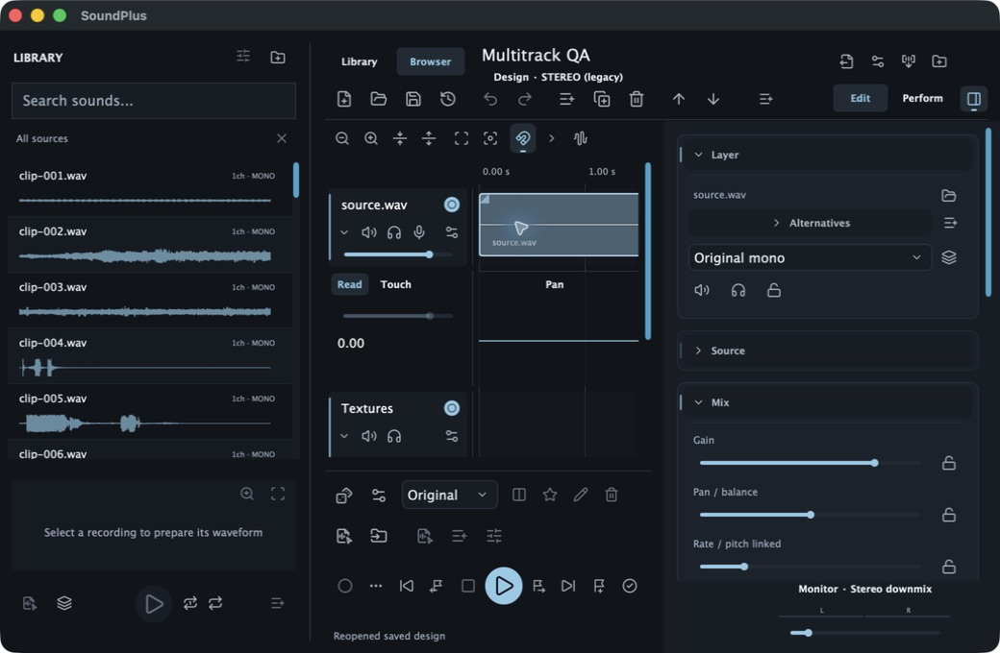
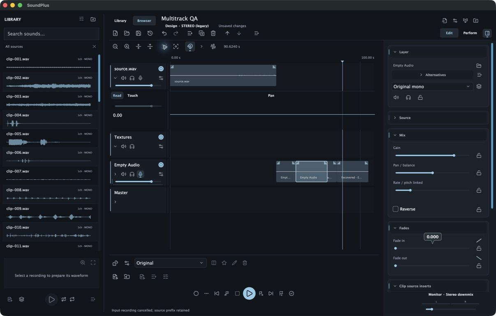

# Multitrack correctness and Audio Track recording v1

Started at `370ba95`, reviewed baseline `d14e23bd3808af67c4d409e0b9295c8bedd86774`. Newer equal Library/Macro widths, bounded responsive Blend pad, vertical Y/bottom X, compact source waveforms and the original transport/monitor placement are preserved. Stage A was committed separately as **`1800bc6`** before input recording implementation began. No push is performed.

## Closure against the supplied milestone

| Item | Status | Implementation and verification |
| --- | --- | --- |
| A1 Output provenance | Fixed | Ordinary stock/hosted multitrack output keeps `multitrack-automation-v1`, separate hosted raw-pass authority and actual WAV hashes. Saved/reopened receipts preserve both. [DesignAudio](../src/DesignAudio.cpp), [DesignModel](../src/DesignModel.cpp), [Stage A report](MULTITRACK_CORRECTIONS_REPORT.md). Historical receipts are not relabelled. |
| A2 Sound-preserving split | Fixed | Independent right-hand processor/rack IDs, cloned source-effect curves and persisted original-history reconstruction, exact project-frame gates, final-fragment tail ownership. Gain/Filter/Delay/owned hosted automation, cut-boundary points, reverse/rate, Undo/Redo, reopen and historical take compatibility tested. [TrackModel](../src/TrackModel.cpp), [split contract](MULTITRACK_AUTOMATION_CONTRACT.md), [MultitrackTests](../tests/MultitrackTests.cpp), [hosted tests](../tests/OrderedInsertTests.inc). |
| A3 Automation editor lifetime | Fixed | Owner/context identity preserves unaffected headers/lanes and focus; hide/delete completes gestures, stale callbacks are rejected. Header-volume gestures also bind document incarnation. Touch, Undo grouping, disclosure and document replacement checks pass. [MultitrackEditor](../src/MultitrackEditor.cpp), [AutomationEditor](../src/AutomationEditor.cpp). |
| B4 Audio controls | Implemented; native Mono verified | Audio-only arm, device/channel selector in Track options, input meter, optional raw monitoring off, shared Record/Stop. Empty/populated track captures append normal clips. Up to8 owners on one input device; independent selected channels tested with controlled input. [session](../src/DesignInputSession.cpp), [header](../src/MultitrackEditor.cpp), [transport](../src/DesignerView.cpp). |
| B5 Input engine | Implemented; qualified workload below | Input-only HAL IOProc inside the existing supervised audio helper. Actual acquisition sample/host timestamps map to the existing output callback's project clock. Actual source rate is retained; explicit roles/rate handling, bounded rings and fail-closed faults. [MacAudioInput](../src/MacAudioInput.cpp), [InputRecording](../src/InputRecording.cpp), [AudioEngine](../src/AudioEngine.cpp), [clock consumer](../src/AudioStream.cpp). |
| B6 Durability | Implemented and tested | Raw PCM/fsynced acknowledged journal, same-parent atomic source-set publication, explicit incomplete/cancelled states, deliberate labelled recovery, source/header hashes checked before one Undo insertion. Actual native helper/app SIGKILL recovery passed. Disk-full, denied permission and unavailable device use controlled fault tests. Files survive Undo. |
| B7 Editing/output integration | Implemented and tested | Recordings are normal source clips, with input receipt lineage separate from rendered-output authority. Split, trim/slip-compatible source regions, placement, fade/gain, Track insert/Group routing/Volume automation and Mono/Stereo/5.1 WAV renders covered. Saved manifest13 retains settings/lineage; old documents/takes keep their prior envelopes/hashes. [input regressions](../tests/InputRecordingTests.cpp), existing editing/multichannel suites. |
| B8 MIDI separation | Preserved | Dedicated MIDI Instrument-slot model unchanged. No MIDI creation/capture/piano-roll/instrument hosting controls added or qualified. |
| B9 Production verification | Local and Mono branches passed; physical interface branches blocked | Controlled input and actual built-in microphone/native workflow evidence below. Physical Stereo, two separate physical inputs and named multichannel interface capture cannot be qualified without suitable hardware. Human listening, physical loopback calibration and receiving-app delivery are separate, unverified items. |

The input contract, limits, clock/latency policy and recovery behavior are in [AUDIO_INPUT_RECORDING_CONTRACT.md](AUDIO_INPUT_RECORDING_CONTRACT.md). Input IPC is11. Documents containing input settings or recording lineage require manifest13; documents without these fields retain their prior version behavior. The shared Library/Designer/Perform architecture and existing plugin services remain in place.

## Automated verification and identity

Stage A: **34/34 suites passed in313.14s**, with available vendor/AU/device branches, unchanged source and six binaries. Its initial failed lifecycle gate and reproduction are retained separately. The worker diagnostic publication race discovered there was fixed without adding callback waiting. [Stage A evidence](verification/input-recording/stage-a/full-gate.log).

Stage B focused final run: **7/7 suites passed in23.05s**; the new audio input suite contains **154 checks**. [Build](verification/input-recording/stage-b/build.log), [focused log](verification/input-recording/stage-b/targeted.log), [controlled input measurements](verification/input-recording/stage-b/controlled-input.json). Controlled tests use generated float32 input and the actual recording store/service, output PCM consumer/clock, session commands, worker completions and normal renderer. They cover Mono/Stereo/two separate selected inputs/5.1 role ordering,48k and44.1k input versus48k project, one-sample placement, no duplicate input-latency subtraction, playback plus capture, monitor gain/raw separation, cancellation, overrun, sample discontinuity, write failure, writer loss, zero-frame Stop, permission denial, repeated terminal completion, fresh metadata, Undo/Redo, reopen and output provenance. Recovery choices exclude another document's retained operations without deleting them.

The initial Stage B full gate passed **35/35 in306.51s** with unchanged source/binaries. Final review then found an input-recording seek-gesture gap and a missing bound for recordings started near the one-hour timeline limit. Targeted tests reproduced both failures before correction: [seek reproduction](verification/input-recording/stage-b/seek-reproduction.log), [timeline-limit reproduction](verification/input-recording/stage-b/transport-reproduction.log). Gesture entry now refuses accepted input capture; navigation and dragging cannot move, replace or finalize it. The source writer rejects a block past the project limit and retains its valid prefix. [Initial full gate](verification/input-recording/stage-b/pre-transport-full-gate.log) remains historical evidence, not final-build qualification.

Final corrected full gate: **35/35 suites passed in305.68s**, with all282 source/resource hashes and six executable hashes unchanged. [After identity proof](verification/input-recording/stage-b/identity-after.json). The gate uses all35 suites with `SOUNDPLUS_VENDOR_QUALIFICATION`, `SOUNDPLUS_QUALIFY_AU=1` and `SOUNDPLUS_LIVE_DEVICE_QUALIFICATION=1`. [Log](verification/input-recording/stage-b/full-gate.log), [before source/build/environment identity](verification/input-recording/stage-b/identity-before.json). Hash coverage includes282 source/test/resource files and the app, tests and four helper executables. Hardware: Apple M5 Pro arm64, macOS26.3.2, SDK26.5, Apple Clang21. Available vendor coverage includes OldSkoolVerb2.14 and LV50A1.0.0 in Mono/Stereo Track/Master paths, plus Apple AUDelay1.6.0 Audio Unit. [Vendor numerical summary](verification/input-recording/stage-b/vendor-summary.json), [AU qualification](verification/input-recording/stage-b/au-qualification.json). Effect-versus-bypass difference in the vendor summary measures that processing occurred; it is not an error against a reference render.

## Actual Mac recording evidence

QA used `build/input-recording/native`, not the user's catalog. Native capture uses **MacBook Pro Microphone**, UID `BuiltInMicrophoneDevice`, actual48kHz Mono, device-reported latency26 frames and safety48 frames. OS access was already permitted; actual denied permission was not toggled. Monitoring remained off. Existing design playback ran through the shared output engine while raw source PCM was acquired.

| Native case | Actual result |
| --- | --- |
| Populated track | Complete2,679,990-frame float32 Mono source appended without removing existing clips. Native Cmd-Z removed that clip, Cmd-Shift-Z restored it, and source WAV stayed present. |
| Empty track | Complete489,092-frame source added. Actual normal receipt measured960 input callbacks,0 input overruns,0 monitor drops and0 output underruns. Maximum input-copy work10.0µs and full native input callback10.75µs since device open. |
| Final measured capture | Record via `R`, Stop via Space:805,177frames,1,577 input callbacks,0 overruns/monitor drops/output underruns, max full native callback10.75µs. Normal completion has no misleading interrupted `originalState`. |
| Helper SIGKILL | Acknowledged1,027,204frames before kill; recovered1,039,492-frame durable prefix, labelled `recovered`, original state `recording`. Transport stopped, arm cleared, no false Complete. Manual recovery appended one labelled clip. |
| Main-app SIGKILL | Acknowledged784,751frames before kill; helper observed loss and retained795,503frames, original state `incomplete`. Relaunch retained the existing saved edits, arms off. Deliberate recovery appended a labelled clip. |
| Final seek isolation | Actual native ruler drag leaves recording active; retained journal shows784,850 frames and zero input overruns/output underruns, max native callback10.125µs. Escape subsequently cancels explicitly. [Native state](verification/input-recording/stage-b/native-seek-isolation.txt), [journal](verification/input-recording/stage-b/native-seek-isolation.json), [cancel outcome](verification/input-recording/stage-b/native-seek-outcome.json). |
| Escape | Cancelled377,657-frame prefix remains in its `.partial` directory with no finalized receipt or inserted clip. Recovery remains deliberate. |
| Save/reopen | Native saved QA r10 has7 clips. Real relaunch reopens r10 and its48kHz sources online with all arms off. A separate local `native-final.soundplus` copy preserves the QA document independently of repeatable generated-test fixtures. |

Independent RIFF/sample inspection verified **bit-for-bit raw float32 versus WAV data equality and receipt SHA-256** for all five finalized/recovered source sets. [Capture audit, exact source/receipt paths and diagnostics](verification/input-recording/stage-b/native-capture-audit.json), [first capture](verification/input-recording/stage-b/native-first-capture.json), [helper pre-kill journal](verification/input-recording/stage-b/native-helper-crash-before.json), [app pre-kill journal](verification/input-recording/stage-b/native-app-crash-before.json), [final reopened native accessibility state](verification/input-recording/stage-b/native-final-reopened.txt). Audio remains local; microphone PCM is not committed.

Acquisition timestamps already describe input sample acquisition time. The mapping records reported input latency/safety and avoids subtracting them twice. Controlled tests establish the mapping within one sample. **No physical acoustic/electrical loopback latency measurement is claimed.** Native measurements show no overruns/underruns in these short workloads; they are not a long-duration or all-device guarantee. The source callback uses fixed prepared storage and atomics, with writer/file/JSON/finalization work outside both real-time callbacks.

## UI verification



Audio arm uses the existing Lucide/theme language in the Track header; input options stay contextual. Record is momentary and enabled only after the input-device acknowledgment. The shared transport keeps navigation and Accurate audition, with spacing that fits1040×680. Browser and Inspector stay visible; normal track/Inspector scrolling remains available. Additional input settings do not consume the Perform pad area. Keyboard focus remained usable after Tab and native R/Space/Escape operated from the timeline. Arm highlight cleared on disarm/restart. Recovery menu stays inside the window and distinct operations have compact IDs, with corrected UTF-8 separators.



The expanded screenshot is1207×768 as captured by the native-control surface; no independent display-scaling matrix is claimed. Existing scale/icon/view suites are included in the final gate. Native inspection found and corrected recovery-menu visibility and UTF-8 label defects; these attempts were not counted as passes until the rendered controls were observed.

## Requirements trace

| Architecture requirement | Coverage in this bounded milestone |
| --- | --- |
| SMP-07 Sample an input | Mic/input choice, actual OS permission request path, chosen-channel meters, monitoring off, recoverable raw PCM/WAV and durable rate/channel/peak metadata. This increment assigns recordings to Audio Tracks; a new sampler/pad-capture interface is outside scope. |
| DSP-04 Preserve timing | Integer source/project samples, actual input-rate source files and explicit renderer resampling, acquisition/output clock mapping, existing plugin PDC, monitor-only gain, retained interrupted prefixes. Physical round-trip calibration remains unverified. |
| PRJ-01 Save and recover | Recording journals and source writes off audio callback, acknowledged durable prefix, actual app/helper interruption recovery, prior saves and source originals intact. Does not newly qualify the proposed≤10-second design-edit recovery objective under every failure. |
| UX-03 Editing feedback | Explicit recording/finalizing/cancelled/interrupted/recovered text plus model-owned arm state and meter; monitor volume excluded from recorded/rendered PCM; original Library behavior retained. |

## Build, launch and five-minute check

Close SoundPlus normally before rebuilding the running bundle. From the repository root:

```sh
.tools/cmake/data/bin/cmake -S . -B build
.tools/cmake/data/bin/cmake --build build --target SoundPlus SoundPlusTests -j 6
build/SoundPlus_artefacts/Release/SoundPlus.app/Contents/MacOS/SoundPlus \
  --data-dir "$PWD/build/gain-hover-native"
```

Use a separate design for the smoke check:

1. In Edit, choose Add track → Audio. Track options → Audio input selects a device and Mono/Stereo or compatible reported roles. Click its microphone icon to arm; allow macOS microphone permission if requested. Leave Raw input monitoring off, or use headphones before deliberately enabling it.
2. Press `R` with timeline focus, make a short sound, then Space. Confirm a new waveform clip appears. Drag/trim/fade it, use one Undo/Redo for recording insertion, and confirm its original WAV remains in the catalog's `recorded-audio` folder.
3. Add a Library sound to the design. Record again into the populated Audio Track while the existing clips play. With a suitable interface, select different physical inputs on a second armed track and check independent captured channels.
4. Save, quit normally, reopen and audition. Input configuration persists; arm and monitoring stay off. Render Design and inspect the output layout/receipt. Judge sound quality and physical timing by listening separately.
5. Start another short recording and Escape. Confirm it adds no successful clip. Audio recording options → Recover interrupted deliberately adds the retained prefix with a Recovered label. Do not unplug a production device or fill the real disk for this smoke check.

Regression command:

```sh
SOUNDPLUS_VENDOR_QUALIFICATION="$PWD/build/input-recording/vendors-stage-b" \
SOUNDPLUS_LIVE_DEVICE_QUALIFICATION=1 SOUNDPLUS_QUALIFY_AU=1 \
caffeinate -i .tools/cmake/data/bin/ctest --test-dir build --output-on-failure
```

## Limits and preserved user data

One selected input device, up to8 armed owners, at most16 physical inputs and4096 frames per callback. Native float32 input streams only; unsupported formats fail explicitly. Raw-source size is bounded below1.75GiB per source and duration below one hour. Optional raw monitoring uses the existing Stereo output and requires matching nominal input/output rates; asynchronous resampling and long-duration device-drift monitoring are outside v1. Automatic source cleanup is not implemented; Undo never deletes recorded originals.

Physical Stereo/separate-input/named multichannel capture and physical unplug recovery are **blocked by unavailable interface hardware**; controlled equivalents pass. Actual disk exhaustion and actual macOS denied-permission configuration are not performed; controlled error handling passes. Human listening is **unverified**. MIDI, VST2/AUv3, OldSkoolVerb custom gestures, physical surround and new native cross-application/Resolve delivery are **not qualified** by this work. Existing finalized Resolve-referenced outputs remain protected at their original paths.

Before relaunch, original **Workflow demonstration r4478**, its exact document payload and preferences compare equal to the protected post-quit snapshot. The in-place catalog remains1 root/43 assets and all37 protected source/output hashes match. Blend remains .3209876/.4846336. [Preservation audit](verification/input-recording/stage-b/user-preservation.json). Final native relaunch reopened the in-place r4478 session in Perform with Browser visible, Blend .321/.485, Macro1 enabled .491, monitor .25 and the existing durable r33 output. The complete document payload, catalog counts and all37 media hashes still compare equal after relaunch; no older snapshot was copied over it. [Native restored state](verification/input-recording/stage-b/restored-user.txt), [preserved Perform interface](verification/input-recording/stage-b/restored-user.jpg). SoundPlus is left running on that original catalog.
