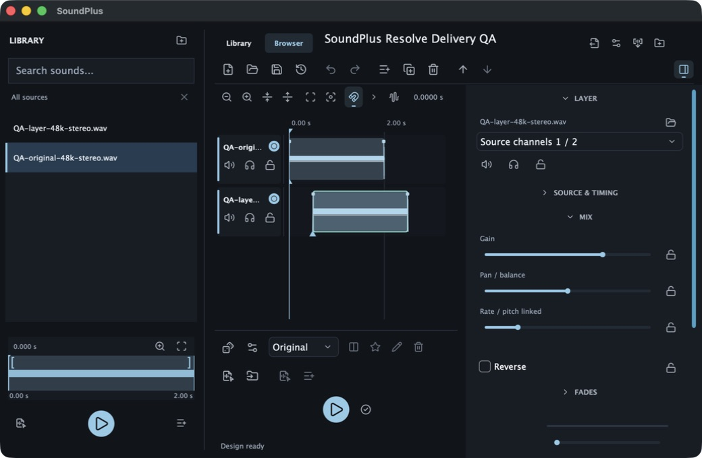
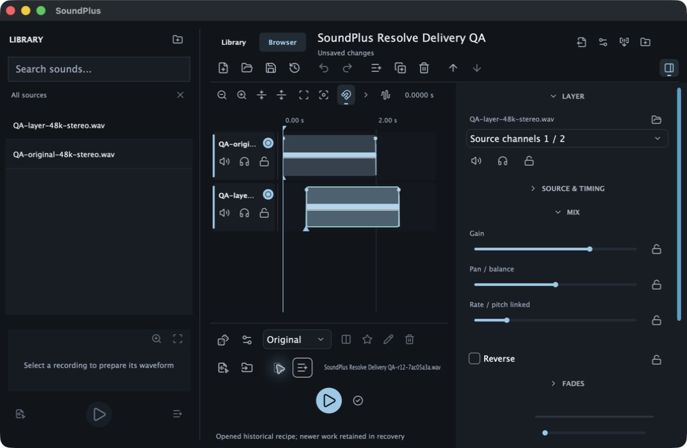
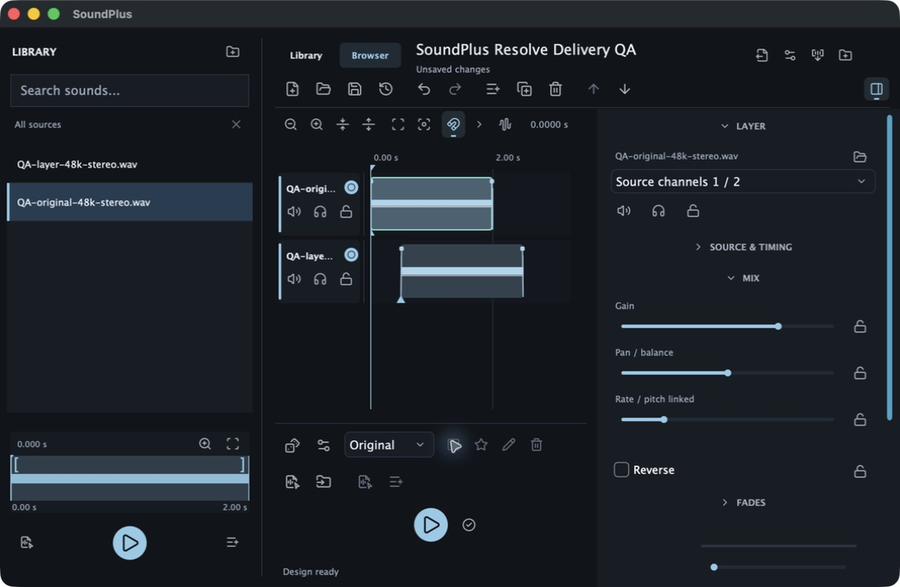
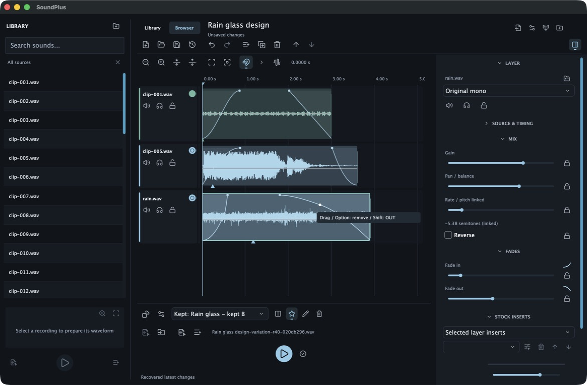
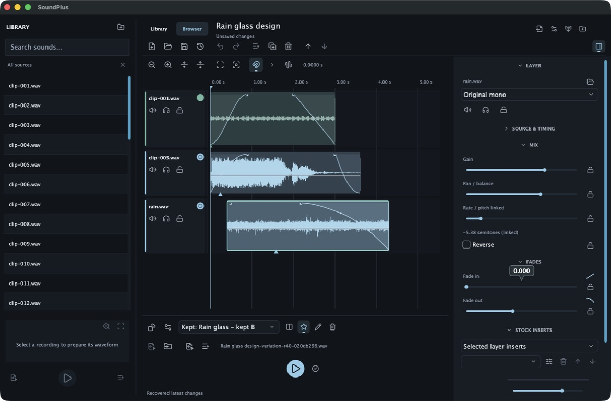
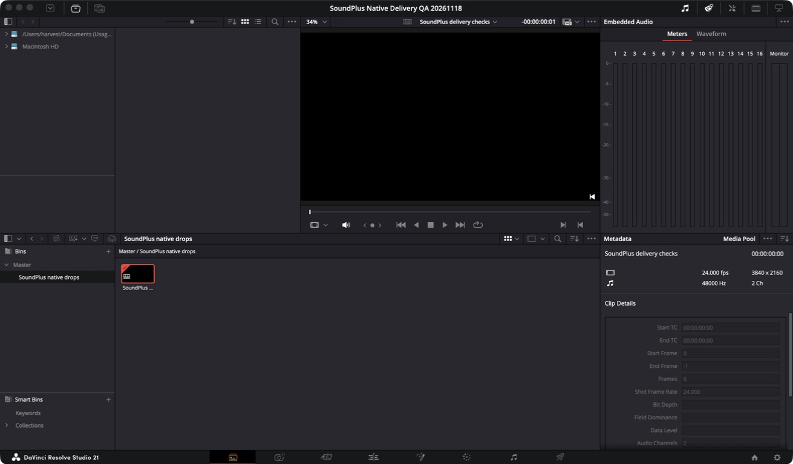
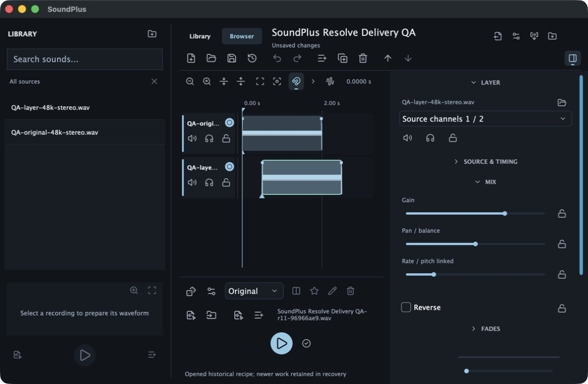
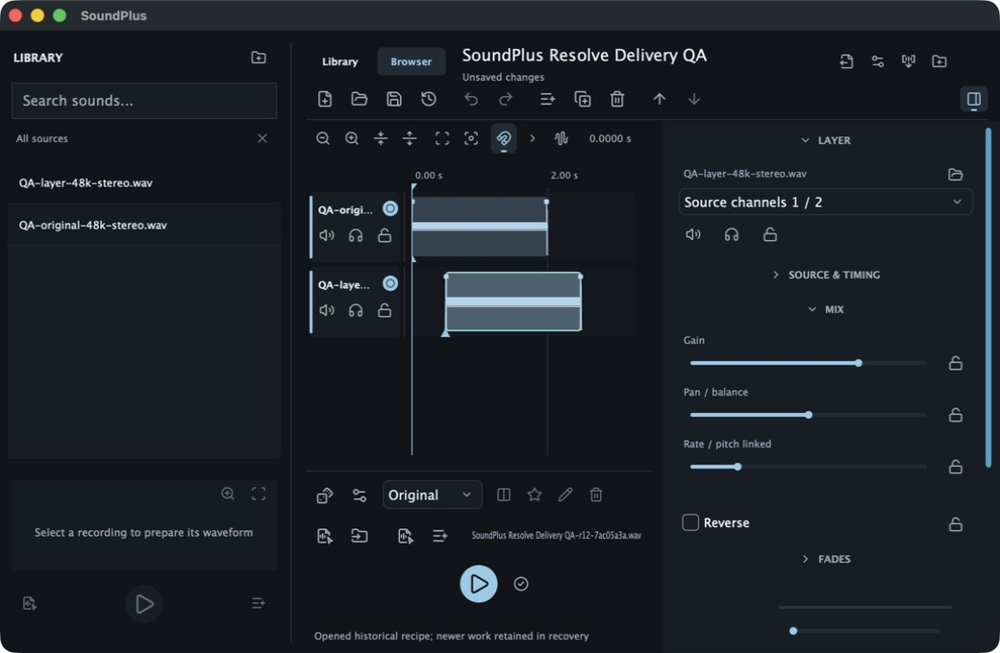

# Button semantics and Resolve delivery follow-up

Implemented from `181f388`, preserving the Lucide family, cached vector renderer, theme, spacing and shared Designer/audio architecture. The thin gain-line and fade insertion cue were checkpointed in `47fc85d`. No applicable AGENTS.md was found. This report records the supported Mac checks on 2026-11-18; it does **not** qualify Resolve delivery.

## Local corrections: passed

- [IconButton](../src/IconButton.h) defaults to a momentary action. Its icon no longer decides its accessibility role. Real stateful controls explicitly opt into toggle semantics at their construction sites in [DesignerView](../src/DesignerView.cpp), [track headers](../src/DesignerCanvas.cpp) and [Library](../src/LibraryView.cpp). Existing model-owned callbacks and `dontSendNotification` refreshes still own state; clicking does not automatically toggle it twice. Browser retains its existing stateful text control.
- Snap Options is a plain popup-launching button. Inspector disclosures expose their actual expanded/collapsed state. Mute, solo, snapping, scrub, variation/parameter locks, Keep and panel visibility retain their actual model state.
- Compare is a momentary switch. Its accessible name and tooltip describe the next action: **Switch to Original** or **Switch back to [variation name]**. Choosing another candidate updates that return target and the selector always reflects the actual mix. Removing the candidate invalidates it. Opening another document, including a historical version with the same ID, clears the cached comparison target during the document transition.
- The gain line has a pixel-aligned **one logical pixel core** with a subtle dark halo, keeping it visible over dense waveform peaks without the earlier heavy line. Selected fade curves show a crosshair/insertion hint when hovered; existing handle, gain and slip cursor priorities remain intact.
- The two upper fade-duration grips now use small mirrored **fade-ramp markers**, fully inset from the clip's top and side borders. [Shared handle bounds](../src/CanvasEditing.cpp) keep painting and hit testing aligned even at zero/full fade lengths. The actual envelope endpoint, fade timing, shape presets, custom interior points and lower sync marker are preserved. Coincident IN/OUT grips remain independently reachable. Native appearance was inspected after rebuilding and reopening the current working design.

The [actual-view command tests](../tests/ViewCommandTests.cpp) exercise selector/Compare/discard callbacks, document replacement, same-ID open transitions, explicit toggle roles and minimum toolbar bounds: **76 checks**. [Icon tests](../tests/IconTests.cpp) now render every tone separately at 1× and 2× and check visible ink against the intended 18-point viewport, allowing one physical pixel for antialiasing: **750 checks**. These are offscreen rendering checks, not separate physical display qualifications.

The native Release app was built and launched on an **Apple M5 Pro MacBook Pro, arm64, macOS 26.3.2 (25D2150)**, built-in Retina display. Seven relevant CTest suites passed after the final marker change in **16.93 s**: view commands, icons, Library selection audition, canvas gestures (**1,437 checks**), sessions, Designer workflow and fades. New marker checks cover zero/full/overlapping fades, inset bounds, matching hit targets and actual pointer dragging. See [test log](verification/button-semantics-ctest.log), [detailed results](verification/button-semantics-test-details.log) and [artifact/evidence record](verification/button-semantics-resolve.json).

Native interaction checks confirmed the plain Snap Options/Compare roles, disclosure states, selector/Compare round trips for Candidate A and B, candidate removal, document switching and same-ID historical reopening. At the supported minimum **1040 × 680 outer window** (1040 × 648 content), Browser and Inspector were both visible. Toolbar actions, track mute/solo/lock, output controls and a Tab-focus outline remained within their targets with no observed overlap or clipping. Inspector content scrolls normally. No additional physical display was tested.











## Resolve delivery: blocked, no accepted import

Receiving application: **DaVinci Resolve Studio 21.1.2.10**, activated and reachable. Separate project: **SoundPlus Native Delivery QA 20261118**; bin: **SoundPlus native drops**; empty timeline: **SoundPlus delivery checks**. No user Resolve project was edited. SoundPlus used a separate two-source QA catalog and design.

| Delivery case | Qualification | Native attempt and receiver evidence | Save / quit / reopen | Copied or referenced |
| --- | --- | --- | --- | --- |
| Library whole original | **Blocked** | Native session started; no imported audio item | Not run for media: no accepted import | Not established |
| Finalized full-design WAV | **Blocked** | Native session started; no imported audio item | Not run for media: no accepted import | Not established |
| Finalized Render Selection WAV | **Blocked** | Native session started; no imported audio item; unaccepted session cancelled with Escape | Not run for media: no accepted import | Not established |

Each automated attempt failed to produce an imported item. Investigation found that the control tool delivered SoundPlus's mouse-drag events while the **live macOS pointer stayed stationary outside the receiving media pool**, around screen (1512, 595). The optional [FileDragButton trace](../src/UIComponents.h) recorded the gesture threshold, existing source, native start and completion separately. It is enabled only with `SOUNDPLUS_QA_DRAG_LOG`; normal launches do no trace-file I/O. The original native file payload, five-pixel threshold and `canMoveFiles=false` were preserved. No audio-thread logging was added.

This evidence establishes **native initiation followed by no observed receiver import**. It does not establish that Resolve rejected a correctly positioned physical drop, nor a later persistence failure. The unchanged live pointer makes cross-application automation the suspected blocker; a physical mouse drag is still required to settle receiver acceptance. No API import, Finder-only drop or internal canvas drop was substituted. Resolve's media-pool API and the visible bin both showed only the empty timeline after the attempts. The QA project was saved, but saving an empty project is not a media-persistence pass. Native-start return values and end callbacks are not receiver acceptance evidence.



## Durable files and PCM verification

All three source files existed before their drag attempts and remain in place. Exact root:

```text
/Users/harvest/Music/SoundPlus/Resolve Delivery QA 20261118/e8574ef3074441ceb8b755346057ea89
```

| Case | Path relative to that root | Duration / frames | Format |
| --- | --- | --- | --- |
| Original | `Sources/QA-original-48k-stereo.wav` | 2.0 s / 96,000 | 48 kHz, stereo, 24-bit PCM |
| Full design | `Renders/SoundPlus Resolve Delivery QA-r11-96966ae9.wav` | 3.0 s / 144,000 | 48 kHz, stereo, 24-bit PCM |
| Render Selection | `Renders/SoundPlus Resolve Delivery QA-r12-7ac05a3a.wav` | 2.5 s / 120,000 | 48 kHz, stereo, 24-bit PCM |

The original was finalized by closing the generated WAV writer. Both renders were made with the real native render buttons, then verified against their finalized receipt SHA-256 and decoded headers. Full hashes and actual paths are in the [evidence record](verification/button-semantics-resolve.json). Ready documents `full-render-ready.soundplus` and `selection-render-ready.soundplus` retain the respective durable output for another native drag.

The fixture contains a 330/550 Hz stereo source at time zero and an 880/1100 Hz source at 0.5 s, with layer gains −6/−9 dB, master −6 dB, 10 ms linear fades and a 0.5 s output tail. Both are two-second recordings. **Render Selection means the primary selected layer only**, rebased to time zero, with its processing and master chain retained and mute/solo overridden. It is not a multi-selection bounce or time-range selection. Here the selected second layer produces 2.0 s plus the silent 0.5 s tail.

The independent [PCM verifier](../scripts/verify_delivery_qa.py) reconstructs gain, placement, fades and master gain from these generated source samples. Maximum decoded-sample errors were **1.2653e−7** (full) and **1.2299e−7** (selection), below **3e−7** tolerance, including the expected frame counts and tail. This verifies the local finalized outputs; there is no imported Resolve content to compare yet. **Human listening was not performed** and is not implied by PCM or UI results.





## Finish receiving-app acceptance with a physical mouse

1. Keep the QA Resolve project open and its **SoundPlus native drops** bin visible. Launch the isolated SoundPlus QA catalog with the command below. The user's working catalog is separate.
2. In Library select `QA-original-48k-stereo.wav`. Physically drag **Drag complete original file** from SoundPlus into the bin. Confirm a new WAV media item appears; a drag animation alone does not pass.
3. In Designer open `full-render-ready.soundplus` from the root above. Drag **Drag WAV** into the bin. Open `selection-render-ready.soundplus` and repeat. These are already finalized outputs; retain their paths.
4. For each imported item, inspect filename, duration, 48 kHz rate and two channels. Place each on an appropriate stereo audio track, apart from the others. Verify content against the recipe above. Record human listening separately from decoded PCM checks.
5. In Resolve record each item's **File Path** to determine whether it references the original location above or a copied location. A SoundPlus copy prohibition is not proof of receiver path behavior.
6. Save the receiving project. Quit SoundPlus. Close and reopen the Resolve project. Confirm all three items remain online, locate and play on their audio tracks, with unchanged metadata and usable content. Only then mark each delivery case Passed.
7. If a physical drag fails, record whether it never initiates, initiates without an import, or imports successfully but later loses media. Preserve all source/output files and the receiving project for diagnosis.

## Commands and preservation

Quit SoundPlus before rebuilding its app bundle. From the repository root:

```sh
.tools/cmake/data/bin/cmake --build build --parallel 6
.tools/cmake/data/bin/ctest --test-dir build --output-on-failure \
  -R 'designer_view_commands|icon_system|library_selection_audition|designer_canvas|designer_session|designer_workflow|designer_fades'
python3 scripts/verify_delivery_qa.py \
  '/Users/harvest/Music/SoundPlus/Resolve Delivery QA 20261118/e8574ef3074441ceb8b755346057ea89'

# Isolated delivery catalog (open the ready documents with Designer's Open action).
open -n "$PWD/build/SoundPlus_artefacts/Release/SoundPlus.app" --args \
  --data-dir "$PWD/build/resolve-native-qa/catalog" --disable-ai

# Working catalog restored at the end of this pass.
open -n "$PWD/build/SoundPlus_artefacts/Release/SoundPlus.app" --args \
  --data-dir "$PWD/build/gain-hover-native"
```

The working **Rain glass design r4148** was backed up before QA. Its autosave remained byte-identical through QA, SHA-256 `675d9e9eacaf46ef216335b45d3c587f343d128dc38dea77e50cbfaa2ef49b73`, and was reopened. Subsequent user edits advanced it to **r4294**. Those newer edits were retained and backed up before the marker rebuild, SHA-256 `25f15846bdf4c0df9a75901a99c2f63237c19ba91f399bd7c793f198139b6c9f`; r4294 was reopened after the final build. No older QA snapshot was installed over newer working edits. The activated Resolve QA project, original sources and durable renders remain available. The remaining limitation is **unqualified receiving-app import and persistence**, not missing WAV generation or Resolve activation.
