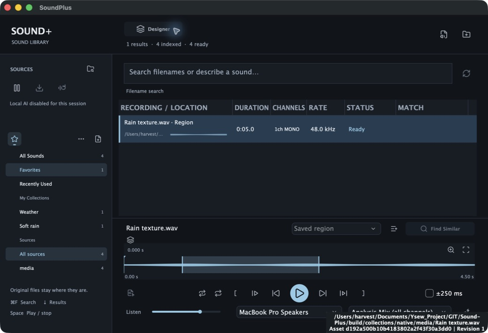
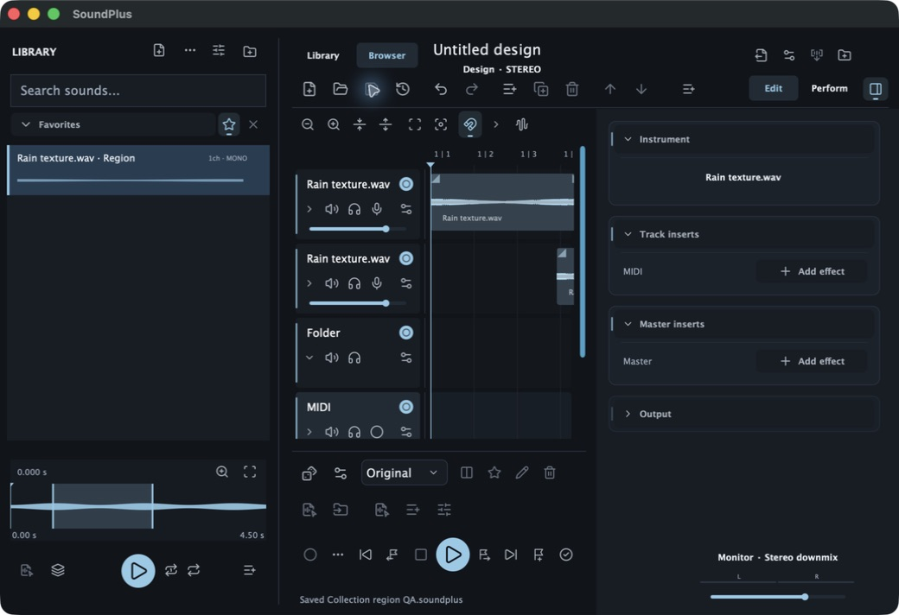
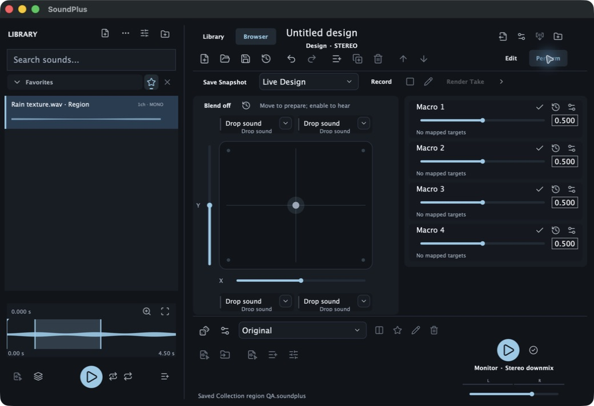
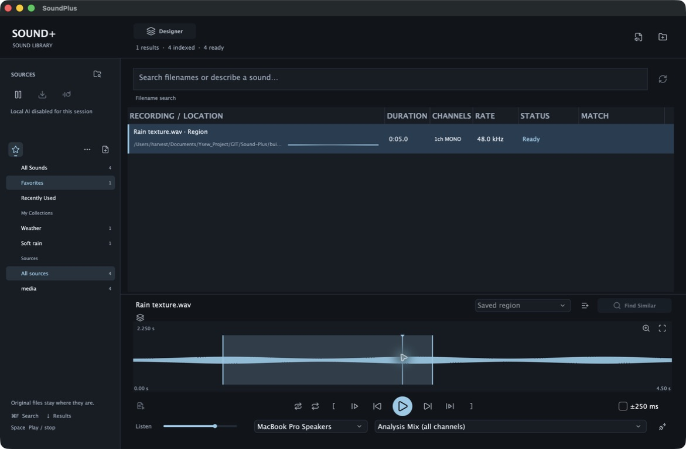
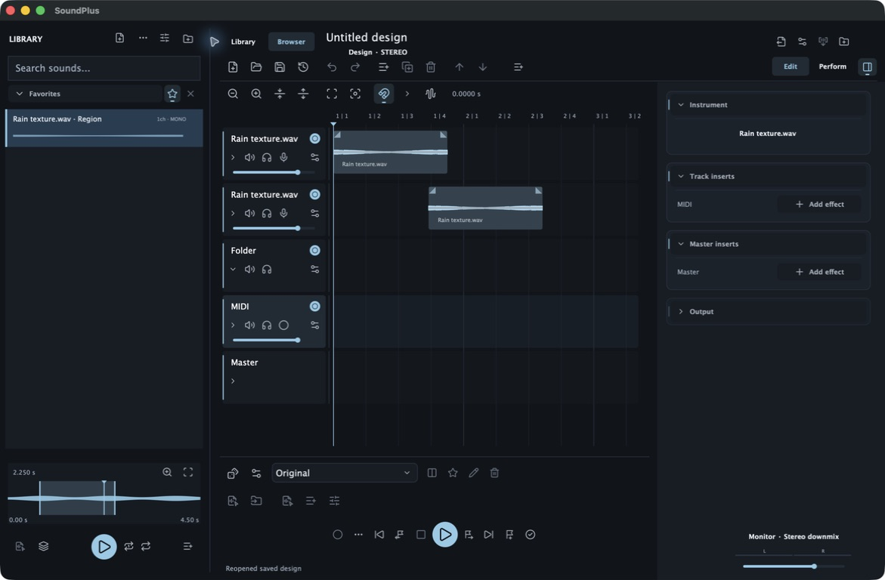

# Nested Collections, Favorites and MIDI correction

Date: 2026-11-22. Reviewed/start HEAD: `f3c5b89e6e77a6666233a695f27760b672054840`; the tree was clean and had no later commits at task start. Stage A was committed separately as **`6975f82eddea0caa5a9fae49be7aabcd48ae4041`** and pushed to `origin/main`. The latest user instruction is to push completed commits after committing; this is recorded in AGENTS.md and supersedes the attachment's initial no-push instruction.

The increment adds virtual organization to the existing Catalog and the existing single LibraryView used by Library and Designer. It retains the JUCE/C++ audio/session architecture, Lucide cache/theme, centered single Perform pad, and one reusable Volume-first automation lane per processable track. Source media stays in place. No audio is generated, moved, copied or uploaded by collection operations.

## Behavior and implementation

- Catalog **v7** migrates v6 in one transaction, with rollback/restart coverage at the actual pre-commit boundary. Earlier supported schemas retain their existing versioned migrations. Newer unsupported catalogs are rejected. The Library writer owns mutations; read workers own queries; UI/audio callbacks never call SQLite.
- Collections have stable UUIDs, sibling order, nested parents, case-insensitive trimmed sibling names, explicit cycle/descendant-depth validation, rename and reparent. Limits:1024 nodes,16 levels. Deletion removes the selected virtual subtree/memberships only. Favorites, source files and Designer clips survive; organization Undo restores deleted hierarchy and memberships.
- Many-to-many membership uses immutable reference IDs. Full-source references are canonical per source UUID. Region references include source UUID, revision, source sample count/rate, half-open original `[first,last)`, cached source provenance and catalog identity. Multiple regions of one source remain separate rows without changing source IDs.
- Offline current sources remain visible; reconnection restores access. Missing source records retain an explicit cached **Unresolved** reference. Changed region revisions/sample contracts are **Needs Review**, excluded from audio delivery and semantic scoring. No filename-based reassignment occurs. Review current audio through All Sounds and save a fresh region explicitly.
- Favorites is independent of collections. One-click star/unstar uses writer-owned state, including accessibility activation. Recent tracks explicit audition/Add use. Metadata history is transactional and durable:100 actions,8 MiB/action and64 MiB total; bulk API operations accept4096 references. UI bulk operations act on the current loaded page (up to512); selections extending outside that window are rejected instead of partly applied. Oversized subtree deletion requires removing members in batches first.
- Full Library exposes nested disclosure, All Sounds, Favorites, Recently Used, collections and independent source roots. Designer exposes the same hierarchy through a compact selector and actions button. Selected scope and mouse disclosure preferences use the existing preferences file. Context/actions support create, rename, move/order, delete, membership, Favorite and organization Undo/Redo; Cmd-Z/Shift-Cmd-Z stay with Library organization when Library owns focus, while search retains text editing.
- Scope includes descendants and intersects the selected source root. Filename/FTS, semantic description search, Find Similar, paging, source waveform and pinned/playing selection retain their existing engine. Eligibility is applied **before** both mapped and SQLite top-N scoring. Exact-name priority is retained in scoped filename browsing. Unresolved records use cached-name substring matching; current/offline catalog records retain FTS5.
- Saved regions audition and transfer their exact original boundaries, independent of broad semantic windows. Library result/selection keys distinguish reference UUIDs while playback, source IDs and waveform caches keep original identities. Dragging into Audio, source pools and sampler retains samples/routing. Sampler assignment now validates the physical file before adopting the supplied catalog identity and retains catalog-backed relinking.
- Collection metadata neither updates embeddings/vector sequence nor changes design/recipe serialization. Existing waveform and vector caches are not invalidated by membership/Favorite edits. No external generation or decorative AI Generated view was introduced.

Source: [Catalog migration](../src/Catalog.cpp#L299), [metadata/query implementation](../src/CatalogCollections.inc), [background service](../src/LibraryService.cpp), [shared navigation/actions](../src/LibraryCollections.inc), [Library view](../src/LibraryView.cpp), [pre-ranking scope](../src/RetrievalIndex.cpp#L436), [sampler transfer](../src/DesignSession.cpp#L1384), [contract](COLLECTIONS_CONTRACT.md).

## Verification

The new [Catalog tests](../tests/CollectionTests.cpp) exercise interrupted actual v7 migration, preserved source/vector identity, nesting/cycles/depth, duplicate names, sibling order, many-to-many/full/region references, pagination, bulk/history bounds, durable Undo/Redo, offline/remount, stable-ID rename/relink, source revision invalidation, unresolved records and paused indexing. A stronger global candidate plus a top-one limit proves both mapped and SQLite filtering happen before ranking. Collection/Favorite annotations produce byte-identical serialized design content.

[Actual view-command tests](../tests/CollectionViewTests.inc) cover Favorite/unstar/Undo (including an accessibility value changing before its action), shared compact scope, exact audition bounds, unchanged playback generation across scope changes, actual Find Similar fusion, Library drag serialization, Add to Designer, SourcePoolView drop, MultitrackEditor sampler drop and save/reopen. Existing playback/pinning/performance/semantic suites were retained. During integration they caught multi-selection restoration and navigation-notification defects; the corrected suites passed before the final gate.

Stage A evidence is in [its report](COLLECTIONS_STAGE_A_REPORT.md): reproduced interleaved split failure, exact MIDI/sampler/owned hosted PCM checks at44.1/48/96k, controlled timing matrix and a separate native-device capture. The rejected6ms lookahead pilot incurred one underrun; the adopted12ms comparison had zero across36 cases. Physical MIDI/controller/DAC/acoustic latency is not qualified.

The first complete frozen attempt passed38/39 in389.55s. Its multichannel legacy fixture created v7 then relabeled it v4/v5 without removing v7 tables; migration correctly rejected that inconsistent fixture. The fixture now removes those sidecars when reconstructing the historical schema. No production correction was needed. The failed attempt and unchanged hashes are retained under `final/attempt-1`.

Final release gate status: **39/39 passed in396.09s**. Source/resource and binary hashes agree before/after. The complete39-suite Release gate runs with `SOUNDPLUS_VENDOR_QUALIFICATION`, `SOUNDPLUS_QUALIFY_AU=1` and `SOUNDPLUS_LIVE_DEVICE_QUALIFICATION=1`. It includes installed/vendor processing, Apple AUv2 instrument, microphone/prefix recovery, frozen takes, Track/Group/Master automation, routing/channel masks, historical recipe/PCM compatibility, all existing Library suites and new collection tests. Before/after manifests cover303 source/resource files and8 binaries. Evidence: [final release directory](verification/collections/final).

Environment: Apple M5 Pro, macOS26.3.2 (25D2150), arm64 Release, Apple Clang21.0.0, SDK26.5, pinned JUCE8.0.6. This does not qualify older macOS hardware/OS releases or a signed public distribution.

## Native workflow and layout

A separate QA catalog and four generated5-second mono48k WAVs were used under `build/collections/native`. Native controls created Weather/Rain, starred/unstarred/undid an exact `[36000,120000)` region, added it to both collections, renamed/reparented/deleted a collection and restored it with organization Undo. Shared state appeared immediately in the Designer selector. Metadata deletion left the existing design/source intact.

A real internal mouse drag from Library into Audio and a real drag onto a MIDI Track assigned the native sampler. The saved QA design retained original asset UUID `d192a500b10b4183802a2f43f30a3dd0`, original path and exact interval in both. Initial out-of-window coordinates did not initiate a drag; using observed window-local coordinates completed the gestures. These are internal application drags, not Resolve/receiving-app qualification. Source-pool delivery additionally passed the actual controlled view handler.

The native Save panel wrote `build/collections/native/data/Collection region QA.soundplus`; restart showed Reopened saved design and retained the Favorite/reference. The final sampler drop keeps its catalog-backed flag, not an external-file reinterpretation. Native focus after dialogs is returned to Library when needed so organization shortcuts reach the correct owner.

The **1040×680 content** size was inspected with Browser and Inspector visible (native title bar adds height). Toolbar, track buttons, output/navigation controls and keyboard focus outline remained usable; Inspector content uses its existing scroll panel. Library and Perform fit within their surfaces. Normal1360×860 content was also inspected. Retina rendering was inspected on this Mac; a separate non-Retina display was not tested.



The Library tree occupies its existing source sidebar; the waveform and centered audition controls retain their space. In Designer, organization is one compact scope row and small action controls, leaving the creative workspace intact.





At normal size, the same layout leaves the waveform and editing canvas prominent:





Accessibility captures and additional images are in [native evidence](verification/collections/native). Human listening was not performed. PCM assertions and real-device/native operation are separate evidence.

## Performance on retained fixtures

Fresh isolated SQLite backups were used. No originals or existing vector caches were modified. These are warm **worker/database** measurements with uncontrolled OS caches, not the previous dispatch-to-native-paint benchmark or model-inference timings. Filename operation = search20 + exact count + disk-backed sequence + last page20;30 mixed empty/exact/prefix and root-intersection samples per scope. Semantic = mapped exact retrieval plus batched reference expansion;20 samples/scope, no inference. Scope contains256 full-source references (four in the small case); Favorites adds64 (four in small, alongside its retained region Favorite).

| Fixture | All filename p50/p95 ms | Collection p50/p95 ms | Favorites p50/p95 ms |
|---|---:|---:|---:|
|4 assets,0 embeddings|0.103 /0.160|0.198 /0.243|0.143 /0.237|
|100,005 assets,0 embeddings|0.880 /9.109|0.837 /1.246|0.399 /0.561|
|10,120 assets,500,027 regions|0.825 /1.974|0.638 /2.548|0.282 /2.133|

|500,027-region mapped retrieval|Vectors scored|p50/p95 ms|
|---|---:|---:|
|All Sounds|500,027|27.261 /28.279|
|Collection|12,800|8.368 /8.557|
|Favorites|3,200|3.480 /3.720|

The100k asset fixture is the retained filename corpus (schema2); the500k case is the retained synthetic embedding capacity catalog (schema4), not100k recordings analyzed through CLAP. The small fixture is the native QA catalog (schema7). Open/migration took0.333/145.678/27.485ms respectively. Metadata transactions added8/420/388 KiB beyond the migrated main database size.256-member commits took9.37ms (100k) and8.91ms (500k); small four-member commit0.62ms.

Peak main-process RSS:14.12 MiB small,105.75 MiB100k,1016.44 MiB500k. The500k figure includes resident pages from scanning the existing-format mapped vector cache; it is not all collection metadata heap. The fresh clone had no copied derivative cache: it built1,032,055,728 bytes once in10.315s. Collection edits left vector sequence unchanged. Backup, migration and initial cache construction are excluded from warm query percentiles. Source SQLite bytes were117,141,504 and2,205,900,800; final main databases117,649,408 and2,206,363,648. JSON retains exact values, case definitions and clone paths: [small](verification/collections/final/performance-small.json), [100k](verification/collections/final/performance-100k.json), [500k](verification/collections/final/performance-500k.json).

The existing semantic budgets remain100 ranked assets,32 candidate windows and five representative moments per recording. Region matches use overlapping existing embeddings clipped to eligible original intervals; no sample-precise event refinement or new embedding generation is implied. Filename/reference pagination retains all eligible saved references.

## Original workspace preservation

The original `build/gain-hover-native` workspace was protected before closing its running bundle, left in place during isolated testing, and reopened in place after qualification. Native observation showed **Workflow demonstration r4478**, its existing Perform/Browser layout, Blend coordinates, Macro1 and monitor preference. No older session or preferences were copied over it.

The [final audit](verification/collections/final/preservation.json) verifies all43 source IDs and their metadata,74 embeddings, vector change records and analysis jobs. The original catalog migrated to v7 and passes SQLite quick-check. After reopen, automatic presence checking changed only the43 `assets.seen` scan encounter tokens; it did not change source content revisions or rerun analysis. All37 referenced source/finalized-output files and26 legacy recording/journal/raw-prefix files retain their SHA256. Of195 protected autosave/take/preview files,194 are byte-identical; only the active autosave wrapper's `updated` timestamp changed. Its full design state, revision, active pointer and saved-file identity are identical.

The pre-quit backup's window geometry was `82 85 1487 962`; the original normal quit persisted `82 85 1465 962` ten seconds later, long before final reopen. The audit records file timestamps and retains this newer geometry. Every other saved preference matches. This distinguishes routine scan/heartbeat/quit metadata from preservation of the user's actual design, library and media.

## Prompt closure

|Items|Status|Actual evidence|
|---|---|---|
|1–2 split continuation, identities/PCM/history|Fixed|Stage A reproduction and exact packet/native/owned hosted regressions, unchanged historical gate|
|3 live responsiveness|Measured/improved within stated scope|36-case paired worker matrix; native186-event capture; physical latency remains unqualified|
|4 independent Stage A commit|Done|`6975f82`,38/38 gate385.30s; pushed|
|5 authoritative transactional catalog|Implemented/tested|v6→v7 actual interruption rollback/reopen; single writer|
|6 stable nested collections/order/validation|Implemented/tested|Cycle/depth/name/order tests; native create/rename/reparent|
|7 many-to-many/offline/unresolved|Implemented/tested|Shared reference IDs, controlled offline/remount/relink/delete; native same region in two collections|
|8 Favorites/Recent/bulk/history|Implemented/tested|API/view tests; native star/unstar/Undo; bounded page/API operations|
|9 exact region/provenance/review|Implemented/tested|Half-open sample/ref checks, revision invalidation, native exact transfers|
|10 source/channel/cache independence|Implemented/tested|Vector sequence and design serialization unchanged; historical/full gate|
|11 bounded paging/count/filter work|Implemented/measured|Disk sequences, aggregate counts, bounded page reads; small/100k/500k metrics|
|12 navigation/actions/accessibility|Implemented/inspected|Hierarchy labels/disclosure, selector, actions, native dialogs; no decorative generated scope|
|13 scoped filename/semantic/Find Similar|Implemented/tested|Root intersection, pre-top-one SQLite/mapped checks, actual fusion and pinning regressions|
|14 same Designer state and transfers|Implemented/tested|Same LibraryView/service, native Audio/sampler mouse drags; actual pool-drop handler|
|15 compact UI/focus/drag feedback|Inspected/tested|Minimum/normal captures, focus outline, actual mouse gestures and source payload checks|
|16 scope/audio and offline/paused metadata|Implemented/tested|Playback-generation assertion, pause tests, native deletion leaves design/source|
|17 local/private|Implemented/inspected|No external provider/network path or audio file operations in metadata commands|
|18 migration/integrity/availability sequences|Passed targeted tests|Catalog tests use generated fixture and controlled commit interruption|
|19 scoped performance/regressions|Measured/tested|Fresh three-fixture JSON plus existing retrieval/playback suites; endpoints distinguished|
|20 native/shared organization and save/reopen|Verified at stated layers|Native dialogs/membership/drags/save/reopen; actual controlled pool/sampler commands|
|21 compatibility|Passed|MIDI/microphone/take/automation/routing/historical suites included|
|22 native layout and unchanged Mac release gate|Passed at stated scope|303 source/resource +8 binary manifests; supported minimum/normal captures|
|23 in-place preservation|Verified after in-place reopen|Original r4478/state retained;43 asset metadata/74 embeddings,37 source/output +26 prefix hashes; routine scan/heartbeat differences itemized in audit|
|24 commit/report/delivery|Complete implementation, tests, report and evidence|Stage A separately committed/pushed; Collections delivery is the commit containing this report, pushed per latest instruction|

## Build, launch and five-minute test

Quit SoundPlus before rebuilding its bundle. From this repository:

```sh
.tools/cmake/data/bin/cmake -S . -B build -DCMAKE_BUILD_TYPE=Release -DCMAKE_OSX_ARCHITECTURES=arm64
.tools/cmake/data/bin/cmake --build build --config Release -j6
open -n build/SoundPlus_artefacts/Release/SoundPlus.app
```

The protected current working workspace uses an explicit data directory; launch it in place with:

```sh
open -n build/SoundPlus_artefacts/Release/SoundPlus.app --args --data-dir "$PWD/build/gain-hover-native"
```

Targeted and full qualification commands:

```sh
.tools/cmake/data/bin/ctest --test-dir build -R '^library_collections$' --output-on-failure
SOUNDPLUS_VENDOR_QUALIFICATION="$PWD/build/collections/manual-vendors" \
SOUNDPLUS_QUALIFY_AU=1 SOUNDPLUS_LIVE_DEVICE_QUALIFICATION=1 \
.tools/cmake/data/bin/ctest --test-dir build --output-on-failure
```

1. Add a sound folder if needed. In All Sounds, select a file, audition with Space, then search/switch source scope while it plays. Stop before selecting a different file if you want silent navigation.
2. Use New Collection to create a parent, select it and create a child. Right-click or use the actions button for rename/move/order/delete. Names can repeat under different parents.
3. Select a recording, mark an interval with the existing handles/I/O or Cmd-E. Click the star. Open Favorites: the row is a Region and its saved interval is highlighted. Click star again, then Cmd-Z with Library focus to restore it.
4. Use selection actions to add that region to the child and another collection. Browse the parent and child; source-root filtering intersects their members. Search filenames or, with the installed local model, Find Similar inside that scope.
5. Switch to Designer, browse the same collection, and drag the region into Audio or a MIDI Track's sampler. Save the design. Delete a QA collection: the file and design clip remain; Undo Organization restores it.
6. Quit/reopen. Favorites, hierarchy and saved sample bounds remain. For an external source, reconnect after an offline check; metadata remains browseable while disconnected or indexing is paused.

## Remaining qualification boundaries

Physical MIDI controller/loopback/DAC/acoustics, human listening, physical surround monitoring, VST2/AUv3 instruments, broad third-party instrument compatibility, external plugin parameter automation, native Resolve receiver persistence and a signed public release remain unqualified/outside this increment. Internal Canvas/source-pool/sampler drops are not receiving-app acceptance. The roadmap retains future pad tabs/overdubs, expanded effects, short-event refinement and external generation adapters.
