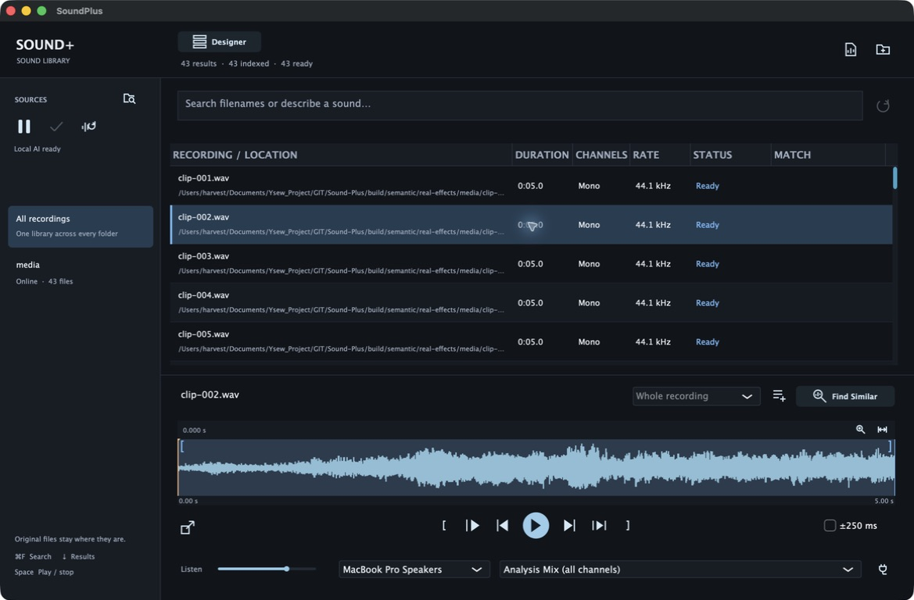
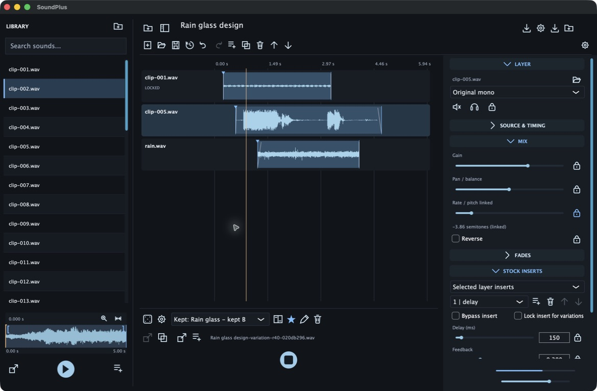
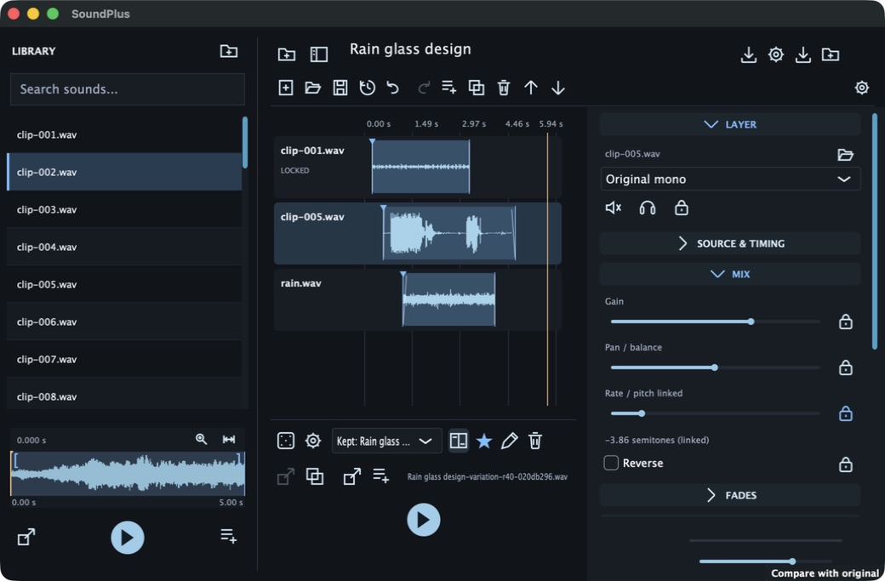
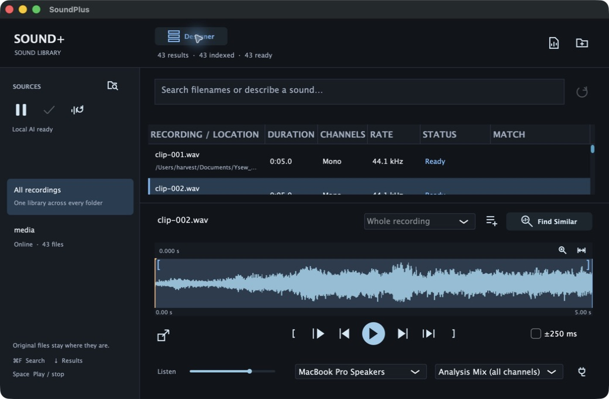
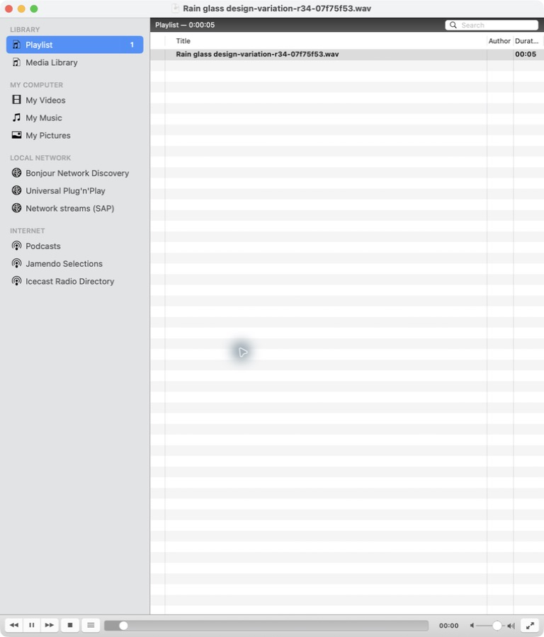

# Designer v1 — implementation and verification

**Historical v1 report.** The current [Designer v1.1 implementation and verification](DESIGNER_V1_1.md) supersedes the lifecycle, live-update, seek-policy and canvas behavior below.

SoundPlus now has a native Layer Editor beside its independently usable Library. It captures a recording or marked region, mixes original sources in place, applies stock inserts, generates and retains variations, saves an editable referenced design and renders a durable WAV. The interface uses original vector artwork, a restrained dark palette, contextual controls and collapsible inspectors; no Krotos assets or proprietary interface elements are used.

The checkpoint before Designer work is commit `aca882119a58dd678d09afe15311b28756ad42de` (`Add Find Similar, scalable retrieval and refined audition controls`). That commit includes the Library UI revisions made after the earlier measured milestone. Designer changes are subsequent working-tree changes. Exact source/application fingerprints and machine-readable results are in [the verification record](verification/designer-v1.json). The architecture specification, [Find Similar report](FIND_SIMILAR.md), [local search report](LOCAL_AI_SEARCH.md) and actual source supplied the baseline.

## Native workflow

The layers icon opens Designer directly. The layer-plus action captures the selected Library range; the reference panel has its own add action. A Library row can be dragged onto the canvas. Designer's add-source action opens an external recording without indexing its folder. Captured IDs, revisions, original integer ranges and channel choices remain independent of later searches or reference edits.

The browser stays beside the canvas and its divider resizes it. Browser and inspector icons hide panels when more canvas space is needed. Timing, fades, inserts and master controls collapse independently. Actions use named, keyboard-focusable icons and tooltips. Technical identifiers and rates live in tooltips; routine playback status and persistent numeric meter readouts are absent. The only timeline labels orient editing. A single application tooltip owner prevents duplicate tooltips across workspaces.

Layers support selection, add/remove/duplicate/reorder, drag placement and edge trims, numeric placement/IN/OUT/sync, set/align sync, mute/solo, gain, pan/balance, fades, reverse and explicitly linked rate/pitch. Undo/redo restores the selected layer and saved playhead, with a new monotonic revision. Source mapping is visible in the inspector: original mono or first stereo pair by default, other source pairs or the declared all-channel analysis average by explicit choice. Library's Analysis Mix monitoring preference does not select Designer channels.

Space plays/stops with the editor focused. I/O mark IN/exclusive OUT, in either case; text editors retain their typing behavior. Command-F focuses browsing, Command-D duplicates, Command-Z/Shift-Command-Z undo/redo, Command-O opens, Command-S saves and Command-R renders. Save/render commands also work with the adjacent browser focused. The native file picker and tab-focusable buttons provide keyboard alternatives.

Window bounds, workspace, browser width, panel visibility/disclosure and monitor volume persist per catalog in `interface.settings`. There is no inactive Performance Mixer tab. A later performance view can edit the same `DesignSession`/`DesignDocument` and feed the existing supervised graph/render pipeline; automation/MIDI and continuous macro scheduling remain v2 work.

## Clock and processing

A design saves a fixed sample rate (48 kHz for new designs). Source intervals are half-open integer samples `[IN, OUT)` at each original rate. Placement/fades and playhead use design samples. Entered seconds round to the nearest integer sample with `llround`; durations use `ceil((OUT-IN) × designRate / (sourceRate × linkedRate))`. Sync positions round once on the design clock. Reverse starts at `OUT-1`; endpoint interpolation clamps within the captured interval. Output length is the ceiling of the selected design interval plus the explicitly rounded tail converted to the requested output rate.

Mixed 44.1/48/96 kHz sources, reverse and 0.25–4× linked rate use the common deterministic 32-tap/1024-phase source converter. Identity-rate reads retain exact source samples. Mono pan uses constant power; centered stereo balance retains both channel levels. Mono output is `(L+R)/2`, so the mono pan law still affects a centered mono source. Filter cutoffs are limited to the usable band at the saved design rate.

The single existing audio helper still owns Core Audio. Readers, channel mapping, source conversion, layer/master stock DSP and FIFO filling run outside the real-time callback. The callback consumes prepared stereo PCM, smooths monitor gain and applies a short monitor-only graph transition. It performs no file/database/model access, allocation or blocking synchronization by code inspection. Graph replacement discards the obsolete FIFO; transport generations coalesce superseded commands. Library audition cancels pending Designer preview work, while a query alone leaves Designer audio active. Each workspace keeps its editing state.

Layer and master racks support ordered gain, high/low-pass filtering, feedback delay and reverb, bypass, saved parameters and locks. Fresh audition/render state starts reset; a seek reconstructs stock state from the design start. Offline render and the live producer use the same graph and channel mapping. Monitor volume and its transition are excluded from the rendered signal. Master level is part of the recipe; clipping is indicated and export receipts record peak/over-range sample counts. External effects can extend the processing boundary in the later hosting milestone.

Generate defaults to five candidates. A settings popover exposes count, enabled parameters and adjustment bounds. Whole-layer, individual layer-parameter and insert-parameter locks constrain changes. Each candidate stores its seed and complete resolved mix. Further generation starts from the selected mix. Trim variations retain the captured source sync point. Keep, rename, discard, original/selected comparison and active kept selection are supported; reopening does not reroll. Comparison does not normalize the render or apply automatic loudness matching.

## Documents and permanent outputs

`.soundplus` version 1 is checksummed JSON with DSP identifier `stock-sinc32-v1`. It records design identity/revision/sample clock, source UUIDs/revisions/locations/stamps, intervals/mapping/sync/placement, envelopes and processing, master settings, complete candidate snapshots, selection, render profile and completed-output receipts. Indexed sources resolve through catalog identity/current relinks; external sources retain explicit locations. Missing/changed sources remain in the document and require reconnection or an accepted replacement. Replacement creates a new design revision.

These are **referenced designs**, not collected media packages. Keep the original files and originating catalog; another machine may require explicit relinking. Source identity validation uses the existing size/mtime/inode/revision policy, not a full content digest of every indexed original. Delivered outputs have SHA-256 digests.

Saves stage and verify a document, synchronize the staged file, preserve a `.bak` and atomically replace the target. Quiet edits autosave after approximately 500 ms to the catalog's `designer-autosave` directory; startup recovery reports its use. Autosaves are durable state. `designer-preview` contains rebuildable immutable playback snapshots. Waveform/retrieval caches are separate from both documents and output media.

Rendering captures an immutable revision and independent processing state. Editing while it runs affects later results. Hidden staging files are finalized, header/length checked and hashed before unique permanent publication. Cancellation publishes no completed output. Default output is 48 kHz, 24-bit stereo WAV in `~/Music/SoundPlus/Renders`; the folder picker selects another permanent location and saves it in the design. Render settings expose 44.1/48/96 kHz, mono/stereo, 16/24-bit PCM or 32-bit float WAV, range and fixed tail (default one second, maximum 30). Peak normalization to −1 dBFS and integer TPDF dither are explicit, off by default. There is no silent normalization.

Drag Original transfers an applicable complete original URL; destination documents may reference that location. Copy Original to Project verifies a byte-for-byte copy, preserving its format/embedded metadata. Render Selection prints the selected layer at zero with the chosen master processing; Render Design prints the active mix. Receipts record path, SHA-256, sample count, recipe revision, active candidate, settings and peak/clipping data. A ready output exposes a native file-drag control and can be added back as an external layer.

## Verification on this Mac

Physical MacBook Pro `Mac17,8`, Apple M5 Pro, 48 GiB, macOS 26.3.2, built-in Liquid Retina XDR display (3456×2234 Retina), arm64 Release/JUCE 8.0.6. Core Audio checks use MacBook Pro Speakers. Other hardware/OS combinations remain unqualified.

The five CTest suites cover existing Library/indexing/audio, performance regressions, semantic integrity, Find Similar integrity and Designer. Generated fixtures exercise mixed source clocks, exact half-open lengths, reverse/rate boundaries, channel pairs/analysis mapping, pan, stock DSP, locks, complete candidate/document recall, catalog relink/revision changes, missing files, immutable render snapshots, cancelled saves/renders, abrupt termination after staging, original-copy checksums and durable receipts. Tests own fresh directories and do not modify a user library.

Prepared eight-layer stereo float PCM, the offline 32-bit WAV and a native helper producer capture agree with maximum absolute sample error **0.0**, dither disabled. The capture is before monitor gain; the monitor-only transition and physical speaker/ADC output are not part of this comparison. Native hardware rate-switch checks exercised 44.1, 96 and 48 kHz, retained the saved 48 kHz design clock/forward position and left the saved document byte-identical.

A visible Designer/browser workload runs eight simultaneous layers for 30 seconds, with three generated 40-second originals (44.1 kHz mono, 48 kHz four-channel, 96 kHz stereo), linked rates 1/0.875, reverse, fades, filter/delay/reverb on every layer and filter/reverb on the master: **26 inserts**. It submits 200 natural-language searches three times. The final measured artifact, p50/p95/p99, separate process memory/CPU and audio counters are recorded in the JSON; all recorded requests must retain the same eight-layer transport ID. This is a 512-frame development-system workload, not the architecture's 30-minute/256-frame release qualification.

The final five-suite run passed in **28.34 seconds**. Final application SHA-256: `1534d413742408bfa4611fb5fdbf9f672af94d7e997c6d8a838f94cc1604093f`. Source-manifest SHA-256: `d0c63356919dd1644084319b0cf29bfce21f410c465b3be0bdeb0e2c4e83f0a4`. These identify the current uncommitted Designer source and the packaged native binaries; the JSON also fingerprints both helpers, test executable and runtime.

| Final native workload | Measured result |
| --- | ---: |
| Search-to-paint p50 / p95 / p99, 600 requests | 7.50 / 13.77 / 14.34 ms |
| Requests with the same active eight-layer design | 600 / 600 |
| Playback observation | 30.00 s |
| Audio FIFO underruns | 0 |
| Audio helper CPU, one-core equivalent | 9.22% |
| Main / audio / AI peak resident memory | 135.69 / 42.66 / 423.70 MiB |

The agent-operated native creative test used three real recordings from the existing attributed ESC-50 subset: marked crickets `[22050,154350)` at 44.1 kHz, a second glass-break Library result, and an external rain copy outside the indexed folder. It edited offsets/trims/gain/pan, set 80% linked rate on glass, inserted delay/fades, locked crickets and glass rate, generated five, kept two, renamed/selected one, saved, quit and reopened through the native picker. Source ranges, locks, seed/resolved settings and selected kept candidate returned. The catalog stayed at 43 assets. A rendered 48 kHz/24-bit stereo result contains **271,553 frames**, one-second explicit tail, peak 0.12539254, no over-range samples and a verified checksum. Dragging that actual WAV back onto Designer added a fourth external layer; undo restored the three-layer selection/state.

Native file-delivery checks and their exact receiving application versions, persistence/cache-cleanup results, and final screenshots are recorded below and in the verification JSON. Automated cross-application gestures must not be counted as passes without an observed destination file or playlist entry. Human-operated checks, if supplied, are attributed separately.

## Native delivery and interface evidence

The permanent render was accepted by **VLC 3.0.24 using File → Open**. A native Save Playlist operation wrote `~/Music/SoundPlus/Designer QA/SoundPlus-delivery-QA.m3u`, whose relative media URL points into the permanent `Renders` folder. After SoundPlus exited, its owned `designer-preview` and `waveforms` directories were moved out of the catalog into a test quarantine. The WAV still had SHA-256 `6549fed9f2030864bc4fb1c962b46813f7d821e942d574b37539c9b4f14c3f66`. Opening the saved playlist again in VLC displayed that recording and entered playback. The final application re-rendered the reopened candidate with the same 271,553 frames and identical WAV checksum; Command-R and Command-S were exercised while the browser had focus.

**Cross-application drag remains NOT VERIFIED.** The ready WAV control successfully delivered a real file URL to Designer in the same application. Library-row drag also added the selected recording to Designer. Automated SoundPlus→Finder/VLC gestures produced no observed destination file/playlist entry; a Finder→VLC control gesture also failed to land. This does not establish whether the cause is the native implementation or the automation route. Finder 26.3's destination folder was still empty. The user authorized Finder/VLC; a separate manual check remains unanswered. Automatic approval review denied the earlier GarageBand and QuickTime Player attempts without a stated reason; those applications were not tested. No receiving-app drag pass or human listening judgment is claimed.

Earlier hardware runs exposed intermittent device-rate/capture failures. The final code compares the running device rate, forces a fresh device open for a real rate change rather than relying on JUCE’s cached-setup shortcut, and preserves prepared PCM for redundant same-rate notifications. Hardware checks require the requested rate to remain stable for 500 ms before advancing. The failed runs are retained under `build/designer/ctest-with-vlc-rate-failure.log` `ctest-capture-interruption.log` and `ctest-delayed-rate-failure.log`; they are not counted as passes. The final complete suite and eight-layer workload were rerun with VLC closed. Broad concurrent external-application device switching remains unqualified.

The native screenshots below use the final build. The Library keeps search/results dominant with a wide waveform and centered borderless transport. Designer uses a compact browser, a larger creative canvas, a contextual inspector and a restrained variation/output strip. Panel collapse and a resizable divider preserve editing space at laptop sizes. The inspected built-in Retina frames include a compact 1040 × 683 capture and a desktop window with saved JUCE bounds 1359 × 861 (CUA scales its capture). Browser/inspector collapse and recall were exercised after relaunch; this is not an external-display scaling matrix or a human usability sign-off.











## Build, launch and repeat

Quit SoundPlus before rebuilding its bundle. Dependencies already installed in this checkout can be reused:

```sh
cd /Users/harvest/Documents/Ysew_Project/GIT/Sound-Plus
.tools/cmake/data/bin/cmake -S . -B build -G Ninja \
  -DCMAKE_MAKE_PROGRAM="$PWD/.tools/bin/ninja" \
  -DCMAKE_BUILD_TYPE=Release -DCMAKE_OSX_ARCHITECTURES=arm64 \
  -DCMAKE_OSX_DEPLOYMENT_TARGET=12.0
.tools/cmake/data/bin/cmake --build build --parallel 6
.tools/cmake/data/bin/ctest --test-dir build --output-on-failure
open -n "$PWD/build/SoundPlus_artefacts/Release/SoundPlus.app"
```

A clean dependency setup uses `./scripts/bootstrap.sh` first. Library and Designer work with `--disable-ai`; semantic benchmarks require the optional pinned local model. For a fresh benchmark, supply an existing indexed catalog and an unused output directory:

```sh
python3 scripts/benchmark_designer.py \
  --catalog /absolute/path/to/library.sqlite \
  --output build/designer/my-measurement
```

The script backs up the catalog into an isolated temporary directory, generates its audio and uses the packaged native UI. It does not reindex the source catalog. Earlier 10k/100k/500k retrieval measurements remain in the Find Similar report; this milestone repeats the affected Designer/search workload and existing regression suites, not the unchanged full capacity/relevance qualification.

## Five-minute creative test

1. **Minute 1:** Find a known sound in your Library. Park the waveform, mark I/O and click the layer-plus icon. Open the adjacent browser or use Command-F to find a second sound and add it. Add a third external recording with Designer's add-source icon.
2. **Minute 2:** Drag a layer and its trim edges. Expand Source & Timing for exact edits or sync alignment. Adjust gain/pan and linked rate in Mix; expand Fades and add a stock insert. Use undo/redo. Search while Designer plays and confirm the mix continues.
3. **Minute 3:** Lock one layer and a parameter on another. Inspect variation bounds, generate five, audition/compare, keep two and rename/select one. Return to Original and back without rerolling.
4. **Minute 4:** Command-S saves a referenced `.soundplus` file. Quit/reopen it and confirm the kept candidate, range, rate, effects and source mapping. Confirm the permanent output folder and explicit WAV/tail settings.
5. **Minute 5:** Render, wait for the ready arrow, drag the actual WAV into Finder and your audio app, and save that receiving document. Add the print as a layer if desired. Quit SoundPlus, reopen the receiving document and confirm its media remains available.

## Requirement slices and qualification limits

| Requirement | Implemented/tested slice | Remaining coverage |
| --- | --- | --- |
| DSP-01 | Layer editing, original sample ranges, sync, reverse, linked rate/pitch, undo/redo | Independent time/pitch processing |
| DSP-02 | Ordered gain/filter/delay/reverb layer/master racks, bypass, levels/clip state | Dynamics, saturation, auxiliary routing, external effects |
| DSP-03 / DSP-04 | Prepared PCM callback, supervised ownership, coalesced graph switches, monitor separation, mixed clocks and hardware rate changes | 30-minute/256-frame gate, external interface, plugin latency; long state-reconstruction seeks remain a qualification gap |
| SMP-05 | Bounded/locked seeded fully resolved candidates, keep/rename/discard/compare/recall | Batch render of multiple kept candidates |
| SMP-06 | Selection/design print, receipt/revision, print back to a layer | Pads, recorded performance/take lineage, buses |
| PRJ-01 / PRJ-04 | Background autosave/recovery, verified atomic save/backup, cancellation/interruption tests | Power-loss/disk-exhaustion hardware tests and future migrations/live capture |
| PRJ-02 / PRJ-03 / DATA-01 / DATA-03 | Referenced identities, catalog relinks, stale/missing checks and accepted replacement | Collected packages, ambiguous-match assistance and broad portability tests |
| EXP-01 / EXP-02 | WAV profiles, explicit downmix/range/fixed tail/normalization/dither, same DSP | AIFF/BWF render, tail-aware auto-detection, handles/sync export metadata, stems |
| EXP-03 | Permanent unique verified output/receipt, original copy, native drag implementation | Cross-app destination qualification requires recorded observed passes |
| EXP-04 | Design/source clocks and render sample counts retained | Host/BWF origin and placement timing |
| UX-01..04 | Standalone Library/Designer, named icons, focused/collapsible controls, keyboard editing, undo, resize/preferences | User-defined collections/saved-search objects and broader accessibility audit |
| UX-05 / OPS-08 | Agent-operated native scenarios, named controls/focus inspection | First-time creator/experienced-human sign-off, VoiceOver and scaling/device matrix |
| OPS-01 / OPS-02 / OPS-04 / OPS-07 | Local processing, owned background work/cancellation and one-Mac parity/rate workload | Global cache quota/disk preflight, pathological network I/O, external interfaces, M2/second Mac and 30-minute soak |
| PERF-01 | Native 200×3 query-to-paint workload during eight-layer Designer playback | Full capacity/relevance gates and listener judgments remain separate |

No plugin hosting, Performance Mixer controls, MIDI/take capture, generative AI design or Resolve marker placement is implied by this build. Referenced sources remain user-managed. Long seeks reconstruct effect state from the design start and can be slow; the existing helper watchdog/slow-storage behavior is not qualified for arbitrarily long designs. Cache quotas, signed/notarized distribution and broad commercial dependency/license qualification remain later release work.
