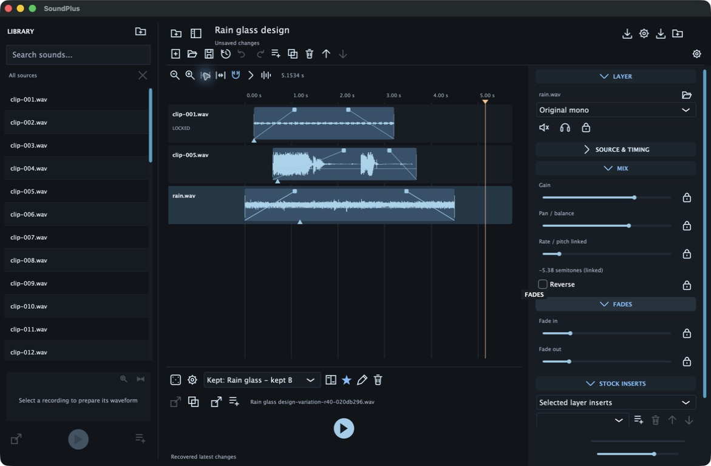
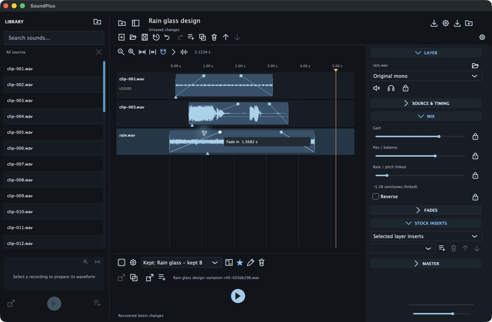
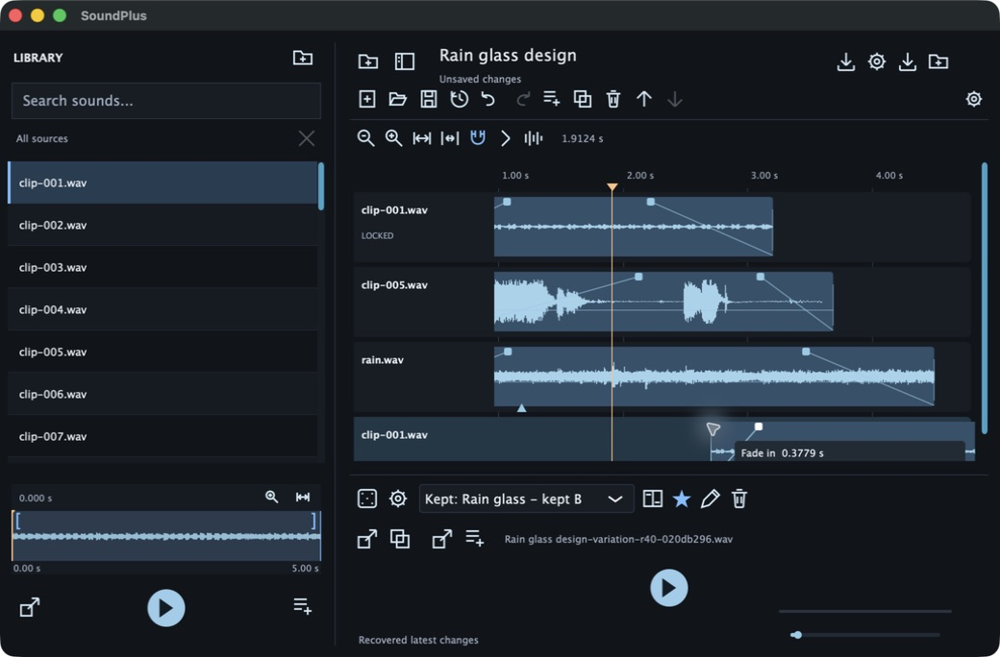
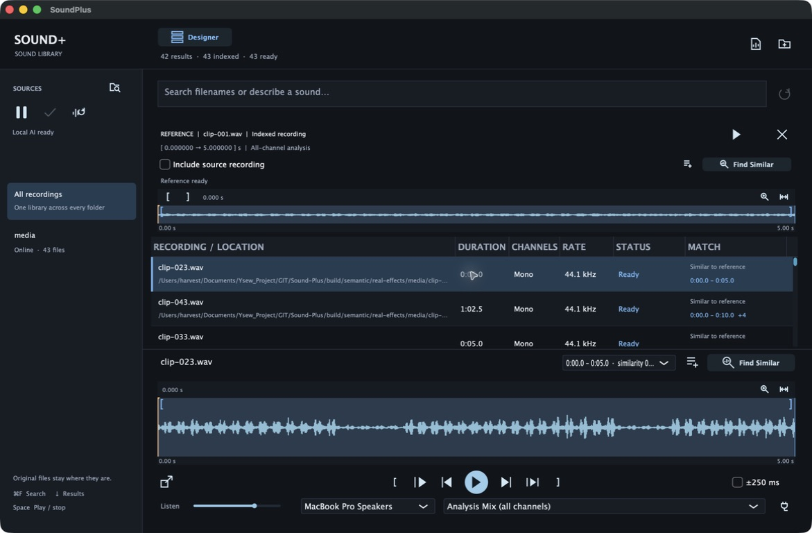
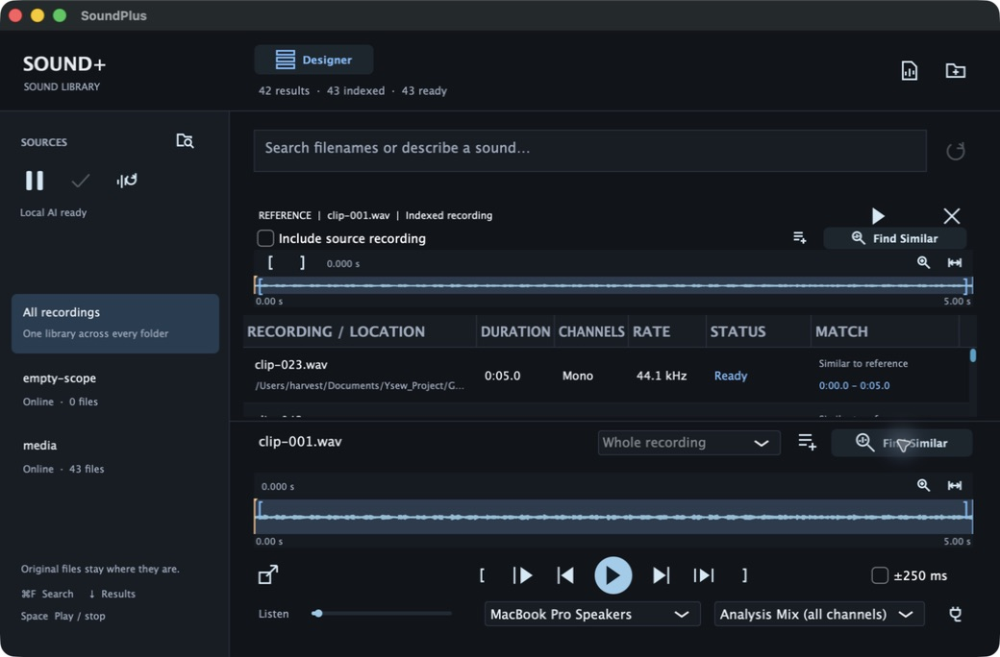
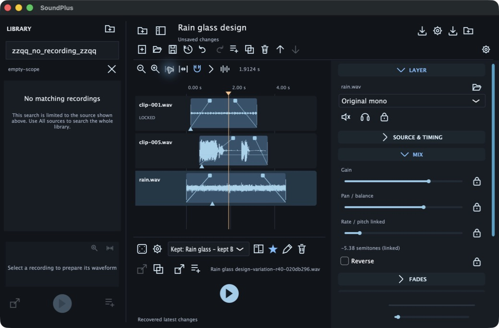
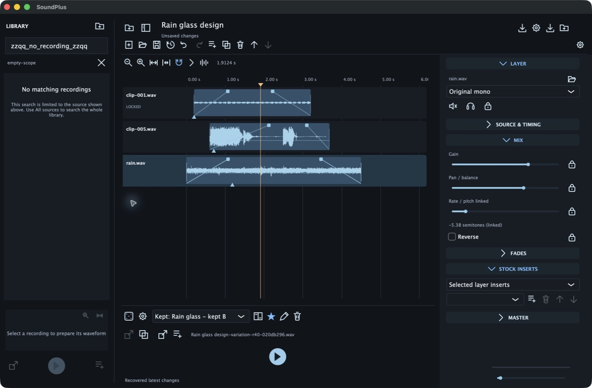
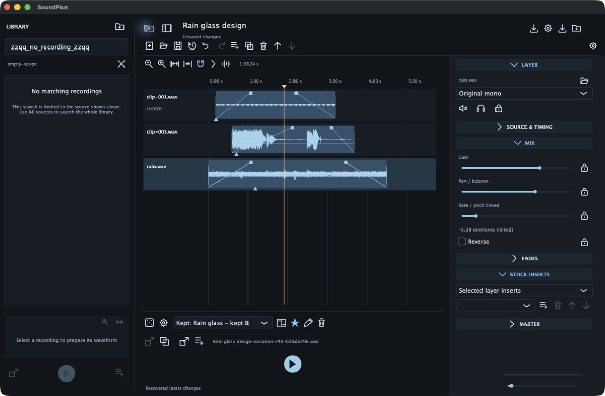
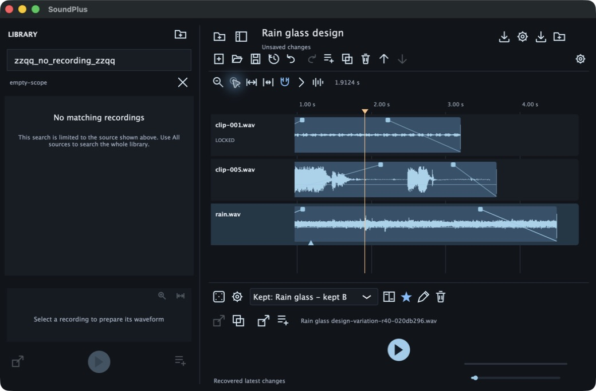

# Designer v1.1 — direct editing, transport and document safety

Implemented against HEAD `c2fe068d333efa0e45b832ad895c3039da523c36`. The checkout matched the review base; there were no subsequent commits to revert. The architecture specification, README, [Designer v1](DESIGNER_V1.md), [review](reviews/SoundPlus_Review_c2fe068.md) and [v1.1 requirements](reviews/Codex_Designer_v1_1.md) supplied the reference. This report describes the subsequent Designer v1.1 implementation, identified by the source/executable fingerprints and the Git commit containing this record. Exact source and executable fingerprints, measurements and native observations are in [the verification record](verification/designer-v11.json).

The Library remains independently usable. The Layer Editor retains the shared `DesignDocument` / `DesignSession` / stock DSP and rendering pipeline and one captured source interval per layer. No Performance/XY, hosting, spatial, automation or multi-clip track controls were added.

## Document lifecycle

New, Open, Recover and Quit use fresh recovery retention before replacing the document or exiting. They do not depend on the 500 ms quiet timer. While replacement is pending, editing is frozen; an I/O error keeps the current document and exposes the failure. This is the retention alternative permitted by the requirements: there is no destructive Discard command. Recover offers individually retained documents with name, revision and saved/recovered state.

Async operations carry document-lifetime and operation identities, including file/name dialogs, imports, preview and output completions. Old saves can finish writing their captured document but cannot attach their path, dirty state, selection or message to a different editor. Recovery activation also rejects obsolete operations. The worker drains accepted work and runs an unconditional immutable owner-thread final snapshot. Normal Quit first completes retention asynchronously, so a failure can leave the editor open. Active name editors are committed before Save and Quit.

Recovery is now a separate version-1 journal: `<document-id>.soundplus`, matching `.json` association/state metadata, and `active.json`. Snapshot and metadata publication are staged and synchronized. Acknowledgments advance only after successful publication; failed autosave retries at the same revision. A newer named save wins over older recovery, while unsaved newer recovery keeps its named association and dirty state. Saved and recoverable states cannot be reversed by a stale same-revision autosave.

**Saved design format stays version 1**, including `stock-sinc32-v1`, source UUID/revision/channel mapping and half-open sample ranges. Existing documents need no migration. Legacy singleton/per-ID autosaves can be recovered; a legacy record without association metadata remains dirty and cannot invent a named destination. The output folder is derived solely from the restored document, or the default permanent render directory. Undo/Redo/New/Open therefore use the folder represented by the document.

## Editing map

| Action | Interaction |
| --- | --- |
| Move | Drag actual clip body horizontally; empty row space positions the playhead |
| Trim | Drag either vertical clip edge below the fade corners |
| Fade duration | Drag the visible square corner handles, including at zero; exact seconds appear on hover/drag |
| Gain | Drag the horizontal constant-gain line vertically; double-click resets unity |
| Source sync | Drag the bottom triangle; this changes the source marker without moving audio; Align Sync remains explicit in Source & Timing |
| Reorder | Drag a stable layer header; insertion line indicates the destination |
| Multiple selection | Shift-click headers or clip bodies; drag a selected body to move the group |
| Slip | Option-drag a clip body; source IN/OUT and sync move together while placement and duration stay fixed |
| Fine | Control during a drag: one-tenth timing movement, or 0.025 dB/pixel instead of 0.25 dB/pixel for gain |
| Snap | Magnet toggle plus grid/target menu; grid defaults to 100 ms, with 10 ms / 1 s options; playhead, other clip edges and sync targets; Command temporarily bypasses |
| Zoom / pan | Zoom icons, Command-wheel or pinch at the pointer; Shift-wheel / horizontal wheel pans; plain wheel scrolls layers |
| Fit | Separate Fit Design and Fit Selected Layers icons |
| Playhead | Drag its ruler/line handle; exact current time is always visible |
| Add / drop | Add uses the parked playhead. Drops show a ghost and add at pointer time. Multiple external files share that time in incoming order, one layer per file |
| Transaction | One Undo per completed drag; no-op click creates no history; Escape restores model and pre-gesture selection; focus loss cancels; release outside commits a bounded edit |

Space toggles Designer playback when editing controls are not focused. I/O mark IN/exclusive OUT in either case. Command-Z / Shift-Command-Z undo/redo, Command-D duplicates, Command-F focuses Library search, Command-O opens, Command-S saves, Command-R renders. Text editors retain typing, selection and text undo. Numeric Source & Timing fields commit with Return. Design/layer names edit on double-click. Common actions retain accessible names and tooltips.

Viewport start and pixels-per-second are independent of content extent. Drag calculations retain the original model and scale; only explicit navigation and predictable edge autoscroll change the view. Headers stay fixed during horizontal pan. The hit order distinguishes ruler/playhead, fade corners, trim edges, bottom sync marker, gain line, playhead line, body and empty space. At very small widths, zoom exposes close targets.

Trim constrains source endpoints first and derives placement from the original opposite endpoint. Source conversion rounds once to an integer sample; duration uses the existing ceiling rule. The left opposite endpoint is exact on the design clock in the tested matrix; conversion to a source sample can move the dragged edge by less than one source-sample step after rate conversion. Ranges remain nonempty and sync remains inside `[IN, OUT)`. Group movement applies one common clamp, preserving relative offsets. Each linear fade independently clamps to clip duration; overlapping fade gains multiply. These are duration and constant-gain edits, not curve editing or automation.

## Transport and scrub policy

A parked head is distinct from acknowledged active playback. EOF transfers ownership once; old end-of-stream reports cannot overwrite a subsequent parked position. Stop intent is immediate and invalidates pending preview work. Status must match the active design and playback generation.

The helper command/status loop dispatches preparation and publishes heartbeats without opening sources, building graphs or reconstructing DSP. A preparation worker cancels superseded requests; a separate producer continues servicing the old stream. The realtime callback consumes prepared PCM and monitor transitions, with no file/database access, graph work, allocation or blocking lock.

Gain/pan/fades/source transforms and master gain use bounded coalesced updates to the running graph; continuous motion does not defer updates until release or restart the clock. Suitable levels/envelopes smooth over 5 ms. Topology/source/effect changes prepare a replacement for a future transport point; missed clock windows produce an explicit retry error rather than silently repeating old audio. The 100 ms measured target below applies to parameter edits, not arbitrary topology reconstruction.

**Live seek is deliberately bounded in DSP history:** reset stock effect state at `max(0, target - 250 ms)` and warm forward to target. This approximates the effect history of a long design. Offline renders still reconstruct the complete preceding history, and cancellation reaches their initial pre-roll. There are no arbitrary-duration seek-cache claims. Source/OS I/O wall time, especially stalled/network storage, is not bounded by the warmup policy.

**Audible preview is a separate implemented behavior:** the speaker-wave icon enables 120 ms forward grains at pointer locations, with 50 ms reset-state warmup and 5 ms endpoint ramps. Requests coalesce at a bounded rate. Moving the pointer backward still plays forward grains; this is not reverse-speed scrubbing. Release while stopped stays stopped; release while playing resumes normal playback at the release position; Stop cancels the gesture/preparation. Native helper PCM capture verifies nonzero grains, positions, duration and ramps. No human listening or acoustic-output judgment is claimed.

## Review closure

“Fixed” below refers to the described finding and its tested scope. The independent qualification exceptions follow the table.

| Finding | Status | Change and evidence |
| --- | --- | --- |
| R01 old save takes over new document | Fixed | Lifetime/operation guards and dialog tokens; controlled delayed A-save → New B proves B path/state/selection/output/message unchanged (`designer_session`) |
| R02 replacement before autosave loses work | Fixed | Fresh retained snapshot before New/Open/Recover/Quit; immediate transition tests, native name-edit → Quit → recovery |
| R03 busy worker skips shutdown snapshot | Fixed for retention | Unconditional final job after queue drain; idle/busy barriers, failing-close/retry tests; native saved r3 / fresh unsaved r4 recall. Blocked optional-waveform shutdown is also tested (Q01 below) |
| R04 stale recovery / premature acknowledgment | Fixed | Per-doc/revision journal, saved association and active identity; successful-save/restart and same-revision failed-autosave retry tests; native clean r2/r3 and dirty r4 reopen |
| R05 preparation blocks helper loop | Fixed within stated I/O scope | Separate cancellable preparation/producer; late seek, newest-wins burst, Stop while preparing and initial range-render cancel measured on hardware (`designer_transport`) |
| R06 trim clamp mismatch | Fixed | Accepted source endpoint determines placement; 44.1/48/96 kHz × forward/reverse × 0.25/1/4 rates; native opposite-edge and zero-bound drags |
| R07 moving time scale | Fixed | Persistent viewport and captured mapping; pure geometry + actual pointer move tests; native clip move and explicit Fit/zoom |
| R08 ambiguous body/hit targets | Fixed | Distinct prioritized targets and hover feedback; narrow/zero handles, no-op/empty targets and real handlers tested; native fade/trim/sync drags |
| R09 EOF overwrites parked head | Fixed | Active/generation ownership; fake status tests and native EOF → park 1.9774 s → wait → Play from that point; Stop → seek stays parked |
| R10 delayed continuous edits / repeated audio | Fixed for parameter path | Leading/coalesced updates, in-place graph controls and authoritative clock; 205 visible UI edit observations, no backwards clock, exact timecoded capture error 0.0 |
| R11 drop ignores pointer time | Fixed | Ghost + viewport conversion, captured ranges/mapping and ordered batch; native Library drop at design sample 129951 retained source `[0,220500)` and indexed status; one Undo removes it |
| R12 duplicated output-folder authority | Fixed | Document-derived folder; Undo/Redo/New/Open tests check actual render destination authority |
| R13 hidden compact scope / missing states | Fixed | Visible source/Similar scope + clear action; real empty-source inspection at 260/300/346 points, wrapped explanation and restored All sources results; pure loading/error geometry checks |
| R14 reference Library overlap | Fixed | Shared adaptive geometry; native 1040 × 684 capture and desktop with reference, results and audition visible; expanded/collapsed Designer inspected |

Architecture requirement slices covered: **PRJ-01/PRJ-04** (retention and recall), **DSP-01** (direct layer editing), **DSP-03/DSP-04** (transport and live-update boundaries), **UX-01–UX-04** (layout, keyboard and undo) and **PERF-01** (search alongside editing). **EXP-03** cross-application delivery qualification remains separate below. These are milestone slices, not full release certification.

## Executed verification

Physical Apple M5 Pro MacBook Pro `Mac17,8`, 48 GiB, macOS 26.3.2 (25D2150), built-in 3456×2234 Retina display. Release arm64, JUCE 8.0.6, CMake 3.31.6, Apple clang 21.0.0. Core Audio: MacBook Pro Speakers, 48 kHz / 512 frames for the interaction workload. This is one hardware configuration.

All **eight CTest suites passed in 40.33 s** on the final build, including the expanded real-pointer modifiers and blocked optional-waveform shutdown. Exact timings are in the verification record. Coverage includes Library/indexing/audio and performance regressions, semantic/Similar integrity, session races/failures, gesture timing and the existing Designer render/recall/native live-offline/device-rate checks. New session tests inject controlled work/completion scheduling, clock and audio status; they do not pretend to drive a native device. Canvas tests exercise shared edit commands and real `DesignerCanvas` pointer handlers, including Option slip, Control gain/reset, Shift multi-select/group clamp, header reorder, Command snap bypass, outside release, one Undo, no-op and Escape selection rollback.

The visible native benchmark runs eight layers / 26 stock inserts / mixed-rate 40-second sources, four seconds of gain-line motion then four seconds of fade-handle motion, alongside 600 semantic searches and indexing 30 generated five-second files. It uses the actual visible canvas handlers with a synthetic JUCE pointer driver every 25 ms; CUA gestures separately establish real native interaction behavior. It is not an OS-event-to-DAC measurement.

| Final visible workload | Result |
| --- | ---: |
| Canvas-handler → paint, p50 / p95 / p99 (301 samples) | 5.77 / 12.18 / 13.85 ms |
| Last coalesced edit → first tagged callback PCM, p50 / p95 / p99 (205 observations) | 56.57 / 69.10 / 73.42 ms |
| Search dispatch → paint, p50 / p95 / p99 (600 queries) | 12.44 / 19.51 / 43.25 ms |
| Input samples overlapping indexing | 192 |
| Queries retaining the same active eight-layer design | 600 / 600 |
| Underruns / helper restarts / stale ready results accepted | 0 / 0 / 0 |
| Audio helper CPU, one-core equivalent | 7.45% |

Latency tagging observes the first sample of a smoothed change; it excludes OS input dispatch, scanout and physical DAC/acoustic delay. Intermediate edits may intentionally coalesce, so 205 heard observations do not imply one callback acknowledgment per pointer event.

The separate native transport test continuously changes gain/pan/fades during search/indexing, captures three seconds of a timecoded channel with **maximum error 0.0**, and checks 12 rapid latest-wins seeks. A seek past a 15-minute silent prefix completed in **54.95 ms**; Stop during preparation in **24.93 ms**; cancelled full-history range pre-roll in **30.19 ms**, with no WAV published. Sixty-seven observations saw preparation in progress while status continued. Two 120 ms scrub grains at 5 s and then 3 s completed in 161.69 / 145.64 ms including preparation and playback. Cancellation before a ready result exists is checked by request ownership; `stalePreparationsDiscarded` counts discarded ready results, not all cancelled jobs.

Native CUA checks additionally covered fade from zero, exact feedback, one-step Undo, bounded trim, stable body move, source sync without audio movement, header reorder, Library pointer-time drop, EOF/park and Stop/seek, stopped/playing scrub-release behavior, text entry without playback, browser-focused Open/Save, normal saved/dirty recovery, the retained-document chooser, minimum/desktop sizes and panel collapse. The named fixture saved r3; Quit committed an active name editor as recoverable r4, and startup restored r4 with its r3 named association. The original working design was backed up before tests; native editing checks used copied catalogs. No user library was reindexed by the benchmark.

## Separate delivery status and exceptions

- **Audible grains: PCM VERIFIED.** Real helper capture verifies the preview window/ramping and forward grains in both pointer directions. Stopped/playing release semantics passed native and session checks. Human listening, physical speaker output and continuous reverse-speed scrub are not claimed.
- **Cross-application drag: NOT VERIFIED.** The finalized existing r40 WAV was dragged toward an empty Finder `Drag-v1.1` folder and VLC 3.0.24. CUA produced no observed file or playlist entry. These attempts cannot distinguish the cross-window automation route from a product defect. No drag-import receiving-state/cache-retirement pass is claimed. Earlier File → Open / playlist persistence evidence in v1 remains separate. A manual drag into Finder and a receiving app, followed by save/exit/reopen, is still required; no denied application was retried.
- **Q01 — stalled optional waveform decoder: shutdown protection implemented.** One earlier native quit waited in `WaveformCache::~WaveformCache` while its worker was inside macOS `open`. The named r2 and fresh journal were confirmed before terminating that owned test process; they reopened correctly. The cache now gives its worker independent shared state, publishes cancellation under its condition mutex, and allows a blocked optional read to finish independently after a 100 ms shutdown grace period. It cannot retain a view or prevent safe application exit after document retention. The deterministic blocked-read check destroys the cache within 500 ms, then releases the read and verifies that the worker safely resumes. Original stack captures remain in `build/designer-v11/quit-sample.txt` and `quit-second-sample.txt`. This protects shutdown from this optional-cache stall; it does not make kernel I/O interruptible or qualify all network/storage operations.
- No second Mac/M2, external interface, network-storage stall matrix, external display/scaling matrix, VoiceOver audit, human UAT/listening or 30-minute / 256-frame soak was run. Existing 10k/100k/500k retrieval/relevance gates were not repeated because the retrieval implementation was unchanged; affected query-during-edit behavior was measured.

Earlier test-harness failures are preserved: an incorrect alias instead of the actual design UUID prevented live updates; a mono panned fixture contaminated the reserved timecode channel. Those fixtures were corrected before the passing runs. They are not silently counted as successful measurements. The final hardware regression retained the existing live/offline sample comparisons and device-rate checks.

## Native interface evidence

The main Library/Designer screenshots were recaptured on the final executable. Intermediate gesture/minimum-size captures retain the same UI geometry; the final additional change concerned cache-worker teardown. The original dark palette and icon vocabulary remain shared. The canvas now gives the edit handles their own targets and leaves numerical detail contextual. Browser scope stays visible; collapsible panels and explicit Fit/zoom preserve editing space. The minimum Library gives each reference/results/audition region a separate usable rectangle.



















## Build, launch and repeat

Quit SoundPlus before rebuilding its bundle. From this repository:

```sh
cd /Users/harvest/Documents/Ysew_Project/GIT/Sound-Plus
.tools/cmake/data/bin/cmake -S . -B build -G Ninja \
  -DCMAKE_MAKE_PROGRAM="$PWD/.tools/bin/ninja" \
  -DCMAKE_BUILD_TYPE=Release -DCMAKE_OSX_ARCHITECTURES=arm64 \
  -DCMAKE_OSX_DEPLOYMENT_TARGET=12.0
.tools/cmake/data/bin/cmake --build build --parallel 6
.tools/cmake/data/bin/ctest --test-dir build --output-on-failure
open -n "$PWD/build/SoundPlus_artefacts/Release/SoundPlus.app"
```

A fresh checkout uses `./scripts/bootstrap.sh` for pinned dependencies. The Library/Designer work without AI using `--args --disable-ai`. The interaction benchmark requires the optional existing local semantic model and takes a read-only SQLite backup into a disposable catalog:

```sh
.tools/cmake/data/bin/ctest --test-dir build \
  -R 'designer_session|designer_canvas|designer_transport|designer_workflow' --output-on-failure
python3 scripts/benchmark_designer.py \
  --catalog /absolute/path/to/library.sqlite \
  --output build/designer-v11/new-measurement --interactions
```

Choose a new output directory each time. Generated fixtures, detailed native logs and intermediate failures remain under `build/designer-v11`; portable evidence is linked above.

## Five-minute check with your own library

1. Find a known sound, mark I/O and add it to Designer. Add a second sound; drag it to a different time and confirm the ghost/drop location. Shift-select and move both.
2. Drag each fade square, including from zero. Trim to a source/timeline bound; confirm the opposite edge stays fixed. Option-slip, drag sync, reorder a header and drag/reset gain. Undo once per action; try Escape during a drag.
3. Use zoom/pan/Fit. Play, search while moving gain/fade, then Stop and park the head. Play to EOF, park elsewhere, wait and Play again. Enable grain preview and try stopped/playing ruler drags.
4. Change a name and immediately choose New or Quit. Reopen and use Recover to retrieve the retained revision. Save a named design, reopen it and check its path, layer settings and output folder after Undo/Redo.
5. Render a permanent WAV. Manually drag it into Finder and your audio app, save the receiving state, quit SoundPlus and reopen the receiver. This last step supplies the cross-application qualification that automation did not establish.
