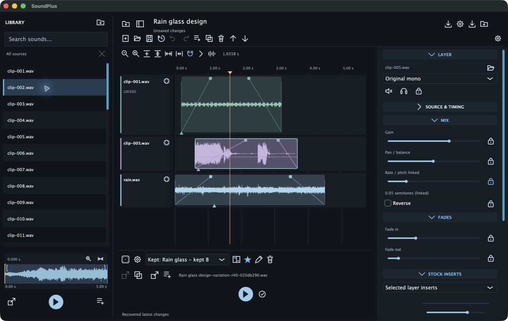
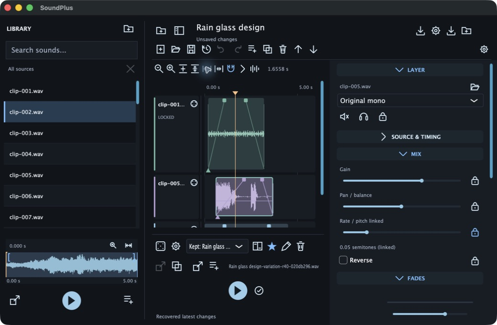
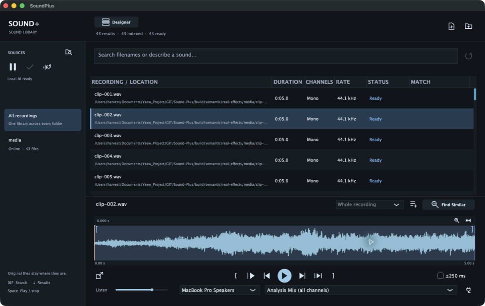
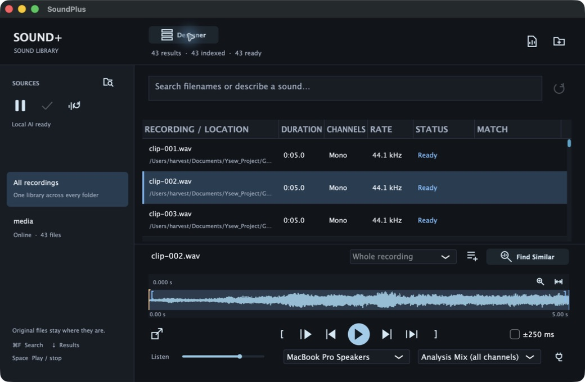
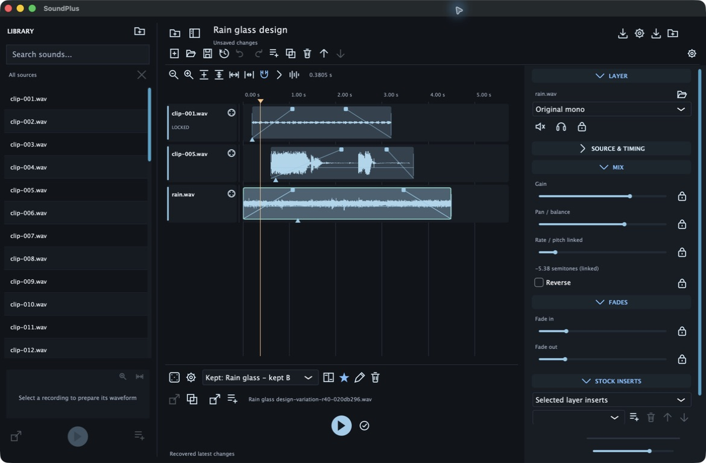

# SoundPlus Designer v1.1.1 correction pass

Implemented from HEAD `ef730216c63407bf1c32f75b2280ef536f3cb12f`, accounting for reviewed baseline `0668ed0a29e11e84458aae43052ad69be5e007ea`. The later Library selection-follow audition change is preserved and its native regression passes. No applicable AGENTS.md was present. The architecture specification, README, [v1.1 requirements](reviews/Codex_Designer_v1_1.md), [review](reviews/SoundPlus_Review_c2fe068.md) and [v1.1 report](DESIGNER_V1_1.md) supplied the product reference.

This pass also implements the requested track presentation changes. Library remains independently usable; one source region per layer, the shared DesignDocument/DesignSession/stock graph, original-file references and version-one document compatibility remain the architecture. No Performance Mixer or inactive future controls were added.

Exact source/executable fingerprints, test results, native measurements and limitations are in [the verification record](verification/designer-v111.json). Earlier milestone measurements remain historical evidence in their own records.

## Correction closure

The C labels below identify the eight findings in this correction request, separately from the earlier R01–R14 review.

| Finding | Status | Implementation and executed evidence |
| --- | --- | --- |
| C01 / P1 startup recovery overwrites early input | Fixed | [DesignSession.cpp](../src/DesignSession.cpp), constructor and protectStartupEdits: install only when launch document/revision/activity are unchanged. Name editors protect input on editor-open, before text commits. Controlled worker tests cover an early committed edit and an active uncommitted editor; retained work stays in Recover. |
| C02 / P1 historical same-ID reopening loses fresh edits | Fixed | [DesignRecovery.cpp](../src/DesignRecovery.cpp), prepareRecall/retain, and session transition: explicit older recall archives the newer retained recipe, then rebases the recalled recipe above the retained revision with the same ID. Stale background retention throws instead of acknowledging a skipped write. Current entries sort before archived recipes, including when an archive timestamp is ahead of the wall clock. Tests open r1 against retained r20, edit/restart at r22, explicitly save r22 and verify the exact r20 archive remains even when its associated named file advances. Rejected stale writes retry at the same revision. UI identifies historical recall and archived entries. |
| C03 / P2 separate imports cancel each other | Fixed | [DesignSession.cpp](../src/DesignSession.cpp), stamp/accepts/finishOperation/addExternals: each accepted import has its own pending identity and retires before completion. Relink and recovery-list refresh use separate operation channels. Tests reorder two import completions across relink/refresh, repeat a completion, and transition to New before a stale completion: each accepted import is added once; obsolete lifetime adds nothing. |
| C04 / P2 pending seek loses current parameters | Fixed | schedulePreview completion republishes newer current parameters against the requested generation when topology matches; a changed topology schedules preparation. Controlled-worker test reproduces old-generation consumption before seek adoption. Real helper/session test confirms a changed delay wet value reaches the new generation and records callback timing. |
| C05 / P2 sustained stock editing starves adoption | Fixed | [DesignLive.cpp](../src/DesignLive.cpp) separates effect topology/identity from parameter values, bypass and locks. [DesignAudio.cpp](../src/DesignAudio.cpp) updates both layer and master racks in place; filter/reverb state and fixed-capacity delay history survive updates. Gain, delay tap, feedback and wet values smooth over 10 ms; filter coefficients retain their state and reverb uses JUCE's smoothing. All four effect types produce measured PCM differences. Native continuous control and actual inspector-slider benchmarks preserve the playback generation/clock with no underruns. Add/remove/reorder/type/source changes still prepare a graph. |
| C06 / P2 primary and selectedIds disagree | Fixed | Session selection reconciliation precedes notifications, captures pre-command selection in history, prunes deleted IDs, and clears the last primary on deselection. Delete is disabled/no-op with no primary. Committing a gesture refreshes command state; Redo safely handles a new gesture invalidating its old redo branch. Controlled selection/variation/Undo/Redo tests and actual native view Duplicate/Delete/Undo/Redo/deselect/variation command callbacks pass. CUA keyboard Command-D, Backspace and Command-Z visibly select the duplicated/restored clip. |
| C07 / P2 coincident fade handles inaccessible | Fixed | [CanvasEditing.cpp](../src/CanvasEditing.cpp), clipGeometry/canvasHitTest: OUT grip is vertically staggered when fades are within 15 points; paint and hit testing share positions. Tiny/one-sample, zero/full and equal fades are tested. Real canvas pointer handlers independently drag each coincident grip, preserving the other fade and one-step Undo. DSP fade law is unchanged. |
| C08 / P2 Fit Design fails long recipes | Fixed | TimelineViewport fit/zoom lower bound is 0.01 px/s. Tests fit a full valid hour plus tail at widths 280/700/2200, retaining both extents; native Fit and horizontal zoom remain explicit. |

No correction finding is deferred or blocked. Cross-application delivery remains a separate unverified acceptance item below.

## Track interface

A header click selects a track with a muted blue header/lane. A clip click highlights only the clip with a distinct mint outline; the surrounding lane stays neutral. The fixed header now has its own surface, colored edge strip, visible separator and gutter before the timeline. Track colors tint waveforms and clips without changing their audio graph identity. The palette icon offers Default, Blue, Sage, Lavender, Amber, Rose and Sand; color changes are saved in the document and support Undo/Redo. Missing color metadata in older version-one documents defaults safely.

Drag any track's lower edge vertically to resize only that track. Double-click its edge to reset. Two vertical-height icons and Command-Option-wheel zoom all rows; existing horizontal zoom icons, Command-wheel/pinch, pan and Fit remain. Heights are keyed by document/layer ID in workspace preferences, independent of audio history; zoom and heights survive reopening. Shared variable-row geometry drives painting, headers, hit targets, reorder insertion, scrolling and sync markers. Pointer tests verify resized-row mapping, independent zoom, persistence, clip-only versus track selection pixels, and audio-structure stability after color edits.

The native screenshots show a taller first track, Sage/Lavender track colors and a clip-only selection. Toolbars use functional vector icons, accessible names and tooltips. Numeric detail stays contextual, with the existing playhead readout and no additional level/timing panels. Full Library and compact browser retain their prior adaptive layout and search scope.

## Effect-history policy and accurate audition

**Ordinary live play/seek/replacement** prepares a fresh graph beginning at most **250 ms before** the requested frame. State earlier than that point is absent. This keeps long seeks bounded but can omit a delay echo or reverb tail caused by earlier material. **Audible scrub** remains a forward **120 ms grain**, with **50 ms history** and **5 ms endpoint ramps**, including when the pointer moves backward. It is not reverse-speed audio.

Use the **check-in-circle Accurate audition icon next to Play** to judge long effect tails. It captures the current recipe and reconstructs stock history from timeline zero on the cancellable preparation worker, then plays from the parked head. This can take longer on a long/dense design. Stop cancels preparation; the realtime callback and helper command loop remain independent. Values edited after the snapshot are applied forward; press Accurate again once the recipe is stable to judge its reconstructed history. Offline range rendering already uses full history and retains that behavior.

The native impulse test uses a 0.5-amplitude impulse at zero, a one-second fully wet delay and a seek to one second. Bounded seek produces no echo; Accurate reproduces the offline full-history reader's 0.35355338 peak with **maximum PCM error 0.0**. This is audio-data evidence, not a claim of human listening or calibrated speaker output. Tooltips expose both histories and the deliberate accurate path.

## Verification on the supported Mac

Physical Apple M5 Pro MacBook Pro `Mac17,8`, 48 GiB, macOS 26.3.2 (25D2150), arm64 Release, JUCE 8.0.6, Apple clang 21 and CMake 3.31.6. Core Audio: MacBook Pro Speakers, 48 kHz / 512 frames. Built-in Retina display; no second Mac, external interface or alternative display scale was qualified.

All **nine CTest suites passed in 47.00 s** on the final source build. This includes Library/index/audio, Library selection-follow, performance, semantic and Similar integrity, session races, actual canvas pointer handlers, native transport and existing render/recall/device-rate workflow checks. Generated fixtures live in isolated per-run output directories. Retrieval ranking was unchanged; historical 10k/100k/500k relevance gates were not repeated. No 30-minute/256-frame soak or human UAT was performed.

The visible native benchmark uses the real inspector slider notifications at 25 ms input intervals, two seconds each for layer high-pass cutoff, delay time, reverb size, master cutoff and master reverb size. It runs eight layers/26 inserts, mixed source rates, 600 semantic queries and indexing 30 generated files. All ten actual view-command checks pass.

| Final inspector workload | Result |
| --- | ---: |
| Coalesced edit → first tagged callback PCM, p50 / p95 / p99 (249 observations) | 58.41 / 72.73 / 76.31 ms |
| Search dispatch → paint, p50 / p95 / p99 (600 queries) | 13.25 / 23.17 / 41.09 ms |
| Editing samples overlapping indexing | 193 |
| Queries during the same active eight-layer playback | 600 / 600 |
| Underruns / helper restarts / playback-generation replacements | 0 / 0 / 0 |
| Helper CPU, one-core equivalent | 8.13% |

Per-control-phase heard samples: 54 / 46 / 49 / 50 / 48, with each phase's p95 below 75 ms. These are JUCE slider notification/callback measurements, excluding OS input dispatch and physical DAC/acoustic latency. Slider-to-paint timing was not measured; coalescing intentionally omits intermediate inputs.

The separate native transport workload continuously edits gain/pan/fades plus layer filter/delay/reverb and master wet parameters while indexing/searching. Its 221 heard observations have p50/p95/p99 **45.48 / 53.90 / 57.53 ms**, with no replacement generation or underruns. A dry timecoded channel has maximum capture error **0.0** during live editing. The 15-minute-prefix seek completes in **53.45 ms**, Stop during preparation in **30.00 ms**, and cancelled offline pre-roll in **33.38 ms**.

The deliberately held-worker pending-seek test first lets the old generation consume the edit, then releases the seek snapshot. The current delay wet value **0.85** reaches the new generation: **81.25 ms** from worker release to observed callback, **136.21 ms** from the original edit to observation, and **120.82 ms** for the tagged edit-to-callback interval. These include the artificial hold/old-generation acknowledgment and graph preparation; they are not steady-state slider latency. The initial short prepared FIFO can contain snapshot audio before reconciled values reach the callback.

Native CUA checks covered track versus clip selection, lower-edge resizing, color choices, vertical zoom, keyboard Duplicate/Delete/Undo, Accurate audition, minimum-size and desktop Library/Designer layouts and workspace relaunch. UI checks used a catalog/recovery copy; the original r2708 working document was backed up and its checksum remained unchanged. Saved UI-copy r2715 contains Sage/Lavender colors, per-track height and 1.25 vertical zoom. The final executable also reopened the original r2708 recipe. Its live journal subsequently advanced to r2714; comparison confirms identical recipe content apart from the revision and optional default color metadata, and the newer revision was retained. Screenshots are from the native application, not mockups; the main layout captures precede the final non-layout recovery-order/Undo-state guards, while the reopened-design capture uses the final executable.

## Earlier review R01–R14

These findings retain their v1.1 implementation; this table states the correction pass's current evidence. Broader prior CUA scenarios remain attributed to [v1.1](DESIGNER_V1_1.md), rather than being claimed as repeated here.

| Review | Status | Current regression / correction evidence |
| --- | --- | --- |
| R01 old save completion | Fixed | Controlled save-A/New-B race, path/state/selection/output/message guards |
| R02 immediate replacement loses edits | Fixed | Fresh-retention New/Open/close tests; C01 adds startup protection |
| R03 busy shutdown loses final snapshot | Fixed for retained work | Idle/busy worker barrier and failing-close/retry; bounded optional-waveform teardown |
| R04 recovery and acknowledgment | Fixed | Save/restart/retry plus C02 historical recall/archive/stale-write checks |
| R05 preparation blocks helper | Fixed within stated storage scope | Native rapid late seeks, Stop, cancellable full pre-roll and status/callback continuity |
| R06 trim clamp mismatch | Fixed | 44.1/48/96 kHz × reverse/forward × linked-rate matrix and real pointer invariants |
| R07 viewport changes during editing | Fixed | Captured mapping; C08 full-hour Fit; variable-height and zoom tests |
| R08 ambiguous targets | Fixed | Real pointer gesture suite; C07 coincident handles; distinct header/clip/resize targets |
| R09 EOF overwrites parked head | Fixed | Session EOF/park/Play and stale-generation checks; Library EOF/Stop selection regression |
| R10 delayed live edits/repeated audio | Fixed for parameter path | C04/C05 native timings, unchanged generation and exact timecode |
| R11 drop placement | Fixed | Captured pointer-time Library/batch imports and one Undo; C03 independent accepted imports |
| R12 output-folder authority | Fixed | Undo/Redo/New/Open folder tests and durable render workflow |
| R13 compact scope/states | Fixed | Existing scope/layout geometry tests and Library performance regression; compact/full UI inspected |
| R14 Library overlap | Fixed | Full Library and expanded Designer inspected at minimum and desktop sizes; layout tests pass |

Requirement slices: **PRJ-01/PRJ-04** document retention/recall, **DSP-01** direct layer editing, **DSP-03/DSP-04** transport/live processing boundaries, **UX-01–UX-04** layout/keyboard/undo, **PERF-01** concurrent search/editing. This is milestone coverage, not full product certification.

## Separate acceptance status

- **Audible scrubbing: PCM VERIFIED.** Forward-grain window, endpoints and backward-pointer semantics pass real helper capture. Human listening and physical speaker audibility are not verified.
- **Accurate audition: PCM VERIFIED.** Native full-history delay comparison passes; CUA action starts playback from the parked head. Long-file preparation remains cancellable, rather than promised instantaneous.
- **Cross-application drag: NOT VERIFIED.** This pass does not claim receiving-app delivery. The earlier CUA Finder/VLC drag attempts did not yield the receiving save/exit/reopen workflow; none of those attempts count as acceptance. Keep this open until a real finalized WAV is dragged into a receiving app, saved there, SoundPlus exits, and the receiving document reopens successfully. Earlier file-open/playlist tests remain distinct.

## Reproduce

From the repository root on the supported Mac, quit the running app before rebuilding its bundle:

```sh
.tools/cmake/data/bin/cmake -S . -B build -G Ninja \
  -DCMAKE_MAKE_PROGRAM="$PWD/.tools/bin/ninja" \
  -DCMAKE_BUILD_TYPE=Release -DCMAKE_OSX_ARCHITECTURES=arm64 \
  -DCMAKE_OSX_DEPLOYMENT_TARGET=12.0
.tools/cmake/data/bin/cmake --build build --parallel 6
.tools/cmake/data/bin/ctest --test-dir build --output-on-failure
open "$PWD/build/SoundPlus_artefacts/Release/SoundPlus.app"
```

For the existing working catalog used in this session:

```sh
open -n "$PWD/build/SoundPlus_artefacts/Release/SoundPlus.app" --args \
  --data-dir /private/tmp/soundplus-v11-native-ke25tiw8
```

Run the inspector benchmark against an isolated backup of a catalog with the optional local model installed; select a fresh output directory:

```sh
python3 scripts/benchmark_designer.py \
  --catalog /private/tmp/soundplus-v11-native-ke25tiw8/library.sqlite \
  --output build/designer-v111/my-stock-run --stock-effects
```

Five-minute own-library check:

1. **Minute 1:** Add a small sound folder, search a filename and audition. While playing, choose another result in full Library and compact Designer browser: audition follows; stopped selection stays silent.
2. **Minute 2:** Add two recordings to Designer. Click a header, then a clip: track and clip highlighting differ. Drag one lower row edge, zoom vertically and horizontally, and choose a palette color.
3. **Minute 3:** Duplicate a selected clip with Command-D, Delete, Undo and Redo; Shift-click to add/remove selection. Drag each fade handle, including after they meet. Use Fit Design and Fit Selection.
4. **Minute 4:** Add delay/reverb, start playback and sustain slider motion. Seek while editing. For a long tail, park just after its earlier cause and compare normal Play with Accurate audition. Stop should cancel any pending preparation.
5. **Minute 5:** Save, make a fresh edit and quit. Reopen the same catalog: latest edits, colors, row heights and zoom remain. To test historical recall safely, save a separate older recipe, advance its same-ID design, reopen that older copy and edit: Recover should list the newer archived recipe and the fresh historical branch must survive reopening.

## Native interface captures

The fixed header/gutter separates track identity from timing. Selection emphasizes the chosen clip; color and height support scanning the design without adding persistent numeric panels. Minimum width keeps all functional navigation tools available, and rows scroll vertically when zoomed taller.










