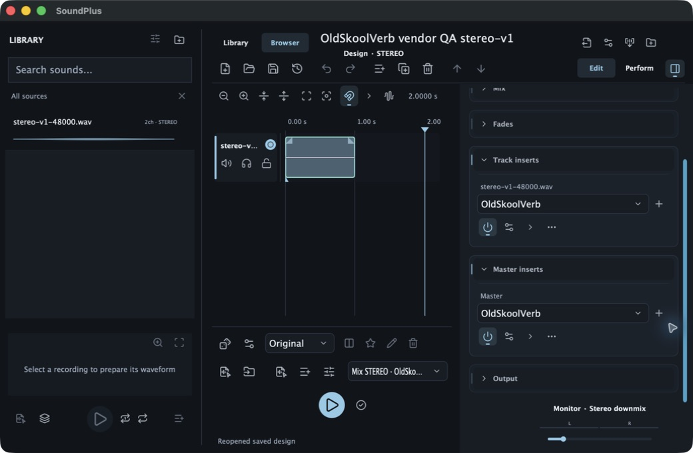

# Minimal effect names

- ✓ Track/Master insert selectors display effect names only, without slot-number prefixes or Stock/VST3/AU suffixes.
- ✓ Process effect selectors and available chooser rows use the same minimal naming. Built-in names use initial capitals.
- ✓ Vendor, format, architecture and path remain available in tooltips/selected diagnostics. Unavailable candidates retain a concise status; model identity, slot IDs and audio processing are unchanged.
- ✓ Native compact Track/Master selectors and chooser rows inspected using the isolated OldSkoolVerb QA document.
- ✓ Targeted plugin workflow suite passed in 59.30 seconds. Rebuilt and reopened the current Workflow demonstration r34, retaining unsaved edits and monitor volume 0.25.

