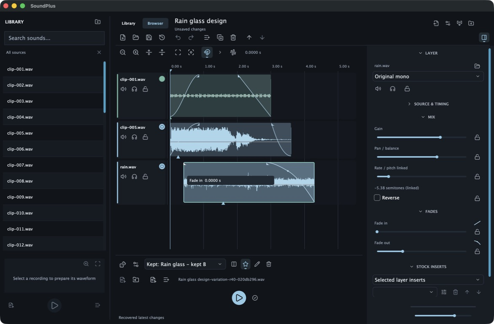

# Fade marker alignment follow-up

Correction from `527c44d`, verified on the Apple M5 Pro / macOS 26.3.2 native Release app on 2026-11-18.

The upper fade icon's tip and curve endpoint now share the exact horizontal position and the clip's top-border centre. The previous five-point vertical inset and offset marker centre caused the visible gap. Both fade curves now join the top border, with the marker extending inward below it. Edge markers reverse their placement as needed to remain inside the clip. The former vertical OUT offset and connector are removed.

[CanvasEditing.cpp](../src/CanvasEditing.cpp) shares marker bounds with hit testing. When fades meet, their opposite-side grips remain reachable; Shift explicitly addresses OUT when handles coincide. Shift-editing a fade preserves the clip selection. Presets, custom interior points, fade duration, document schema and audio processing remain intact.

The native app was rebuilt, launched and visually inspected. **designer_canvas** passed **1,441 checks**, including zero/full fades, marker-tip alignment, border contact, overlapping handles, real pointer drags and selection retention. **designer_fades** passed **1,137 checks**, including native/render parity. Both suites passed in **2.84 seconds**. Other suites were not repeated for this focused geometry change. See the [CTest log](verification/fade-marker-alignment-ctest.log) and [detailed results](verification/fade-marker-alignment-test-details.log).

The current Rain glass design **r4908** was retained and backed up before rebuilding, then reopened. Native inspection did not edit the design.

Newer user edits after reopening remain in the running working session. The inspected native executable SHA-256 is `aac605e3efe58803b73c1d9b42a7c64317ce56a01dbcb07d4cb6bfe7fc0e08d3`.



Quit the app before rebuilding its bundle:

```sh
.tools/cmake/data/bin/cmake --build build --parallel 6
.tools/cmake/data/bin/ctest --test-dir build --output-on-failure \
  -R 'designer_canvas|designer_fades'
open -n "$PWD/build/SoundPlus_artefacts/Release/SoundPlus.app" --args \
  --data-dir "$PWD/build/gain-hover-native"
```
