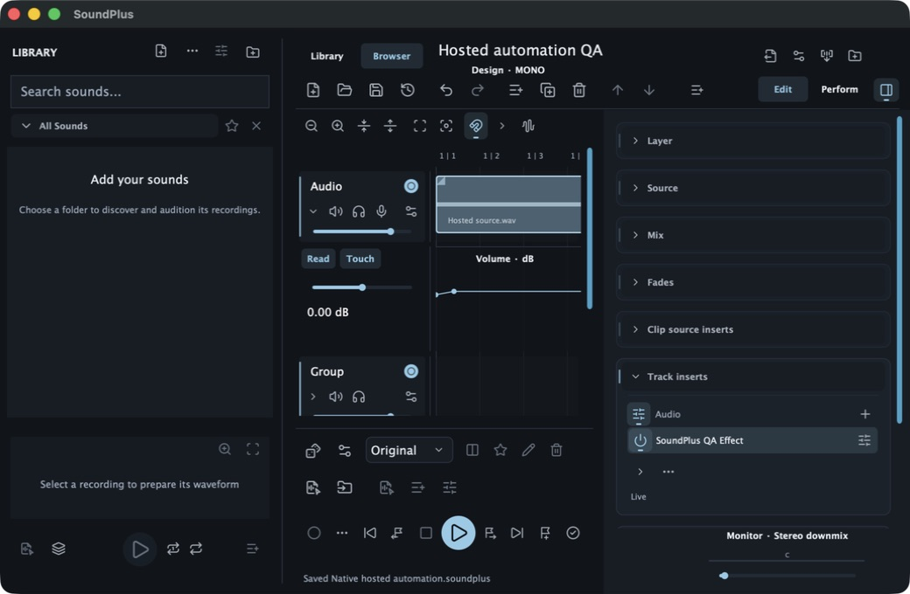
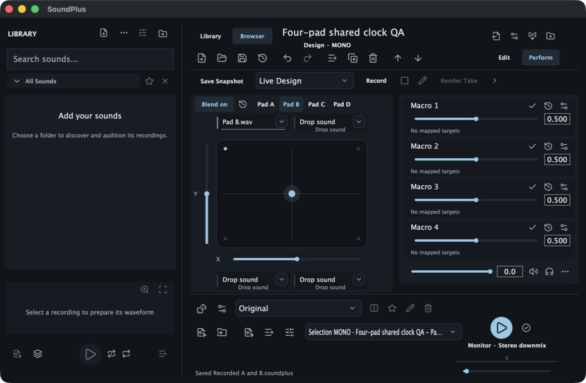
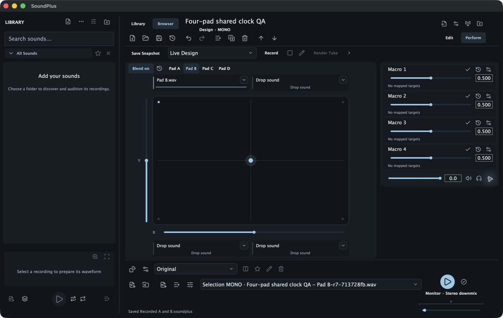

# Hosted parameter automation and four-pad Perform — milestone report

Reviewed baseline: `3da199dfe3e48db19e08daec88c420962ccfb8bc`. The complete supplied review was read together with current repository instructions and native/advanced effects, hosting, MIDI, track-automation and take contracts. Advanced effects were preserved; the final prompt's four-pad follow-on is implemented as a separately verified stage.

Implementation commits (each pushed to origin/main):

| Commit | Verified change |
|---|---|
| `2914805` | Stable hosted binding and bounded isolated timestamp/offset scheduling foundation |
| `684cdc2` | Effect and Instrument Read automation, manifest17/recipe8 and owned VST3/AUv2 PCM oracles |
| `d4d113d` | Acknowledged Touch recording/recovery, native editor callbacks, target repair and session/device tests |
| `bb54ba4` | Reproduced and fixed program-recall base-state loss underneath Read, both formats |
| `970cc9f` | Four-pad shared-clock overdubs/mixing/printing, native UI corrections and installed-vendor reference tests |
| `598ee01` | Complete source/script and17binary final-gate identity tooling |
| `37c7a4d` | Historical MIDI registry expectation updated to assert qualified binding identity/eligibility; AU-enabled suite passed in26.23s |

Evidence/report commit `1013cdd` was pushed with origin/main confirmed equal. The final checklist-closure commit changes documentation only. The pre-existing local `AGENTS.md` indentation edit is preserved outside these commits. The exact tested implementation/source identity is retained below rather than attributing a prior test to a later C++ build.

## Closure against the supplied stages

| Requirement | Status and implementation | Actual verification / limits |
|---|---|---|
| A — identity / clocks / IPC / SDK threading | **Implemented.** Owner Track/Master + optional Clip/Instrument UUID, insert UUID, format/class/fingerprint/native ID. SPR6 sequenced input/source frames and sample offsets, exact-instance validation, bounded helper-message-thread sub-blocks. Persistent manual/opaque/program base is separate from Read/Touch. | Owned VST3/AUv2: malformed events, duplicate names, reorder, ID drift/unavailable binding, exact first/last boundaries, MIDI rebasing and retained history. Full binding strings are resolved before token transport. No display-name/index fallback. [Events](../src/HostedParameterEvents.h), [identity](../src/HostedParameterIdentity.h), [worker](../src/HostedRackService.h), [live precedence](../src/HostedRackLive.h). |
| B — Read / single lane / effect+Instrument / PDC | **Implemented.** All hidden Read curves evaluate; one collapsed Volume-first lane remains per Audio/MIDI/Group/Master, Clip source targets in owner Audio lane. Continuous normalized32-frame anchored schedule + exact keys; discrete Hold. | Fifteen44.1/48/96k ×1/32/61/257/512 combinations for each owned format/class; independent effect/instrument PCM, source/Track/Group/Master placements, notes/CC, bypass, PDC, tails, seeks and retained leases. 5.1 Side vs Rear stays named and distinct. Owned VST3 rejects its unsupported Discrete16; owned AUv2 verifies16 distinct channels. [Track registry/scheduler](../src/TrackModel.cpp), [effect oracles](../tests/HostedAutomationTests.cpp), [Instrument oracles](../tests/HostedInstrumentAutomationTests.cpp). |
| C — Touch / interruptions / UI / Undo | **Implemented for Read/Touch.** Armed target captured at Begin independently from shown target; bounded applied-frame gesture recording,100ms return, one Undo per retained pass. Native effect+Instrument callbacks and ordinary lane/inline controls share recorder. Confirmed repair; unresolved curves retained read-only. | Owned real VST3/AUv2 editor callback tests, selector changes, exact return, native close/idle/focus/reset, killed-helper partial checkpoint, late-generation rejection, failed recovery write/retry and contiguous ACK. Agent-operated actual VST3 editor pointer drag, Undo/Redo, Save/Reopen; actual-device slider workload. [Recorder](../src/HostedTouchCapture.h), [session tests](../tests/HostedTouchSessionTests.cpp), [native evidence](verification/hosted-automation/native/README.md). **Latch/Write/Trim/Preview/Punch are deferred** to separate mode qualification; no inert controls. |
| D — immutable takes / transport / historical compatibility | **Implemented.** Nonempty bound hosted curves choose manifest17/recipe8. Mix/base/opaque/binary/curves/routing/PDC/source provenance frozen; ordinary projects and recipe1–7 encodings stay on historical branches. | Consumed pre-monitor PCM vs frozen replay at same and converted rates, finalized receipt/header, hash Save/Reopen, live mutation isolation, seeks and retained-helper reacquisition. Latency/schema changes fail for reprepare; no silently certified changed graph. Program recall regression reproduced before fix, then VST3/AUv2 verified base0.75 under Read0.25 and correct Read-off. [Take implementation](../src/PerformTake.cpp), [failure/retest log](verification/hosted-automation/program-recall/reproduced.log), [verified log](verification/hosted-automation/program-recall/verified.log). Native microphone and MIDI capture remain separate and their existing regression suites run unchanged. |
| E — qualification / preservation / delivery | **Passed within the stated qualification scope.** Owned independent oracles, exact installed vendors, actual native device/editor/UI, isolated QA and protected-original audit. | See exact artifact/gate result below, [stage-e receipts](verification/hosted-automation/stage-e), and [native screenshots/steps](verification/hosted-automation/native/README.md). Physical/human/receiver and distribution gates remain open, separately stated. |
| Four-pad follow-on | **Implemented and targeted checks passed.** A–D tabs/+; independent four-source XY/macros/level/mute/solo, shared graph/clock, selected-pad overdub while other curves replay; editable motion + immutable take; combined/per-pad prints. | Independent amplitude/stem/rate/partition oracles, actual CoreAudio A→B recording, A point/hash preservation, live/frozen maxError0, Save/Reopen, actual view Undo/menu commands, native waveform/tab/shortcuts/minimum checks. Legacy single-pad fields/hash/PCM preserved. [Contract](PERFORM_MULTIPAD_CONTRACT.md), [model/curve/render](../src/MultiPad.cpp), [PCM tests](../tests/MultiPadTests.cpp), [device tests](../tests/MultiPadDeviceTests.inc). |

The exact policies, capacities, precedence, missing-binding behavior and format qualifications are in [HOSTED_AUTOMATION_CONTRACT.md](HOSTED_AUTOMATION_CONTRACT.md). Parameter APIs are called under the documented helper-thread/sub-block policy, **not a universal promise of vendor sample-accurate response**.

## Build and full Release gate

Native Apple M5 Pro, macOS26.3.2 build25D2150, SDK26.5, Apple clang21, arm64 Release, JUCE8.0.6. Full application, helper, owned fixture and ASan-target build completed with:

```sh
cd /Users/harvest/Documents/Ysew_Project/GIT/Sound-Plus
# Close the running SoundPlus bundle and its helpers first; preserve its latest session.
python3 scripts/guard_bundle_closed.py
.tools/cmake/data/bin/cmake -S . -B build -G Ninja \
  -DCMAKE_MAKE_PROGRAM="$PWD/.tools/bin/ninja" \
  -DCMAKE_BUILD_TYPE=Release -DCMAKE_OSX_ARCHITECTURES=arm64 \
  -DJUCE_DIR="$PWD/vendor/JUCE-8.0.6" -DBUILD_TESTING=ON \
  -DSOUNDPLUS_BUILD_PLUGIN_ASAN_QA=ON
.tools/cmake/data/bin/cmake --build build --config Release -j8
```

Full gate command (no test-name filter or QA shortcut):

```sh
export SOUNDPLUS_VENDOR_QUALIFICATION="$PWD/build/hosted-automation/final-vendors"
export SOUNDPLUS_LIVE_DEVICE_QUALIFICATION=1
export SOUNDPLUS_QUALIFY_AU=1
export SOUNDPLUS_HOSTED_VENDOR_QUALIFICATION=1
unset SOUNDPLUS_QA_OVERLAY_ONLY SOUNDPLUS_QA_TOUCH_ONLY SOUNDPLUS_QA_LOCAL_AU
python3 scripts/qualify_hosted_release.py before
.tools/cmake/data/bin/ctest --test-dir build -C Release --output-on-failure
python3 scripts/qualify_hosted_release.py after
```

Final result: **51/51 passed in547.30seconds**, exact tested source HEAD `37c7a4d6bafc1e08a8127047aab852c985198adb`. All377source/resource/script hashes and17binary hashes match before/after (`unchanged=true`). [After identity](verification/hosted-automation/final/release/identity-after.json) and [detailed test output](verification/hosted-automation/final/release/ctest-detailed.log) accompany the complete summary. Only `tests/MidiInstrumentTests.cpp` and the test executable changed between the first and final runs; the standalone app/native evidence binary stayed identical. The first full run passed50/51 in523.28s with all377source/script and17binary hashes unchanged. Its sole failure was the historical MIDI registry assertion requiring the now-implemented hosted Instrument targets to be read-only. It is replaced by checks of complete binding ownership/identity and declared automatable eligibility, retaining the existing collapsed Volume-first and historical recipe5 assertions. [First-run failure and exact identities](verification/hosted-automation/final/first-run/ctest.log) are retained. [Complete log](verification/hosted-automation/final/release/ctest.log), [before identity](verification/hosted-automation/final/release/identity-before.json). No source or runnable binary changed during the final run. Final vendor/device/multi-pad and installed-Instrument receipts are retained alongside its identities, with a [machine-readable qualification summary](verification/hosted-automation/final/release/qualification-summary.json). The final installed Apple AUMIDISynth test also saved its state/program and reopened two fresh isolated graphs with finite musical PCM; this verifies processing/persistence, not a human or physical-keyboard audition.

Earlier targeted gates are retained independently: foundation4/4 in47.90s; hosted+compatibility10/10 in149.84s; stage-C7/7 in179.75s; expanded final hosted/multi-pad10/10 in141.15s; final native pad-correction4/4 in9.62s. An initial newly added waveform-demand test failed because its test Pad B was empty; the fixture was assigned before retesting. Its failure is retained, not erased or counted as a pass.

## Independent DSP versus installed-vendor evidence

Owned effect and Instrument fixtures are real loadable VST3/AUv2 processors. Their normalized/quantized/step gain, delay/history, MIDI notes/CC and channel behavior have independently calculated sample expectations. They exercise15 rate/partition combinations and actual consumed/frozen/rendered PCM. Process-local AU fixture registration is QA-only and does not install or alter user plugins.

Installed exact binary/state scheduling comparisons:

| Installed processor | Format | Parameter | Layouts | Targeted result |
|---|---|---|---|---|
| Voxengo OldSkoolVerb2.14 | VST3 | DryGain / native11 | Mono, Stereo | Both passed; max absolute PCM error0 |
| Viator DSP LV50A1.0.0 | VST3 | Trim / native3568674 | Mono, Stereo | Both passed; max absolute PCM error0 |
| Apple AUDelay1.6.0 | AUv2 | Dry/Wet Mix / native0 | Mono, Stereo | Both passed; max absolute PCM error0 |

The vendor reference is a second retained processor driven by direct block controls at the exact segment boundaries; it independently exercises the new offset schedule while retaining history. It is **not an independent implementation of proprietary vendor DSP**. Paths, versions, fingerprints and layout negotiation receipts are retained in [installed-vendors.json](verification/hosted-automation/stage-e/installed-vendors.json). Broad third-party Instrument compatibility is not implied by owned Instrument tests.

## Native device, resource and interface checks

The retained stage-e workload used MacBook Pro Speakers,48kHz/512frames. It sent160 actual inline slider notifications over4691.99ms and retained163points including return/endpoints. Playback generation, graph and helper stayed unchanged; source frames progressed with nonzero pre-monitor PCM; reported underruns stayed0→0. Producer maximum was6.87ms. Actual largest inline command file was2207bytes (under64KiB). These are workload observations, not maximum-capacity guarantees.

Measured CPU deltas over that interval: isolated retained plugin0.00659s, audio helper0.21670s, GUI-test process0.36367s. Isolated plugin resident size75,923,456bytes / physical footprint17,810,248bytes; audio helper peak RSS51,576,832bytes; GUI-test process peak RSS37,224,448bytes. The GUI-test process runs real view commands but is not the full standalone GUI. Isolated resource counters come from macOS `proc_pid_rusage`, not the main-process counter relabeled as plugin usage. [Raw receipt](verification/hosted-automation/stage-e/native-device-resources.json). The final gate repeated the workload:160inputs in4766.63ms,161retained points,557command bytes, unchanged graph/generation and0→0underruns; see its [separate raw receipt](verification/hosted-automation/final/release/native-device-resources.json). No DAC/acoustic timing or human listening was measured.

Actual native-app gestures found and fixed Save/Space propagation from new pad tabs, a missing Read-menu handler, and worker demand that stayed on Pad A. Automated actual-command regressions and native retest passed. Read off/on preserves41A/41B points and only changes selected pad flags. Native menu→Edit opens Pad D/X in the existing Master lane. Browser and Inspector remain visible in Edit at1040×680; four-pad Perform also fits1040×680. Screenshots include the native titlebar; desktop captures are downsampled. Real Retina hardware was checked; a separate1× physical display was not.







The layout keeps the existing Lucide family, theme tokens and fixed/equal sidebars. Pad tabs occupy the Blend header; level/mute/solo/actions use the macro footer. The bounded pad and its Y-left/X-bottom axes retain available center space; no new scrollbars or decorative modes are introduced. Fade appearance/gesture directions remain unchanged.

## Original workspace preservation

Authoritative protected original: Workflow demonstration r4498, document0403deec259f4169857b336246f201da in `build/gain-hover-native`. Protected after normal close at `build/hosted-automation/protected-afterclose-1795404991871727000`; never restored over current state. Pre-final audit:392protected file hashes unchanged,197retained state files identical,18SQLite tables unchanged, latest document payload exactly unchanged. This includes references/state as well as media;392is not asserted to be392recordings. Post-gate audit before reopen remained exact. Native in-place reopen showed Workflow demonstration; startup refreshed60descriptive parameter metadata fields (callbackIndex/discrete/unit, parameters and baseline) on one existing plugin and advanced autosave to r4499. The raw byte-equality audit correctly flags that change; a separate strict semantic audit permits only those additive fields and the revision increment. Every other payload field—including parameter values, opaque/program/binary state, recording/media references, routing, takes and outputs—remained unchanged, as did all392protected file hashes and18catalog tables. No backup was restored. See the [strict reopen audit](verification/hosted-automation/final/release/workspace-after-reopen.json) and [exact diff](verification/hosted-automation/final/release/reopen-payload-diff.json). The preserved working window is left open. Recording journals, microphone media, IRs, source pools, collections, original recordings and finalized outputs were not moved or rewritten by QA.

## Five-minute exercise in an isolated design

Launch the app with the command below; use a separate data directory when experimenting:

```sh
build/SoundPlus_artefacts/Release/SoundPlus.app/Contents/MacOS/SoundPlus \
  --data-dir "$PWD/build/my-automation-trial" --disable-ai
```

1. Add Folder to index your test sounds; add a source to a new Design. Add a supported effect, then expand that Audio Track's one automation lane. Its selector starts at Volume; search for the exact inserted effect/parameter and add points. Collapse the lane or select Volume: the hidden Read curve keeps playing.
2. Enable Touch and arm the desired hosted target. Start playback, drag its inline slider or qualified native editor knob, release, then Stop. The target stays captured even if the shown selector changes. Undo once removes the pass; Redo restores it. Save and reopen the design to inspect retained motion.
3. In Perform, assign audio to Pad A, then + creates B. Assign another layer to B. Record A's level/XY motion, Stop, select Live Design and B, then Record B while A replays. Editing tabs changes neither solo nor ownership of the shared transport.
4. Pad actions→Edit recorded automation opens the existing Master lane. Choose A/B targets to inspect independent curves; the other curves remain active. Turn Read off/on deliberately to compare manual base with recorded motion.
5. Render Design for the combined output; Pad actions→Render this pad for an isolated pad. Inspect the finalized output selector. Save/quit/reopen and compare. Listen separately for creative tails; this exercise does not replace human acceptance or a receiving-app persistence test.

## Remaining limits and next slices

- Read and qualified Touch only. Latch/Write/Trim/Preview/Punch need distinct writer/transport qualification and have no inert controls here. Perform recordings freeze existing hosted curves; simultaneous native-editor gestures during that take recording are not added to the take.
- Host-controlled32-frame interpolation/sub-block policy; vendor internal smoothing/quantization can differ. Exposed inline metadata remains bounded512parameters (complete schema validation permits16384); parameter/bus/latency topology changes require reprepare. All event/callback/project capacities fail explicitly, not silently.
- Four-pad v1 uses exclusive audio-layer ownership; duplicate a layer to reuse its media independently. Shared MIDI stays outside pad stems. Pad stems pass through the common Master, so nonlinear/stateful Master stems need not sum to combined output. Editable-curve capacity failure retains the completed frozen take and previous curves, with an explicit warning.
- IRs remain external content-verified references; export tail remains explicit. No portable collect/package feature added.
- Human listening, physical MIDI keyboard, physical multi-speaker mapping, calibrated acoustic latency, Resolve import/place/save/quit/reopen, broad vendor coverage and signed/notarized distribution remain open. No native-drag start or internal drop is reported as Resolve qualification.
- Precise event-region refinement, granular/spectral creative DSP and external AI generation remain roadmap items; no decorative UI was added for them.
