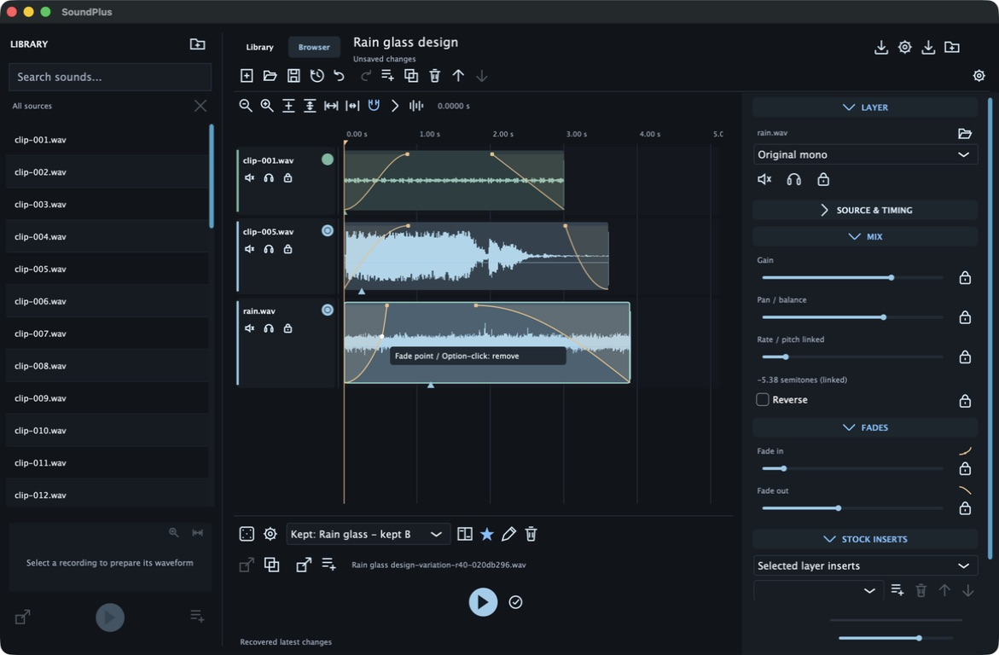
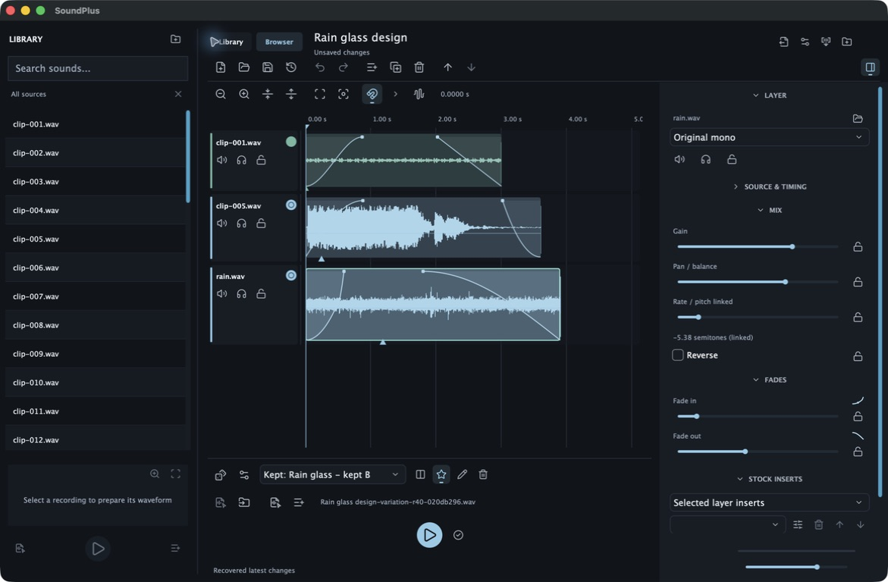
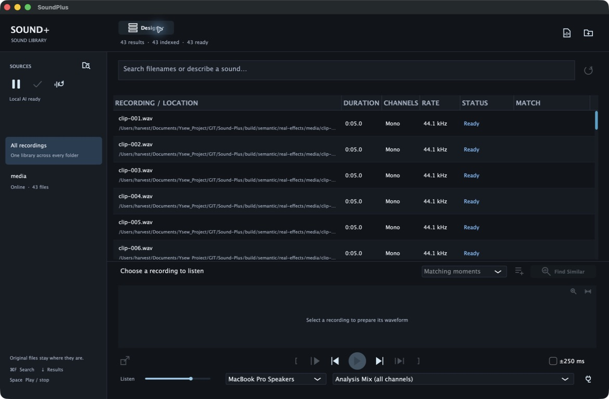
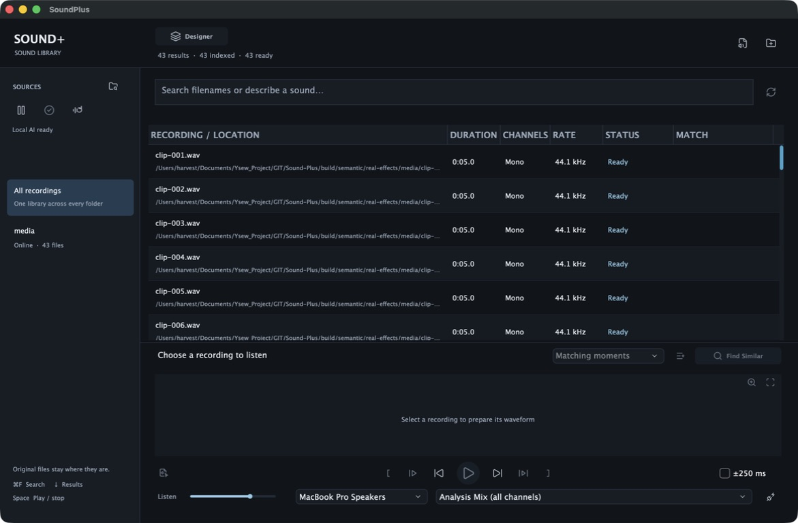
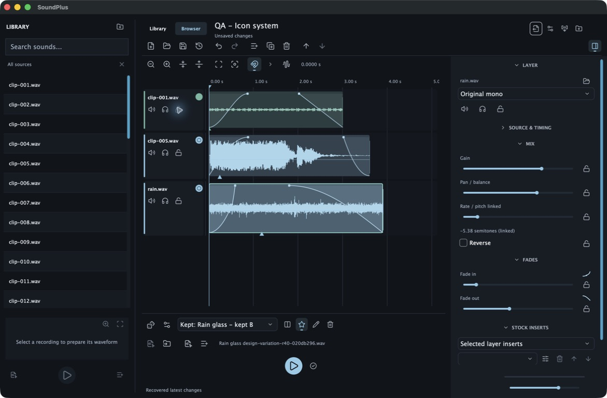
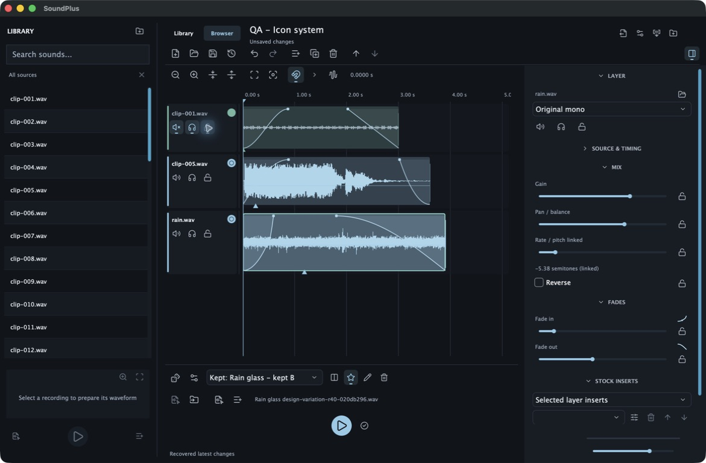
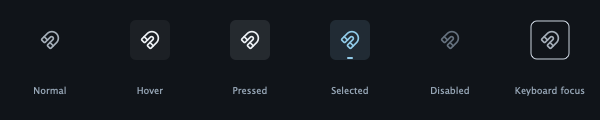
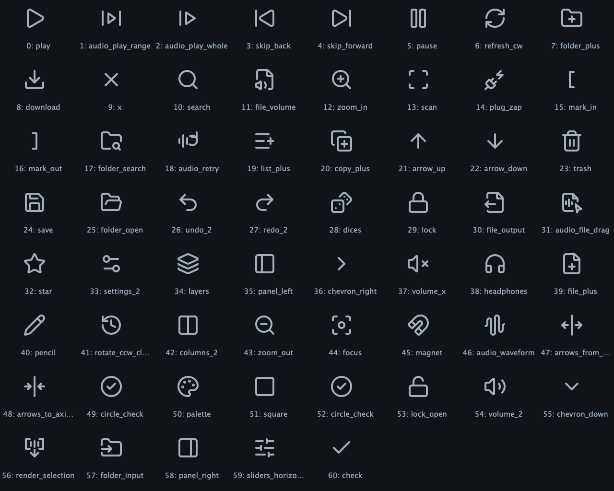
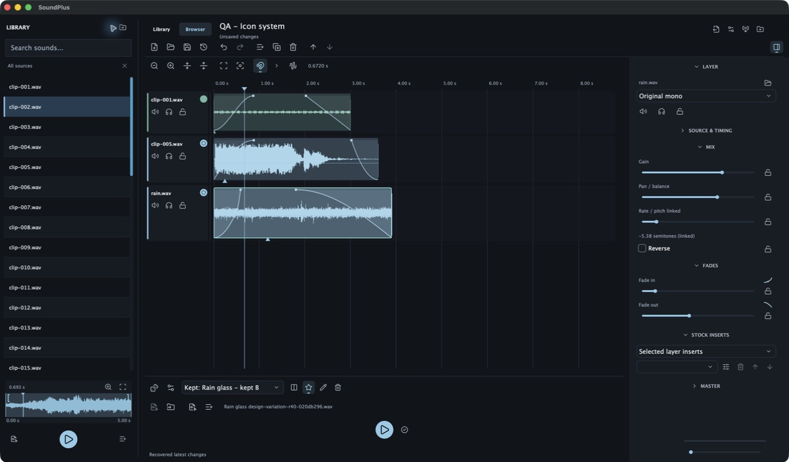

# SoundPlus icon system and theme pass

Implemented from `006890e`, preserving the editable fade curves, Designer v1.1.1 corrections and Library selection-follow audition. No applicable AGENTS.md was present. This pass changes presentation, explicit icon state and small toolbar spacing; the document schema, stock DSP, session lifecycle and file-drop callbacks remain in place.

## Family, geometry and loading

The primary family is **Lucide**, pinned to upstream revision [`de8d11aac831d519d2377ff516868244475fac06`](https://github.com/lucide-icons/lucide/tree/de8d11aac831d519d2377ff516868244475fac06). **53 upstream SVGs** are stored unmodified in the repository. The complete upstream ISC license, applicable Feather MIT license and attribution ship in the app's `Contents/Resources/Licenses` folder. The [asset manifest](../resources/icons/manifest.json) records source, mapping and SHA-256 hashes.

The [central registry](../src/IconRegistry.cpp) maps 61 semantic entries to 60 assets, including seven SoundPlus audio symbols. CMake embeds the SVG bytes with JUCE BinaryData. Control construction preloads and parses each distinct asset once, preparing its tone variants. Paint only draws an existing JUCE Drawable; no filesystem access, SVG parsing or asset cloning occurs there. There are no audio-callback callers.

All icons keep their **24 × 24 source viewBox**, **2-unit stroke**, round caps and round joins. The renderer applies a uniform transform to that viewBox and never enlarges tight path bounds. No optical offsets are currently necessary.

| Context | Icon viewport | Target |
| --- | --- | --- |
| Standard toolbar | 18 logical points | Usually 32 × 32 |
| Compact track/inspector | 16 logical points | 28–30 points |
| Disclosure | 13 logical points | Existing panel/header target |
| Main transport | 24 logical points | 40-point accent circle |

Related tools have small consistent gaps; document/history, undo/redo, layer editing, vertical/horizontal navigation and output operations have larger group breaks. Compact layouts retain their smaller targets and omit the playhead text when it cannot fit. Library and Browser remain text buttons, as requested earlier.

## Shared states and theme colors

[Theme.h](../src/Theme.h) defines normal neutral gray, bright neutral hover, pressed background, accent selection, recognizable disabled ink and neutral keyboard focus. Ordinary actions no longer all use bright cyan. Selected controls have both a tinted surface and a short bottom marker, providing a cue beyond hue alone. Disclosure direction indicates expanded/collapsed state without treating every open inspector section as a bright active mode.

Keyboard traversal draws a thin neutral focus outline. Mouse activation does not retain that keyboard outline or falsely use active blue. Toggleable controls expose On/Off to accessibility while model-owned callbacks still decide state; automatic toggling was not enabled for those callbacks.

Fade IN and OUT use the **same cool curve color derived from the current accent and text tokens**. Designer and Library playheads use the shared accent. The former fixed orange curve/playhead colors are removed; amber remains for Library status/error/offline information. Sliders, selection and the two workspaces use the same shared accent source.

Transport Stop/Play, indexing Pause/Resume and model-installed state are selected explicitly with `setIcon`; they are not inferred from label text. Lock switches between open/closed padlocks, and mute switches between speaker waves/crossed speaker. Parameter locks retain their variation-lock meaning.

| Important action | Symbol |
| --- | --- |
| Save | Lucide floppy disk |
| Render Design | Lucide output file |
| Render Selection | Bounded waveform with output arrow |
| Copy Original to Project | Lucide folder-input |
| Drag Output | Audio document with drag pointer |
| Duplicate | Lucide copy-plus |
| Fit Design / Fit Selection | Lucide scan corners / focus target |
| Inspector / processing settings | Lucide panel-right / sliders |

All icon controls retain accurate accessible names and tooltips. Existing document, undo/redo, duplicate, delete, transport, mark and zoom shortcuts appear in the corresponding tooltips. App-rendered combo-box disclosure arrows and palette selection checks use the same registry.

The seven original audio-specific assets are Play Whole, Play Match, Mark IN, Mark OUT, Retry Analysis, Render Selection and Drag Audio File. Their combinations distinguish audio ranges, analysis retry and delivery operations that a generic action alone would not express. They use the same source grid and stroke rules. Actual color swatches, accurate fade-law previews, waveform handles and the playhead are data/editor graphics rather than replacement action icons.

## Executed verification

This section records the historical icon-family pass. The focused [button-semantics and Resolve follow-up](BUTTON_SEMANTICS_AND_RESOLVE_DELIVERY.md) corrects the original icon-inferred accessibility roles, qualifies the supported minimum window size, and replaces the composite-tone render assertion with independent per-tone viewport assertions. Its receiving-app status supersedes the earlier drag attempt below.

Native arm64 Release build on the supported Apple M5 Pro MacBook Pro, macOS 26.3.2, built-in Retina display. Core Audio used MacBook Pro Speakers at 48 kHz / 512 frames. All **11 CTest suites passed in 48.32 seconds**. The build retained the existing upstream HarfBuzz compiler warnings; no application-source warning or build error remained.

The original **icon_system** suite passed **139 checks**: each asset's composite-tone image contained ink away from the image edges at 1×/2×; repeated semantic aliases share a parsed asset; painting all tones/sizes does not increase the parse count; viewBox transforms remain uniform; labels cannot change transport symbols; lock/mute variants and selected/focused/disabled state rules remain distinct. That original assertion did not independently establish each tone's visibility or containment in the intended icon viewport. The follow-up strengthens it. The 1×/2× images are JUCE offscreen vector-render checks, not claims of two physical monitors. The pressed-state atlas exercises the shared JUCE painting rules; it is not an OS mouse-down screenshot.

The entire existing suite was selected because the registry and theme reach Library, compact browser, Designer, waveform controls and the core/static-link consumers. Canvas tests exercise actual pointer handlers for fades, selection, trims, slip, resizing and drop commands; the session/transport/fade suites protect history, recovery, original-file references, audio and export behavior. See the [test log](verification/icon-system-ctest.log) and [artifact/evidence record](verification/icon-system.json).

Native CUA checks passed for Designer Play/Stop, Library Space transport and selection-follow audition, indexing Pause/Resume, header Mute/Solo/Lock, keyboard Undo/Redo, Snap, audible-preview mode, Browser and Inspector visibility, accessible On/Off state, keyboard focus and OS-zoomed window layout. The inactive controls returned to neutral; active locks/mute/solo visibly changed shape or gained the selected marker. Desktop before/after pairs use the same restored window state and capture size (**1171 × 768**, CUA-downsampled) on the same display. The OS-zoomed layout was inspected separately. No additional physical display scale or interface was qualified.

Native QA used a separate catalog and a document named **QA - Icon system**. The latest working **Rain glass design**, r3726, was backed up and remained byte-identical throughout QA; it was reopened at the end. QA actions were retained separately at r3735.

**Output drag: attempted, delivery unverified.** A coordinate drag from the ready output produced no observed receiving drop. The existing file-URL drag implementation and threshold remain in place, but this attempt is not a passing receiving-app test. Cross-application acceptance still requires dropping into a receiving app, saving there, exiting SoundPlus and successfully reopening the receiving document. Human listening and physical speaker audibility are also not claimed by these UI/PCM checks.

## Before and after

The Library retains its search/results/audition structure. Designer keeps the fixed track headers, clip selection and editable curves; the icon family, grouped spacing and quieter idle states reduce toolbar weight. The cool fade/playhead colors now belong to the same palette as the rest of the editor.



















## Reproduce

Quit the application before rebuilding its bundle. From the repository root:

```sh
.tools/cmake/data/bin/cmake --build build --parallel 6
.tools/cmake/data/bin/ctest --test-dir build --output-on-failure
open "$PWD/build/SoundPlus_artefacts/Release/SoundPlus.app"
```

The current working catalog can be opened explicitly:

```sh
open -n "$PWD/build/SoundPlus_artefacts/Release/SoundPlus.app" --args \
  --data-dir "$PWD/build/fade-ui/native-ui"
```
