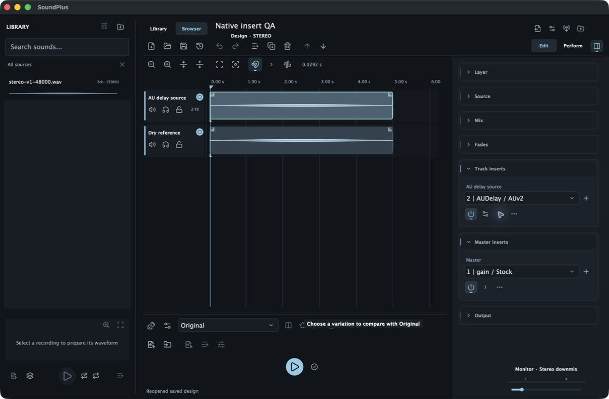
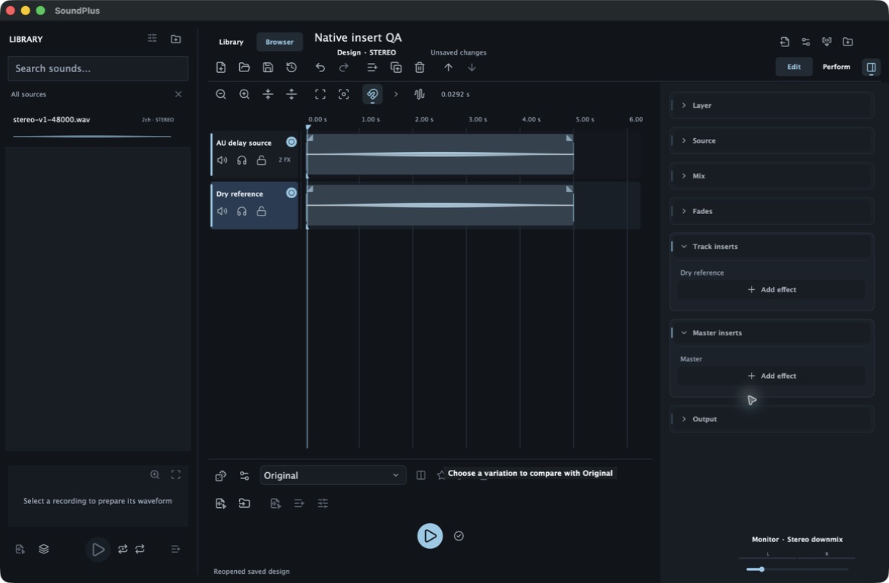
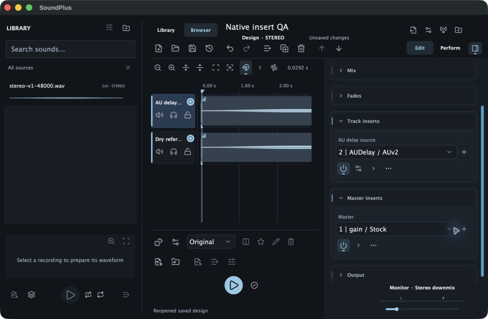

# Unified insert UI follow-up

Baseline: `3e09c9d`. The user requested fewer repeated icons, contextual effect tools, and one stock/plug-in panel rather than separate sections.

Tasks in progress:

- ✓ Inspect guidance, protect latest actual Workflow demonstration r34 and close its bundle before rebuilding.
- ✓ One shared selector per track/master, one Add effect action and contextual loaded-effect controls.
- ✓ Less-used actions moved into owner-bound menus; distinct Lucide plus, power and ellipsis symbols.
- ✓ Four targeted suites passed; empty/mixed/add/remove/power/parameter and minimum-size states inspected natively.
- ✓ Latest r34 session retained and reopened; source/binary/native evidence recorded.
- ✓ Local commit completed; no push.

The change is presentation-only. Stock and plug-in processing retain their existing signal order and independent saved state. A combined selector does not add arbitrary cross-stage reordering. Menu callbacks bind document generation, owner and slot; they cannot follow a later selection.


## Verification

Build passed. [Four targeted suites](verification/insert-ui-cleanup/tests.log) passed in **56.36 seconds**: Designer view commands, icon system, Designer session and plugin processing. The plugin suite includes new production-component checks for one combined selector, correct stock edit ownership, empty-state visibility, contextual tools and removal back to a compact state. Existing plugin PCM/state, saved-job, ownership and failure regressions also pass. This follow-up does not claim a new full-suite or sanitizer run.

Native checks used a separate generated-media QA catalog on macOS 26.3.2 / M5 Pro. A shared selector showed stock filter and Apple AUDelay; switching to AU changed the tools in the same card. Parameter disclosure stayed inline. Removing stock and external Master effects through their menus restored Add effect alone. Adding a stock gain and searching/loading another AUDelay through the shared menu worked. Effect power moved On → Off → On with matching bypass suffix/tooltip. Play/Stop and the 1040×680 layout with Browser/Inspector visible remained usable.

[Source/binary identities and native observations](verification/insert-ui-cleanup/identity-and-native.json) bind the QA copies to the actual app. The latest actual user session was **Workflow demonstration r34**; 178 protected files were unchanged before relaunch. No older snapshot was restored. No new human-listening, alternate display-scale or receiving-app qualification is claimed.







Repeat from the repository root after closing bundle users:

```sh
.tools/cmake/data/bin/cmake --build build --target SoundPlus SoundPlusTests --parallel 6
.tools/cmake/data/bin/ctest --test-dir build -R '^(plugin_processing|designer_view_commands|icon_system|designer_session)$' --output-on-failure
open "$PWD/build/SoundPlus_artefacts/Release/SoundPlus.app"
```
