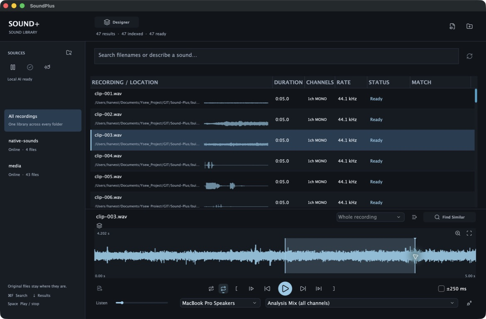
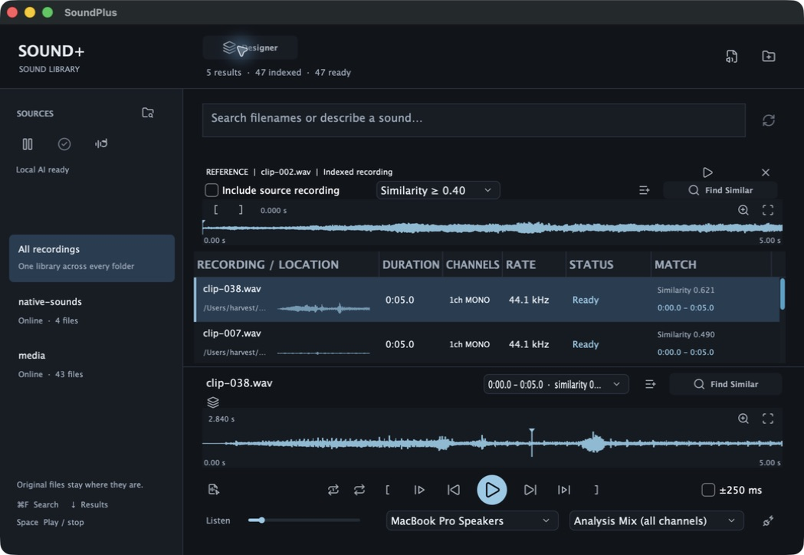
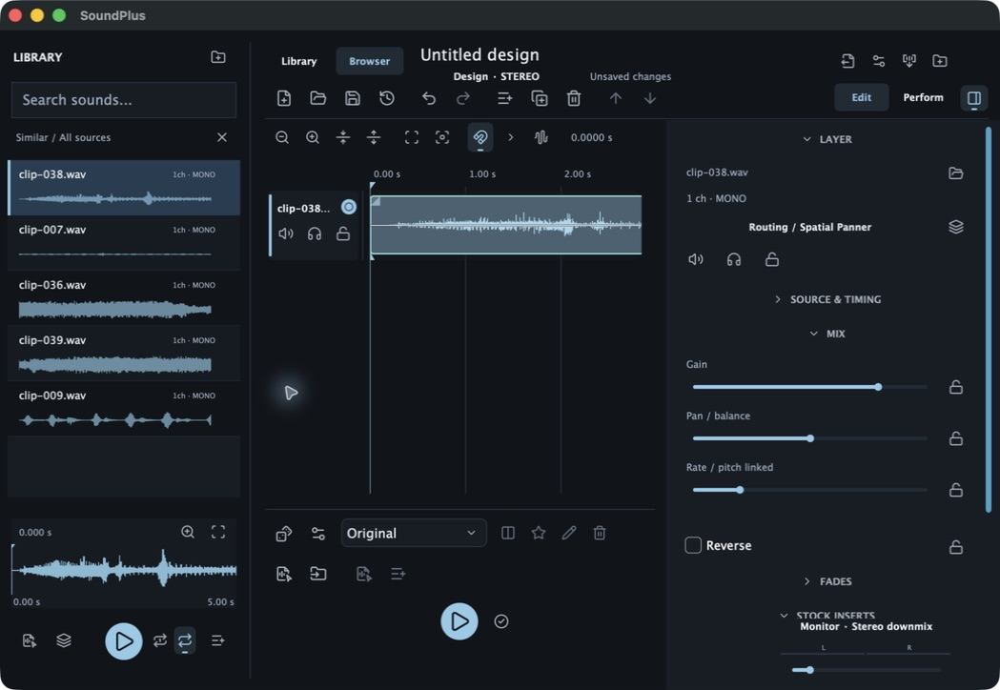

# Library playback and similarity — tasks in progress

- ✓ Read AGENTS/current HEAD and inspect waveform, transport and semantic-result paths.
- ✓ Remove redundant waveform bracket glyphs. Shade only explicitly selected ranges; default selection, seeking and whole-file playback stay unshaded. Retain drag/I/O/transport marks and align playhead pin/line.
- ✓ Add Library Off / Repeat One / Repeat All, including the compact browser. Designer looping is excluded per the user’s scope clarification.
- ✓ Add configurable minimum cosine similarity, strict result eligibility and descending score order; retain source exclusion and source scope.
- ✓ Build and regression/PCM/native UI checks.
- ✓ Reopen the protected working catalog and finalize this evidence.

Verification on Apple Silicon/macOS 26.3.2: full CTest **23/23 passed in 102.35 s** (`ctest-delivery.log`); after the final one-line playback/selection separation, the relevant **7/7 suites passed in 9.42 s** (`final-ui-checks.log`). The final build is in `build-final.log`. The real-model reference workflow also passed (`similar-workflow.log`, `similar-workflow-output/workflow.json`). No human listening rating is claimed.

## Behavior

The latest user clarification governs range display: a newly selected recording has no visual range selection, even when search supplies an end-to-end match. Playback bounds and visual selection are separate. Dragging, I/O (either case), transport marks, exact range editing, or choosing a matching moment displays the range highlight and thin boundaries. Clicking to seek and Play Whole do not create a range. Only the redundant waveform bracket glyphs are removed. The pin and vertical playhead now share their horizontal center in both waveform and Designer canvas.

Library transport has mutually exclusive Repeat One and Repeat All toggles; both off means ordinary playback. Repeat One loops the recording or marked Play Match range in the decoder/FIFO producer, retaining original bounds after seeks. The callback only consumes prepared PCM. Repeat All follows the current result sequence across pages and wraps; known offline/failed rows are skipped, with bounded work per UI tick. Stop, error, a new query or Designer taking transport cancels the queue. Generation/intent checks reject stale completion events. A pinned reference can repeat alone; Repeat All does not advance it into Library candidates. Designer looping is excluded per the user's answer. Preferences save the mode without automatically starting playback.

Find Similar uses an adjustable minimum cosine score (default 0.55). Both recordings and individual moments must qualify; nonfinite/weak moments are excluded, recordings sort by their highest qualifying score, and ties use stable asset IDs. There is no filename-only tail. Existing source exclusion, root filtering and the bounded top-100 retrieval remain. The cutoff is an interface preference and does not change the exact-range embedding cache identity.

## Sources and repeatable checks

- [Waveform selection, marks and painting](../src/Waveform.cpp), [Library controls, ownership and paging](../src/LibraryView.cpp).
- [Background loop decoder](../src/AudioStream.cpp), [helper request/status](../src/AudioPlaybackService.cpp), [explicit protocol field](../src/AudioIPC.cpp).
- [Similarity filtering/fusion](../src/LibraryService.cpp), [reference cutoff](../src/Reference.h), [pinned Lucide provenance](../resources/icons/manifest.json).
- [Generated-fixture PCM, gesture, control, threshold and paging regressions](../tests/PlaybackSearchTests.cpp). Loop PCM is checked frame by frame at 48 kHz and 44.1 kHz, including an initial seek and multiple wraps. View checks include stale completion, error, known offline/failed rows, mode exclusivity, Stop, search changes and minimum control bounds. Render checks cover explicit selection, plain seeking, absence of extra brackets and pin/line alignment at 1×/2×.

```sh
# Quit any processes running from this bundle before rebuilding it.
.tools/cmake/data/bin/cmake --build build --parallel 6
.tools/cmake/data/bin/ctest --test-dir build --output-on-failure
open -n "$PWD/build/SoundPlus_artefacts/Release/SoundPlus.app"
```

The isolated native QA catalog is `build/library-playback-update/native-qa`; four finalized generated half-second WAVs are in `build/library-playback-update/native-sounds`. The original 43-recording reference corpus remains in place. Build, CTest and actual-model workflow evidence is under `build/library-playback-update/` (ignored local artifacts).

The actual-model workflow passed indexed and external references, changed intervals, multiple windows, source inclusion/exclusion, source scope, rapid requests, changed/offline/silent/channel error cases and reopen cache reuse. Its measured edited-reference encoding was 43.49 ms uncached and 0.27 ms cached; retrieval was 0.53 ms. This is functional/PCM and embedding evidence, not human listening evidence or a guarantee of subjective relevance.

## Protection

The previously open working design `f079cfb5d0bd4d3db119805d64b35d0a`, revision 12754, and its active variation were copied before closing and again after quit. Its six referenced source/output file hashes and document hash remained unchanged during implementation. The separately reopened default catalog and its recovery/settings were also retained before closing. QA uses a separate catalog; no older snapshot is restored over a working session.

## Native verification

| Check | Observed result |
|---|---|
| Default recording selection | clip-003 displays an unshaded waveform and no extra range bracket glyphs. |
| Explicit marks and pin alignment | Click to park, lowercase I, then uppercase O produces only a 2.500–4.202 s highlighted range while stopped. Pin/line are visibly centered. |
| Repeat One | Generated half-second recording remains playing across many lengths; toggle exposes On. Decoder/PCM and helper-generation continuity have separate automated coverage. |
| Repeat All / Stop | Switching from One turns One Off and All On, advances Loop-02 → Loop-01 and later back to Loop-02. Stop returns transport to Play and ends advancement. |
| Cutoff 0.55 | clip-002 reference returns only clip-038 (0.621), excluding the source. |
| Cutoff 0.70 | Zero results; no ordinary Library filler. Cached reference is reused. |
| Cutoff 0.40 | Exactly five alternatives: clip-038 0.621; clip-007 0.490; clip-036 0.485; clip-039 0.444; clip-009 0.428. |
| Compact browser | At the 260-point browser minimum, One/All/Play remain visible, separate and functional alongside Designer and Inspector. One On clears All; Stop and Off clear correctly. |
| Narrow full Library | Cutoff, transport and output selectors remain inside their panels. Saved native QA window bounds: 1049×692; exact 1040×680 component bounds also have automated checks. |
| Restart | All On was retained on the first QA reopen without autoplay; subsequent Off/Off state and cutoff 0.40 are saved, and Off/Off is visible after a second reopen. |







These screenshots preserve the existing dark theme, vector family and Designer appearance. The repeat actions sit beside transport, while the score cutoff appears only in the full reference-search context. Repeat All prepares successive files and is not a gapless playlist guarantee. Cosine scores are not probabilities or human relevance judgments.

Final native application SHA-256: `732ea08f4bc936cace86ddf3f46abea97ac3d8ad56305f45ee3cccc01e3e786d`.

The original working catalog was reopened at completion. Native Designer accessibility confirmed **Rain glass design, revision 12754** with its original layers; the app was returned to Library (43 indexed recordings). Post-reopen document and all six referenced source/output hashes still match the pre-task protection record.
