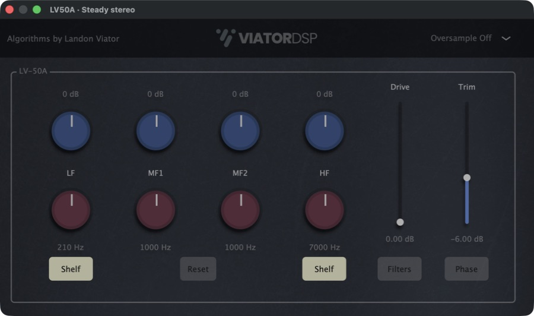
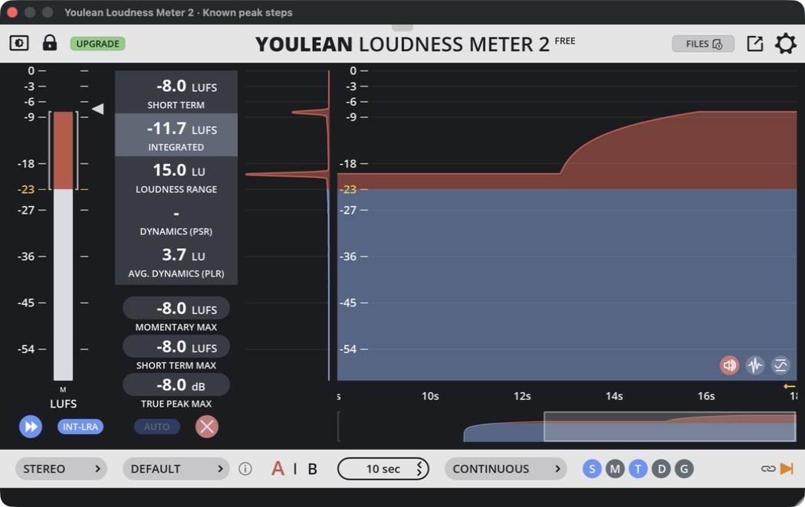
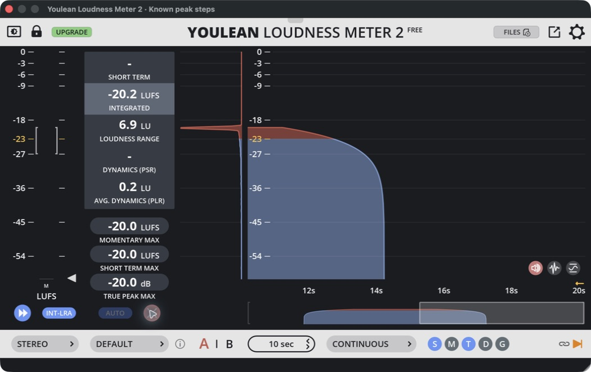
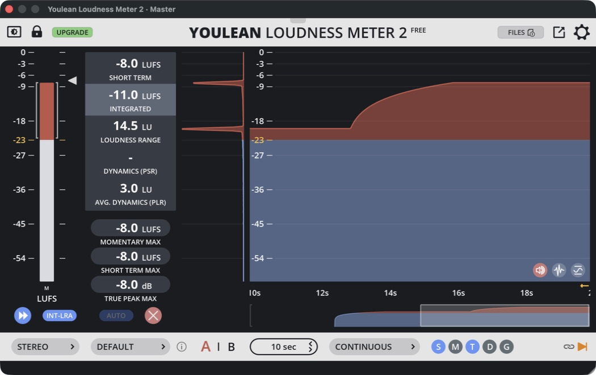
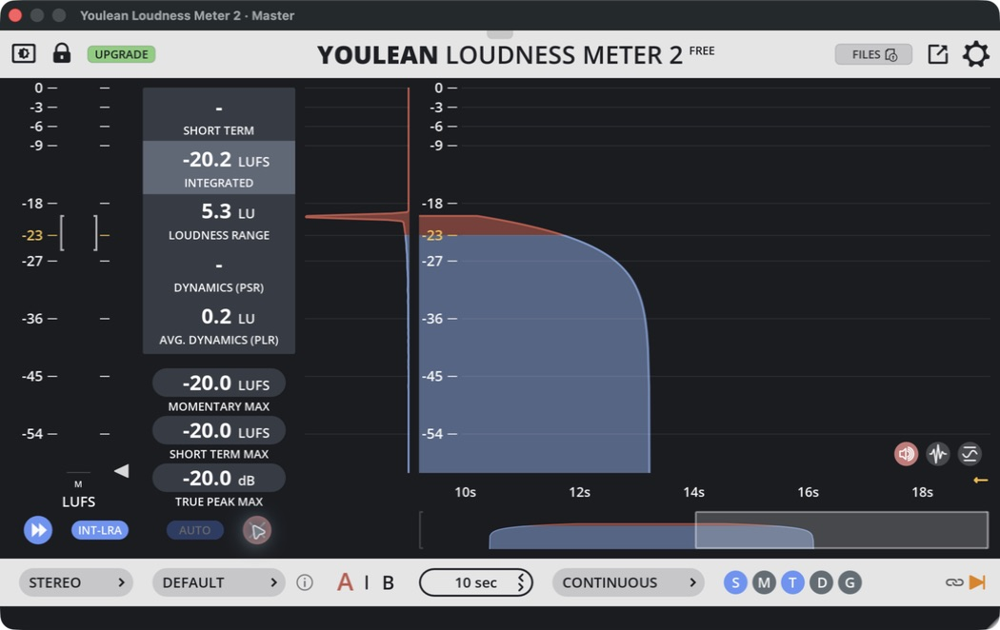
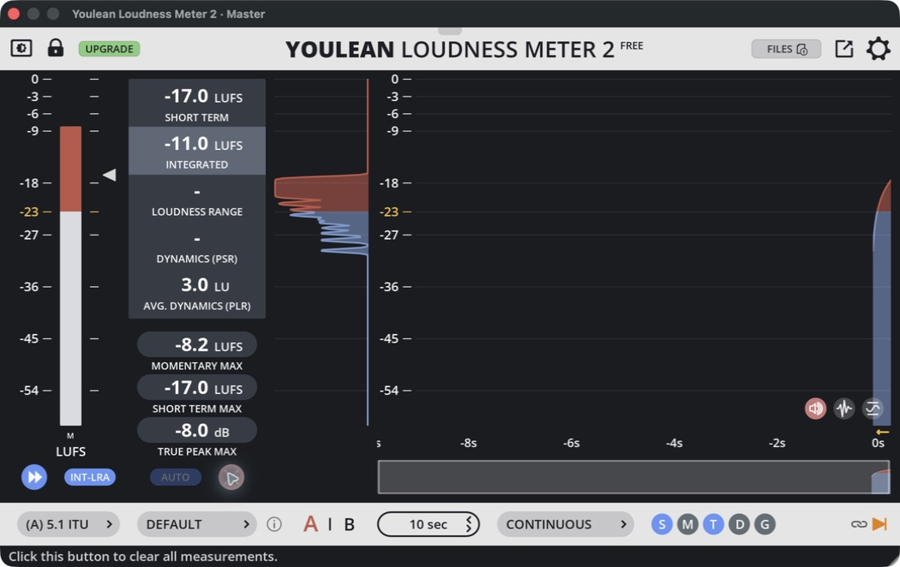
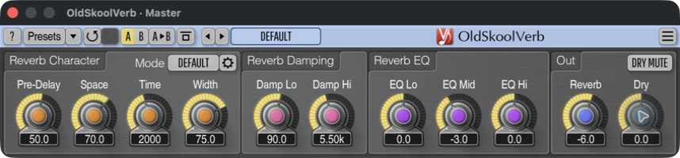

# Live Insert Correctness and Recovery

Correction sources: `32a78e2` and `a6dedbd`, starting from reviewed `27b8e5f11c47d6770f9252c0f49300eeb81a2811`. The earlier recorded `35fe786` application and its native evidence are historical; this report distinguishes new execution from those records. The retained audible/native-instance architecture, fresh offline rendering, Track/Master sections, layouts and visual system are preserved.

## Findings and closure

| Finding | Status | Implementation and evidence |
|---|---|---|
| A native-indexed seeds | Fixed | [HostedRackLive.h](../src/HostedRackLive.h) seeds the complete bounded native vector, validating exposed index/stable ID. Actual retained large schema Gain index 580 → capture/Main ACK → another high-index edit → Undo/Redo → Save while open → fresh saved recipe PCM. [Regression](../tests/PluginLiveCorrections.inc). Focused ASan instruments this production worker TU and fixture. |
| B coalesced intent ordering | Fixed | [HostedRack.h](../src/HostedRack.h), [DesignSession.cpp](../src/DesignSession.cpp), [HostedRack.cpp](../src/HostedRack.cpp): transient per-parameter origins survive Main snapshot and pending-client coalescing; independent restore origins/sequences; ACK clears covered intents only. Held-publication Main Gain(t1)/native Gain(t2)/Main Bias(t3), both before/after first delivery; retained/fresh PCM agree. Runtime clocks are not saved as document authority. |
| C timeout/replay/reset race | Fixed | New lease drains the prior request before reset; one mutex covers complete DSP, dry-ring updates, completion publication and reset/ack. Production 250 ms deadline unchanged. Owned 650 ms block → timeout clears stale PCM → immediate replay; raw operation order and overlap detector confirm reset after completion, dry latency ring restarts correctly. [Service](../src/HostedRackService.h), [regression](../tests/PluginLiveCorrections.inc). |
| D durable registry ordering | Fixed | [PluginProcessing.cpp](../src/PluginProcessing.cpp): canonical interprocess-locked durable ordinal reservation, legacy tick migration, target-only Retry, newer full-scan deletion/presence barriers. Prior-boot huge ticks, independently started writer, changed binaries, cancellation and paused Retry(B)/delete A/newer Rescan regression in [Gate A tests](../tests/PluginGateATests.inc). Probing stays outside lock. |
| E capture boundaries | Fixed | Owner/context-bound queue gates Snapshot, Generate, Save/Render/copy/move/duplicate/transitions. Visible Effect actions → Save preset captures after chooser, resolving the original owner/slot afterward. Actual production commands and visible menu action with held native publication prove fresh state, not merely the hidden button. [Session](../src/DesignSession.cpp), [view](../src/HostedRackView.h), [tests](../tests/PluginSnapshotCorrections.inc). |
| F Render Selection owner | Fixed | Invocation binds incarnation/document/variation/take/layer; completion validates or cancels. Actual A request → B selection renders A; owner removal and document replacement cannot publish stale output. Existing hosted pre-master stem semantics remain. [Tests](../tests/PluginCommandCorrections.inc). |
| G pending commands | Fixed | Explicit bounded FIFO, context validation, concise pending message, explicit failure/cancellation, no-work immediate continuation. Save→Render, Save→Close, Duplicate, Save→variation transition, failed capture and last active insert removal covered. Historical outputs/inactive inserts cannot falsely keep capture work pending. [Tests](../tests/PluginCommandCorrections.inc), [retained view commands](../tests/PluginLiveTests.inc). |
| H capped history | Fixed | Decide suppression/merge/Redo policy before pushing/truncating. Real native gesture stages at 99/100/beyond capacity plus intervening real edit, Undo/Redo. Polling/opaque observation does not fabricate user history. [Tests](../tests/PluginHistoryCorrections.inc). |
| I scale contract | Fixed; vendor acceptance separately recorded below | Generic per-view success-only cache; SDK rejection/unhandled requests retry, successful equal requests do not repeat, including accepted pre-attachment request. Actual SDK owned IPlugView tests cover attachment, failures, success, 1→2→1, same-view hide/reopen and fresh view. No vendor-name exception. [Policy](../src/NativeViewScale.h), [pinned patch](../cmake/JuceNativeScale.cmake), [test](../tests/NativeViewScaleTests.inc). |
| J final gate/evidence | Verified | Final unchanged Release gate and native reruns recorded below. No VST3/AUv2 evidence is promoted to VST2/AUv3, physical surround, listening or receiving-app acceptance. |

## Reproduce

Close all app and helper processes using the bundle before building. Tests use generated fixtures and isolated catalogs; do not point test commands at a working catalog.

```sh
.tools/cmake/data/bin/cmake -S . -B build -DCMAKE_BUILD_TYPE=Release -DCMAKE_OSX_ARCHITECTURES=arm64 -DSOUNDPLUS_LIVE_FIXTURE_ASAN=OFF
.tools/cmake/data/bin/cmake --build build --target SoundPlus SoundPlusTests --parallel 8
SOUNDPLUS_VENDOR_QUALIFICATION="$PWD/build/live-corrections/vendors-final" \
  SOUNDPLUS_LIVE_DEVICE_QUALIFICATION=1 SOUNDPLUS_QUALIFY_AU=1 \
  caffeinate -i .tools/cmake/data/bin/ctest --test-dir build --output-on-failure
build/SoundPlus_artefacts/Release/SoundPlus.app/Contents/MacOS/SoundPlus \
  --data-dir "$PWD/build/gain-hover-native"
```

Focused Release checkpoint: **3/3 in 44.45 s**, `plugin_live` **160 assertions**, registry Gate A and owned SDK scale. Focused ASan **2/2 in 38.59 s** (`plugin_live`, `native_view_scale`), `ASAN_OPTIONS=detect_leaks=0:halt_on_error=1`. `SOUNDPLUS_LIVE_FIXTURE_ASAN=ON` instruments the actual `PluginWorkerMain.cpp` TU, including retained capture/control/reset code, and the owned plugin; the rest of JUCE/core is not claimed instrumented. ASan was switched OFF and normal Release rebuilt afterward. The additional Save→variation transition assertions execute in the final Release gate.

The first full Release run passed 29/30 in 241.73 s. AU refresh succeeded, but target-first publication changed existing chooser ordering. Preserving the latest registry order for Retry fixed that regression; focused `plugin_correctness` + `plugin_gate_a` then passed 2/2 in 22.11 s. The failed full log is retained, not hidden.

Earlier failed runs are retained in `build/live-corrections`: compile type errors; large-fixture setup incorrectly reused small-schema fields; CRLF-only operation-log assertion mismatch; a real active-mix no-work predicate bug; and illegal normalized fixture step values. Fixes retain watchdogs and PCM tolerances. Fresh PCM quantization was investigated rather than loosening its comparison.

## Runtime contracts

Recovery ordering is reserved in the canonical registry's `.operations.json` sidecar while holding its existing interprocess guard. Legacy arbitrary tick values belong to epoch zero. New results carry epoch one and durable ordinals. Cancelled operations may leave harmless gaps but do not publish registry entries. Full scans publish a deletion barrier; successful reuse records presence so an older scan cannot undo newer observation. Targeted Retry publishes only its touched target and retains current roots/diagnostics.

A timed-out block is not reusable merely because its borrower releases the lease. The next borrower waits for that request's completion, then requests serialized whole-operation reset. Cancellation/crash/deadline failures reject output. The device callback still only consumes its preallocated ring; state, parsing, allocation, locks and file I/O remain on control/producer/service paths.

Live seek remains approximate: it reconstructs from the bounded pre-roll start, normally 250 ms. Accurate audition and offline render reconstruct from frame zero; use them when judging long reverb/delay tails. Editor hide/reopen does not itself reset DSP. Explicit program/opaque Undo restore may reset vendor history as part of that processor's state API.

## Boundaries and next feature

VST2 remains required/blocked by absent adapter/SDK path. AUv3 enumeration/asynchronous architecture exists but no runtime fixture is qualified. Exact Mono, Stereo, Side and Rear roles remain distinct; no silent downmix, relabel or multi-mono substitute. Youlean Rear front-pair tests do not qualify rear/LFE stimuli or physical surround. Human listening and receiving-app import/place/save/quit/reopen are separate and are not inferred from these tests.

Next feature milestone: one ordered stock/plugin chain per Track/Master and nondestructive whole-rack bypass. Plugin-aware takes and Expanded Perform follow.

## Final unchanged Release execution

Final processing/UI source **`a6dedbd`** (on top of `32a78e2`), Apple M5 Pro, macOS 26.3.2, JUCE 8.0.6, native arm64 Release. **30/30 passed in 240.57 s**, with vendor output path, actual device workload and AU qualification enabled as shown above. [Full log](verification/live-corrections/ctest-final.log), [source/helper identities](verification/live-corrections/build-identity.json), [AU record](verification/live-corrections/au-qualification.json). No runtime/test source changed after that build. Later edits are reports and evidence/audit tooling.

`plugin_live` passed **180 assertions**, Gate A **63**. The processing suite's 733,769 checks include per-sample numerical loop assertions, not that many independent scenarios. [Owned summary](verification/live-corrections/owned-live-summary.json), [registry summary](verification/live-corrections/gate-a-summary.json), [processing summary](verification/live-corrections/processing-summary.json). Exact Mono, Stereo, LCR, Quad, 5.0, Side, Rear and 7.1 negotiation/routing/PDC/output authority regressions remain in the gate. Apple AUDelay AUv2 executed; AUv3 and VST2 remain open as stated above.

[Raw owned retained-worker evidence](verification/live-corrections/owned-raw.zip), [portable six-channel PCM/state/output evidence](verification/live-corrections/portable-processing.zip), [recomputed portable audit](verification/live-corrections/portable-processing-audit.json), [concurrent workload audit](verification/live-corrections/processing-workload-audit.json), [vendor numerical results](verification/live-corrections/vendor-numerical-results.json), [inline vendor observations](verification/live-corrections/vendor-inline-controls.json). Raw logs and earlier failures are retained alongside the passing run.

Actual device: **MacBook Pro Speakers, 48 kHz, 512 frames, two active output channels**. The native owned gesture workload contains 20 matched events; first affected DSP block start p50/p95 **5.952/9.685 ms**, Main state receipt **38.457/59.616 ms**. One final coalesced inline observation: **37.989 ms DSP / 101.290 ms Main receipt**; no percentile population is claimed for n=1. [Recomputable timing audit](verification/live-corrections/latency-audit.json). DSP timestamps precede PCM-ring/device consumption; Main receipt is not pixel paint or physical latency. Controls/state/IPC remain outside the device callback.

## Final native vendor reruns

The separate QA bundle, catalog and documents are under `build/live-corrections/native`. The [native executable identity](verification/live-corrections/native/build-identity.json) matches the final root Release binaries. No user document was used as a QA fixture.

| Actual case | Result | Observation and retained evidence |
|---|---|---|
| LV50A 1.0.0 native Track edit/history/save/render/recall | Passed | Actual Trim drag −6→−12→−6 dB while playing, before editor close. Main Undo/Redo returns output −12/−6. Save with editor open captures current recipe. Native render and fresh-app recalled render are byte-identical Stereo 48 kHz float32, 192,000 frames (3 s region + 1 s tail). Selected windows measure **5.999999757 dB** native and Undo/Redo differences. View close/reopen preserves generation `1e6bbc621c3040b88f7e489b157113c6` and byte-identical selected PCM windows. This stateless tone case does not independently prove stateful reverb history. |
| Youlean 2.5.15 Track Stereo | Passed for stated signal | Correct full 1050×662 native viewport; −8.0 dB True Peak Max, Reset at displayed button clears measurements, later low step holds −20.0 dB, Short Term clears in silence. |
| Youlean 2.5.15 Master Stereo | Passed for stated signal | Independent Master instance repeats high/reset/low/clear behavior. These are peak/window/directional checks, not a calibrated LUFS certification. |
| Youlean exact 5.1 Rear Master | Passed for accepted bus/front-pair stimulus | Loaded a separately prepared Rear QA document through native Open; host endpoint explicitly L,R,C,LFE,Lb,Rb. Native channel menu reports automatic 5.1 ITU (vendor UI uses generic Ls/Rs labels); Auto mode and Reset respond. No source channels were relabeled: Stereo source routes only to L/R; other output channels remain zero. This is not a native layout-popup workflow claim, rear/LFE stimulus or physical monitoring qualification. |
| OldSkoolVerb 2.14 custom native control | **Open / blocked by unconfirmed tool input** | With only its correct QA editor active, Dry Mute click, Dry numeric field double-click and Dry knob drag produce no confirmed change. Captured parameter vector and opaque hash remain unchanged; sampled PCM RMS remains identical. No host-slider or window-open result is counted as native-control acceptance. Root cause is not established; no vendor-specific exception was added. Its requested native-change→PCM→Undo/Redo→open Save→stateful reopen→fresh recall sequence remains unqualified. |

Exact vendor identities: LV50A `VST3-LV50A-175fed7d-f3a1a62e`, fingerprint `058fff6658c6f7b28919755e000586d14f4d69e1b4d16e13b1e92c32d1d45054`; Youlean `VST3-Youlean Loudness Meter 2-1caa29dc-8eadedc1`, fingerprint `3ed43bfed460a0f8c7e821522f77d9e3036f46c6de3e70fa39daf9cc9123f066`; OldSkoolVerb `VST3-OldSkoolVerb-c2dd90f-10700a49`, fingerprint `07d6795a69f355fdf5145f96dee45220a1414b5f17907b4f43f78acca3168a83`. All execute native arm64 from installed universal bundles. Exact endpoint/state captures are retained in the native evidence directory.









[Native PCM archive](verification/live-corrections/native/native-pcm.zip) retains selected raw pre-monitor windows and both finalized LV renders. [Recomputed audit](verification/live-corrections/native/pcm-recomputed.json), [LV observation ranges](verification/live-corrections/native/lv-audit.json), [meter source comparisons](verification/live-corrections/native/meter-pcm.json), [OldSkoolVerb status](verification/live-corrections/native/old-native-status.json). Nine Track/Master/Rear windows match the decoded quantized PCM16 input exactly on L/R; Rear's other four roles are exactly zero. Nominal −20 dB source peaks are PCM16-quantized, so exact comparisons use the decoded source, not an unquantized decimal target. Ephemeral full-capture counters restart with each app launch; the archive retains the actual selected observation bytes independently of those temporary paths.

```sh
python3 scripts/audit_live_correction_native.py docs/verification/live-corrections/native
python3 scripts/audit_live_insert_events.py docs/verification/live-corrections/owned-events-0.jsonl docs/verification/live-corrections/owned-events-1.jsonl
python3 scripts/audit_plugin_processing.py docs/verification/live-corrections/portable-processing.zip
python3 scripts/audit_plugin_workload.py docs/verification/live-corrections/processing-load.json
```

To close OldSkoolVerb's remaining acceptance: launch the separate QA catalog, native Open `build/live-corrections/native/OldSkool native live QA.soundplus`, go to start and Play; use a physical native Dry/Reverb gesture and confirm a captured control/state change plus live PCM before closing. Then actual Main Undo/Redo, Save while open, close/reopen during a stateful tail and verify no reset, quit/reopen the saved design and render. Retain the exact generation/parameters/PCM at each step. The current automated custom-input attempts cannot stand in for this evidence.

## Preservation and final status

Reopened the original `build/gain-hover-native` catalog **in place**, at **Workflow demonstration r3801**, Perform, Blend enabled X **.608** / Y **.760**, Macro 1 enabled **.491**, monitor **.25**, original finalized `Workflow demonstration-r33-035ab55c.wav` still referenced. No older r36/r2040 snapshot was restored. [Restored native state](verification/live-corrections/user-restored-ax.txt), [preservation audit](verification/live-corrections/preservation-before-reopen.json). Of 258 protected hashes, 256 are unchanged; the two normal-Quit changes are recovery metadata and its backup. The latest primary document body, source media and durable renders are unchanged.

A–H and the generic scale contract are fixed with production regressions. The full Release gate and LV50A/Youlean reruns pass. **Full native vendor acceptance remains incomplete because OldSkoolVerb custom input is unconfirmed.** Human listening, physical surround and receiving-app delivery were not run or claimed. VST2/AUv3 remain visible open requirements. The next feature milestone stays the ordered stock/plugin chain and nondestructive whole-rack bypass; it has not been implemented in this correction pass.
