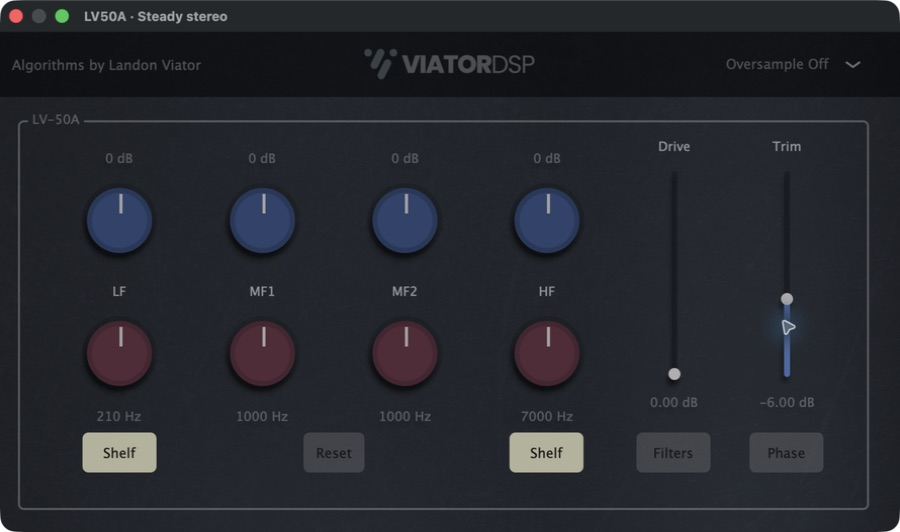
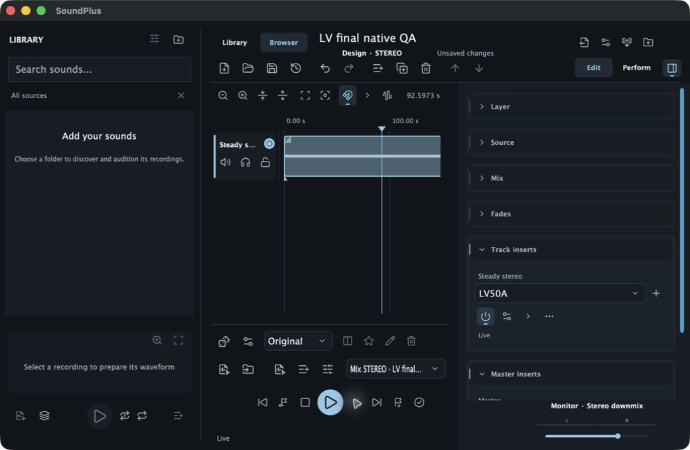
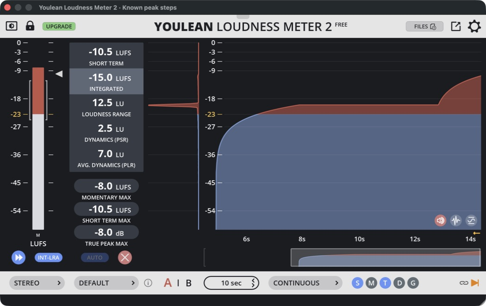
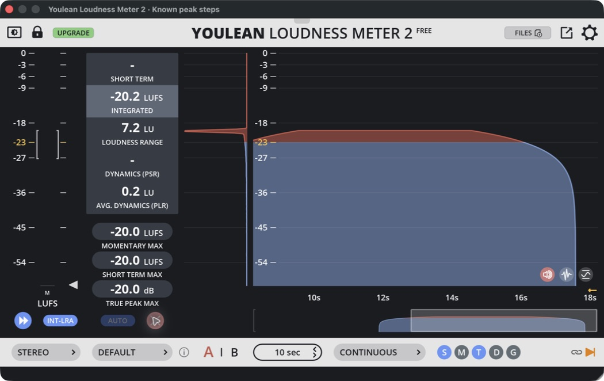
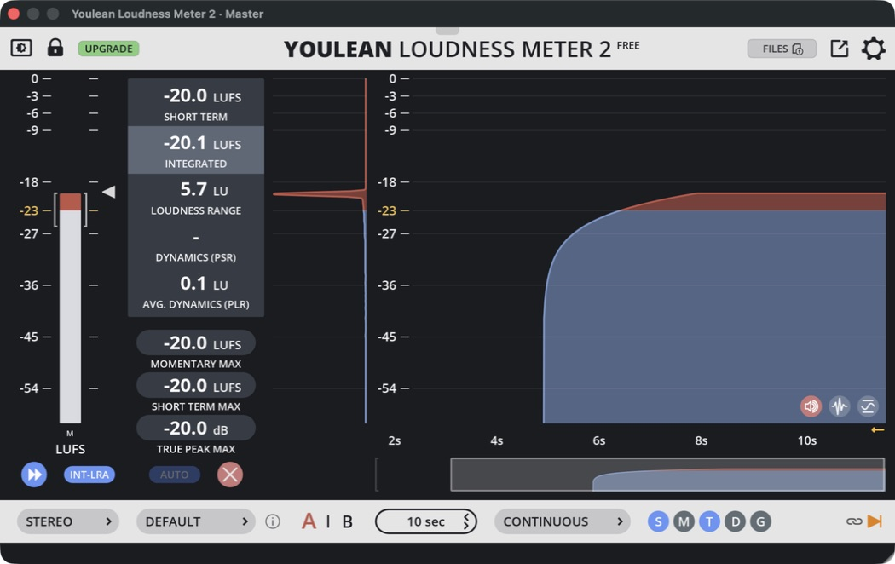
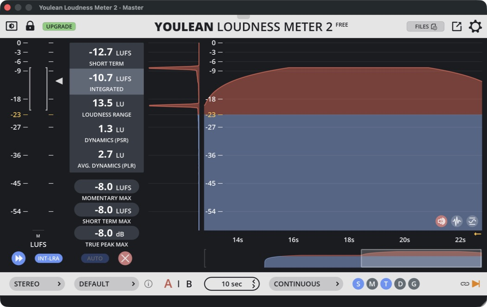
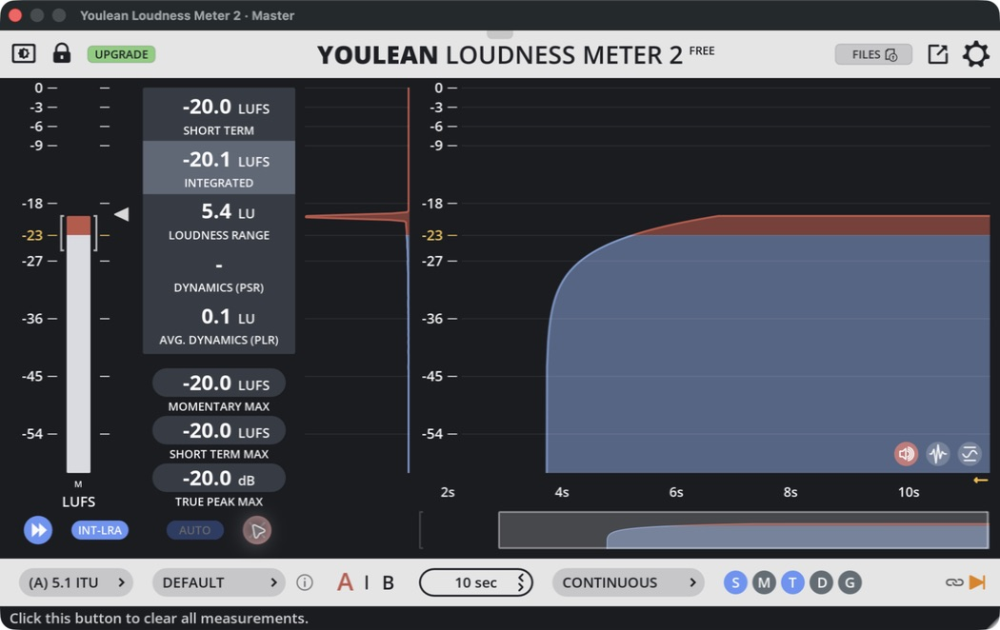

# Live Insert Editing, Metering and State Synchronization

Live native editors now control retained audible insert instances, with coherent state/history and open-editor Save/Render. The final full gate passes 29/29. LV50A and Youlean native cases pass as detailed below; **OldSkoolVerb custom native gesture qualification remains open**, so full two-vendor native acceptance is incomplete.

Started at reviewed `185ed9aac74633e336d24df46a3c40f164af61f9` with a clean tree. Gate A committed as `cdfad9c`; retained-instance architecture as `0e45fd7`; idle capture/native ordering corrections as `1d108b7`. The provisional separate-instance bridge was discarded before Gate B. Original media and durable outputs remain in place. Latest working session is protected separately from generated QA documents.

## Implementation

Gate A coordinates registry writers by canonical registry identity with process and interprocess boundaries around snapshot and revisioned publication. Expensive probes run outside that boundary; publication reconciles latest roots, entries and operation identities. Deterministic tests pause an older Track snapshot, publish Master/root/recovery work, then resume it; cancellation, chooser dismissal and failed workers cannot publish stale state.

Worker-produced recipes publish opaque state/hash, matching values/identities/baseline and program together. Baseline-equal legacy requests defer to their captured native seed; explicit changes apply, and coherent acknowledgments advance the seed. Legacy recipes without a baseline remain explicit overrides. Both finite and persistent paths reject native identities that change during preparation.

Each live slot has one retained GUI-capable isolated service. Its native editor and its audible processing use the same `AudioPluginInstance`; the audio graph borrows an exclusive processing lease. The service outlives view selection, editor close and ordinary playback stop. Explicit document incarnation, variation, owner, slot and generation bind commands and captures. Offline renders instantiate fresh processors from the coherent recipe.

The device callback only consumes the existing PCM ring. Processor creation, GUI, file/JSON I/O, hashing and coherent serialization stay outside it. The service processes on a worker under the processor callback lock; UI/SDK operations stay on its message thread. Opening/closing an editor does not reset DSP. Deliberate Play/seek/graph adoption resets and warms history using the existing bounded live-seek policy; Accurate audition starts at zero.

Inline deltas preserve touched controls through coalescing. Per-parameter event clocks protect newer native edits while composing unrelated Main edits. Opaque restore operation IDs prevent reapplying state for every slider movement. Native gesture/program/state notifications create separate history boundaries. Silent opaque changes are retained as observations, without fabricating an identifiable Undo gesture. Save/Render/copy/move/duplicate/transition gates asynchronously capture the actual live instance, retrying if newer Main edits arrive. Natural EOF uses a fresh idle barrier and zero-length SDK flush without advancing effect history.

Independent services retain bounded heartbeat/deadline/RSS supervision. Current coherent document captures and generation checkpoints survive failure; unacknowledged edits after a hang/crash are not guaranteed. Failed capture blocks certified Save/Render. Explicit reconnect recreates only the correctly bound owner from its current recipe.

New inserts auto-open their floating native editor; the action focuses the correct existing window. Track and Master panels stay separate. Normal selection hides failed/unsupported/incompatible candidates; explicit diagnostics retain failure/recovery information. Designer gains compact start/end, Stop, previous/next marker and Add Marker actions. Markers persist and support ruler seeking/drag/remove and Undo/Redo; Home, End and M shortcuts are available. Existing Lucide/theme/fade/waveform appearance is preserved.

## Verification boundaries

Source tests, numerical PCM, native interactions, actual meter response, human listening, physical surround and receiving-app acceptance are separate categories. A native window or transparent PCM alone cannot qualify a meter. UI receipt timestamps do not measure pixel paint. Raw pre-monitor float captures do not establish physical speaker output.

The final source/executable identities are retained in [build-identity.json](verification/live-inserts/final/build-identity.json). Final qualification results and native evidence are appended below when performed.

## Reproduction

Close SoundPlus and all helpers from its bundle before building.

```sh
.tools/cmake/data/bin/cmake -S . -B build -DCMAKE_BUILD_TYPE=Release -DCMAKE_OSX_ARCHITECTURES=arm64
.tools/cmake/data/bin/cmake --build build --target SoundPlus SoundPlusTests --parallel 8
SOUNDPLUS_VENDOR_QUALIFICATION="$PWD/build/plugin-editor-live/vendors-repeat" \
  SOUNDPLUS_LIVE_DEVICE_QUALIFICATION=1 SOUNDPLUS_QUALIFY_AU=1 \
  .tools/cmake/data/bin/ctest --test-dir build --output-on-failure
build/SoundPlus_artefacts/Release/SoundPlus.app/Contents/MacOS/SoundPlus \
  --data-dir "$PWD/build/gain-hover-native"
python3 scripts/audit_live_insert_events.py /path/to/events.jsonl
```

Vendor branches require the installed exact binaries. Without the vendor/live-device environment they do not execute. `SOUNDPLUS_AUDITION_CAPTURE=/absolute/folder` enables QA-only pre-monitor interleaved float32 captures; these are not delivery WAVs. Intermediate ASan regression evidence covers the owned native generic editor and helper symbol isolation; the final Release artifact is not represented as ASan-instrumented.

## Remaining format and product boundaries

TAL-Reverb-3 VST3 2.3.0 remains rejected for duplicate native IDs. No renumbering, opaque vendor patch or format substitution was added. VST2 SDK/adapter dependencies and AUv3 runtime qualification remain open. VST3/AUv2 success does not close them. No vendor was contacted.

Exact named layouts remain mandatory; mono source inserts remain mono before surround routing. No silent downmix, role relabeling or automatic multi-mono was added. Arbitrary stock/plugin interleaving, true whole-rack bypass, plugin-aware take capture and Expanded Perform remain later increments. Human listening, physical surround and receiving-app acceptance have not been qualified in this milestone.

## Closure and actual qualification

| Item | Status | Evidence / limits |
|---|---|---|
| A1 registry writers | Fixed | Deterministic production registry interleavings, alias, root/recovery publication, cancellation and failure; Gate A 53 checks. |
| A2 coherent returned jobs/effective controls | Fixed | Actual worker result recipe, opaque seed → edit → return/Undo → fresh/finite/save/reopen; post-prepare schema identity rejection in both paths. |
| B1 retained audible native instance | Implemented; owned and LV50A native verified | Native editor owns the actual isolated processor used by PCM; final native LV controls affect output before close. OldSkoolVerb custom-control acceptance remains open below. |
| B2 bidirectional state/history/save | Fixed to tested contract | 98-check owned checkpoint includes native/inline/program/notified opaque, silent observation, stale command composition, EOF capture, Main view command ownership; LV native Undo/Redo/open Save/render and fresh restoration. Silent opaque changes have no fabricated gesture boundary. |
| B3 independent lifetimes | Fixed; owned production tests | Track/Master, copy/move/duplicate and selection changes, owner/unrelated removal, document/variation generations, crash/reconnect/shutdown. Native both-window service evidence retained; LV close/reopen PCM unchanged. |
| B4 Youlean actual metering | Passed for stated buses/signals | Real Track and Master Stereo, known peak steps/silence/native Reset; accepted exact 5.1 Rear service and Auto 5.1 UI signal response. Front-pair stimulus only in the six-channel case; independent per-channel/LFE regressions remain source/PCM evidence. |
| B5 modern workflow | Implemented | Auto-open/focus, concise Live state, separate Track/Master, ordinary chooser excludes unavailable effects, compact existing visual system; real transport/markers added. Native outer minimum 1040×680 verified. |
| B6 channel-role behavior | Preserved | Full role/impulse/LFE/PDC/output-authority suites; exact Rear meter bus, no Side substitution or physical surround claim. |
| B7 compatibility boundaries | Preserved/open | TAL VST3 duplicate IDs remain rejected; VST2 dependency/adapter and AUv3 runtime remain open. |

### Native LV50A and output authority

LV50A **1.0.0**, class `VST3-LV50A-175fed7d-f3a1a62e`, native arm64 execution from universal bundle. Actual Track native Trim click/drag changed −12/−6 dB during playback, before closing. Main Undo/Redo restored the open native control and output level. Save while open captured −6 dB (normalized .375). A native Render while open finalized a Stereo 48 kHz float32 WAV, 192,000 frames (3 s region + 1 s tail), with document checksum matching its actual bytes.

Selected pre-monitor raw windows show exactly **6.000000 dB** between native states and between Undo/Redo. Windows before close and after reopen are byte-identical; retained instance generation is unchanged. The fresh native render's 48,000..96,000 frame segment matches the corresponding initial live −6 dB segment with **maximum error 0**. LV50A is effectively stateless for this tone; stateful no-reset/tail lifetime is separately proven by the owned reset-counter/PCM fixtures, not inferred from LV alone. [Recomputable PCM audit](verification/live-inserts/final/native/pcm-audit.json), [raw windows + finalized WAV](verification/live-inserts/final/native/lv-raw-windows.zip), [render identity](verification/live-inserts/final/native/lv-render-audit.json).




Actual marker Add, Go to Start and Next Marker returned to frame 4,444,672 (92.5973 s); the saved document retains that marker. The minimum's saved content bounds are 1040×648, plus the native 32-point title bar. Inspector groups scroll above fixed output monitoring; transport and track controls remain reachable. This is the actual Retina Mac display, not every display/scaling combination.

### Native scale correction discovered during qualification

Youlean initially drew into one quarter of its host viewport; its Reset/update prompt hit tests were displaced. This was reproduced, not inferred from a screenshot alone: the displayed button ignored its position and responded at doubled coordinates. A generic pinned-JUCE guard suppresses repeated **unchanged** `IPlugViewContentScaleSupport` notifications after attachment. It preserves the first notification and actual scale changes; there is no plugin-name condition, ID rewrite, vendor bundle patch or processing-layout change. CMake applies the reviewed patch reproducibly and fails if the pinned implementation anchor changes. The observed failure is consistent with the [JUCE maintainers' native scaling discussion](https://forum.juce.com/t/hosting-vst3-plugin-shows-the-wrong-size/62619); that source does not itself prove our installed vendors' behavior. Final native viewport, correctly positioned Reset and signal tests were repeated after this correction.

### Actual Youlean metering

**Youlean Loudness Meter 2 2.5.15**, class `VST3-Youlean Loudness Meter 2-1caa29dc-8eadedc1`, universal arm64+x86_64, native arm64, fingerprint `3ed43bfed460a0f8c7e821522f77d9e3036f46c6de3e70fa39daf9cc9123f066`. Fresh probe accepts Mono, Stereo, LCR, Quad, **5.1 Rear** and 7.1; **5.1 Side is rejected**. No Side/Rear alias was used.

Generated 48 kHz Stereo sine: 5 s silence, 8 s −20 dBFS peak, 8 s −8 dBFS peak, 8 s silence, 8 s −20 dBFS peak, 8 s silence. Actual Track and Master windows respond to the same playing bus. True Peak Max reaches −8.0 dB; native Reset clears measurements while playback continues; the later low step holds −20.0 dB. Short-term clears on sustained silence, while held maxima appropriately remain. The Master screenshots explicitly show low −20.0 and high −8.0 peak history. These are known-peak/directional/window/reset checks, not a calibrated LUFS certification. Reset/hold/window interpretation follows the [official manual](https://cdn.youlean.co/wp-content/uploads/2021/02/Youlean-Loudness-Meter-2-MANUAL.pdf).

The native Design layout menu converts Master to **5.1 Rear**. Its service records exact roles L,R,C,LFE,Lb,Rb; Youlean's channel menu identifies the six-channel automatic mode as 5.1 ITU (its own UI uses generic surround labels). Selecting Auto and Reset yields signal-driven −20.0 peak/loudness on the front-pair stimulus. Other roles stay silent in Main monitoring. This qualifies an accepted six-channel instance with front-pair input; it does not claim a rear-only meter stimulus or physical surround output. [Exact service capture](verification/live-inserts/final/native/youlean-rear-service.json).







### OldSkoolVerb native acceptance remains open

OldSkoolVerb **2.14**, `VST3-OldSkoolVerb-c2dd90f-10700a49`, universal/native arm64, fingerprint `07d6795a69f355fdf5145f96dee45220a1414b5f17907b4f43f78acca3168a83`. Numerical Mono/Stereo Track/Master processing, fresh recalled renders and retained tails pass. Its native window opens, remains while Main plays, and closes/reopens. However, repeated custom knob drags, Dry Mute/preset clicks and wheel attempts through the native-control tool did **not** establish a coherent parameter/PCM change. A transient displayed wheel value is insufficient; it is not counted as success. Repeated after the scale correction; no vendor-specific workaround was introduced.

Status: **native gesture qualification BLOCKED by unconfirmed custom UI interaction** (not a qualified pass, and not proof the plugin fails with a physical mouse). To close it: open the isolated `OldSkool native live QA.soundplus`, open Master OldSkoolVerb, Play, change Dry/Reverb using a real native gesture, confirm live inline state and PCM before closing, then Undo/Redo, Save while open, close/reopen without a tail reset, and reopen the saved recipe/render. Until that passes, full LV50A + OldSkoolVerb native acceptance is incomplete.

### Categories deliberately not conflated

| Category | Actual status |
|---|---|
| Source/production tests | Final full gate recorded below; owned state/lifetime/schema/role suites. |
| Numerical PCM | Owned effective-state/tail/PDC/output authority; vendor recalled renders; native LV raw-window/render audit. |
| Native interactions | LV native click/drag/history/Save/render/close-reopen; minimum and marker controls; OldSkoolVerb custom gesture remains blocked. |
| Signal metering | Actual Youlean Track/Master Stereo and accepted Rear bus as described. |
| Human listening | Not performed/claimed. |
| Physical surround | Not performed/claimed. |
| Receiving-app acceptance | Not rerun/claimed in this milestone. |

## Final gate, measurements and preservation

Final processing/UI source commit **`35fe786`**, Release arm64 on Apple M5 Pro / macOS 26.3.2 / JUCE 8.0.6. The complete awake gate passed **29/29 in 226.79 s**, with `SOUNDPLUS_VENDOR_QUALIFICATION=$PWD/build/plugin-editor-live/vendors-awake-final`, `SOUNDPLUS_QUALIFY_AU=1` and `SOUNDPLUS_LIVE_DEVICE_QUALIFICATION=1`. Actual LV50A/OldSkoolVerb vendor branches and Apple AUDelay AUv2 1.6.0 executed; the optional environment is not inferred from a default test pass. [Full log](verification/live-inserts/final/ctest-final.log), [vendor numerical matrix](verification/live-inserts/final/vendor-numerical-summary.json), [AU record](verification/live-inserts/final/processing-au-qualification.json).

`plugin_live` passes **98 checks**; Gate A passes **53**. The broader processing suite includes numerical loop assertions, not hundreds of thousands of independent scenarios. The [portable processing audit](verification/live-inserts/final/portable-processing-audit.json) recomputes owned six-channel PCM, saved job/baseline and durable split/output authority from [retained raw evidence](verification/live-inserts/final/portable-processing.zip). The [concurrent workload audit](verification/live-inserts/final/processing-workload-audit.json) recomputes its retained polling/timing records in [load.json](verification/live-inserts/final/processing-load.json).

The first post-scale full run encountered helper heartbeat/cleanup timeouts while macOS entered **Clamshell Sleep at 15:08**, repeated dark wakes, and FullWake at 17:02. Its [failed log](verification/live-inserts/final/ctest-sleep-interrupted.log) and [power events](verification/live-inserts/final/sleep-interruption.log) are retained and excluded from delivery acceptance. Awake focused rerun passes 3/3 (108.19 s), followed by the complete unchanged-build pass. No watchdog deadline was relaxed; the final invocation used a temporary idle-sleep assertion, not a persistent power-setting change.

### Control response workload

Actual device: **MacBook Pro Speakers, 48,000 Hz, 512-frame buffer, two active output channels**, Mono owned bus expanded by monitoring. The actual [device observation](verification/live-inserts/final/device-observation.json) records zero underruns during the control workload. Twenty owned native control gestures at 80 ms intervals and forty Main inline updates at 20 ms intervals execute during one sustained audition, followed by natural EOF, native state capture and a fresh graph comparison. Inline updates coalesce; this is intentional, not forty independent published latency samples.

| Observed events | n | First affected DSP block start, p50 / p95 | Main state receipt, p50 / p95 |
|---|---:|---:|---:|
| Native control events | 20 | **4.993 / 10.773 ms** | **38.962 / 50.866 ms** |
| All matched, deduplicated captured events | 21 | **4.996 / 11.253 ms** | **42.240 / 53.369 ms** |

The final coalesced inline event is one observation: **29.670 ms DSP / 98.498 ms Main receipt**; no meaningful percentile distribution is claimed for n=1. Timings use the same monotonic tick clock and nearest-rank estimator, require matching first-affected event identity, and exclude stopped/deferred/silent-opaque rows. DSP timing ends before PCM-ring/device consumption; UI receipt is model publication, not native-widget or pixel paint latency. Owned native-slider reflection is checked separately. [Raw events](verification/live-inserts/final/owned-events-0.jsonl), [recomputed summary](verification/live-inserts/final/latency-audit.json), [full owned raw PCM workload](verification/live-inserts/final/owned-raw-workload.zip).

After the final full gate, the unchanged QA app reopened saved LV r9, its marker at 92.5973 s, native Trim −6 dB and existing finalized WAV. Both final-build owner windows were opened again: distinct processor generations, both visible, both processing, Main Play/Save successful. [Final dual-owner capture](verification/live-inserts/final/native/dual-owner-state-final.json), [fresh app native recall](verification/live-inserts/final/native/lv-after-app-reopen.jpg). Source/helper hashes in [build identity](verification/live-inserts/final/build-identity.json) include all direct and GUI helpers and confirm the native QA copy matches the root build.

The original `build/gain-hover-native` catalog was reopened **in place**. Actual UI: **Workflow demonstration r36, unsaved**, playhead **6.0000 s**, clip-005 selected, monitor **.25**, durable r33 render referenced. The TAL-Reverb-3 **AUv2** slot remains in its original layer; it is not a substitute for the rejected VST3 case. All 250 protected paths remain present. Of them, 249 hashes are unchanged; the sole changed autosave differs only in playhead/checksum and matches the newer native-observed 6-second position rather than the initial backup's .7543-second position. No older snapshot was copied over newer edits. [Preservation record](verification/live-inserts/final/user-preservation.json).

Changed source/assets are listed in [changed-files.txt](verification/live-inserts/final/changed-files.txt). Main groups: canonical registry/coherent job publication; retained service/lease/exchange/control and Main session gates; native worker/UI/private-symbol isolation; transport/markers/icons; owned fixtures and actual view/device regressions; reproducible pinned-JUCE scale guard. This report, contract/matrix/checklist and audit scripts/evidence complete the documentation. No push was performed.

Additional audit commands:

```sh
python3 scripts/audit_plugin_processing.py docs/verification/live-inserts/final/portable-processing.zip
python3 scripts/audit_plugin_workload.py docs/verification/live-inserts/final/processing-load.json
python3 scripts/audit_live_insert_events.py docs/verification/live-inserts/final/owned-events-0.jsonl
python3 scripts/audit_live_insert_pcm.py docs/verification/live-inserts/final/native
```
