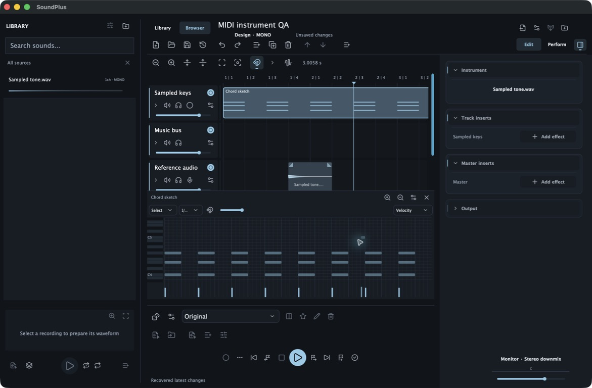
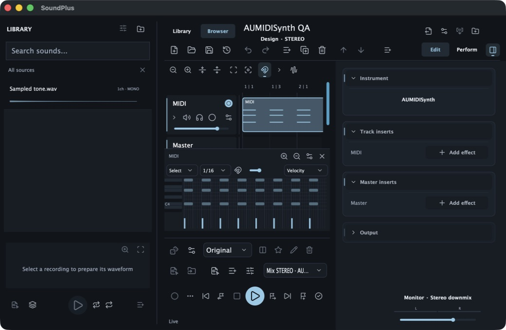
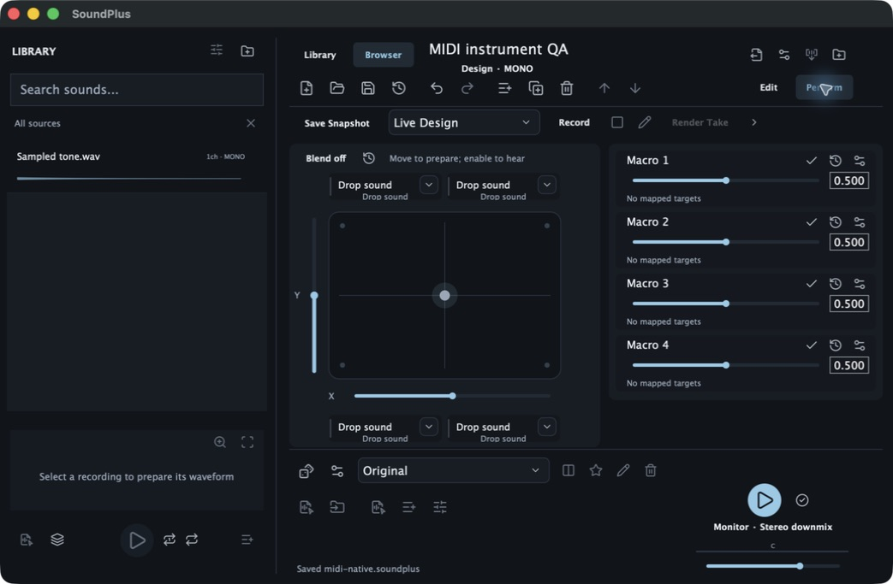
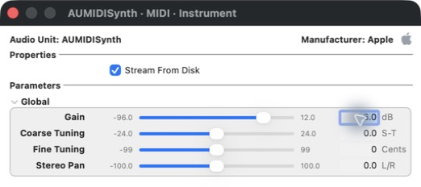

# MIDI sequencing and instruments — development report

Starting/reviewed HEAD: 949dbc5619c9921cd52f5588a5b91a94d9523884. No later commits or unrelated changes at start. Read the current recording, automation, take, hosting and format contracts. Preserve all existing catalog/media/recording prefixes and finalized/Resolve-referenced WAVs. No push.

## Stage A prerequisite checkpoint

| Review finding | Correction | Evidence |
| --- | --- | --- |
| A1 Previously active monitor survives rejection | Disable and clear matrix before validation; epoch-tag queued frames, discard stale backlog, reset peaks only at the safe device boundary. Output-device changes disable the raw monitor. Separate monitor-command serial reconciles actual state/error with current UI intent. Raw capture remains independent. | Real service/session tests enable 48 kHz, reject 44.1 kHz, inspect actual silent monitor output, safely re-enable, restart/reconfigure, reject bad mapping, and repeat during capture with identical unprocessed samples. |
| A2 Acknowledged raw PCM not content-validated | Version 2 per-owner SHA-256 prefixes, byte counts and owner binding; incremental worker hashing with all-owner commit. Validate all prefixes/finite PCM before derived writes, then verify the copy digest. | Real stores test independent SHA oracle, same-size raw mutation, nonfinite data with a matching mutated digest, mismatched owner prefixes, first-owner-only append failure, retained checkpoint/raw bytes and interrupted WAV finalization. |
| Legacy policy | Default v1 partial recovery refuses. Explicit legacy action stays labelled `legacy-unverified` and Recovered (unverified); finite/size checks still apply. Old finalized WAV hashes and old files are retained. | Clean v1 recovery requires opt-in and retains the unverified receipt marker. |

Source: [InputRecording](../src/InputRecording.cpp), [session/UI acknowledgments](../src/DesignInputSession.cpp), [helper device changes](../src/AudioEngine.cpp), [real-store/service tests](../tests/InputCorrectionChecks.inc). The [recording contract](AUDIO_INPUT_RECORDING_CONTRACT.md) now specifies this version/compatibility policy.

Stage A final relevant gate: **7/7 passed in 34.37 s**, with **195 input checks**. [Gate](verification/midi/stage-a/gate.log), [source/build identity](verification/midi/stage-a/identity.json), [controlled input evidence](verification/midi/stage-a/controlled-input.json). This stage was committed as `7d6f374` before MIDI implementation. Existing microphone/device/listening/receiver qualifications are not expanded by controlled regressions.

## MIDI delivery

| Requirement | Result and source | Verification |
| --- | --- | --- |
| B1 Separate Track type / identity | Typed MIDI Tracks, dedicated Instrument before Track inserts, stable clip/note/controller identities; Group/Master routing retained. [Model](../src/MidiModel.cpp), [Track model](../src/TrackModel.cpp). | Real save/reopen, actual canvas selection/duplicate/delete, old manifest regressions. |
| B2 Clip editing / musical clock | Absolute 9,600,000 ticks/quarter, constant tempo/signature; create/move/copy/trim/split/overlap/quantize-strength/transpose/velocity/loop, Undo/Redo. Untouched split fragments preserve articulation; copies rekey it. | [MIDI tests](../tests/MidiTests.cpp): rate/BPM conversions, split continuation and independent-copy identity. |
| B3 Piano roll / devices | Contextual keys/notes/velocity and CC64/bend/CC1 editor, tools/snap/zoom; Track device/channel picker, transient arm/monitor. [Editor](../src/MidiEditor.cpp), [timeline](../src/MultitrackEditor.cpp). | Actual view commands and native draw/transpose/copy/paste/Undo; focus and Command-Q forwarding regression; normal/minimum screenshots below. |
| B4 CoreMIDI capture | Native host timestamps → existing output clock; bounded callback queue; applied/acquired frames, off-callback atomic journals; Stop/panic/fault handling and deliberate incomplete recovery. [Service](../src/MidiInput.cpp), [session](../src/DesignMidiSession.cpp). | Real owned CoreMIDI source, controlled timestamps/zero-velocity note-off/sustain/bend/channel/overflow/cancel; real session completion/duplicate recovery/wrong context/Undo/Redo/read failure. Actual app pass 126 packets, Save/quit/reopen. Physical keyboard open. |
| C1 Native sampler | Referenced source/range, max 32 voices/eight alternates; pitch/rate/velocity/ADSR/sustain, released-first/oldest stealing, loop/one-shot, CCs, deterministic alternates. [Sampler](../src/NativeSampler.cpp). | Independent PCM oracle, partition invariance, overlapping notes, pitch/bend/velocity/sustain/steal, continuous Gain, live/offline applied-frame comparison. |
| C2 Dedicated hosted Instrument | Explicit VST3/AUv2 purpose and descriptor, MIDI offsets/shared playhead, exact no-input/main-output bus, PDC, state/program and retained isolated GUI. [Exchange/client](../src/HostedRack.cpp), [worker](../src/PluginWorkerMain.cpp). | Owned VST3 offset/PDC/release/gate oracle, partition invariance, crash/hang/latency/missing-binary/layout refusals; actual installed AUMIDISynth and native GUI workflows below. |
| C3 One lane / automation | Existing collapsed Volume-first lane retained. Native Instrument Gain/Tuning targets use shared prepared automation; external targets visible read-only. [Targets](../src/TrackModel.cpp), [graph](../src/DesignAudio.cpp). | Existing multitrack automation suite; explicit MIDI lane/readonly assertions and actual view regression. Other read-enabled curves remain compiled independently of the shown target. |
| C4 Shared engine / immutable output | Same score scheduler/Instrument graph live/offline; MIDI seeks rebuild full history on a cancellable worker. Manifest 14/recipe 5 freeze score, sources and Instrument state; historical 1–13 manifests/1–4 recipes retain compatibility. [Contract](MIDI_INSTRUMENT_CONTRACT.md), [takes](../src/PerformTake.cpp). | Actual immutable recipe/hash recall, authoritative single-pass hosted renders, receipt save/reopen, native output PCM checks and full regression gate below. |

Stage B/C implementation checkpoint: `a812ecb`. Native/capture corrections and qualification checkpoint: `c2af851`. Final keyboard correction: `0ee9710`; dedicated Instrument discovery/effect-isolation regression: `6383b44`. Stage A remained committed before MIDI began. No push.

## Native hardware and instrument evidence

Apple M5 Pro / macOS 26.3.2 / arm64 / SDK26.5. Tested in `build/midi/native`, never the user's active catalog. The owned CoreMIDI sender is a real virtual endpoint, not a physical keyboard. It produced 126 native callback packets in a completed pass, followed by normal Stop/Undo/Redo/Save/quit/reopen and replay. The journal retained all 126 packets; 126 were scheduled later than acquisition, maximum 2,601 frames at 48 kHz (54.19ms). This measures producer lookahead/scheduling in this run; it is not calibrated acoustic/electrical/keyboard latency. [Capture record](verification/midi/native/capture-summary.json).

| Instrument | Actual verification | Boundaries |
| --- | --- | --- |
| SoundPlus MIDI Oracle0.1.0, owned arm64 VST3 | Sample-offset/PDC/release/tail independent oracle; faults isolated. Real retained native editor stayed open during Play/navigation, Gain 1→0.50 reached the document and remained 0.50 after Save/quit/reopen (31-frame latency retained). Native Render Design finalized a 9 s, 48 kHz, Stereo, 24-bit WAV; peak 0.265748024 agrees with `.25 × .50 × 90/127 × 3` within one24-bit step. Receipt remains available after app exit. | Owned deterministic fixture, not vendor universality or human listening. |
| Apple AUMIDISynth1.0.0, installed AUv2, arm64 | Actual AU registration/scan accepts exact Mono/Stereo. MIDI produces finite PCM; note-off late tail reaches0 in the controlled case. State/program survive two fresh isolated graph processes. Native Apple editor Gain 0→−6dB while playing reaches document; Save/quit/reopen shows−6dB. Native 9 s, 48 kHz, Stereo, 24-bit render finalized with nonzero finite PCM and durable receipt. | This exact installed instrument/bus. External parameter automation stays read-only. |
| Apple DLSMusicDevice | Rejected exact-bus negotiation: extra output cannot be disabled. Diagnostic retained under `build/midi-instrument-tests/06420871cfd74c838d3d09fd8375ee24/installed-au-scan.json`. | Not qualified or offered as accepted. |

[Native source/output hashes, parameters and PCM summary](verification/midi/native/instrument-output-summary.json). Native paths remain in place under the explicitly named isolated QA roots. A separate [nondefault-program preset check](verification/midi/program-recall.json) saved the owned Instrument’s Half program and recalled identical program/name/opaque-state hash in a fresh helper; that metadata check is not an additional PCM oracle. No receiver drop was attempted in this increment. A render or drag-start callback is not receiver acceptance.

The first AU attempt skipped its branch because AU discovery excluded Synths. That filter was corrected and the test now requires the branch when the registration exists. Later AUMIDISynth tests actually ran; they supersede the skipped attempt. A first LaunchServices QA launch stalled in the Apple SQLite VFS; it was retained as an unsuccessful startup attempt. Launching the actual binary initialized that isolated catalog successfully. No catalog engine workaround or user-data replacement was applied. Use the direct launch command below.

Native normal/minimum Browser+Inspector checks found and corrected piano-roll focus, narrow snap text, global Command-Q interception and the final MIDI-only Render/Perform-record enablement override. Separate Instrument/Track/Master sections remain usable; the existing Lucide/theme/pinned audio fades and Perform layout are preserved. Minimum outer window is 1040×680 (client 1040×648); normal testing about 1360×890 including native frame. Output selector truncates long filenames deliberately with a full-path tooltip. Screenshots are logical captures from a Retina display, not a qualification of every macOS scaling configuration.






## Final gate and preservation

**Final required Release gate: 37/37 passed in 345.23 s**, with vendor, AUv2 and actual device branches enabled. MIDI sequencing/sampler/session tests report 966 checks; dedicated Instrument tests report 11,007 (including per-sample finite assertions), and audio-input recording reports 195. [Complete gate](verification/midi/final/gate.log), [per-suite detail](verification/midi/final/suite-detail.log), [installed/owned Instrument evidence](verification/midi/final/midi-instrument-evidence.json), [vendor numerical results](verification/midi/final/vendor-numerical-results.json). Before/after lists match all 296 source/resource hashes and 8 binary hashes: [before](verification/midi/final/identity-before.json), [after](verification/midi/final/identity-after.json). Tested source HEAD `6383b44`; subsequent changes are documentation/evidence only. An interrupted run is retained separately. A complete unchanged-build run at `0ee9710` passed 36/37 in 280.40 s: the old discovery assertion still expected every Instrument class to be rejected. The test has been corrected to require accepted Instrument-only discovery and actual effect-purpose refusal. That failed run and its matching before/after identities are retained under `pre-discovery-contract`; it is not labelled a passing final gate.

User preservation: before reopening the user workspace, current `Workflow demonstration` r4478 exactly matches its protected payload and preferences; catalog remains 1 root/43 assets and all 37 protected source/output hashes match. No old backup was restored. The prior microphone QA catalog is also intact: all 5 finalized microphone WAVs match the previous milestone hashes, the cancelled partial remains present, and 24 recording/raw/journal files are inventoried. No independent pre-task digest is inferred for every unreferenced raw/journal file. [Prior recording audit](verification/midi/prior-recording-preservation.json). [Audit](verification/midi/preservation-before-reopen.json). Final native in-place reopening shows the same r4478 Perform workspace, Blend/XY/Macro1/monitor settings, sources and finalized output; payload, preferences, catalog counts and all37 protected hashes still match. The app is left open. [After-reopen audit](verification/midi/preservation-after-reopen.json), [native screenshot](verification/midi/native/user-workspace-reopened.jpg).

## Build, launch and repeatable checks

Close SoundPlus and all its bundled helper processes before rebuilding. From this checkout:

```sh
cd /Users/harvest/Documents/Ysew_Project/GIT/Sound-Plus
.tools/cmake/data/bin/cmake -S . -B build -G Ninja \
  -DCMAKE_MAKE_PROGRAM="$PWD/.tools/bin/ninja" \
  -DCMAKE_BUILD_TYPE=Release -DCMAKE_OSX_ARCHITECTURES=arm64 \
  -DCMAKE_OSX_DEPLOYMENT_TARGET=12.0
.tools/cmake/data/bin/cmake --build build --parallel 6
SOUNDPLUS_VENDOR_QUALIFICATION="$PWD/build/midi/vendors-final" \
SOUNDPLUS_LIVE_DEVICE_QUALIFICATION=1 SOUNDPLUS_QUALIFY_AU=1 \
  caffeinate -i .tools/cmake/data/bin/ctest --test-dir build --output-on-failure
```

Launch the preserved working catalog directly:

```sh
./build/SoundPlus_artefacts/Release/SoundPlus.app/Contents/MacOS/SoundPlus \
  --data-dir "$PWD/build/gain-hover-native"
```

Use a separate catalog for a fresh manual test:

```sh
./build/SoundPlus_artefacts/Release/SoundPlus.app/Contents/MacOS/SoundPlus \
  --data-dir "$PWD/build/midi/manual" --disable-ai
```

Five-minute check: Add Folder and choose your sounds; search and audition. In Designer Edit, Add Track → MIDI, double-click empty MIDI canvas to create/open a clip. Instrument → Load sample (or drop a Library source/range onto its MIDI Track). Draw three overlapping notes, adjust velocity, quantize strength, duplicate/split and Undo/Redo. Play; try Sustain and bend in the clip controller lane. Choose a connected MIDI input in Track options, arm, enable monitoring deliberately and press R; Stop retains one editable clip and its journal. Save, quit/reopen: arm/monitor should be off, notes/sources/state retained. Render Design, inspect the finalized WAV and receipt. If you have a compatible Instrument, use External instrument; only actually accepted exact buses appear. Open Editor, modify while playing, then Save/quit/reopen and compare the actual parameter and rendered sound. Listening is your separate acceptance step.

Open limits: no physical MIDI controller was available; no calibrated round-trip latency, physical surround or human listening was performed. Physical unplug/permission/disk-full paths are not newly qualified by controlled tests. MIDI1 short notes/CC/program/bend are supported; SysEx, aftertouch, MPE, MIDI2 and tempo maps are outside this increment. Passes are limited to 120 s and the remaining 8,192-event design budget. Producer lookahead adds measurable live-monitor delay. MIDI full-history seeks may prepare slowly in long designs and remain cancellable. Native envelope stage lengths are established on stage entry. External Instrument automation, VST2/AUv3 and untested vendors/buses remain unqualified. Receiving-app import/placement/save/quit/reopen remains separate/open; finalized WAVs are preserved.
