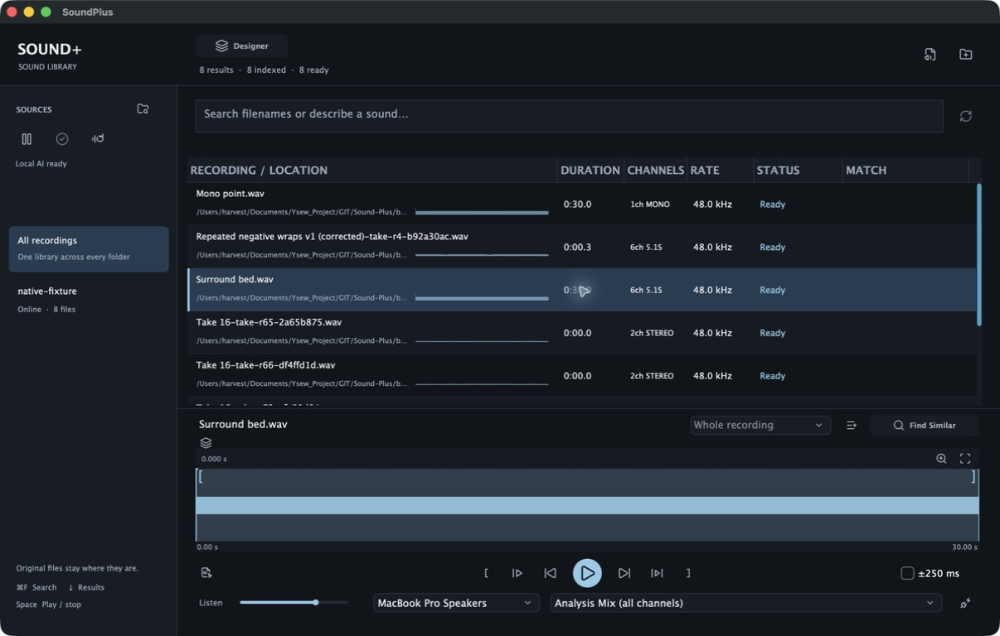
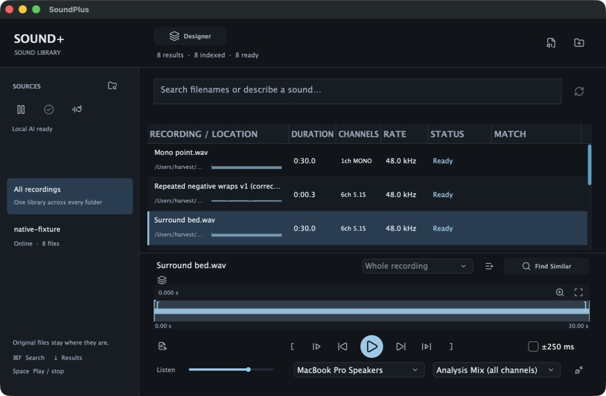
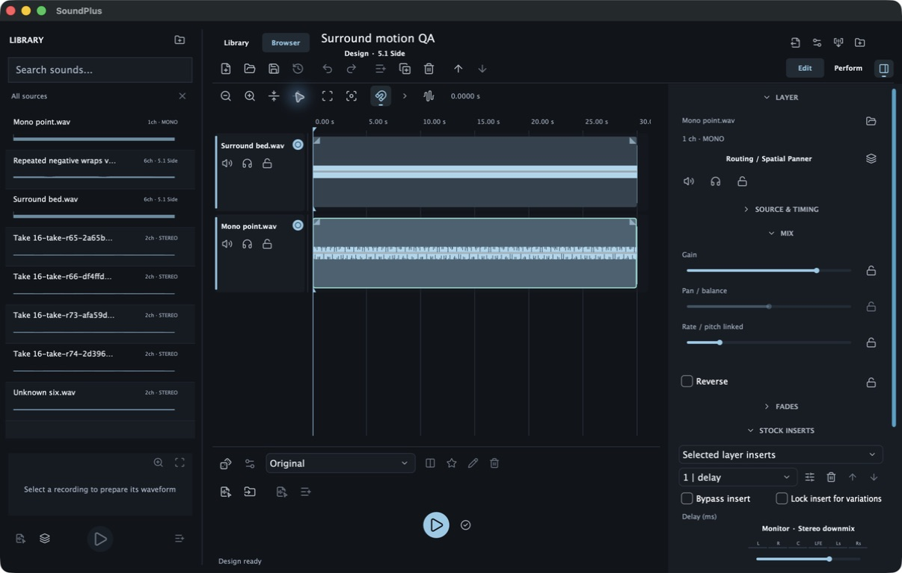
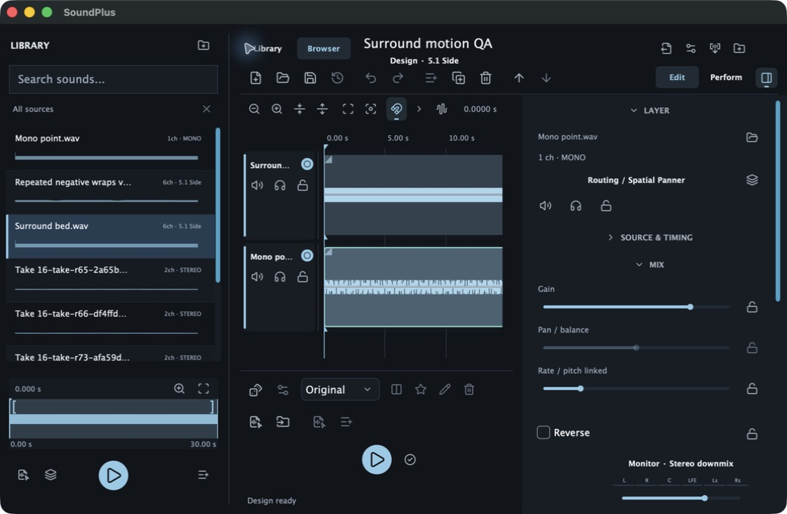

# SoundPlus v1.4.1 — correction closure and verification

R11–R17 are fixed. The final native build passed **22/22 CTest suites in 98.05 seconds**, focused regressions, actual macOS workflows and a 45-second indexing/search/waveform/audio pressure run. The latest actual **Rain glass design r9731** is reopened with its original identity, kept variation and settings. No Source Pools feature or Resolve automation was added; nothing was pushed.

Starting HEAD was exactly reviewed `6364dfdeda2a60388b7fd6c1cc52a726be69a5c4`; there were no later source changes to reconcile or pre-existing working changes. The pasted user request defines scope; the ZIP review, correction brief and audit were read as supporting references. AGENTS, architecture requirements, the v1.4 contract/report and applicable source were inspected first. The live [checklist](MULTICHANNEL_V1_4_1_CHECKLIST.md) and [compatibility contract](MULTICHANNEL_V1_4_1.md) record the decisions.

## Exact candidate and hardware

Compiled source: **`1b48b12e1ca35afb1ae9501d701ed9ef9994620e`**. Later delivery commits contain documentation, evidence and the independent Python auditor. [Artifact identities](verification/multichannel-v141/artifact-identity.json), the [archive manifest](verification/multichannel-v141/artifact-manifest.json) and [source-file digests](verification/multichannel-v141/compiled-source-files.json) identify the tested code.

- App SHA-256: `48a9705dcc485c66c55c5df2a19ca1f1b1b51e2fcf90f5e949f438ad89f3eea4`.
- Audio helper SHA-256: `d4b0b2ee62f37aa99c95aca29b31a810765212d8caadc465f52082b6d34d8cf7`.
- Tests SHA-256: `5904ab6cc5d7e242fc29ac501f1c95524f0c8d3d636506b3aa399106ea7e7f4f`.
- MacBook Pro, Apple M5 Pro, 48 GiB, arm64; macOS **26.3.2 / 25D2150**; built-in Retina 2× display; MacBook Pro Speakers, **48 kHz / 512 frames**. No physical surround device, alternate display scale or physical unplug qualification is claimed.

## Finding closure

| Finding | Status and resulting behavior | Source and actual evidence |
|---|---|---|
| **R11** | **Fixed.** Delete removes its output preference in the same Undo transaction; receipts/files survive. Edit/save/load agree on Live/current-take keys and current-takes+1 bounds. Bounded old dangling metadata is pruned without deleting content. Recording's temporary graph also clears preferences when it strips take contexts. | [Delete](../src/DesignTakeSession.cpp#L268), [load/validation](../src/DesignModel.cpp#L353), [temporary record graph](../src/AudioPlaybackService.cpp#L138). Controlled sequence: 23 lifetime IDs, ≤16 current takes, explicit preferences plus Live, Delete/Undo/Redo, autosave/save/reopen and failed-write protection. Actual session/helper capture at the preference limit reaches Ready, renders and saves 17 preferences. Native UI performed two successful replacement captures with explicit output churn; r76 retains 16 complete takes, 17 preferences and 28 durable receipts after full application restart. Fixture history is generated/cloned; this does not claim 23 separate hardware recordings. |
| **R12** | **Fixed with explicit compatibility dispatch.** New Live processing/new takes use routing v2 / `stock-layout-takes-v2`. Old frozen v1 recipes keep their original PCM and hashes. Corrected-copy creates another ID/recipe, preserves motion and original outputs, and records lineage. | [Panner](../src/ChannelLayout.cpp#L283), [copy action](../src/DesignTakeSession.cpp#L286), [versioned recipe](../src/PerformTake.cpp#L290). Literal-speaker periodicity/energy/LFE/boundary tests, many revolutions, mono/stereo/divergence, real parameter adoption, controlled capture and actual helper capture/replay/render. Mandatory pre-repair fixture preserves its exact WAV SHA and silent final window. Native UI created/rendered a corrected copy with no inherited Ready output. Independent PCM results below. |
| **R13** | **Fixed.** Construction/reselection loads the selected route; implicit and absent routes show effective coefficients or zero/muted. Inspection is a no-op. One-field edits preserve full unedited trim precision. Drafts survive unrelated refreshes but cannot cross layer/document/model-route changes. | [Binding and refresh](../src/DesignerLayouts.cpp#L179). Actual production panel callbacks check two distinct routes, precision, implicit/absent routes, draft/context changes, Undo/Redo/reopen and resulting PCM. Native mute-only edit retained −6 dB/inversion; reopening and Undo showed the correct state. |
| **R14** | **Fixed.** Unverified changed size/mtime/inode advances revision and invalidates catalog interpretation, including same-count replacement; newly detected layout is the safe fallback. Metadata/override writes guard the source identity/revision/stamp. Existing frozen layer/take interpretations are untouched. | [Discovery](../src/Catalog.cpp#L386), [metadata](../src/Catalog.cpp#L541). Actual background service: 6→2, 2→6, changed same-count content, unchanged reopen/rescan, rename, hash-verified same-inode relocation, stale queued override and historical incompatible metadata. Actual Add/graph/audition succeed. Native six-channel override → stereo replacement retained asset ID, advanced revision2→3, removed override, auditioned and added to Designer. This policy does not claim cryptographic recognition of arbitrary cross-volume catalog copies. |
| **R15** | **Fixed.** Mode changes reuse the actual audition owner's path, range, revision/stamp and override, guarded by playback intent generation. Candidate changes cannot reinterpret a reference or steal another context. Pending changes preserve their requested seek. | [Mode handler](../src/LibraryView.cpp#L410), [matching interpretation update](../src/LibraryView.cpp#L1683). Actual callbacks/native helper adoption plus independent pair/mean/layout PCM; empty/same-size/differently sized candidate overrides; matching/stale source revisions; pending, stopped and protected Designer intents. Native unknown-six reference with 5.1 Rear override continued through Analysis/Pair/Layout with a mono candidate selected; stopped changes stayed stopped. |
| **R16** | **Fixed.** Legacy conversion preserves physical pairs and odd final channels. Analysis Mix explicitly averages every physical input into one Mono voice before effects/routing; up to64 source channels remain distinct from the ≤16-channel DSP bus. Whole-mix conversion commits only after validation. New complete-source Library Add remains complete. | [Conversion](../src/LayoutDesign.cpp#L36), [mean sampling](../src/DesignAudio.cpp#L346), [routing contract](../src/ChannelLayout.cpp#L393). 66 pair/mean/metadata/output combinations across1/2/3/4/5/6/16/63/64 channels, independent PCM, anti-phase cancellation, transactional rejection, Undo/save/reopen and unchanged historical takes/receipts. Maximum oracle error **1.48e−9**. Native conversion showed source3/4 and all-channel mean, Undo/Redo, save and reopen. |
| **R17** | **Fixed.** Split settings, complete set membership and explicit finalized-output identity persist independently of legacy DSP. A missing selected member makes the set unavailable instead of substituting another output. Print uses its multichannel Mix master. | [Serialization/validation](../src/DesignModel.cpp#L199), [publication](../src/DesignAudio.cpp#L1109), [selection](../src/DesignTakeSession.cpp#L182). Mandatory historical fixture and actual render-panel callbacks cover split/interleaved/Mono, every member role/path/hash, explicit older output, save/reopen, Undo/Redo, missing member and Print PCM. Native legacy Stereo split render, explicit newer-set selection/reopen and Print/Undo/Redo passed; both stems and the printed master remain present. |

Named regressions are in [MultichannelCorrectionsTests.cpp](../tests/MultichannelCorrectionsTests.cpp). The large assertion count includes per-sample comparisons; it is not a count of independent scenarios. R5–R10 guards remain, including capture ownership, immutable replay and old render/hash behavior; their existing suites pass.

## Compatibility and PCM

The [policy was written before changing panner DSP](MULTICHANNEL_V1_4_1.md). Document v6 / `stock-layout-v2` gates new metadata and processing; private helper IPC is7. Empty-layout legacy stereo serialization/DSP remains unchanged. Editable layout-aware v1 mixes migrate on adoption with retained dirty recovery; frozen takes do not. Source identity and UI metadata never replace a frozen processing version. Legacy mean conversion is an explicit v2 field, absent from old recipes.

The committed pre-repair fixture at `verification/multichannel-v141-spatial-v1*` contains the reachable eleven-target sequence, applied1200 frames apart. Its original WAV SHA-256 remains `83aa8ed02bb3f76e616be61beed5406986f1f8936d2f5ae655db485870277b12`; its last512 frames are zero under v1. This documents the old behavior rather than hiding it.

Fresh final-source helper recording applied the same eleven targets with each settled beyond10ms. The [independent Python audit](verification/multichannel-v141/independent-pcm-audit.json) checks **39,936 consumed frames × six channels**, replay and actual rendered WAV:

| Check | Actual result |
|---|---:|
| Native capture vs native immutable replay, maximum sample error | **0.0** |
| Native capture vs finalized float WAV, maximum sample error | **0.0** |
| Settled per-channel literal-speaker oracle, maximum error | **6.53e−9** |
| Steady full-range energy / LFE | 0.04 for0.2 input / exactly zero LFE |
| Native UI corrected-copy final-window oracle error | **5.12e−9** |

[Raw capture](verification/multichannel-v141/R12-nativeRaw.gz), [raw replay](verification/multichannel-v141/R12-nativeReplayRaw.gz), [render](verification/multichannel-v141/R12-native-render.wav.gz), [source document](verification/multichannel-v141/R12-nativeDocument.gz), event/recipe identities and individual settled windows are retained. These are pre-monitor digital PCM comparisons. They do not establish physical speaker assignment or human listening. Capture frame counts depend on callback/status timing; historical35,328-frame and preliminary46,080-frame records are not this final run.

Ordinary Live seek retains the existing **250ms bounded history** approximation. **Accurate audition** reconstructs from timeline zero and plays from the parked head. Audible scrub remains a forward120ms grain with50ms warmup and5ms ramps, including backward pointer movement. The existing impulse/delay comparison and transport suites passed; these policies were preserved, not redesigned. See [the detailed history policy](DESIGNER_V1_1_1.md#effect-history-policy-and-accurate-audition).

## Complete-suite and pressure evidence

[Final full log](verification/multichannel-v141/ctest-full.log): **22/22, 98.05s**, including all21 existing suites plus corrections. [Native-limit focused log](verification/multichannel-v141/R11-native-targeted.log): corrections, take integrity, capture lifecycle and recorded takes passed after the additional worker correction. [Build log](verification/multichannel-v141/build-R11-native.log).

Final pressure: a fresh process/catalog copied from owned warm derivatives, 10,000 actual WAVs /1,253,073,116 bytes, 45.007s active, 48kHz/512, 5.1 Side, eight layers, continuous performance edits, background inference/indexing, visible per-channel details, two incoming batches and simulated offline/reconnect. OS file cache is uncontrolled.3314 headers are one-time metadata enrichment; this is not an unchanged steady-state reopen measurement.

| Measurement | Final run |
|---|---:|
| Query→paint p50 / p95 / p99, ms (30 observations) | 5.54 /12.52 /16.39 |
| Selected waveform p50 / p95 / p99, ms (30) | 23.74 /49.80 /52.95 |
| Whole viewport p50 / p95 / p99, ms (30) | 166.46 /195.07 /208.28 |
| Producer maximum / graph preparations, first→final status | 2.14ms /1→1 |
| Underruns / helper restarts | **0 /0** |
| Nonzero / total pre-monitor status observations | **16,046 /16,048** |
| UI / audio / AI peak RSS, bytes | 200,556,544 /56,999,936 /461,848,576 |
| Retained waveform peak arrays / full entries / geometries | 686,712 bytes /48 /96 |

[Summary](verification/multichannel-v141/pressure-final-summary.json), [raw native report](verification/multichannel-v141/pressure-final-native.json.gz), [plan](verification/multichannel-v141/pressure-final-plan.json). Percentiles use nearest-rank; peak-array accounting excludes geometry/container/process overhead. Repeated status observations are not independent audio samples. The report's nested `audioAtStop` is null; final audio measurements above use the top-level final audio status, not that null field.

**Two below-threshold observations remain unlocalized** because the benchmark did not retain their individual timestamps/PCM. They are not diagnosed or dismissed as initial status, silence or audible dropouts. The baseline's six untimestamped observations remain independently unexplained. Corrected panning and the bounded native capture do not establish the cause of either pressure observation set.

Native testing exposed the additional R11 temporary-graph failure after the first full pass. The failure was retained, the projection corrected, and a real session/helper regression added. All22 suites and pressure were then rerun against the final helper. A wide-input UI regression during development was also corrected before the final run. An attempted late pressure screenshot bound to an extra empty default instance after the benchmark exited; it was excluded. It is not used as pressure evidence.

## Native interface and workflow evidence

Native CUA used generated fixtures and `build/multichannel-v141/native-catalog`, separate from the user's catalog. [Action log](verification/multichannel-v141/native-events.json.gz) and [saved-document/receipt/source audit](verification/multichannel-v141/native-workflow-audit.json) retain the actual results. Normal and supported **1040×680 minimum** windows were inspected on Retina2×. Browser and Inspector remained visible in Edit; toolbar, track buttons, routing popup, transport, output controls and keyboard focus remained usable. Timeline zoom is preserved on resize; Fit Design is available. No UI redesign or future decorative controls were introduced.

The Library retains top search and compact metadata/overview waveforms; Designer keeps the browser alongside the canvas, with detailed routing/effects in contextual panels. The shared Lucide, cached vector, subdued theme, selection and10-point pinned fade-corner language is preserved.






Additional images: [reference with a different candidate](verification/multichannel-v141/library-reference-normal.jpg), [route editors](verification/multichannel-v141/route-minimum.jpg), [converted arithmetic mean](verification/multichannel-v141/legacy-mean-routing.jpg), [legacy selected split set](verification/multichannel-v141/legacy-split-minimum.jpg). These earlier UI images share the same final app executable SHA; the subsequent correction affected the audio helper's temporary record document.

## Preserved user state and qualification limits

[Final preservation audit](verification/multichannel-v141/working-final-audit.json): actual document ID `f079cfb5d0bd4d3db119805d64b35d0a`, **r9731**, document/settings hashes unchanged, all43 catalog asset IDs unchanged, and all six protected source/render hashes unchanged. The real app is left open on **Rain glass design**, **Kept: Rain glass - kept B**, Blend off, X0.321/Y0.218, four disabled macros at0.5, monitor0.70, Perform workspace, AI enabled. No old QA snapshot was restored over working edits.

| Qualification | Status |
|---|---|
| Local Library/Designer corrections, save/recovery, native playback and generated PCM | **Passed**, at the tested hardware/settings above |
| Native SoundPlus→Resolve drag: original, full design, Render Selection | **Blocked/unverified**: a correctly targeted native receiver drop and subsequent acceptance/persistence have not been established through the available app-scoped drag control |
| Resolve API import/placement/save/reopen | Historical v1.4 evidence only; separate from native drag and not repeated here |
| Physical surround mapping / physical unplug / human listening | **Unverified**, separate acceptance items |
| Broader admission-ceiling combinations, alternate display scaling, distribution signing | Not qualified by this patch |

No new receiver rejection is asserted and drag implementation was not changed speculatively. To finish native Resolve qualification, use the throwaway v1.4 QA project and finalized source paths in the [delivery case record](verification/multichannel-v14/delivery-cases.json). Physically drag each original/full-render/primary-layer Selection output from its SoundPlus control onto a confirmed Resolve Media Pool target; distinguish failure to initiate, rejected drop and later persistence failure. Verify an actual media item, filename/duration/rate/channels/expected PCM, place it on the matching audio track, save, quit SoundPlus, close/reopen the receiving project, and confirm Online media plus whether it references or copies the source. Prior API evidence used Resolve Studio21.1.2.10 and source references; it does not qualify that gesture. Retain all original files and durable renders.

Incremental architecture coverage: **LIB-03/04/05**, **DSP-01/02/03/04** and **EXP-01/02/03**, for metadata/identity/persistence, selected stock/routing/sample-timing/callback contracts and durable WAV delivery. This does not claim every clause: independent pitch/time, additional effects, AIFF design rendering, hosted plugins/latency compensation and Resolve placement remain outside scope. Source Pools remains [v1.5](SOURCE_POOLS_NEXT.md), based on the corrected source/routing/processing/persistence contracts.

## Build, launch and repeat

From this checkout, quit SoundPlus and its bundle helpers before rebuilding:

```sh
cd /Users/harvest/Documents/Ysew_Project/GIT/Sound-Plus
# For a fresh checkout only:
./scripts/bootstrap.sh
.tools/cmake/data/bin/cmake -S . -B build -G Ninja \
  -DCMAKE_MAKE_PROGRAM="$PWD/.tools/bin/ninja" \
  -DCMAKE_BUILD_TYPE=Release -DCMAKE_OSX_ARCHITECTURES=arm64 \
  -DCMAKE_OSX_DEPLOYMENT_TARGET=12.0
.tools/cmake/data/bin/cmake --build build --parallel 6
.tools/cmake/data/bin/ctest --test-dir build --output-on-failure
# This user's current catalog/session:
"$PWD/build/SoundPlus_artefacts/Release/SoundPlus.app/Contents/MacOS/SoundPlus" \
  --data-dir "$PWD/build/gain-hover-native"
# Normal default catalog, on a fresh setup:
open "$PWD/build/SoundPlus_artefacts/Release/SoundPlus.app"
```

Run the independent audit against portable committed PCM, without the original absolute build paths:

```sh
python3 scripts/audit_multichannel_v141.py \
  docs/verification/multichannel-v141/corrections-results.json \
  build/multichannel-v141-portable-audit.json \
  --archive docs/verification/multichannel-v141
```

Five minutes with your own sound library, in a separate new QA design:

1. **Minute1:** Add a folder; search before scanning finishes. Select/play a recording, change search and selection during playback, then stop and change selection. Only active playback should follow selection.
2. **Minute2:** Add a mono/stereo or known multichannel recording to Designer. Open Routing, set trim/inversion, apply, then change only Mute. Close/reopen and Undo/Redo; trim/inversion should stay correct. Inspect another input/output without creating unity routes.
3. **Minute3:** For an existing legacy QA layer, choose a non-first physical pair or Analysis Mix, then deliberately choose a Design layout. Routing should retain the pair, or show Mono/all-channel mean. Undo restores the legacy mix. In Library, pin a multichannel reference, select another candidate and switch audition modes while the reference plays.
4. **Minute4:** Record a short take. Render Stereo Split, save, render an interleaved alternative, select the older split set and reopen. The selected set and all stems should remain available; Print uses Mix.wav. Delete/Undo/Redo the take and create another; saves continue to work.
5. **Minute5:** Quit/reopen and search immediately. Inspect at minimum size with Browser/Inspector visible. Optional replacement check uses a **copy in the QA folder**: apply a six-channel override, replace that copy with Stereo and rescan. It should keep its catalog identity, use detected Stereo and permit audition/Add; frozen old layers keep their original source-change handling.
