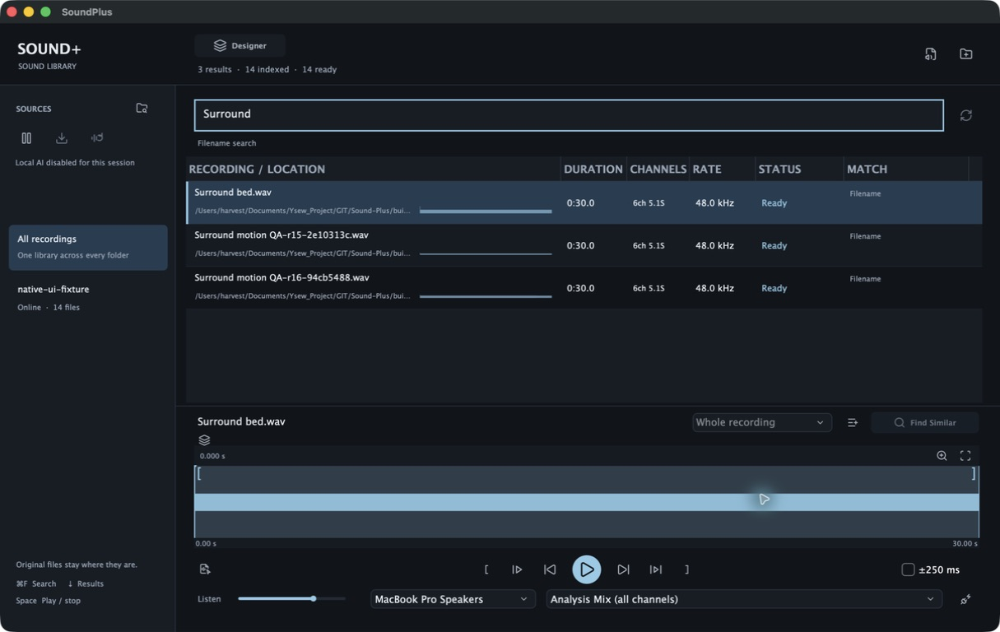
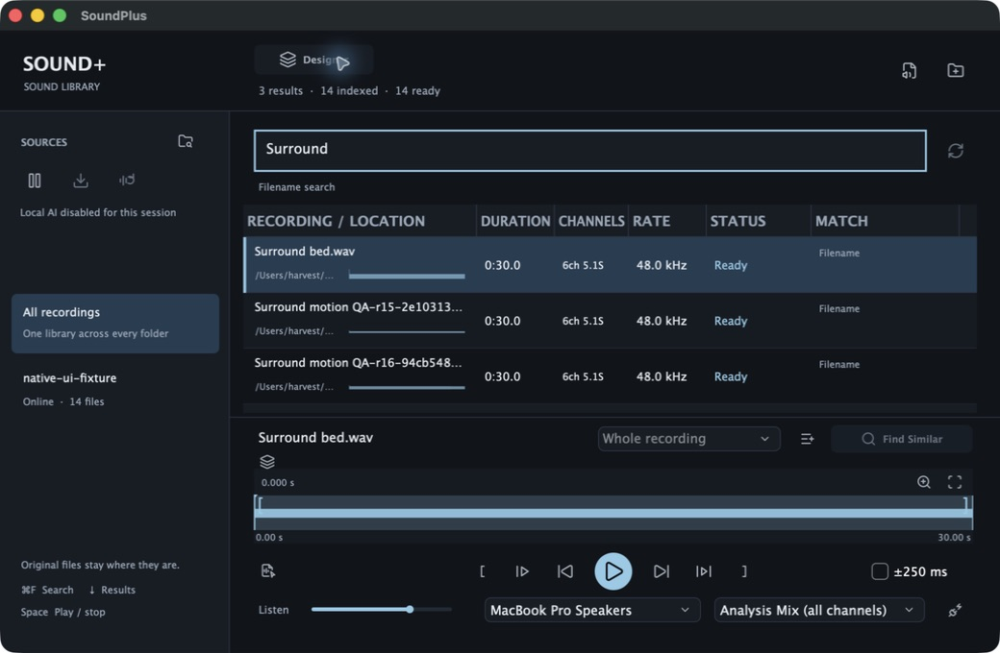
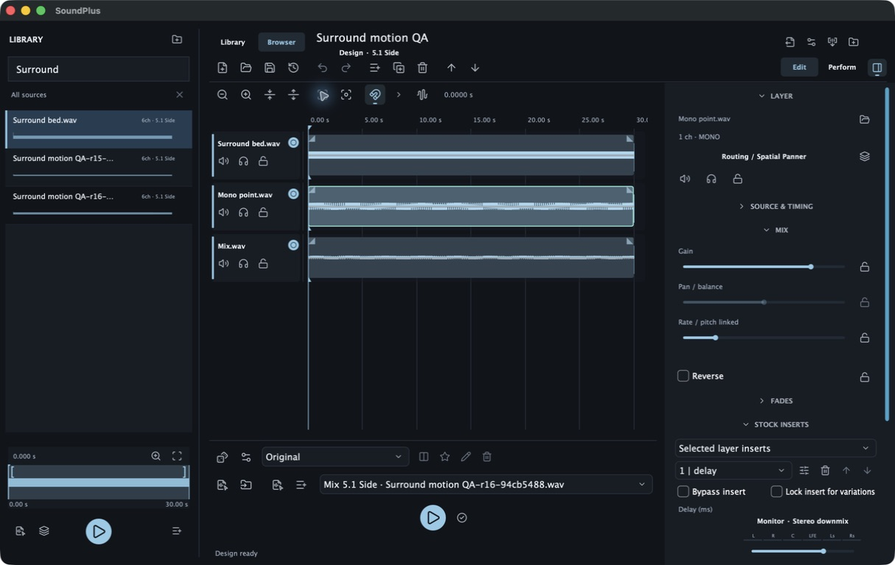
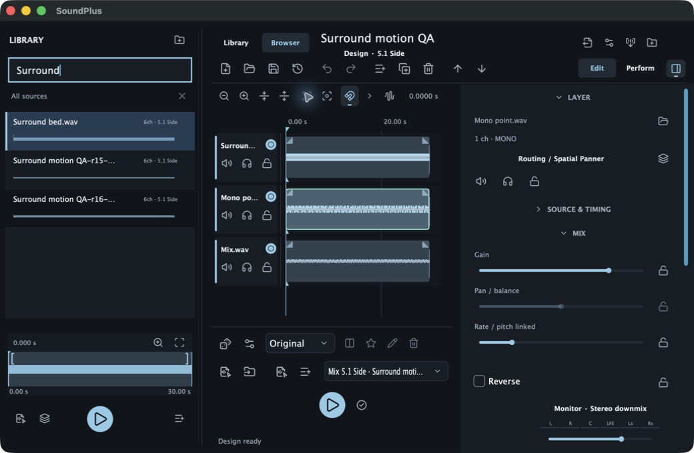
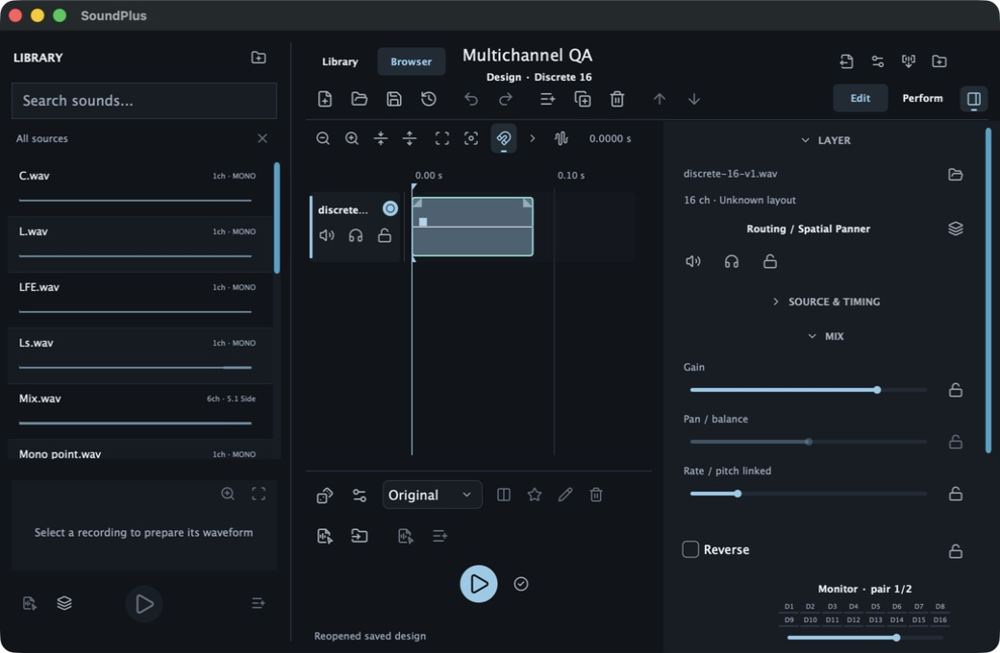
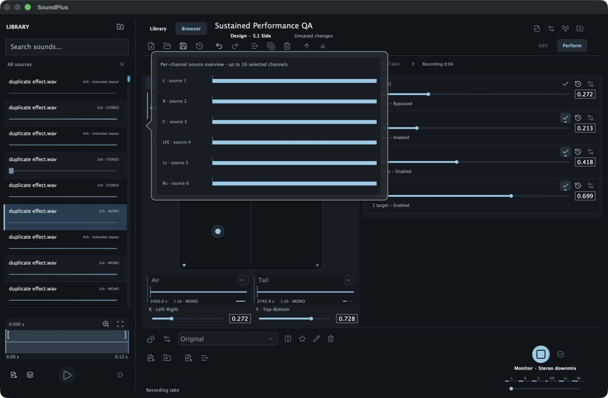
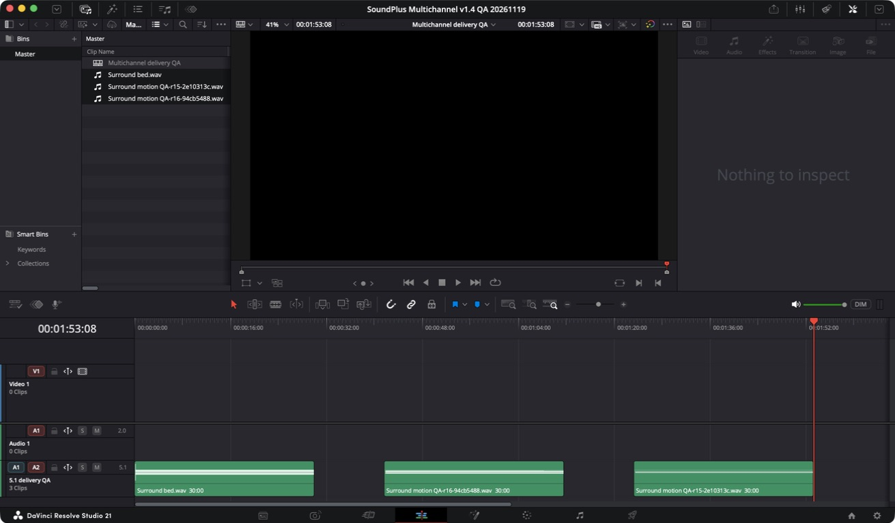
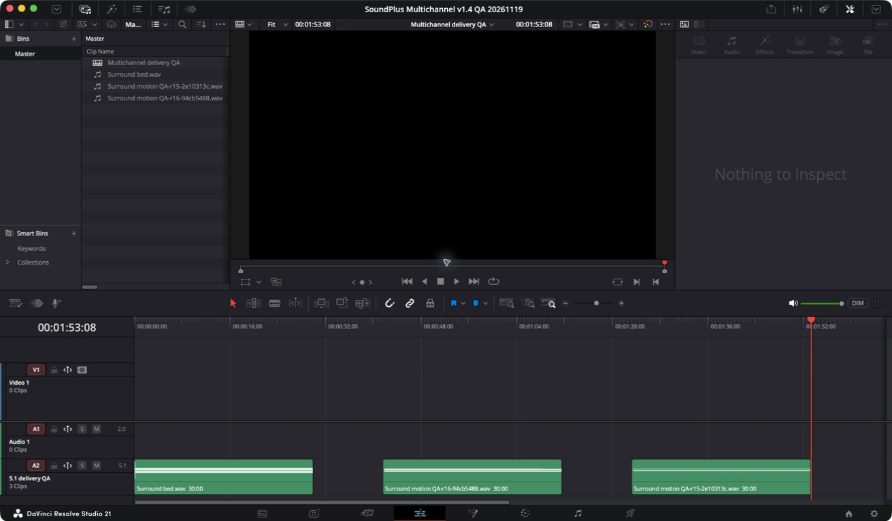

# SoundPlus v1.4 — implementation and qualification

The local Library → layout-aware Designer → spatial performance take → interleaved/split WAV workflow is implemented. Processing/export supports 1–16 ordered channels; source admission remains 1–64 with explicit supported selection above 16. Legacy documents/takes retain their canonical serialization and DSP. **Native drag delivery to Resolve, physical surround monitoring, physical device unplug and human listening remain unqualified.** Resolve API import/placement/save/reopen passed separately.

Scope comes from the attached user request, with the [v1.4 brief](reviews/Codex_v1_4_Multichannel_Designer.md), [review](reviews/Review_3609486_Performance_v1_3_1.md) and [evidence audit](reviews/Review_3609486_Evidence_Audit.json) as reference material. Starting HEAD was exactly `3609486`; R5–R9 guards were preserved. See [workflow, channel order, coefficients, migration and limits](MULTICHANNEL_V1_4.md) for the product contract.

## Commits and implementation references

- `4431786`: required first commit, symmetric R10 active/pending context invalidation and controlled session regressions.
- `25f6e98`: bounded partial IPC writes, Unicode framing and real socket backpressure tests.
- `f200301`: multichannel model, graph, UI, monitor, take/event contracts, WAV outputs and targeted tests.
- `b4fac3d`: historical source PCM regenerated in an owned test directory; mandatory fingerprints and explicit same-byte relink make the compatibility regression independent of old absolute fixture paths.
- `2951a00`: startup recovery reads old catalog schemas safely during the asynchronous writer migration. Exact source/artifact identities are in [artifact.json](verification/multichannel-v14/artifact.json).

| Request section / finding | Closure | Sources and actual verification |
|---|---|---|
| 1 — preserve working data | Done | Catalog SQLite backup, recovery/settings copies and source/render hashes before rebuild; final source/catalog audit and native reopening of the actual latest document. No historical backup replaced newer work. |
| 2 / R10 — context restoration | Fixed | [DesignSession](../src/DesignSession.cpp), [session tests](../tests/DesignSessionTests.cpp), [native helper tests](../tests/MultichannelTests.cpp). Active and held preparation Undo/Redo cover Live↔Take and Take A↔B; stale work cannot play; valid Live↔Live remains. Actual helper ownership is checked with acknowledged generations and nonzero PCM, beyond displayed text. |
| 3 — separate channel contracts | Implemented | [ChannelLayout](../src/ChannelLayout.cpp), [LayoutDesign](../src/LayoutDesign.cpp), [Catalog](../src/Catalog.cpp). Named layouts, discrete identity, mask/order/confidence/override, explicit wide-source pair/window, persisted bus/routes/export and separate monitor mapping. Unknown six-channel input stays unknown. |
| 4 — legacy identity | Verified | [DesignModel](../src/DesignModel.cpp), [PerformTake](../src/PerformTake.cpp). Mandatory committed historical fixture load/save/reopen, deliberate Live conversion, unchanged take/event hashes and byte-identical original WAV; [parity record](verification/multichannel-v14/legacy-parity.json). |
| 5 — generalized audio path | Implemented/tested | [DesignAudio](../src/DesignAudio.cpp), [AudioStream](../src/AudioStream.cpp), [AudioEngine](../src/AudioEngine.cpp), [processor boundary](../src/ProcessorBusContract.h). Named/discrete identity through every stock layer/master effect, resampling, edits, FIFO, peaks and independent WAV reader. No plugin host added. |
| 6 — bed/matrix/spatial/LFE | Implemented/tested | [DesignerLayouts](../src/DesignerLayouts.cpp), [DesignAudio](../src/DesignAudio.cpp). Role beds, explicit trim/polarity/mute matrix, mono/stereo spatial images, wrap smoothing/divergence, LFE off/send/lowpass. Anti-phase, isolated-channel, continuity and typed motion tests. Source Blend keeps its source-weight meaning. |
| 7 — compact UI/waveforms | Verified locally | [ChannelDetails](../src/ChannelDetails.cpp), [WaveformPreview](../src/WaveformPreview.cpp), [LibraryView](../src/LibraryView.cpp), [DesignerView](../src/DesignerView.cpp). Normal/minimum screenshots, labelled 16-channel meters, shared cache identity/budgets/idle tests, keyboard focus and real routing gestures. |
| 8 — independent monitoring | Implemented; physical gate open | Stereo downmix, pair/index assignments, monitor gain/solo and silent unassigned hardware outputs tested without render mutation. Capture lifecycle handlers tested in legacy and six-channel modes. Actual machine has only two speaker outputs; no mapped physical 5.1 or unplug claim. |
| 9 — immutable multichannel takes | Verified locally | [TakeCapture](../src/TakeCapture.cpp), [DesignTakeSession](../src/DesignTakeSession.cpp), [AudioPlaybackService](../src/AudioPlaybackService.cpp). Frozen contracts, shared bounded event capacity, applied-frame motion, structural capture locks, rate-converted replay/tails, cancellation/overflow/stale/failure boundaries and deliberately mismatched Live edits. |
| 10 — durable outputs / receiver | Local output verified; native receiver drag blocked | Interleaved masks/order, linked normalization, independent-channel deterministic dither, clipping/nonfinite checks, RIFF preflight, atomic split sets, receipt selection/reopen, actual primary-layer Render Selection and multichannel Print. Resolve API persistence passed; native drag is not qualified. Details below. |
| 11 — verification/evidence | Done within stated limits | Full 21-suite run, generated unique channel impulses/tones, independent PCM/RIFF audit, real native capture/edit/save/reopen and sustained 10,000-file workload. Raw records and screenshots are committed below. |
| 12 — Source Pools follow-on | Documented | [Source Pools brief](SOURCE_POOLS_NEXT.md) now requires stable resolved IDs/layout/range/mapping and immutable take freezing. Source Pools, plugin hosting, object/Ambisonic and Resolve integration features remain outside this implementation. |

Architecture requirement coverage is incremental: LIB-03 metadata/overrides, LIB-04 incremental persistence, LIB-05 identities, DSP-01 linked edits, DSP-02 gain/filter/delay/reverb and channel validation subset, DSP-03 prepared callback path, DSP-04 sample timing/resampling/monitor separation, EXP-01 WAV/conversion subset and EXP-02/03 render policy/durable files. This does not claim independent pitch/time, dynamics/saturation/aux sends, AIFF design rendering, hosted latency compensation, integration placement or every clause of those broader IDs.

## Qualified operation matrix

Exact role orders are in the workflow document. All named presets are Mono, Stereo, LCR, Quad, 5.0, 5.1 Side, 5.1 Rear and 7.1; LCR WAV order is **L,R,C**. No six-channel count inference is used.

| Channels/layouts | Inputs/edits/routing | Stock effects | Capture/replay/export | Qualified workload |
|---|---|---|---|---|
| All eight named presets; Discrete 6 and 16 | Unique per-channel impulses/tones; identity, trim/slip/placement, reverse, custom fades, linked rate, gain/mute/solo, duplication/variation, relink | Gain, HP/LP, delay and independent linked mono reverb on layer and master; isolated-channel and stacked-rack checks | Interleaved + split role/PCM/hash checks; float/int output; 44.1k conversion, linked normalization, deterministic dither | Short generated offline/controlled fixtures, not simultaneous maximum layers/effects |
| Unknown 6 | Unknown detected order retained; explicit interpretation or reviewed index routing | Same admitted bus contract | Unknown metadata retained separately from chosen interpretation | Actual Library Add/drag and native override/save/reopen |
| Source 64 → supported pair / 16-channel window | New wide layer starts unresolved; last pair 62/63 and physical indices 48–63 tested | Explicit supported subset only | Exact selected physical-channel WAV identity | No silent first-pair truncation; no 64-channel design/export claim |
| Mixed 48k/44.1k/96k mono/stereo/6-channel | Distinct durations, nondefault matrix, linked edits | Layer/master processing | 44.1k rendered channel sum and actual primary-layer selection command | Generated controlled fixture |
| 5.1 Side, 8 layers, 26 total inserts, 7 spatial targets | One 6-channel bed plus seven mono sources, Source Blend/macros/spatial motion | Continuous audible macro targets; graph preparation remains stable | Real 60s take, 45s immutable replay, 180 metadata edits during replay, full render comparison | Measured on the Mac below; not a claim for every admission ceiling combined |

Admission ceilings are 2048 routing cells, 512 channel-insert units, 128MiB estimated delay histories and 256MiB estimated prepared data per graph; 16 spatial targets. They are deterministic preparation limits, not a measured global RSS ceiling. Legacy limits remain. Capture keeps 120s / 8192 events / 16 takes; the expanded preallocated event queue is 3,866,624 bytes. Arming reserves worst-case event JSON space under the 64MiB document limit.

## Automated tests and PCM evidence

The final full CTest run passed **21/21** suites: multichannel, take integrity, capture device lifecycle, recorded takes, library stability, waveform scheduling, audio health, waveform previews, performance state, Designer view commands, icon system, library/audio, selection audition, library performance, semantic integrity, similarity integrity, Designer transport, canvas, session, workflow and fades. Exact timing is in [final-ctest.log](verification/multichannel-v14/final-ctest.log); [build log](verification/multichannel-v14/final-build.log). The large multichannel assertion count includes per-sample checks, not that many independent scenarios.

The multichannel suite independently reads actual RIFF bytes and channel masks. It checks every supplied stock effect on each declared layout at layer and master, plus stacked racks, stateful tails, correlated/anti-phase material, 16-channel output and the 64-channel source boundary. View commands cover routing gestures and Undo/Redo/Escape, wide-window selection, output choices and Render Selection. Capture-device tests invoke actual engine lifecycle handlers and service transitions in **both legacy and six-channel contracts**; they do not physically disconnect hardware.

A native helper capture's consumed-frame prefix, its replay and its offline render compare with maximum error **0 on every channel**. The committed [PCM prefix record](verification/multichannel-v14/native-pcm-prefix.json) identifies the exact frame extent, format, original paths and hashes; matching compressed float32 prefixes are retained. Ahead-produced, unconsumed frames are excluded deliberately. Rate-converted 44.1k and effect-tail comparisons are additional controlled tests.

The sustained pressure outputs are audited separately by [audit_multichannel_outputs.py](../scripts/audit_multichannel_outputs.py). [Its result](verification/multichannel-v14/pressure-release-output-audit.json) verifies published document checksums, output hashes, masks/order and every channel of the common WAV extent after deliberately different Live edits. This proves output reproducibility, not the original physical listening experience. Human listening ratings were not supplied/performed here.

Startup migration correction: native restoration exposed an old-schema read before the writer finished adding layout columns. Read-only Catalog connections now build a backward-compatible projection from actual column availability, retain that valid projection across the migration commit, and reject future schemas. They neither migrate nor block UI/audio. Controlled automatic-recovery tests run first against isolated schema 4 and 5 catalogs, then commit the writer migration and reuse the pre-existing reader. A native copied schema-4 catalog additionally verifies the real startup path. The actual latest user document is preserved throughout.

## Mac pressure measurements

| Measurement | Capture | Replay |
|---|---:|---:|
| Active time (s) | 60.001 | 45.051 |
| UI peak RSS (bytes) | 248020992 | 235732992 |
| Audio peak RSS, whole process (bytes) | 97615872 | 71483392 |
| AI helper peak RSS (bytes) | 459997184 | 459964416 |
| Counted waveform peak-array maximum (bytes) | 765552 | 767616 |
| Full entries / geometries | 48 / 96 | 48 / 96 |
| Graph preparations start → stop | 2 → 2 | 1 → 1 |
| Producer maximum (ms) | 2.303 | 2.364 |
| Underruns / helper restarts | 0 / 0 | 0 / 0 |
| Nonzero / total status observations | 22792 / 22798 | 12790 / 12790 |
| Query → painted results, p50 / p95 / p99 (ms) | 5.45 / 13.09 / 18.53 | 5.88 / 10.23 / 71.40 |
| Selected waveform, p50 / p95 / p99 (ms) | 23.13 / 56.21 / 63.41 | 21.50 / 90.85 / 96.35 |
| Whole waveform viewport, p50 / p95 / p99 (ms) | 177.76 / 203.55 / 206.14 | 196.42 / 225.95 / 249.70 |

The final artifact SHA-256 is `a316d811d4136f4d89b853e1362cc47a1a390005b4b98d4e0e8b9cba2e7303c5`. Capture retained 2316 applied events at a body end of 2881024 frames. Replay performed 180 metadata edits while preserving recipe/event identity. Capture recorded **6 below-threshold peak observations** (`preMonitorPeak ≤ 1e-8`); its initial status had `firstCallbackMs=0`, `acceptedSourceEnd=0` and `takeEnd=0`. This is consistent with initial pre-consumption status, but individual zero-observation timestamps were not logged, so all six cannot be definitively localized. They are retained as observations, not dismissed as proof of silence or declared audible dropouts. Replay had no below-threshold observations.

Raw per-observation reports, plans, summary files, source recipes/events and native logs are under [verification/multichannel-v14](verification/multichannel-v14). Fresh processes use copied warm derivatives/catalogs; OS file cache is uncontrolled. The 10,000 real WAV corpus totals 1,253,073,116 bytes. Each old catalog copy performs 3314 one-time multichannel metadata header enrichments; this is not an unchanged steady-state restart benchmark. Incoming batches and simulated folder offline/reconnect are exercised while inference, search and waveform work continue. The folder simulation is not a physical drive unplug.

Percentiles use nearest-rank over 40 recording and 30 replay observations, recomputed from raw samples. Status checks often observe the same callback state; they are not independent audio samples. Waveform memory reports counted peak arrays, excluding geometry/container/process overhead. The pressure fixture used no display-only summaries, so its reported summary count is zero; separate waveform tests enforce ≤2048 pairs, recovery adoption, global counts and settled-idle behavior. Per-channel details were actually visible during the run, sharing the same global pool.

Development failures were retained rather than converted into passes. A first v1.4 pressure run failed after about 33.8s: a nonblocking IPC write returned EAGAIN despite a healthy recent heartbeat, with no audio underrun. The worker transport now handles partial progress/backpressure with a bounded 250ms timeout; real tiny-socket tests cover complete framing/Unicode and blocked peers. An initial timeout-test setup accidentally used a blocking socket; a process sample identified that test-harness hang, the owned test was terminated and its socket setup corrected. A historical compatibility test initially used a build-relative optional fixture lookup; this was corrected to a mandatory repository-root lookup before the final full run. Historical input PCM is now regenerated in an owned test directory and fingerprint-checked before explicit test-only relinking; old recipe/event hashes are not rewritten. The final native startup check then exposed and closed the catalog migration race described above. These observations do **not** diagnose the earlier historical helper restart or historical zero-peak observations; those remain qualified as unexplained in prior reports.

## Native UI and workflows

The real native app was inspected on Apple Silicon with a Retina 2× display, at a desktop size and the supported **1040×680 minimum**, with Browser and Inspector both visible. Toolbars, track buttons, output selector, routing/settings panels, keyboard focus outline, gain and labelled meters remained usable. The 16-channel meter layout uses two rows of eight. The shared Lucide/theme/fade-corner appearance is retained; advanced matrix/spatial/device/export controls stay contextual.








Library channel badges are compact (`5.1S`, `5.1R`, `DN`, `?`; `*` for override); accessibility and hover details retain full identity/confidence/order. Designer source badges identify interpretation while Design, Monitor and actual finalized Export stay distinct. Dense source views use combined extrema; the disclosure adds labelled channels without permanently crowding the editing canvas.

The [native workflow document](verification/multichannel-v14/native-workflow.soundplus.gz) and [event/receipt/interpretation audit](verification/multichannel-v14/native-workflow-audit.json) retain that generated QA case. Native QA used `build/multichannel-v14/native-catalog` and generated `native-ui-fixture`, separate from the working catalog. Verified actions: known/unknown layout display; playing selection switches audition while stopped selection remains silent; unknown full-layout monitoring rejects ambiguity; explicit 5.1 Rear override persists independently of unknown detection; routing/spatial popup; a real spatial slider drag during recording; Ready/Kept take; actual 5.1 and Stereo take outputs plus atomic split output; preset changes do not relabel old outputs; Print preserves all six channels; Undo/Redo removes/restores that printed layer; actual full Live and primary-layer selection renders; save/quit/reopen retains ready output selection. The manual spatial drag produced one applied motion event before the 30s source ended; continuous motion is covered by the pressure and helper tests, not overstated as a manual listening session.

## Resolve delivery: separate gates

Receiver: **DaVinci Resolve Studio 21.1.2.10**, throwaway project `SoundPlus Multichannel v1.4 QA 20261119`, timeline `Multichannel delivery QA`, track A2 `5.1 delivery QA` (type 5.1). The previous receiving project was saved and restored afterward.

| Delivery case | Finalized source on disk | Native SoundPlus → Resolve drag | Separate API import / placement / save / source-app exit / project reopen |
|---|---|---|---|
| Library complete original | `build/multichannel-v14/native-ui-fixture/Surround bed.wav` | **Blocked / unverified** | **Passed** |
| Designer full Live design | `build/multichannel-v14/native-ui-fixture/Renders/Surround motion QA-r16-94cb5488.wav` | **Blocked / unverified** | **Passed** |
| Designer Render Selection | `build/multichannel-v14/native-ui-fixture/Renders/Surround motion QA-r15-2e10313c.wav` | **Blocked / unverified** | **Passed** |

All paths are relative to `/Users/harvest/Documents/Ysew_Project/GIT/Sound-Plus`. [Source hashes, independent headers and per-channel peaks](verification/multichannel-v14/delivery-cases.json) establish that each file existed/finalized before delivery. All are 30s, 48kHz, six-channel float32 WAV with 5.1 Side mask/order. Render Selection means the **current primary layer**, placement reset to zero and mute/solo cleared, through its layer processing and the master; it is not a time-region crop or multi-selection render. Selection QA routes the mono point into Rs; its nonzero Rs PCM and near-zero/zero remaining channels match that mapping. The full output contains the bed, point and printed multichannel mix.

Two original-file gestures logged native drag initiation/end. The app-scoped automation did not establish a confirmed drop on the Resolve target: its Media Pool and audio tracks remained empty. A same-byte generated fixture copy appeared in the repository's `docs/` folder at the attempted drag time, consistent with a Finder-targeted misdrop; it was moved into owned `build/multichannel-v14/native-drag-misdrop/` instead of being committed. This does **not** establish that Resolve rejected a correctly targeted native drop. The render drag cases were not independently repeated after the shared cross-window gesture path could not be targeted reliably. No speculative drag implementation change was made. [Native drag log](verification/multichannel-v14/native-drag.jsonl).

Additional compatibility testing used Resolve's API to import all three exact source paths and place them on A2. Each actual media item reported Online, 48kHz, 32-bit, six channels and 30s, with embedded mapping `[1,2,3,4,5,6]`, type 5.1. The project was saved, SoundPlus fully quit, the receiving project closed and reopened. All three items remained Online and on the timeline with the same mapping/properties. Resolve **references the original source paths; it did not copy these files**. The QA source/render files are retained durably. See [API import evidence](verification/multichannel-v14/resolve-api-import.json.gz) and [save/reopen result](verification/multichannel-v14/resolve-api-reopen.json). This is not native drag qualification or a human surround listening result.




Manual completion of the native-drag gate:

1. Open the throwaway QA receiving project and expose its Media Pool/5.1 audio track. Use a physical mouse to drag **Drag complete original file** from the Library, then the selected finalized full Mix, then the selected finalized Selection output from Designer. Confirm each ghost/file is over the receiving target before release.
2. For each, verify an actual imported media item, place it on the 5.1 track, and check its exact filename, 30s duration, 48kHz, six channels and mapping. Compare expected bed/full/point-to-Rs content; record listening separately from PCM checks.
3. Save the receiving project, quit SoundPlus, close and reopen that project. Confirm all three remain Online/playable and inspect their file paths. Record copied versus referenced media. Leave sources and durable renders in place.
4. If a case fails, identify whether no native drag started, a correctly targeted drop was rejected, or import succeeded but persistence failed. Do not substitute Finder/internal drops or API import for the native gate.

## Build, launch and repeat

Close all SoundPlus app/helper/test processes before rebuilding the bundle. From this checkout:

```sh
cd /Users/harvest/Documents/Ysew_Project/GIT/Sound-Plus
./scripts/bootstrap.sh
.tools/cmake/data/bin/cmake -S . -B build -G Ninja \
  -DCMAKE_MAKE_PROGRAM="$PWD/.tools/bin/ninja" \
  -DCMAKE_BUILD_TYPE=Release -DCMAKE_OSX_ARCHITECTURES=arm64 \
  -DCMAKE_OSX_DEPLOYMENT_TARGET=12.0
.tools/cmake/data/bin/cmake --build build --parallel 6
.tools/cmake/data/bin/ctest --test-dir build --output-on-failure
open "$PWD/build/SoundPlus_artefacts/Release/SoundPlus.app"
```

To reopen the actual working catalog used in this session (AI enabled), after quitting any existing instance:

```sh
"$PWD/build/SoundPlus_artefacts/Release/SoundPlus.app/Contents/MacOS/SoundPlus" \
  --data-dir "$PWD/build/gain-hover-native"
```

For isolated fixture reproduction, use a fresh directory; do not regenerate over frozen take sources:

```sh
soundplus_mc_fixture=$(mktemp -d "${TMPDIR%/}/soundplus-mc.XXXXXX")
"$PWD/build/SoundPlusTests_artefacts/Release/SoundPlusTests" \
  --prepare-multichannel-ui "$soundplus_mc_fixture"
```

Five-minute test with your own sounds (use a new design; keep your current one saved/recoverable):

1. Add a small representative folder in Library. Search/select a mono, stereo or surround sound. Confirm channel badge/order and per-channel details. Play, select another result to switch, stop, and select again to confirm silence while stopped.
2. Open Designer, create a new design and add the source. A named surround bed in an empty new design adopts its layout; otherwise choose Design → 5.1 Side deliberately. Keep Monitor → Stereo downmix on a two-output Mac.
3. Select a mono layer, open Routing / Spatial Panner, enable Spatial Panner and move azimuth. Try a fade/rate edit and Undo/Redo. Keep LFE send off unless intentionally testing it. Unknown/wide sources require explicit interpretation/selection.
4. Perform → record a short take, move a captured control, stop and Keep. Change the Live mix, reselect the take and replay; its frozen content must stay stable. Use Accurate audition for long effect-history judgments; live scrubbing is explicitly approximate.
5. Render Same as design, then Stereo, then split mono. Use the finalized-output selector to verify each actual layout; Print the split master and inspect all channels. Save, quit and reopen; check document/take/output identities. Receiving-app native drag qualification requires the longer separate workflow above.

## Remaining qualification limits

Only macOS 26.3.2 / Apple M5 Pro / 48GiB / Retina 2× / built-in stereo speakers at 48kHz and 512 frames was hardware-qualified here. Native 16-channel UI and offline PCM do not qualify a physical 16-output device. No physical 5.1 assignment, physical unplug, alternate display scale, long-term maximum-load soak or human multichannel listening is claimed. RF64 is unqualified; oversized RIFF is rejected before work. Distribution signing/notarization and external plugin hosting remain outside scope.

The actual user session and source preservation result is recorded in [working-session audit](verification/multichannel-v14/working-session-pre-reopen-audit.json) and the [final reopening audit](verification/multichannel-v14/working-session-final-audit.json) / [native accessibility state](verification/multichannel-v14/user-session-reopened-final-ax.txt). Revision 9731, Kept B, Blend off, X0.321/Y0.218, monitor0.70, document/settings bytes, 43 catalog IDs and all protected media/render hashes were retained. No QA snapshot was copied over the working document.
