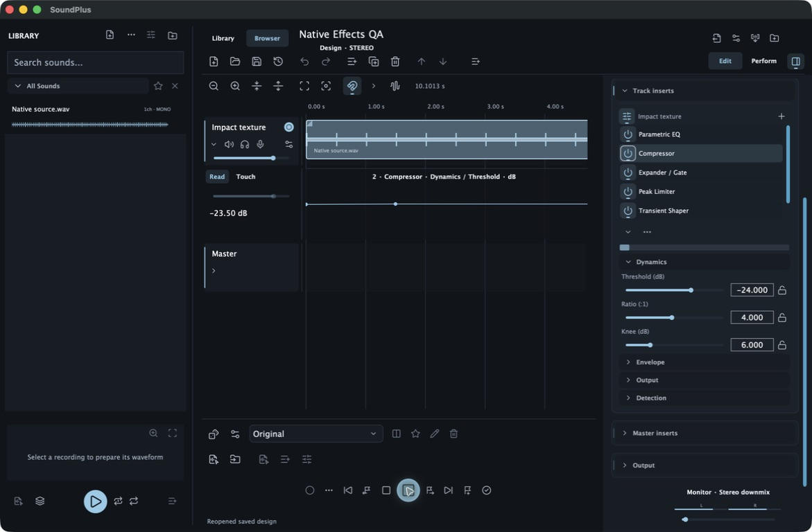
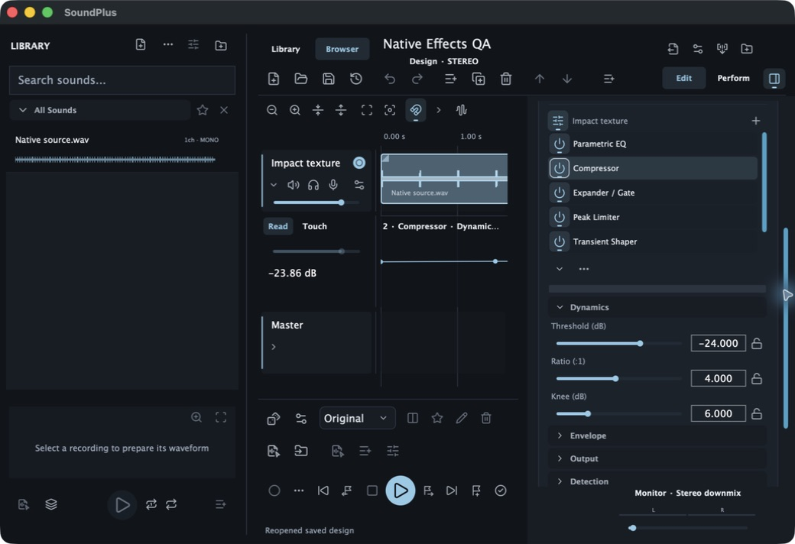
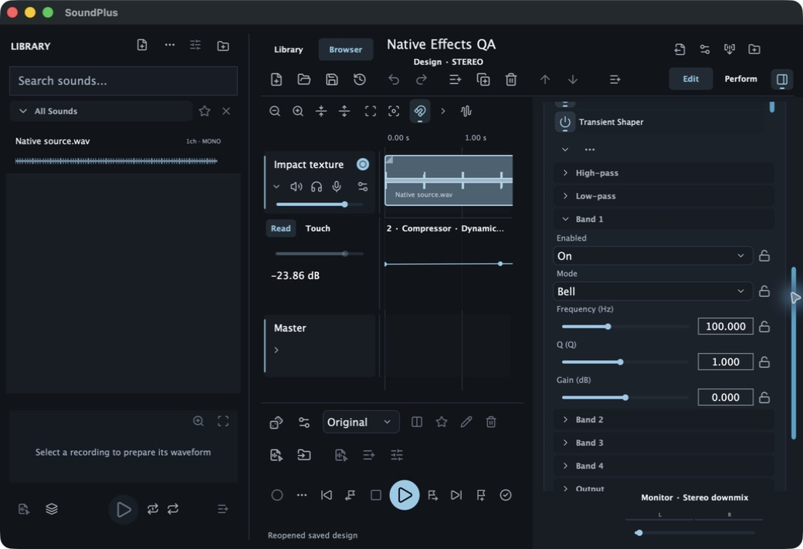
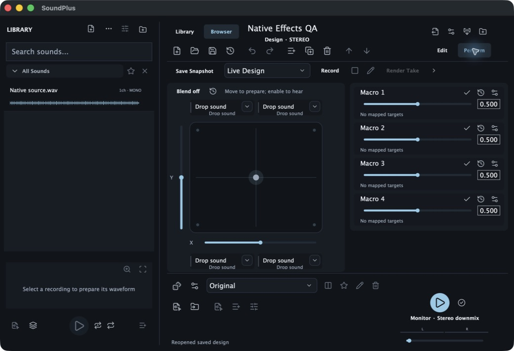

# Professional Native Sound-Design Effects v1

November 22, 2026. Reviewed/start commit:`54ed393caa5fdaa47a399333f20e3833b3181606`; no later commits existed at initial inspection. This report covers the bounded effects increment requested in the accompanying review. Architecture and the old four-slot DSP remain shared with Library, Designer, Perform, recording and the ordered hosted rack.

## Delivered behavior

Six native effects now use versioned definitions, stable keyed parameters and editable metadata presets: four-band Parametric EQ with HP/LP, Compressor, Expander/Gate, fixed-lookahead Peak Limiter, Transient Shaper, and Tanh/cubic Saturation. The existing Inspector renders collapsible parameter groups with numeric entry, units, choices, variation locks and gain-reduction meters. Track, Clip-source, Group and Master keep their ordered stock/hosted inserts.

The existing **one automation lane per track** remains collapsed by default with Volume initially displayed. Its chooser includes the native parameters; selecting a curve changes only the displayed curve. Hidden read-enabled curves still process audio. Lookahead is a deliberate structural/read-only target because changing it rebuilds latency/PDC; other controls use live smoothing and the existing project clock.

Offline collection/Favorite references remain visible, searchable and organizationally editable. Play, Process, Add to Designer and file delivery require current media plus its root to be online. Add to Designer is disabled for offline media rather than creating a placeholder. Cached Find Similar retains its previous eligibility. Needs Review/unresolved regions cannot silently deliver stale audio.

New documents use manifest15 / `native-effects-v1`; new native-containing frozen takes use recipe6 / `native-effects-takes-v1` / explicit fixed-latency policy. Historical manifests1–14, frozen recipes1–5, four-slot parameters/locks, `parameter-0`…`parameter-3`, source IDs and old DSP recipes retain their original meanings. See [processing contract](NATIVE_EFFECTS_CONTRACT.md) for exact algorithms, schemas and limits.

## Staged delivery

| Stage | Pushed commit | Executed qualification |
|---|---|---|
| A availability and versioned foundation | `f2b9fcd` |9/9 targeted suites,50.37s; [log](verification/native-effects/stage-a-tests.log) |
| B EQ | `9f64915` |4/4 targeted suites,6.37s; [log](verification/native-effects/stage-b-tests.log) |
| C dynamics, presets, metering | `f992c9c` |9/9 targeted suites,55.95s; [log](verification/native-effects/stage-c-tests.log), native real-device continuous edit |
| D output-clock correction, bounded controls, native UI and final gate | `4d7d165` |40/40 Release suites389.31s, unchanged313 source/resource files and eight binaries, native UI/device and preservation checks; committed/pushed to origin/main |

## Review closure

Numbers correspond to the 18 implementation/acceptance items in the supplied review.

| ID | Status | Source and actual evidence |
|---|---|---|
|1|Fixed|[Library availability](../src/LibraryView.cpp), [actual collection view tests](../tests/CollectionViewTests.inc): root-offline, media-offline, stale region, callbacks, internal delivery, restored availability; offline membership/IDs retained.|
|2|Implemented/verified|[Native definitions and canonical state](../src/NativeEffects.cpp), [schema tests](../tests/NativeEffectsTests.cpp): typed complete state, transactional errors, future type/version/policy rejection.|
|3|Implemented/verified|[StockEffect adapter](../src/DesignModel.h), [live controls](../src/DesignLive.cpp), [track registry](../src/TrackModel.cpp): old array unchanged, new explicit IDs, duplicate names/order/rekey/locks/session commands and deterministic variation tests.|
|4|Implemented/verified|[Native panel](../src/NativeParameterPanel.h), [rack](../src/StockRackView.h); actual normal and1040×680 native screenshots below. Mix numeric entry displays percent while model remains0–1.|
|5|Implemented/verified|[OrderedRack](../src/OrderedRack.inc), [take policy](../src/PerformTake.cpp): combined native/hosted dry alignment and parallel owner PDC, explicit preparation failure, fixed native latency, recipe6. Device callback remains prepared-PCM consumer.|
|6|Complete|Foundation committed/pushed before new DSP stages; historical compatibility suites included in each stage and final gate.|
|7|Implemented/verified|[EQ DSP](../src/NativeEffectsDSP.cpp): four Bell/Shelf/Notch bands, enabled HP/LP, repeated12/24/36/48dB/oct sections, saved requested frequency and actual-rate Nyquist clamp.|
|8|Verified numerically|[Independent EQ tests](../tests/NativeEqTests.inc): separate JUCE coefficient factory, scalar DF1 impulse and complex response/phase; required rates/blocks, boundaries and rapid sweeps. Maximum measured impulse error9.35295e-8.|
|9|Implemented/verified|[Dynamics DSP](../src/NativeEffectsDSP.cpp), [independent oracles](../tests/NativeDynamicsTests.inc): static/knee and analytic attack/release,20ms RMS step, gate hysteresis/hold, transient fast/slow envelopes, linked/LFE behavior and actual meters.|
|10|Implemented/verified|Future-window sample-peak limiter, fixed prepared lookahead, gain-reduction meter and no hidden gain. Brute-force window oracle, extreme/near-zero/silence tests, exact held ceiling keyframe at project1024 for all required blocks. True-peak is excluded.|
|11|Implemented/verified with stated limit|Tanh/bounded cubic, drive/mix/output and editable [preset metadata](../resources/native-effects-presets.json). Analytic transfer and mode-crossfade tests.1x processing; measured high-drive9kHz→21kHz alias at48k approximately−10.53dBc. No anti-alias claim.|
|12|Implemented/verified|[Native integration](../tests/NativeIntegrationTests.inc), [mixed ordered tests](../tests/OrderedInsertTests.inc): Clip/Track/Group/Master placement, hidden curves, stable timing/locks/seed, MIDI and frozen capture/replay integration.|
|13|Verified within measured scope|Independent oracles at44.1/48/96k and1/32/61/257/512 blocks; accurate seek/fresh start, bounded tails, finite overload, save/reopen and kept-take/export PCM. Direct CPU/RSS and real-device editing evidence below.|
|14|Verified in PCM/files|All named layouts plus discrete4/16, explicit LFE detector policy, distinct5.1 Side/Rear, final WAV physical order/masks, native/hosted parallel PDC and aligned bypass. Physical speaker-room listening remains unqualified.|
|15|Verified|Legacy-v7 fixtures, historical hashes/PCM, source pools, MIDI/microphone, collections and semantic/similarity suites are included in the full Release gate below.|
|16|Native checks passed|Actual Inspector groups/keyboard numeric edit, preset Save/Load, parameter chooser/curve insertion, Undo/Redo, Save/Quit/Reopen r11; Browser+Inspector at1040×680 and1360×860 on Retina2×. Human listening is separate.|
|17|Verified|40/40 Release suites passed in389.31s with vendor/AUv2/device branches.313 source/resource and eight binary hashes match before/after.|
|18|Complete|Original in-place r4478 state, catalog, recording journals and durable media audited against this task's protection copy; roadmap updated. Verified implementation/evidence `4d7d165` pushed to origin/main; this final documentation receipt changes no tested implementation.|

## Native workflow evidence

QA used generated40s48k mono audio and an isolated `build/native-effects/ui-final/data` catalog, not the working catalog. Actual native commands opened `Native Effects QA.soundplus`, changed Compressor threshold to−24dB during playback, saved a `.soundplus-effect`, changed/restored it through native Save/Load preset dialogs, edited one automation curve, used Undo/Redo and saved/reopened revision11. The [saved native workflow proof](verification/native-effects/native/saved-workflow-proof.json) records frames0/72000/1920000 with threshold−24/−23.351351351351354/−24; its stable instance ID and values survived reopening. The native meter updated during playback. JUCE popup menus are absent from this tool's screenshot/AX surface; keyboard selection reached the real file dialogs and resultant files were checked. Popup appearance itself is not claimed visually verified.

The Inspector keeps the existing single outer scroll area. Collapsible groups reveal detailed controls without taking timeline space. Minimum-size Edit gives the Browser330points and retains both the Inspector and transport; long automation names truncate with a tooltip. The current Perform layout and pinned fade corners are preserved. No decorative EQ analyzer or additional pad was introduced.









Corresponding `*-ax.txt` files retain accessible control names/states. Screenshots were captured from the native app, not mockups. A final percent-format-only correction subsequently adds correct0–100% Mix text and removes redundant `Q (Q)` text; its actual Slider formatting/parse regression is in the final native suite and its final native [minimum screenshot](verification/native-effects/native/mix-percent-minimum-final.jpg) and AX snapshot show100.0%.

## Measurements and final gate

Mac hardware: **Apple M5 Pro, macOS26.3.2 build25D2150**, arm64 Release, Apple clang21, SDK26.5. Retina display scale2.0. CoreAudio MacBook Pro Speakers48k/512 is the measured output; no physical multichannel or acoustic latency claim.

Final native continuous run: **453 gesture inputs**, observed edit sequence364 and298 unique heard-edit observations,623616frames advanced, **zero underruns**, same graph epoch/helper. Input-to-prepared-callback timing p50 **56.36ms**, p95 **70.08ms**, max **76.82ms**. Existing coalescing intentionally does not adopt every pointer value; these observations measure prepared-PCM control scheduling, not DAC or human latency. Producer maximum1.042ms; audio helper peak52,510,720bytes and0.961CPU seconds across the run. Concurrent filename searches were dispatched throughout. See [raw run](verification/native-effects/final/native-continuous-edit.json) and [summary](verification/native-effects/final/native-summary.json).

Direct DSP benchmark runs 512 frames /16 channels at each required rate; warm default-state p95 observations span approximately0.040–0.374ms (maximum observed block0.410ms); [final dynamics evidence](verification/native-effects/final/dynamics-evidence.json) records p50/p95/max and native latency per effect. Whole-suite peak RSS is separately identified in [memory evidence](verification/native-effects/final/memory-evidence.json), including test graphs/GUI/source reads; it is not isolated DSP heap. These warm measurements do not certify the128-instance/4096-parameter maximum design on every machine.

Full Release result: **40/40 passed, zero failures,389.31seconds**. All313 source/resource and eight binary identities match after the complete run. [Gate log](verification/native-effects/final/full-gate.log), [before](verification/native-effects/final/release/identity-before.json), [after](verification/native-effects/final/release/identity-after.json). Frozen hashes cover313 source/resource files and eight binaries. No implementation change is allowed between final identity manifests.

Available branches actually exercised Apple **AUDelay1.6.0 AUv2** and **AUMIDISynth**, installed **LV50A1.0.0** and **OldSkoolVerb2.14** mono/stereo Track/Master processing, and retained-editor/inline controls on the real MacBook Pro Speakers48k/512 device. The live hosted observation records598528frames, zero underruns and graphEpoch1. See [AU effect](verification/native-effects/final/processing-au-qualification.json), [AU instrument](verification/native-effects/final/au-instrument-scan.json), [vendor summary](verification/native-effects/final/vendors/summary.json) and [live device](verification/native-effects/final/live-device-observation.json). No physical multichannel controller/loopback is implied.

The gate is invoked with:

```sh
SOUNDPLUS_VENDOR_QUALIFICATION="$PWD/build/native-effects/final-vendors" \
SOUNDPLUS_LIVE_DEVICE_QUALIFICATION=1 SOUNDPLUS_QUALIFY_AU=1 \
caffeinate -i .tools/cmake/data/bin/ctest --test-dir build --output-on-failure
```

A previous full run was deliberately interrupted to fix percentage display before freezing the final candidate; its [partial log](verification/native-effects/final/interrupted-for-percent-ui.log) is not counted as a full pass. The retained [offline fixture attempt](verification/native-effects/final/stage-d-offline-fixture-attempt.log) and [corrected retest](verification/native-effects/final/stage-d-offline-retest.log) record the selected-copy/result-row test mismatch. The earlier [transient oracle attempt](verification/native-effects/stage-c-oracle-attempt-1.log) records the independent oracle's unsigned-negation error. Production tolerances were not weakened for either correction.

## Preservation and limitations

The user's original `build/gain-hover-native` was protected and normally closed before rebuilding. No backup was restored over current data. Before reopening, all63 protected media/output/journal SHA256s and all18 SQLite tables were identical.194/195 session/take/preview files were byte-identical; the remaining active autosave differed only in its `updated` shutdown timestamp, retaining the entire r4478 state. Window preferences persisted normally on initial shutdown. See [audit](verification/native-effects/final/preservation-before-reopen.json). Final native reopen restored **Workflow demonstration r4478**, its unsaved state, Perform/Browser, Blend x0.321/y0.485, enabled Macro1 value0.491, monitor0.25 and its original finalized output path. All18 tables and63 protected file hashes still match after reopening; the same autosave timestamp-only difference remains. See [post-reopen audit](verification/native-effects/final/preservation-after-reopen.json).

Bounded limits: native128 instances /4096 parameters per mix plus existing rack limits; fixed prepared limiter lookahead, no continuous latency automation; sample-peak rather than true-peak limiting;1x saturation with documented aliasing; repeated-Q HP/LP sections rather than an unspecified Butterworth design. Live seek retains the existing approximate pre-roll policy; **Accurate audition** rebuilds from the start for judging history/tails. Native meters report producer state and may lead the device cursor.

Human listening, physical surround/keyboard/DAC loopback, new external receiver/Resolve delivery and signed/notarized release were **not verified** by this increment. Existing source/Resolve paths are retained; that preservation is not a receiver acceptance test. Advanced delay/reverb/creative transforms, hosted parameter automation, multi-pad Perform and external generation remain [roadmap work](NATIVE_EFFECTS_ROADMAP.md).

## Build, launch and five-minute check

Close SoundPlus and its bundle helpers before rebuilding. From this repository:

```sh
.tools/cmake/data/bin/cmake -S . -B build -DCMAKE_BUILD_TYPE=Release -DCMAKE_OSX_ARCHITECTURES=arm64
.tools/cmake/data/bin/cmake --build build --config Release -j 6
open -n "$PWD/build/SoundPlus_artefacts/Release/SoundPlus.app" --args --data-dir "$PWD/build/gain-hover-native"
```

Use an isolated catalog if desired by replacing the last data directory with a new path. Original audio remains referenced in place.

1. Add a sound folder in Library. Select a current recording and add it to a new Designer design. Preserve your existing design by saving it first.
2. Select its Audio Track, open Track inserts and add Parametric EQ. Expand Band1; enter a frequency/gain and choose Bell/Shelf/Notch. Bypass and compare. Add Compressor and Peak Limiter; inspect gain reduction while playing.
3. Expand the track's **single** automation lane. Choose an EQ or Compressor parameter and insert two points. Select another displayed curve: the previous read-enabled curve keeps playing. Lookahead is labelled structural/read-only.
4. Use Effect actions to save/load a `.soundplus-effect`, adjust a control, Undo/Redo, save the design, quit and reopen. Confirm state/curve/preset values. Render with normalization disabled to evaluate actual gain; monitor volume does not alter the export.
5. In Library Favorites or a collection, disconnect the source drive or temporarily make only your test folder unavailable. Its rows/membership remain, while Play/Process/Add are unavailable. Reconnect and refresh. Do not move or rename production files merely for this check. Listen to the result yourself; this human review is independent from the retained PCM tests.
