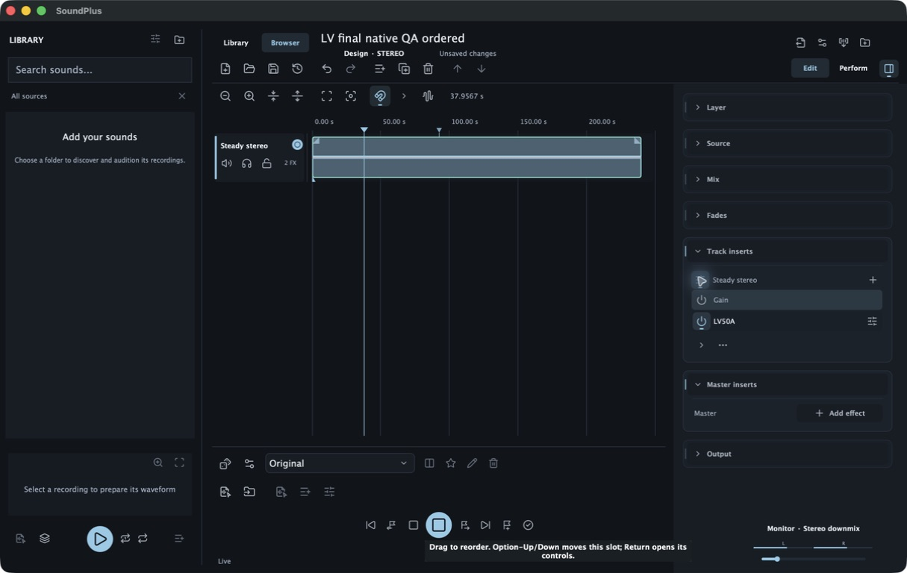
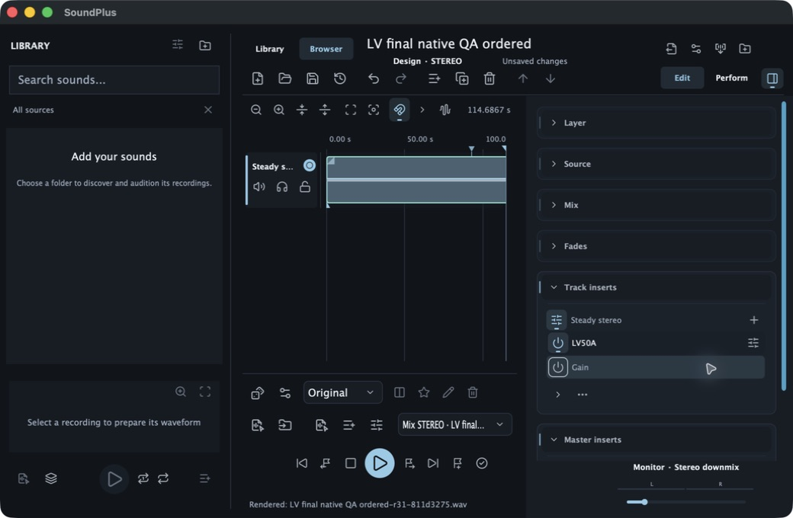
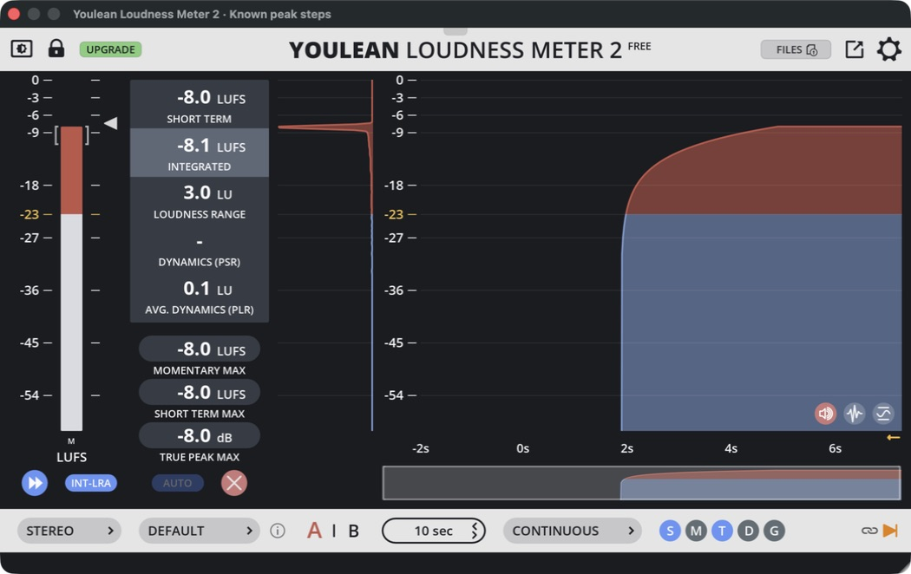
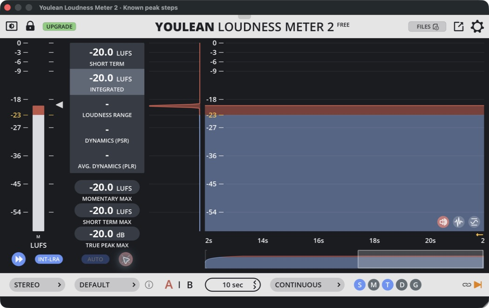
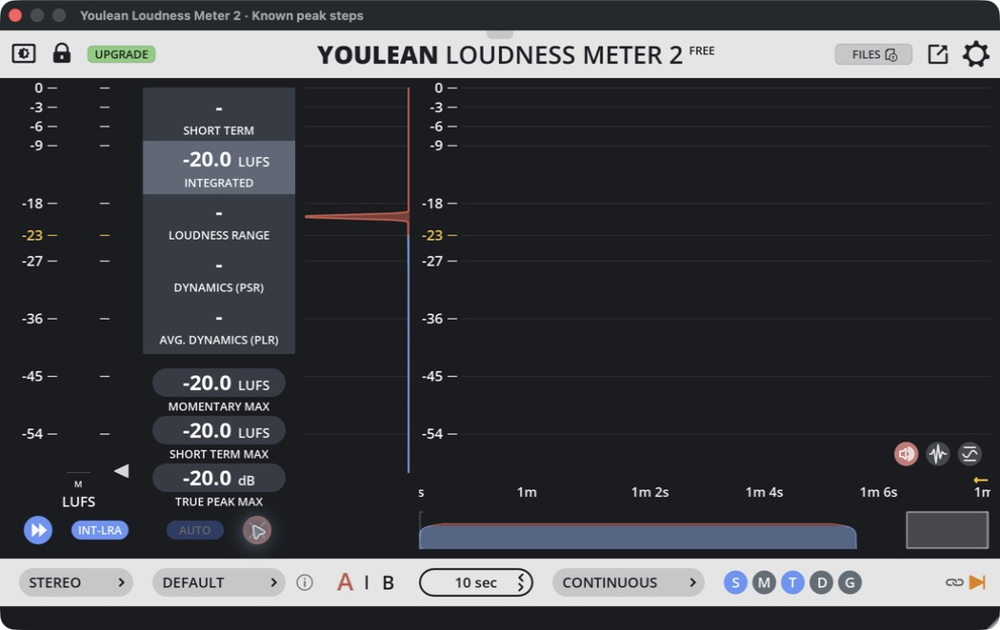
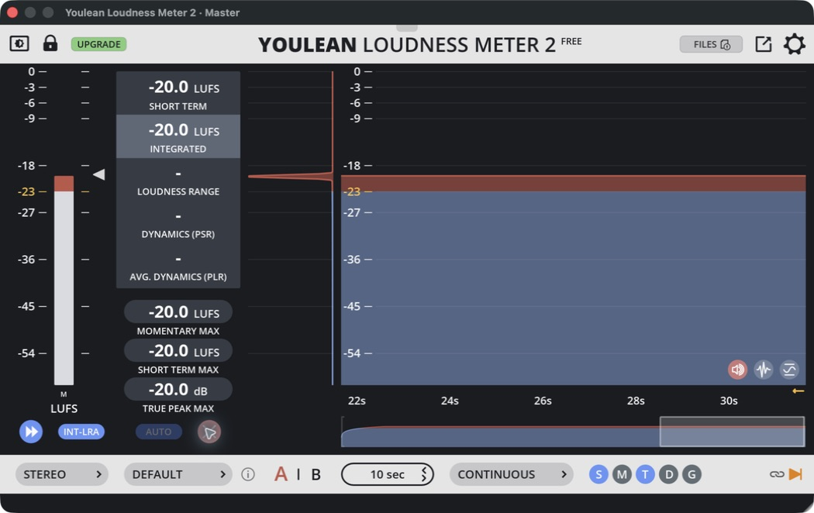
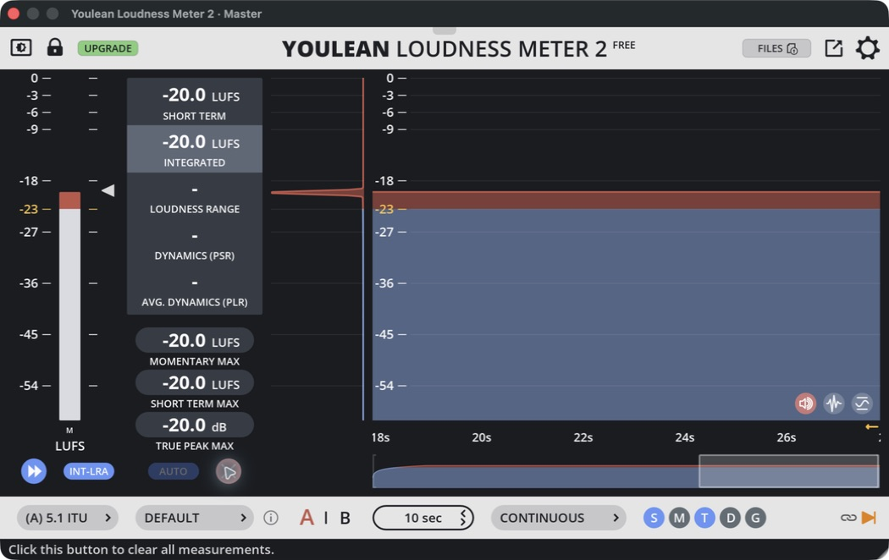

# Ordered inserts and nondestructive chain bypass

Starting HEAD `277359060ddda81ce11d61fb4f5a1e4db21c0d58`. Stage A correction checkpoint `5b81430` was committed only after its required full 30-suite gate passed. Stage B preserves the shared JUCE/native/session architecture, Lucide/theme system, editing gestures, Library and exact routing roles.

## Closure

| Item | Status | Source and evidence |
|---|---|---|
| A1 equal-value newer intents | Fixed | `newerHostedIntents` in HostedRack.h; LiveInsertSession dispatch and HostedRack client gate; actual held-publication session and direct-client regressions in PluginIntentReturnTests.inc. Main .4 → native .25 → Main .5 retains .5 through capture/ACK/Save/fresh PCM. Restore/program origins independent. |
| A2 accepted output requests | Fixed | DesignSession startOutput reports explicit busy/cancelled results rather than silently losing a request. Held capture + held first output worker regression covers two owners, copy, context, cancellation and failure. A second output is visibly rejected; no output FIFO is promised. |
| A3 registry coverage/presence | Fixed | Coverage-scoped deletion and maximum old/incoming/current presence in PluginProcessing.cpp. Actual paused async custom-root scans, both completion orders, independent writers, legacy clocks, Retry/cancel/deletion regressions. |
| B1 canonical model/migration | Implemented and tested | InsertChain.cpp, DesignModel.cpp/h; one typed stable-ID order, inline versioned persistence, all sixteen legacy slots retained. Legacy stock then hosted order and group bypass preserved. No second editable order. See migration contract. |
| B2 actual ordered DSP | Implemented and tested | OrderedRack.inc, DesignAudio.cpp, DesignLive.cpp; noncommutative affine PCM oracle across eight exact layouts. Track before routing, Master before master gain, summed hosted latency, explicit failure/cancel, source-independent service identity. |
| B3 whole-chain bypass | Implemented and tested | Separate owner flag, aligned dry ring, 10 ms live crossfade, wet history evolves while bypassed. Individual bypass/locks/settings/order unchanged through Undo/Redo/Save/reopen. |
| B4 ordered UI | Implemented; native execution below | OrderedInsertList.h, StockRackView.h, HostedRackView.h. Actual mixed rows, drag and Option-Up/Down reorder, per-row enable/editor, Add effect and concise per-slot failure state. Separate Track/Master sections. |
| B5 verification | See final execution below | OrderedInsertTests.inc and OrderedInsertCommandTests.inc plus existing suites. Actual view commands are labelled separately from native pointer gestures. |

## Important contracts

See [migration and DSP policy](ORDERED_INSERTS_MIGRATION.md). Manifest 9 / ordered-inserts-v1 is the live chain format. Historical frozen take recipes keep their old checksum/encoding; new stock recipes needing chain bypass use recipeVersion 2. Hosted takes remain explicitly unsupported. Copies use new slot IDs/services; reorder retains identities; moves preserve identity and change the bound owner. All copy/move operations use the coherent session capture boundary.

Reorder is a structural graph change: safely retire the old borrower and rebuild using bounded live-seek pre-roll, normally 250 ms. There can be a brief preparation transition and an effect-history reset. Accurate audition/offline processing starts from frame zero for long tails. Native editor hide/show does not reset history. Whole-chain bypass keeps wet history running and crossfades latency-aligned wet/dry over 10 ms. Missing/incompatible/crashed effects still reject preparation/processing while bypassed.

Eight stock plus eight hosted slots per owner remain valid; one-second summed owner latency and existing whole-mix service/state limits remain. Bypass does not reduce wet CPU usage. No device callback parsing, allocation, state capture or file/database work was introduced.

## Reproduce

Close all app/helper processes using the bundle first. Use isolated test catalogs.

```sh
.tools/cmake/data/bin/cmake -S . -B build -DCMAKE_BUILD_TYPE=Release -DCMAKE_OSX_ARCHITECTURES=arm64 -DSOUNDPLUS_LIVE_FIXTURE_ASAN=OFF
.tools/cmake/data/bin/cmake --build build --target SoundPlus SoundPlusTests --parallel 8
SOUNDPLUS_VENDOR_QUALIFICATION="$PWD/build/ordered-inserts/vendors-final" \
  SOUNDPLUS_LIVE_DEVICE_QUALIFICATION=1 SOUNDPLUS_QUALIFY_AU=1 \
  caffeinate -i .tools/cmake/data/bin/ctest --test-dir build --output-on-failure
build/SoundPlus_artefacts/Release/SoundPlus.app/Contents/MacOS/SoundPlus \
  --data-dir "$PWD/build/gain-hover-native"
```

Targeted suite: `ctest --test-dir build -R '^(ordered_inserts|plugin_live|plugin_processing|multichannel|performance_state)$' --output-on-failure` using the bundled CTest above. Retained actual/expected/input PCM is re-auditable with `python3 scripts/audit_ordered_inserts.py <summary.json>`; it compares recorded WAVs against independently computed expected samples, not human listening.

## Verification history and limits

Stage A: **30/30 / 250.93 s**, vendor/AUv2/device branches enabled; evidence [stage-a](verification/ordered-inserts/stage-a). Stage B initially exposed full-wet interpolation rounding; the settled wet path now preserves historical PCM bits and existing golden tests pass. Earlier affine test used illegal fixture quantization values, then the new latency/crash setup used the wrong native parameter indices. Those test setups were corrected after inspecting the actual fixture schema; a helper-reported exact latency assertion prevents false nonzero-latency qualification. Earlier passing runs are not counted for the corrected latency case. Raw failed logs remain under build/ordered-inserts.

Corrected ordered suite passed **20.23 s**, including actual helper latency 7/11/13 frames, named-role impulses, split/interleaved output, bypass crossfade/tails, failures, session commands and state. First full Stage B run: **30/31 / 214.76 s**; only obsolete hosted-manifest version-8 assertion failed. It now requires version 9. No watchdog or numerical tolerance was relaxed. Final unchanged-build results supersede these checkpoints below.

This milestone is Release arm64 on the supported Mac; no new instrumented-build qualification is claimed. Prior milestone ASan results are historical. Production command tests, fresh native execution, recorded-data re-audits, listening, physical surround and receiver persistence are distinct activities.

## Open acceptance / next milestones

VST2 adapter/lawful SDK dependency and AUv3 runtime fixture qualification remain open. Other installed plugins/layouts are instance-specific. No silent role relabel, downmix or multi-mono substitution is used. Youlean Rear front-pair input does not prove rear/LFE response or physical surround. Human listening and receiving-app import/place/save/quit/reopen are not qualified here. Plugin-aware takes, Expanded Perform beyond four assignments and Resolve integration are later milestones.

OldSkoolVerb physical-input handoff if tool gestures remain unconfirmed: open the isolated OldSkool QA document, play, physically drag Dry or Reverb and confirm its native displayed value changes; compare retained pre-monitor PCM; Undo/Redo; Save with editor open; close/reopen without resetting tails; then fresh-app recall/render. Keep the exact changed native value and state/PCM evidence. Window opening or an inline host-slider change alone does not close this item.

Pre-native checkpoint: all **31/31 passed / 271.55 s**, vendor/AUv2/device branches enabled. Afterward only the misleading checked context-menu label was changed to “Insert chain enabled”; the final full gate after native review is recorded separately.

## Fresh native execution on the final UI build

Separate QA bundle `build/ordered-inserts/native/SoundPlus.app` matches final root executable/helper hashes. Original user catalog is closed during QA. Native LV50A 1.0.0: actual stopped drag and Option-Down reorder; actual playing drag preserves playhead position and processor generation; native Trim −6→−12→−6 dB; Main Undo/Redo restores expected output. Selected PCM delta **5.999999757 dB** for both native/history changes. Whole-chain bypass produces aligned dry output, then restores wet while Gain's own bypass remains off. Save with editor open writes version 9. View close/reopen retains the displayed −6 dB state; processor generation across reorder is explicitly recorded. Fresh-app recalled finalized render is byte-identical, Stereo 48 kHz float32, **192,000 frames** (3 s selected region plus 1 s tail). This stateless tone case does not prove stateful tail continuity.

Actual minimum native window **1040×680**, Browser and Inspector visible: ordered rows, chain/slot controls, keyboard-focus outline, transport and output controls remain usable. Master inserts are reachable by inspector scrolling above fixed monitor controls. Long names elide normally; source waveform stays compact. Screenshots below are from this build.

The initial 45 s Youlean timing attempts are not treated as low-after-Reset evidence: some screenshots/windows fell after the intended step, and seeking produced a transient true-peak overshoot. A separate 90 s generated PCM16 fixture (2 s silence, 10 s −8 dB peak, 60 s −20 dB peak, 18 s silence) makes final native observations repeatable. Final accepted windows are separately labelled `long` and compared against this decoded fixture. Earlier attempts remain in raw QA logs and do not overwrite the final evidence classification.

Source entry points: [canonical chain](../src/InsertChain.cpp), [serialization/migration](../src/DesignModel.cpp), [ordered producer DSP](../src/OrderedRack.inc), [live parameter identity](../src/DesignLive.cpp), [session transfers](../src/DesignSession.cpp), [ordered rows](../src/OrderedInsertList.h), [Track/Master UI](../src/StockRackView.h), [ordered PCM/state tests](../tests/OrderedInsertTests.inc), [actual command tests](../tests/OrderedInsertCommandTests.inc). Native input described here uses CUA pointer/keyboard actions; the command suite invokes production view commands directly and is not passed off as native gestures.

| Final native case | Actual result | Evidence / boundary |
|---|---|---|
| LV50A 1.0.0 | Passed to the tone/state/history/order scope above | [Native Trim](verification/ordered-inserts/native/lv-native-minus6.png), [fresh recall](verification/ordered-inserts/native/lv-fresh-recall.png), generation and state records, both finalized renders in the PCM archive. |
| Youlean 2.5.15 Track Stereo | Passed | −8.0 dB native peak; Reset followed by −20.0 dB; Short Term clears in sustained source silence. Separate long-fixture selected PCM windows match decoded source exactly. |
| Youlean 2.5.15 Master Stereo | Passed | Independent Master generation `3868e038f1b34720b5c8947683428ead`; repeated high/Reset/low/silence. |
| Youlean exact Rear Master | Passed for front-pair stimulus | Endpoint **L,R,C,LFE,Lb,Rb**, generation `75efe157687d4b92a779bd101fc86f2c`; native automatic 5.1 ITU mode (generic vendor Ls/Rs UI labels), high/Reset/low/silence. No host role relabel. Four other pre-monitor channels are exactly zero. No rear/LFE stimulus or physical qualification. |
| OldSkoolVerb 2.14 custom native input | **Blocked / unconfirmed** | One active correct-window Dry-knob drag and separate Dry Mute click on final build. Parameters and opaque hash unchanged, sampled RMS both **0.0672920162751**. [Exact status/handoff](verification/ordered-inserts/native/old-status.json), before/after states and [screenshot](verification/ordered-inserts/native/old-native-attempt.png). Cause unestablished; no vendor/scale exception. Its full native-edit → PCM/history/save/tail-reopen/fresh sequence is not qualified. |









[Native selected PCM and reference inputs](verification/ordered-inserts/native/native-pcm.zip), [window identities/ranges](verification/ordered-inserts/native/pcm-records.json), [recomputed numerical audit](verification/ordered-inserts/native/pcm-recomputed.json), [QA inputs/logs](verification/ordered-inserts/native/qa-inputs-and-logs.zip), [final matching native build](verification/ordered-inserts/native/build-identity.json). The audit confirms **nine** exact decoded meter windows across Track/Stereo Master/Rear, 6 dB LV native/history deltas, retained reorder generation, and byte-identical fresh renders with final WAV metadata. These are numerical data audits of fresh native execution, not human listening.

```sh
python3 scripts/audit_ordered_native.py docs/verification/ordered-inserts/native
unzip docs/verification/ordered-inserts/stage-b/ordered-pcm.zip -d /tmp/soundplus-ordered-audit
python3 scripts/audit_ordered_inserts.py /tmp/soundplus-ordered-audit/summary.json
```

## Final unchanged-build gate and restoration

Implementation checkpoint **`d9f62b2`**, Stage A **`5b81430`**. Native arm64 Release on Apple M5 Pro / macOS 26.3.2 / JUCE 8.0.6, ASan OFF. Final required gate **31/31 / 264.24 s**, with explicit vendor output directory, AUv2 and actual-device qualification enabled. No processing/UI/test source changed after this build. [Final gate](verification/ordered-inserts/stage-b/final-gate.log), [raw CTest output](verification/ordered-inserts/stage-b/final-last-test.log), [exact source/test/helper identities](verification/ordered-inserts/stage-b/build-identity.json).

Final ordered suite **352,650 assertions / 20.45 s**; retained live **219 / 42.57 s**; registry **97 / 16.84 s**; processing **733,769 / 66.39 s**, eight exact named buses and actual Apple AUv2 branch. Assertion counts include per-sample loops, not that many independent scenarios. The ordered suite compares fresh versus retained-service PCM in all four Mono Track/Master permutations as well as the independent 32-case layout/order oracle. Existing controlled source/session/transport/fade/library/take suites remain green. Device execution is recorded separately in [device observation](verification/ordered-inserts/stage-b/device-observation.json).

[Portable ordered PCM/reference archive](verification/ordered-inserts/stage-b/ordered-pcm.zip), [recomputed audit](verification/ordered-inserts/stage-b/pcm-reaudit.json), [ordered command/state records](verification/ordered-inserts/stage-b/ordered-state-and-commands.zip), [final worker/control/registry records](verification/ordered-inserts/stage-b/final-control-evidence.zip), [vendor numerical checks](verification/ordered-inserts/stage-b/vendor-numerical-results.json). Earlier failed checkpoints are preserved and explained above; no passing fixture claim is retroactively applied to the incorrect latency/crash parameter setup.

The original catalog `build/gain-hover-native` was reopened **in place** after all test/QA processes exited. Actual native observation confirms **Workflow demonstration r3801**, unsaved, Perform active, Blend enabled X **.608** / Y **.760**, Macro 1 enabled **.491**, monitor **.25**, original durable output still available. No old QA snapshot was restored over it. [Semantic preservation check](verification/ordered-inserts/stage-b/preservation-final.json) finds no document differences; all **259 protected media/preview files** remain present and hash-identical. Only the recovery journal's normal Quit timestamp differed before restoration. [Native restoration observation](verification/ordered-inserts/stage-b/restored-session-observation.txt). The actual user app remains open.

No human listening, physical surround or receiving-app persistence was performed for this milestone. OldSkoolVerb custom input, VST2 adapter/dependency and AUv3 runtime qualification remain explicitly open. Next feature work is plugin-aware takes and Expanded Perform beyond four assignments; Resolve is later.
