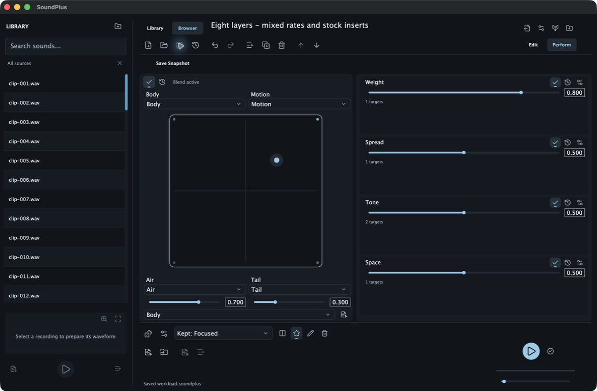
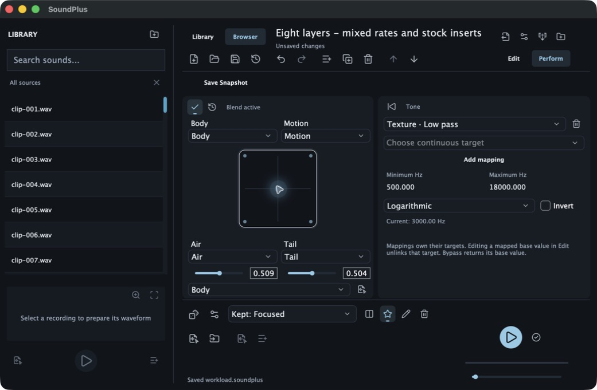

# Performance Mixer v1 — bounded M2 delivery

Starting HEAD: `43f5776`. This implements the attached M2 blend/macros/static-snapshot prompt while preserving the later fade-control requests. It shares the existing Designer document, session, source references, stock DSP, transport and permanent-output pipeline. Library remains independently usable without a design, account, DAW or network connection.

## Architecture and behavior

The [architecture note](PERFORMANCE_ARCHITECTURE.md) was written before implementation. [PerformanceState.cpp](../src/PerformanceState.cpp) resolves a stable base mix plus control state into one effective mix. Resolution is pure and idempotent. [DesignLive.cpp](../src/DesignLive.cpp), [DesignAudio.cpp](../src/DesignAudio.cpp) and [DesignSession.cpp](../src/DesignSession.cpp) use it for live values, graph initialization, accurate audition and offline outputs. Performance metadata is excluded from the structural signature; continuous motion uses the existing coalesced parameter path.

Four blend slots use stable layer IDs. Bilinear corner amplitudes are normalized to unit squared sum over valid occupied slots. Zero slots do nothing; one stays at unity; an unoccupied zero-energy corner uses equal-power weights across occupied slots. Unassigned layers remain unchanged. Assignment starts bypassed, activation is explicit, and centre/reset does not enable it. Coherent summation can clip: there is no hidden master normalization. The existing clip indication and monitor control remain shared.

Four renamable macros each support up to sixteen stable layer/effect/parameter targets. Qualified targets are gain, balance, intentional master gain, stock high/low-pass cutoff, delay wet and reverb wet. Mapping supports min/max, linear/log/smooth response, inversion, current units, reset, bypass and unassign. Missing or incompatible targets stay visibly unresolved. Reordering never redirects a target. One macro owns a target even while bypassed; blend-assigned gain cannot also be mapped. Intentional inspector edits unlink only that target, including choosing its unchanged base value. The inspector and canvas gain line display effective macro values. Blend amplitude remains a separate factor. Random variation generation skips macro-owned fields; existing locks still constrain generation.

Gain/balance/master transitions use the existing 5 ms smoothing; delay wet uses 10 ms and reverb JUCE's smoothing. Filter cutoffs now ramp over 20 ms, updating coefficients in 32-sample sub-blocks while retaining history on the producer worker. The realtime callback still consumes prepared PCM. Resolution, JSON, allocation, source/database I/O and graph construction stay outside it. Existing bounded live-seek history and deliberate Accurate audition behavior are unchanged; see [the effect-history policy](DESIGNER_V1_1_1.md#effect-history-policy-and-accurate-audition).

## Workspace and snapshots

[PerformView.cpp](../src/PerformView.cpp) adds a prominent blend pad beside four named macros and a contextual mapping editor. Edit retains the layer canvas. Both workspaces share the Browser, transport, variations and output actions. Switching changes a workspace preference only. Slots accept an existing-layer drag or accessible picker. Dropping a Library recording creates a normal DesignLayer through the existing captured-source path. No extra hidden voices are introduced.

Pad arrows step by 0.025, Shift-arrows by 0.005, Home centres, and Escape cancels an active drag. Numeric X/Y and macro fields provide alternatives. Gestures use session begin/end/cancel; completed drags create one undo step. Document/variation identity and operation tokens reject stale control/name-editor events.

Save Snapshot creates a named **kept, editable variation** containing base values and control settings. Recall never bakes and reapplies controls. Later edits while it is selected modify that candidate. The existing selector, Original/variation A/B action, rename, keep/discard, Undo/Redo, atomic save/recovery, output receipts and print-back remain in use. This is a static configuration, not a recorded take.

Render selected layer still means the **primary selected layer**, not every selected layer or a time range. The complete mix is resolved before isolating/rebasing that layer, preserving its full-design blend weight and master processing. Monitor gain is excluded. Print-back adds a normal external layer; source media remains unchanged.

## Compatibility

Neutral existing designs keep manifest version 1 and their original sound. Any performance assignments, mappings, names, values or bypass state require **manifest 2 / `stock-perform-v1`**, with nested control-state version 1. Previous readers reject version 2 rather than ignoring audio-affecting controls. A version-1 document carrying non-neutral performance state is rejected. No SQLite migration is needed. Designs remain referenced documents, so source media must remain available or be relinked.

## Verification

The machine is an Apple M5 Pro MacBook Pro with 48 GB RAM, macOS 26.3.2. Native audio used MacBook Pro Speakers, 48 kHz, 512-frame buffers. Automated PCM checks are distinct from human listening; no human listening sign-off is claimed.

All **13 CTest suites passed in 50.67 s**: 4,831 performance-state checks, 1,449 canvas checks and 79 actual view-command checks, alongside the existing Library, search, selection-follow, transport, session, fade and render suites.

The final evidence, workload distributions, source paths, render receipts and native outcomes are recorded in [the verification record](verification/performance-mixer-v1.json). Tests generate small isolated audio fixtures. Intermediate failing logs remain under `build/performance-mixer/`: the selected-render test initially assumed four occupied slots while its fixture had one; the inspector check used exact floating-point equality. The fixture and tolerance were corrected, with no change to the correct one-slot law.

| Requirement | Actual checks |
|---|---|
| Neutral compatibility and one effective state | Version gates, 0–4 slots across an 11×11 grid, bounds/conflicts/inversion/log response, idempotence, static recall, native pre-monitor versus finalized float WAV; maximum PCM error 0.0 |
| Stable ownership | Reordered/deleted layers, incompatible/removed effects, transactional rejected mappings, explicit inspector unlink and Undo |
| Gestures and session safety | Actual pad/macro pointer callbacks, one-step undo, Escape, Shift-arrows, stale document/name events; native numeric/keyboard operation and mapping range edit/Undo |
| Shared pipeline and continuity | Native eight-layer/26-insert workload, pad and four macros at 25 ms driver intervals, 600 searches and 30 concurrent indexed files; same helper, graph and playback generation, zero underruns; exact serialized recipe/playhead unchanged by workspace switch |
| Snapshots and outputs | Native named snapshots, Original/Focused A/B, saved-document reopening, full and primary-layer WAV finalization, receipt checksums, ordinary-layer print-back and Undo |
| Assignment and layout | Native existing-layer drop; Library drop produced a ninth ordinary layer and one Undo restored eight; minimum-size Browser/pad/mapping/output checks and normal/minimum screenshots |

The final serial workload ran for 12.00 seconds, with 252 observed tagged updates and 193 input samples overlapping indexing. All 600 searches occurred during eight-layer playback.

| Metric | Previous stock-inspector baseline | Perform workload |
|---|---:|---:|
| Search-to-paint p50 / p95 / p99, ms | 13.25 / 23.17 / 41.09 | 7.71 / 17.10 / 48.52 |
| Edit-to-callback p50 / p95 / p99, ms | 58.41 / 72.73 / 76.31 | 53.74 / 68.27 / 73.94 |
| Audio-helper CPU, % of one core | 8.13 | 8.07 |
| Underruns | 0 | 0 |

Native full output: 2,242,286 frames (46.7143 s); primary layer: 1,968,000 frames (41 s including its one-second tail). Both are PCM24 stereo at 48 kHz, non-normalized, with matching SHA-256 receipts under `~/Music/SoundPlus/Performance Mixer QA`. Exact paths and hashes are in the record. The final saved native QA document reopens at revision 1897 with Balanced (.5/.5/.5) and Focused (Weight .8, X .7, Y .3). Your working Rain glass design was restored at revision 6351 with its original hash; subsequent user edits were retained.

## Screenshots and layout decisions

The pad and assignments occupy the left creative panel; macro names and values stay visible on the right. Mapping replaces that right panel contextually. Transport, comparison and durable output actions remain beneath the workspace. User-defined names retain text; familiar actions reuse the cached Lucide/theme system. Fixed fade controls are now 10 logical points with 60% bright / 15% faded theme-accent fill, retaining their direction while the curve moves.





## Boundaries and remaining qualification

- Some native captures omitted idle toolbar glyphs during partial repaints; resizing restored them. AX commands, offscreen rendering and geometry checks passed. Capture artifact versus a macOS repaint defect remains unresolved; the cached icon renderer was preserved.
- Measurements are short development workloads, not a 30-minute soak, 256-frame gate, M2-machine qualification, external-interface test or human UAT. Callback latency excludes OS dispatch and physical DAC/acoustic delay. The preceding inspector baseline uses a different control protocol; comparison is descriptive, not a statistical performance guarantee.
- Snapshots are editable variations. Recorded motion, MIDI, live input, sampler pools, plugins, independent pitch/time and surround are outside this slice; no inactive controls advertise them.
- Resolve physical native-drop qualification remains **open/manual**. Previous drag initiation did not establish receiver import or persistence; no drag code was changed here. Use the prepared original/full/selected WAVs in [the separate Resolve report](BUTTON_SEMANTICS_AND_RESOLVE_DELIVERY.md), verify imported items and audio-track placement, save the throwaway receiving project, quit SoundPlus, close/reopen Resolve, and check online media and whether it references or copies each source. Internal drops and durable local renders do not qualify Resolve acceptance.

## Build and launch

From the repository root:

```sh
.tools/cmake/data/bin/cmake --build build --parallel 6
.tools/cmake/data/bin/ctest --test-dir build --output-on-failure
open build/SoundPlus_artefacts/Release/SoundPlus.app
```

Close processes running from the bundle before rebuilding. For isolated QA, launch its executable with `--data-dir /absolute/path/to/qa-catalog --disable-ai`. The measured workload is repeatable with `python3 scripts/benchmark_designer.py --catalog /path/to/indexed/library.sqlite --output /new/evidence/directory --performance-controls`; semantic benchmarking requires the existing local model.
