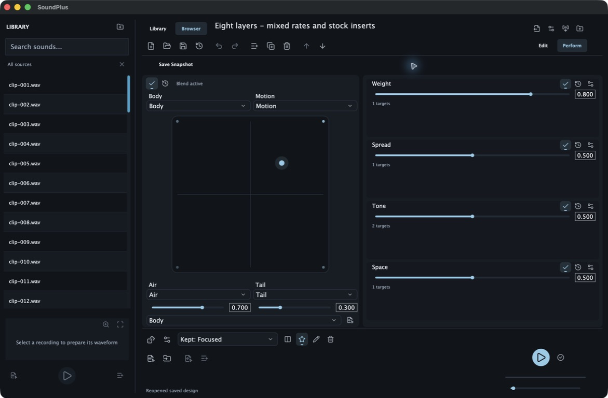
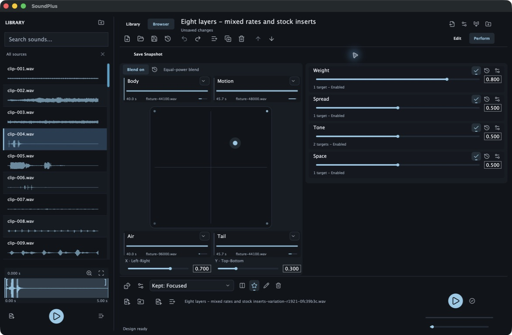
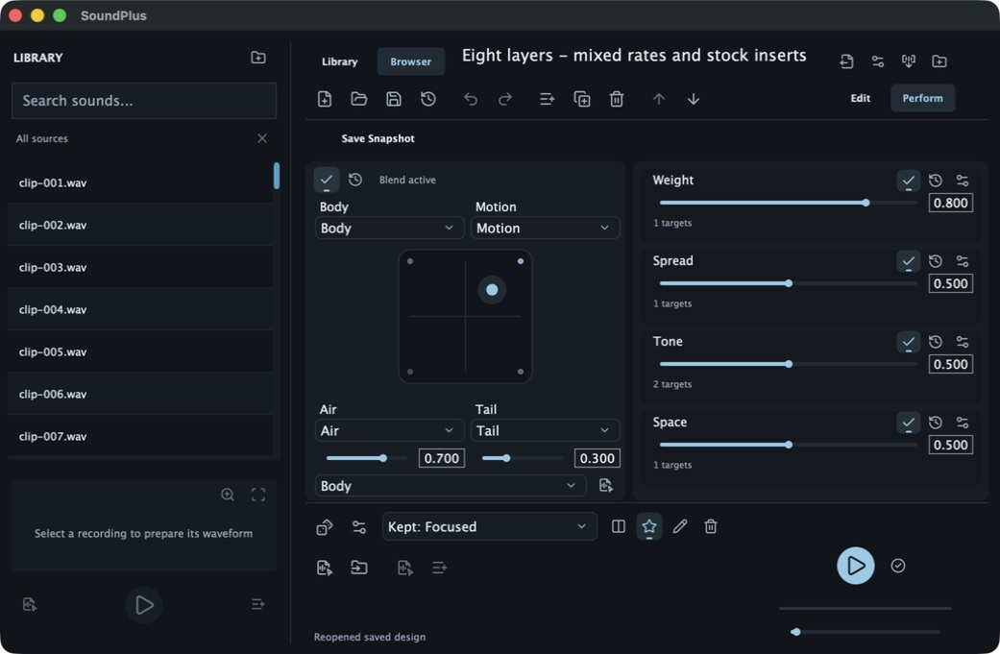
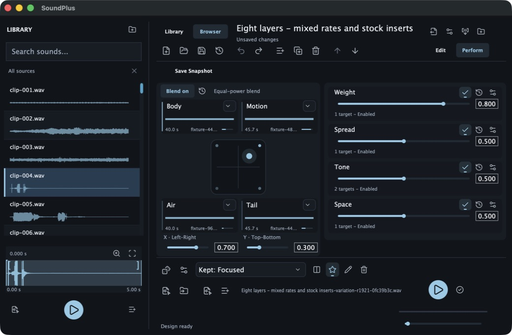
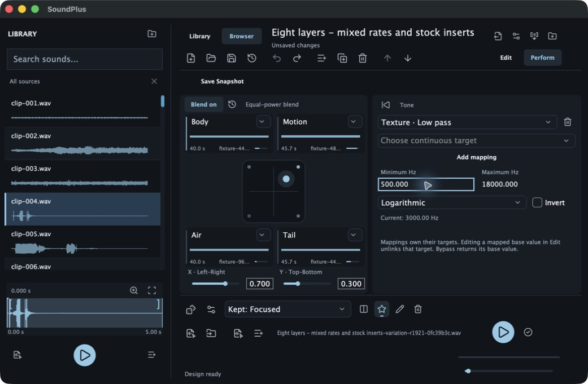
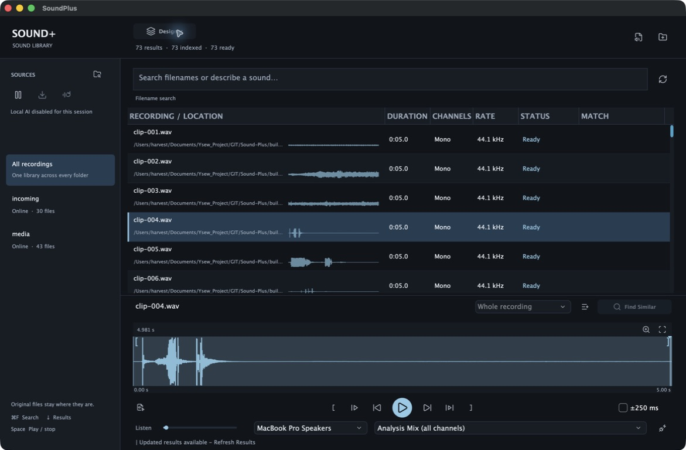
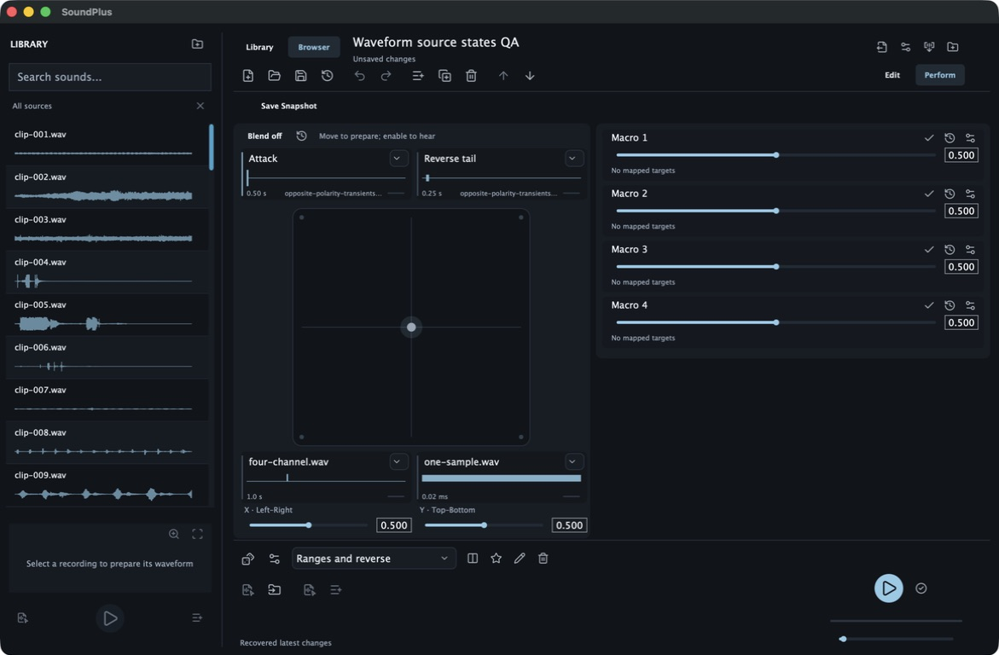

# Performance Mixer v1.1 — corrections, source waveforms and usability

Reviewed and starting HEAD: `e6ca7484830d6bfc8d3c95a22b7b8b6e889d1e6f`. The checkout was clean; neither finding was already corrected. The [implementation request](reviews/Codex_Performance_v1_1_Waveforms_Usability.md) and [review](reviews/Review_e6ca748_Performance_Waveforms.md) are retained locally. This remains the shared standalone JUCE Designer/Library architecture; no new transport or audio engine was introduced.

## Functional corrections and compatibility

**Sparse-pad continuity — fixed.** [PerformanceState.cpp](../src/PerformanceState.cpp) now uses linear coordinates on the segment between two occupied corners, or barycentric coordinates on the triangle formed by three. Positions outside that convex hull project to the nearest point on it. The resulting nonnegative amplitudes are normalized to unit squared sum. Projection is unique and continuous; there is no last-pointer/last-valid-weight state. Zero assignments remain a no-op, one remains unity, and four retain the exact previous bilinear behavior. Unassigned layers keep their own levels. Coherent signals can still clip; the master is not silently normalized.

Existing performance documents/snapshots retain **legacy law 1**, including their former sparse-edge behavior. New mixes use **law 2**. The active legacy mix exposes **Update law**, an explicit one-step undoable change; other snapshots retain their own settings. Nested state version 1 loads as law 1; new state version 2 names law 2. The new state requires manifest **3 / `stock-perform-v2`**. Untouched legacy mixes retain manifest **2 / `stock-perform-v1`**; neutral old designs remain manifest 1. Older readers reject the new manifest, and the reader rejects a new law disguised under an older manifest. Atomic backups/recovery remain in use. Existing durable WAVs are retained.

The live parameter path, graph initialization, Accurate audition, snapshots, full render and primary-selected-layer render still consume the same pure effective-state resolver. Selected-layer output resolves the complete design before isolating its primary layer, retaining its blend contribution. The existing bounded live-seek versus full-history Accurate audition policy is unchanged.

**Slider Escape — fixed.** [PerformView.cpp](../src/PerformView.cpp) latches a cancelled control until its release callback. Escape restores the recipe and displayed values immediately. Continued held-pointer values are ignored, release does not commit, and a fresh gesture works. Numeric/keyboard edits and the existing document/variation identity guards remain functional. Failing-before logs reproduce both reviewed findings; passing tests exercise the actual configured callbacks for all four macros and both X/Y sliders, including fresh drag, Undo/Redo and switching during a gesture.

## Source cards and row rollout

**Perform cards: delivered. Library and compact Browser rows: delivered for visible files.** [SourceCard.cpp](../src/SourceCard.cpp) provides a single editable title, replace/clear picker, 26-point waveform, linked-rate duration and separate contribution cue. Sub-10 ms durations use milliseconds, including a nonzero 0.02 ms hint for a 48 kHz one-sample file. A custom alias survives replacement and clearing. Source-card dragging moves or swaps assignments in one Undo; stale document/variation payloads are rejected. All existing layers remain available through accessible pickers. A Library drop creates one normal DesignLayer. Return/double-click opens the assigned stable layer in Edit. Ordinary selection and painting do not play, seek or steal Library audition.

The pad stays spatially between the four cards. Macro rows are compact, with **Enabled**, **Bypassed** or **No mapped targets** states. X/Y axes have visible labels and numeric fields; arrows, fine Shift-arrows, Home and Escape remain. Blend has a readable on/off action and an off-state explanation. Target ranges, inversion, curves and detailed effective values remain in the contextual editor. The current Lucide/theme system and fixed 10-point subdued corner fade handles are preserved.

[WaveformPreview.cpp](../src/WaveformPreview.cpp) aggregates every peak bin intersecting each logical pixel column. It uses **all-channel extrema**, preserving opposite-polarity and nonselected-channel transients. A card crops the assigned `[IN, OUT)` range and mirrors it for reverse; duration includes source rate and linked playback rate. This is a **source overview before fades, gain, inserts and macros**, not a selected-channel-pair display or output meter. Partial edge bins are conservatively included at cache resolution; it does not promise sample-exact trimmed-edge amplitude detail. The passive head uses the existing `sourceAtTimeline`/`layerDuration` mapping and hides outside the source interval, including effect tails, or when playback belongs elsewhere.

The shared `WaveformPool` reuses the existing serial decoder. Selected audition, visible cards, visible rows plus two neighbors, and visible Edit layers supply bounded demands. It retains at most **48 sources**, **96 geometries**, and **40 requested assets per surface**. Peak pairs have a 24 MiB retained-cache ceiling; each geometry has at most 2048 columns. Results are immutable and deduplicated by source identity/stamps. Each surface independently observes completion generations. Source/layer/range/reverse rebinding clears old geometry immediately; late completions cannot paint under a new binding. Visible cached sources are revalidated on the worker after five seconds, allowing offline/reconnect feedback without source I/O in paint. The existing reference-audition worker remains separate.

Loading, missing layer, offline source, decode failure and real silence are distinct, including accessible waveform descriptions. Fresh worker validation can supersede an old file-offline observation from opening the document; catalog revision/replacement conflicts still require explicit resolution. Control motion transforms/reuses cached geometry and does not decode the source again. File reads, decoding and cache writes remain off paint and the realtime callback. Rows are virtualized and request their visible slice, rather than the entire catalog. The detailed selected-file audition waveform remains available.

Concurrent scrolling exposed two result-page invalidation paths. `requestPageForRow` now rejects rows from a previous query, and deduplicates missing-row requests against the **published page serial**, rather than the entire query. A semantic prefix or background refresh can replace an already fetched larger page with a 20-row prefix; the missing viewport must then fetch again. A new actual-view test fails before this correction and passes afterward. The load driver records 600 immediate pending-query scroll attempts, settled-result scrolling and actual row-waveform paints; a five-second missing-paint deadline distinguishes this condition from a search timeout.

Failed experiments are retained in the verification record. Two runs eventually reached normal audio EOF while the driver stopped advancing. The diagnostic one had a completed semantic request, 465 acknowledgements and no underruns: this is evidence of the row-paint wait, not a semantic-worker stall. Another intermediate run reported an audio-helper restart after 425 acknowledgements, with a semantic request pending. That restart's cause was not established. Search-stage diagnostics and explicit IPC health-failure logging were added; this is observability, not a claimed restart fix.

## Executed verification

The [verification record](verification/performance-v11.json) contains exact commands, hashes, native outcomes, measurements, fixture paths and output receipts. Testing ran on the Apple M5 Pro MacBook Pro, 48 GB RAM, macOS 26.3.2, using MacBook Pro Speakers at 48 kHz / 512 frames. Native display scale was **2×**; automated icon rendering also covers 1×/2×. Other physical display scales, external interfaces and M2 hardware were not qualified.

The final build passes all **14 CTest suites in 50.98 seconds**; the new waveform suite includes 3,634 checks, and performance-state coverage includes 19,930. Generated fixtures include silence, opposite-phase stereo transients, an isolated fourth-channel transient, two ranges of one source, reverse/rate, one sample, a one-hour source with a short transient, disconnect/reconnect/relink and decoder failure. Controlled workers cover late results, recycled bindings, bounded turnover and absence of decoder calls on the UI thread. Test counts include fixture-write assertions and should not be read as a count of independent user scenarios.

Native workflow evidence includes explicit law-update Undo/Redo, card movement, Library drop/Undo, alias edit and replacement, Library audition ownership during card selection, bypass/reset, mapping feedback/Undo, keyboard route to Edit, snapshots/reopen and full/primary-layer render/print-back. Full output is 2,242,286 frames; primary-layer output is 1,968,000 frames including its one-second tail. Both are finalized PCM24 stereo at 48 kHz under `~/Music/SoundPlus/Performance v1.1 QA`, with matching receipt hashes. Automated pre-monitor versus offline PCM comparison for the new sparse law has maximum error **0.0**; monitor gain remains excluded. Human listening is reported separately in the record. The latest user working design, **Rain glass design r8567**, was reopened at the end with its protected `.soundplus` SHA-256 unchanged; its legacy law and current variation were retained.

### Cold/warm measurement

The final cold/warm serial runs each used 73 catalog files, eight layers / 26 stock inserts, 600 description queries, 30 concurrently indexed five-second files, ten seconds of pad/macro motion and twelve seconds of playback. Each includes 600 immediate old-row scroll attempts while a query is pending, 48 settled-result scroll steps, and 39 acknowledged waveform paints after viewport movement. Helper PID, graph epoch and playback generation stayed unchanged; underruns remained zero. Workspace switching retained the exact recipe/playhead. Three additional cold fresh-process repeats passed the same assertions: **3,000 total final search acknowledgements** across five runs. This does not close the earlier unexplained helper restart.

| Metric | Cold derivatives | Warm derivatives, fresh process |
|---|---:|---:|
| Query-to-Library-paint acknowledgement p50 / p95 / p99, ms | 13.16 / 21.37 / 48.13 | 13.11 / 21.96 / 46.75 |
| Last coalesced edit-to-tagged callback p50 / p95 / p99, ms | 52.93 / 68.90 / 72.50 | 54.45 / 70.25 / 72.49 |
| Audio-helper CPU, % of one core | 7.71 | 7.66 |
| Source decodes | 76 | 30 |
| Verified derivative loads | 543 | 642 |
| Retained sources at end | 48 | 48 |
| Retained geometries at end | 76 | 76 |
| First adopted source overview, ms | 110.39 | 57.37 |

Warm decoding is limited to the 30 newly indexed files; prior catalog and unchanged design-source derivatives are reused. The retained peak-pair payload at the end is 718,720 bytes in both runs; this is not total application memory. Request-to-UI-adoption latency is recorded separately and capped to the first 512 observations. Its p50/p95/p99 values are 5.41/11.75/33.04 ms cold and 5.51/12.08/26.41 ms warm. The warm run ended with one derivative request still in flight; 30 is the observed decode count, not a claim that every queued job had finished. The previous v1 control-only baseline used different scrolling/control protocols, so these measurements are descriptive and do not claim a speedup.

### Comparable captures

Before and after use the same eight-layer **Focused** QA document, the same X/Y (.7/.3), macro values and source references. Full four-slot weights are unchanged by the explicit law update. Normal logical content is 1360×860; minimum is 1040×648, plus native titlebar. The capture tool downsamples normal captures to 1171×768 and minimum captures to approximately 1041×681. After the native workflow, normal capture also shows the selected Browser audition; that selection differs from the baseline capture.
















### Closure

| Item | Actual disposition |
|---|---|
| Review finding 1 — sparse blend | Fixed; all 16 masks, legacy compatibility and native PCM parity pass. |
| Review finding 2 — held slider Escape | Fixed in code; all six actual configured callback sequences pass. Physical simultaneous held-pointer/Escape remains a separate human check. |
| Perform waveform cards | Delivered and natively checked, including source errors, reconnect, ranges and tiny duration. |
| Library / Browser row rollout | Delivered for visible files; page invalidation regression and five final combined workloads pass. |
| Usability, theme and fixed fades | Native normal/minimum 2× layouts checked; existing editing and icon regressions pass. |
| Toolbar disappearance | Not reproduced; capture versus physical-display cause remains unresolved. |
| Load reliability | Final cold/warm + three repeats pass; one intermediate helper restart remains unexplained. |
| Human listening / physical held gesture | No human result received at report preparation; no perceptual pass claimed. |
| Resolve physical delivery | Open independent receiver qualification; no new acceptance claim. |

## Qualifications and limits

- **Toolbar disappearance: unresolved, not reproduced in this pass.** Glyphs remained present in native window captures through Edit/Perform changes, focus changes, minimize/raise, Finder occlusion/exposure and resizing. The previous capture/display ambiguity is not closed by the icon atlas or by these non-reproductions. No repaint workaround was substituted for a demonstrated fix.
- Native toolkit callback tests cover the continued-held-drag Escape sequence. The computer-control interface exposes atomic drags, so a physical held-pointer Escape sequence and physical listening/display observations require separate human evidence; their actual status is in the record.
- One intermediate workload reported an audio-helper restart. The final five workloads did not reproduce it; explicit IPC health logging was added. Its cause remains unresolved, so this pass does not claim the intermittent restart is fixed.
- Cold/warm measurements use a short 73-file development workload, not a large-library guarantee, 30-minute soak or 256-frame qualification. Cold means a fresh derivative directory; OS file caches are uncontrolled. The warm process reuses derivatives and unchanged design sources while indexing 30 new uncached files. Latency ends at result adoption or tagged callback PCM, not physical DAC/acoustic output.
- Resolve physical original/full/selected delivery remains **open/manual** until actual receiver import, track placement, save, SoundPlus exit and receiver-project reopen pass. The prepared durable files and exact receiving steps remain in [the separate delivery report](BUTTON_SEMANTICS_AND_RESOLVE_DELIVERY.md). This pass does not infer acceptance from drag initiation or rewrite drag delivery.
- Plugin hosting, MIDI, recorded motion, sampler pools and surround remain outside this milestone.

## Build and launch

Close running processes from this bundle before rebuilding. From the repository root:

```sh
.tools/cmake/data/bin/cmake --build build --parallel 6
.tools/cmake/data/bin/ctest --test-dir build --output-on-failure
open build/SoundPlus_artefacts/Release/SoundPlus.app
```

Use the executable with `--data-dir /absolute/qa/catalog --disable-ai` for an isolated native walkthrough. To reopen the preserved working catalog used during development:

```sh
build/SoundPlus_artefacts/Release/SoundPlus.app/Contents/MacOS/SoundPlus --data-dir "$PWD/build/gain-hover-native"
```

A five-minute check with your own sounds: add a folder in Library; scroll and search while its row waveforms load; start audition and select another result; open Designer/Perform and drop four sounds onto the cards. Rename one role and replace its source, then Undo. Enable Blend and move through an empty corner after clearing one assignment. Play the design, confirm card playheads follow only its source intervals, and check macros/mapping/bypass. Save, quit and reopen; render to a permanent folder. For the remaining physical gesture check, drag each macro and X/Y slider, hold the mouse, press Escape, continue moving and release, then verify a fresh drag and Undo. This walkthrough does not qualify Resolve receiving persistence.

 `scripts/benchmark_designer.py --performance-controls --waveform-scroll` adds visible preview scrolling to the existing search/index/playback workload; `--waveform-cache-from` and `--fixture-from` allow a fresh-process warm comparison with unchanged source identities. Full executed commands and results are retained in the record.
