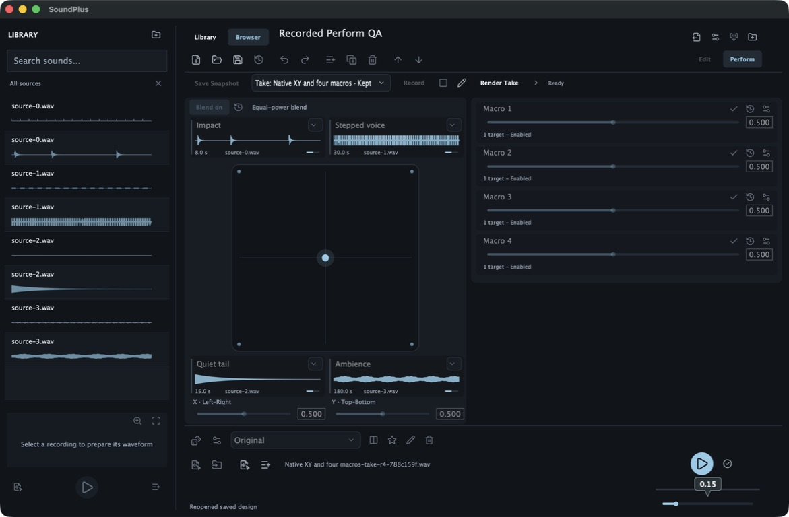
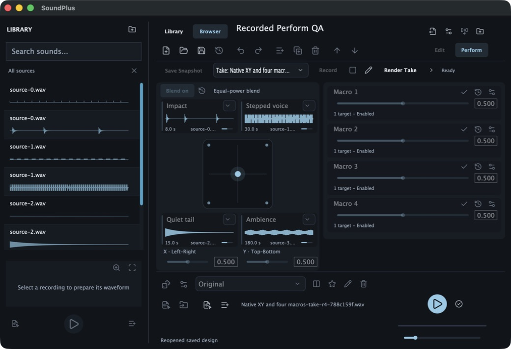
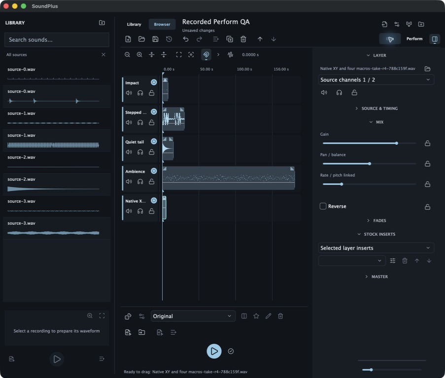

# Performance Mixer v1.3 — Recorded Perform Takes v1

Implemented from clean starting HEAD `0cfa5f6cc303af4abf058513430fe74fe1559134`, following the complete supplied user request and [review/prompt](reviews/Codex_Performance_v1_3_Recorded_Takes.md). The first focused corrective commit is `817c810`. This milestone preserves JUCE/C++, Library/Designer/session/shared audio, Lucide/theme, selection-follow audition, editable fades and fixed 10-point corner handles. No hosted plug-ins, MIDI, sampler voices, surround or picture spotting are added.

## Delivered workflow

In Perform, choose **Live Design → Record**. Arming verifies the frozen recipe and original-source content fingerprints on a worker. Capture begins at frame zero with fresh stock-effect history. Move XY and four macros, including bypass/reset, then **Stop**. The finished take becomes the active context: **Audition → Keep/name → Save → Render Take**. Drag WAV and print-back become available only after a permanent context-matching WAV is finalized. Print-back adds a normal referenced external layer to Live Design.

A snapshot remains an editable static recipe. A take is an immutable recipe plus applied controls. A WAV is a durable output with a receipt. Later live edits or snapshot recall do not change a take. Incomplete drafts remain explicit and cannot audition/render. Take options expose Cancel, Delete with Undo and content-verified source relink. One Undo removes a finished capture; Keep/name/delete have separate Undo actions. Live controls restore unchanged after Stop/Cancel; there is no undo entry per event.

The compact take controls reuse the existing snapshot/tool row. No extra vertical strip reduces the XY area. Normal and minimum layouts retain four actual waveform cards, the pad, macros, transport and output actions; long names truncate with complete tooltips. Take replay controls are read-only playback state. Opening another document is available directly from a completed take; active capture blocks document/seek/device/Library takeover. Arming reserves transport before source verification completes.







## Capture, clock and persistence

See [the complete contract](PERFORMANCE_TAKES_CONTRACT.md) and [shared architecture](PERFORMANCE_ARCHITECTURE.md). The capture point is `DesignReader` source production after coalescing, immediately before the resolver/DSP changes actually produce PCM. Integer project frames, contiguous sequence, take/session/play generation and a typed full normalized state preserve atomic XY, Blend enable and all four macro values/enables. Unapplied/stale/coalesced inputs do not create events. Reset records its effective value.

Stop quiesces the callback hazard outside the callback and retains only events needed by consumed output. Exact duration is `outputFrames / captureRate`; exclusive source dependency is `ceil((outputFrames−1) × projectRate / captureRate) + 1`. The dependency may include one interpolation guard frame, without lengthening the take. This distinction fixed a development conversion-boundary mismatch. Replay uses absolute integer project frames, a take-only partition-independent 32-frame coefficient phase, and the existing resolver/processors. Static DSP behavior is unchanged. Take audition always rebuilds history from zero. Live Design's approximate seeks remain approximate; use Accurate audition for judging long tails. Render gates source input at the consumed dependency and appends the chosen effect tail once. Monitor gain is excluded.

Limits: **120 seconds, 8192 applied events, 16 takes/document**; one fixed **655,360-byte event array**, latest pending control state, serial producer and checkpoint worker. Atomic checkpoints have 250ms opportunities, subject to storage delays. Source hashing, checkpoint JSON, graph work and I/O stay off the callback. Empty capture, overflow, sequence corruption, source/helper/device/generation or storage failure cannot be Ready. EOF/120s finalize the consumed body normally. Cancel abandons the draft. Recovered checkpoint prefixes are always Incomplete. Long source preparation has no arbitrary 15-second false timeout; cancellation invalidates its completion. Worker-admission rejection releases transport and exposes failure.

Take documents require **manifest4 / stock-takes-v1**. Static documents retain their prior versions. Load is bounded to64MiB. Recipe/event/envelope hashes and source identities/revisions/content SHA-256 are checked. Relink accepts identical bytes, storing relocation separately from the frozen hash. Shared immutable recipe/events keep Undo and control updates from copying/serializing every historical take. Receipts identify kind, take, recipe/event hashes, processing version, source fingerprints, rates, consumed/body/output frames, tail policy, final WAV hash and render settings.

## Closure and executed checks

Machine: **Apple M5 Pro, MacBook Pro Mac17,8, 48GiB, macOS26.3.2 (25D2150)**; native arm64 Release, Retina2×, built-in MacBook Pro Speakers. Only this hardware/OS/display was exercised. Resolve was running in the background. Exact artifacts, measurements, source/output audit, commands and raw-record hashes are in [the machine-readable evidence](verification/performance-v13.json).

| Requirement / finding | Status | Actual evidence and source |
| --- | --- | --- |
| R3 retained selection re-pins Refresh/new query | Fixed | Corrective commit817c810; actual AI-enabled Refresh and typed-query handlers with retained lexical selection then controlled delayed semantics, no audio retarget, subsequent deliberate pin. `LibraryView.cpp`, `tests/ReliabilityTests.cpp`; [correction report](PERFORMANCE_V1_3_CORRECTIONS.md). |
| R4 overdue validation/reload churn | Fixed | Same commit; unchanged82-demand pressure beyond first completion, retained Offline/Changed/reconnect and stable decode/work counters.48 peak sources/96 geometries plus bounded160 display summaries. Oldest overdue validation every fourth admission; scheduler bound is4N admissions plus current job, excluding blocked OS I/O. `WaveformPreview.cpp`, `Waveform.cpp`, reliability suite. |
| A applied capture, coalescing, generation, sequence | Passed | `tests/TakeTests.cpp`: real producer/read-ahead path, exact boundary, atomic XY/four macros/enables/reset, stale/coalesced rejection, future-event trimming; native helper capture. `TakeCapture.cpp`, `DesignAudio.cpp`, `AudioPlaybackService.cpp`. |
| B original capture/replay/offline and history | Passed within stated tolerances | Original pre-monitor PCM is compared to immutable replay, then finalized32-bit WAV to replay including the tail. Controlled-rate tolerance1e−7; native-helper tolerance1e−6. Measured capture/replay max difference0.0 for all five configurations and native helper. Fixtures include impulses, delay, filter, reverb and Stop/tail-length checks. This is not human listening. |
| C project/output clocks | Passed for tested configurations | Controlled producer:44.1→44.1,48→48,96→96,48→44.1,44.1→48kHz.1536 consumed output frames per rate case, block-boundary event plus discarded read-ahead. Native device qualification is48kHz/512 only; other hardware rates are not claimed. |
| D persistence/immutability/Undo/compatibility | Passed | Actual session Record/Stop/Keep/name/Delete/Undo/Redo/save/reopen/live edits/static snapshot; version/checksum rejection and identical-content relink. `PerformTake.cpp`, `DesignTakeSession.cpp`, session/recovery tests. |
| E failure/ownership | Passed tested sequences | Cancel during held preparation, long Arming, pending prior/new generations, settled foreign generation, empty/short capture, source EOF, native Library/device takeover prevention during Arming and Recording, event overflow through actual producer, intentional helper kill, missing source, rejected queue, write failure, recovered prefixIncomplete. Physical device removal was not newly exercised; its handler is inspected and controlled transport guards tested. |
| F concurrent work and limits | Final results below | Full 120s capture with continuous XY/macros,10k catalog indexing/search/semantic refreshes, whole viewports, waveform work and owned offline/reconnect. Event/checkpoint backlog/memory/audio health retained. |
| G native workflow/layout | Passed within listed limits | Actual macOS input Record → pointer XY + keyboard adjustment + four macro edits → manual Stop → native named take (six events,244736 consumed frames) → Audition → Save/quit/reopen → RenderTake (263936 stereo48k float frames, one0.4s tail) → ordinary-layer print-back → Undo restores four layers, kept take and WAV intact. Configured minimum (1040×680 JUCE bounds, 1040×712 captured native frame) and normal screenshots above show impact, stepped, quiet-tail and long-ambience data. |
| Existing functional gates | Passed | All18 Release CTest suites; final duration/results in verification JSON and [CTest log](verification/performance-v13-ctest.log). Existing static audio, direct gestures, fades, icons, Library/search/selection, waveform, transport and recovery gates retained. |
| Historical intermittent helper restart | Cause unresolved | Strengthened test waits for a different PID and subsequent healthy idle heartbeat before checking retained notice. Intentional faults are separate from ordinary runs. New successful runs do not identify the historical cause. |
| Human listening / physical held-pointer Escape / other displays | Unverified unless separately recorded | Optional listening request sent for the native QA WAV; no inferred human pass. Automated PCM, native pointer/keyboard XY and callback-cancellation tests are distinct. Attempted Space after AX Play did not establish keyboard focus/stop, so that particular native shortcut attempt is not a pass; keyboard suites remain passed. |
| Resolve receiving-app persistence | Blocked | Resolve Studio21.1.2 reachable via connector. No actual native receiver drop/placement/save/exit/reopen established by current app-scoped pointer automation. No receiver rejection is inferred. No API import or internal/Finder drop is substituted. |

### Sustained measurement

Final-artifact run: **5,760,000 consumed frames = 120.000 seconds**, 4,504 applied events; UI active window 120,000.686ms. 80 selected previews and queries, 80 fully painted viewports, 20 pinned semantic refreshes, 4 incoming batches and observed owned-source Offline/reconnect. **Zero reported underruns, no helper-health events, one preparation, stable helper/process/play/graph generations.** Nonzero pre-monitor signal in 43,701/43,708 repeated status observations; seven zero-peak observations were not individually diagnosed and are not represented as a listening result. Peak checkpoint backlog **30 events** of8192.

P50 /p95 /p99 milliseconds: query to paint **5.53/9.83/15.53**; selected waveform data adoption **29.37/50.94/64.70**; whole viewport paint **233.86/276.23/332.24**. Peak resident bytes: app **194,936,832**, audio helper **77,135,872**, AI helper **462,471,168**. These are process peaks, not callback allocation counts or a total-system memory guarantee. Cold derivative caches; OS cache uncontrolled. Full final CTest run:18/18 in **72.55s**.

Kept sustained take `8f6ad30b0d00435b8964693bcd867de3` is saved at `build/performance-v13/recording-qualified-512/Sustained QA Take.soundplus`. Its permanent WAV is `/Users/harvest/Music/SoundPlus/Renders/Sustained recorded motion-take-r5-ee4c299f.wav` (5,808,000 frames; SHA-256 `01558723db9d9232554d16fa426b7f3a9639ecae51fa9baf9fc306431d423210`), with the document receipt and immutable event/recipe hashes. Finalization intentionally stops the active core at the120s cap; zero source-rate/clock fields in final idle telemetry do not replace the stored consumed duration. Earlier pre-final builds also completed two120s recordings; those passes are disclosed separately and do not stand in for this artifact.

The existing v1.2 synthetic corpus is reused:10,000 real WAV paths/1,253,073,116 bytes/133 distinct whole-file hashes,128 intentionally copied short templates plus independently generated long sources. This measures file-count/source-I/O behavior with limited content diversity, not10k unique commercial recordings or semantic relevance. Cold derivatives do not mean a cold OS cache. Final post-run hashes/headers/sizes are audited against [the retained full manifest](verification/performance-v12-corpus-manifest.json.gz). The separate40-minute source drives8 layers/26 stock inserts, so ordinary source EOF is beyond the120s capture cap. Its content hash is retained. The earlier v1.2 30-minute512/60-second256 results remain historical; this milestone qualifies the full bounded recording limit, not another30-minute run or a new256 qualification.

### Saved native QA take

Document: `build/performance-v13/native-fixture/workload.soundplus`, **Recorded Perform QA**, revision7, take **Native XY and four macros**, `db051f772f1c4253b9bd39c524723bd4`. Event hash `ecba422317702b2261256e0a5a91f38ce042983e5893e4bd2c796b866af61b23`; recipe hash `8ef73e09101cbf8112fe1ed061eb3a709ced050b4f34604328e62067c88994a0`.

WAV: `~/Music/SoundPlus/Performance v1.3 QA/Native XY and four macros-take-r4-788c159f.wav`; SHA-256 `a78b6a7c08b89a443ec5329c33a736734182eeb4352eb03d76009d8ce3678696`.5.4986667s, stereo48kHz32-bit float. The document retains its complete receipt; compressed document/receipt/source manifest are included with the verification artifacts. Generated originals remain at their paths. Recreate the deterministic source bytes using `--prepare-take-ui` into a fresh directory, then use content-verified relink if relocating that take. IDs/timestamps/input timing differ on a new native capture.

### Working-session protection and failed attempts

The latest actual working **Rain glass r9299**, newer than the historical r9054 report, was backed up with every recovery file/settings before a safe native quit. QA used separate catalogs. No old snapshot was copied over it. Final hashes and reopening checks are recorded in the evidence JSON. Existing three user renders and historical durable QA outputs are rehashed; new takes/renders never replace them.

Development logs retained under `build/performance-v13` include a conversion-boundary PCM mismatch fixed by consumed-frame interpolation dependencies, a floating tail-ceil extra-frame fix, preparation failure phase correction and a controlled test initially inheriting an unrelated draft. An initial8s native fixture reached natural EOF before manual movement; that attempt is not claimed as the complete native workflow. It was repeated successfully with the180s ambience fixture. Final checks below supersede those attempts; they remain disclosed.

## Reproduce and try in five minutes

Close running SoundPlus/bundled helpers before rebuilding. From the checkout:

```sh
.tools/cmake/data/bin/cmake --build build --parallel 6
.tools/cmake/data/bin/ctest --test-dir build --output-on-failure
open "$PWD/build/SoundPlus_artefacts/Release/SoundPlus.app"
```

For a separate generated QA document/catalog:

```sh
build/SoundPlusTests_artefacts/Release/SoundPlusTests --prepare-take-ui "$PWD/build/my-take-fixture"
open -n "$PWD/build/SoundPlus_artefacts/Release/SoundPlus.app" --args \
  --data-dir "$PWD/build/my-take-catalog" --add-folder "$PWD/build/my-take-fixture" --disable-ai
```

Open the generated `workload.soundplus` using Designer's Open action. To repeat the sustained workload, use a fresh run directory and the prepared v1.2 fixture:

```sh
python3 scripts/benchmark_reliability.py run \
  --fixture build/performance-v12/fixture-qualified \
  --output build/my-recording-run --seconds 120 --buffer-frames 512 --record-take
```

1. Minute1: Add your sound folder in Library; audition an original and add two or more layers to Designer. In Perform assign corners, enable Blend and map/enable desired macros. An unmapped macro is honestly inert.
2. Minute2: Record from Live Design; wait for Recording, move XY and mapped macros, bypass/reset one, search the Browser while audio continues, then Stop.
3. Minute3: Audition the take; Keep/name and Save. Select Live Design, alter a layer or recall a snapshot, then return to the take: its frozen sound should be unchanged.
4. Minute4: Quit/reopen the same catalog/design. Select the named take, Audition and RenderTake to a permanent folder. Confirm the ready WAV and receipt.
5. Minute5: Print it back, inspect the ordinary layer and Undo the print. The take and delivered WAV remain. Do the receiving-app check below separately.

For Resolve: preserve your working project and create a throwaway project. Drag the actual finalized take WAV from SoundPlus's ready output control into Resolve; confirm an imported media item, audio-track placement, filename/duration/rate/channels and expected content. Save the Resolve project, exit SoundPlus, close/reopen the receiving project and verify online usable audio. Record whether Resolve copied bytes or references the permanent WAV. Keep that WAV/originals. If the gesture cannot cross apps, record **gesture not established**, rather than declaring that Resolve rejected the file. [Earlier original/full/primary-selection manual cases](BUTTON_SEMANTICS_AND_RESOLVE_DELIVERY.md) remain separate blocked items.
