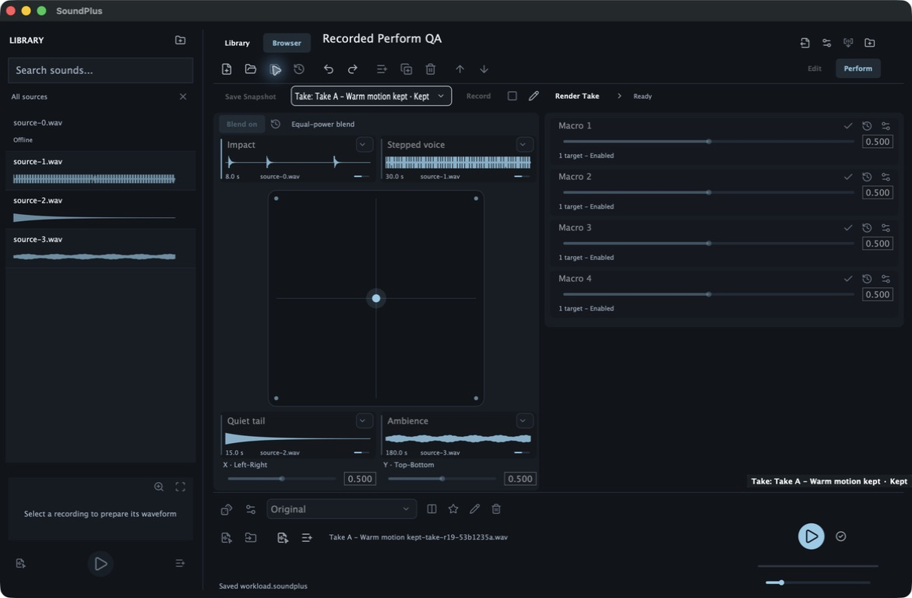
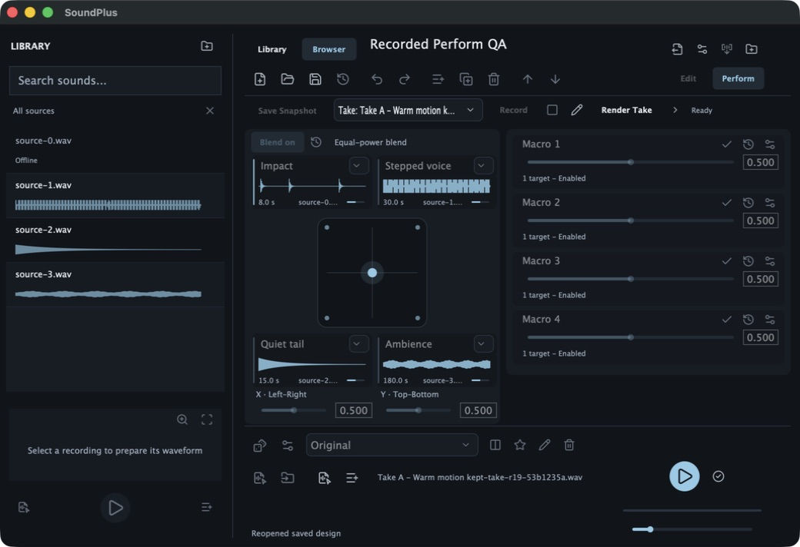

# Performance Mixer v1.3.1 — Take Integrity and Output Correctness

Implemented from reviewed HEAD `3eae9b569f1edb9bb94b345c9af5e4354ef7d64e`. The prerequisite R3/R4 changes in `817c8105bc38a169a2811ecd8a508a84ab6ae830` are retained. The supplied [review](reviews/Review_3eae9b5_Perform_Takes.md), [requirements](reviews/Codex_Performance_v1_3_1_Take_Integrity.md), v1.3 report, architecture and take contract informed this bounded correction. Implementation commit: `d51cfdb7ba8811d6854838ce3566c1e2b8ab43d4`. No new creative feature or UI redesign is included. Manifest4, stock-takes-v1 and the120s/8192-event/16-take limits remain unchanged.

## Finding closure

| Finding | Disposition | Correction and verification |
| --- | --- | --- |
| R5 immutable replay | Fixed | Explicit metadata/audio change classification in `DesignSession.h` and `DesignSession.cpp`, including pending preparation. `DesignLive.cpp` carries a take recipe/event context through IPC and `AudioPlaybackService.cpp`; the service and `DesignReader`/`DesignGraph` independently reject external live parameters for immutable replay. Keep/name, actual output-popup callbacks and receipt adoption leave playback/generation/hash intact. `tests/TakeIntegrityTests.cpp`: sparse sustained state, live gain/rack/layer mismatch, held preparation/completion, stale same-generation live parameters, actual native pre-monitor PCM comparison. Max difference0.0; tolerance1e−6. Reader guard difference0.0. |
| R6 ready delivery | Fixed | `DesignTakeSession.cpp::selectContextOutput/readyOutput` is used after restore, completion, selection, Undo/Redo/delete and immediately before Drag/Print. A take must match receipt identity, processing, hashes, rates, consumed/body frames and source ID/fingerprint set; the finalized path must exist. Static-output semantics retained. Tests assert actual view file binding and Print button, A/B/Live, held completion, reopening, Undo/Redo/delete and removed output. Native A rendering into selected B/Live and reopening unrendered B exposed no A WAV. Receipts and permanent WAVs remain. |
| R7 effective take inputs | Fixed | `DesignAudio.cpp::renderDesign` resolves one verified effective immutable source snapshot, reused for normalization, production, receipt provenance and final publication guards. Internal prepared-input constructors are private. Tests move the original, relink identical bytes, add an unrelated missing Live layer, render, then mutate the actual effective source after the final buffer: failure publishes no partial WAV and retains earlier outputs. Native original path actually absent; relinked render succeeded with correct effective path/revision/inode/fingerprint receipt. |
| R8 device interruption | Fixed for exercised handlers/service transitions | `CaptureDeviceLifecycle.h` latches the first stop/error/rate event with an epoch and capture ticket, bounded atomic diagnostic storage, and a CAS gate against Ready publication. No locks/allocation/I/O in the lifecycle callback path. `AudioEngine.cpp` handles the signal off callback; reservation/Arming baseline crosses IPC. Failed capture retains a prefix/diagnostic, releases ownership and requires a fresh deliberate capture. `tests/DeviceCaptureTests.cpp` exercises the actual callbacks, handler and playback service: Stop→same-rateStart before one handler tick, unchanged-rate error, rate change, idle initialization, held Arming, deliberate recovery and late final-checkpoint completion.36 checks. Physical unplug/replug remains unverified. |
| R9 recovery summary bound | Fixed | Every `displays` write routes through `WaveformPool::adoptDisplay` in `WaveformPreview.cpp`. `tests/ReliabilityTests.cpp` uses20s sources whose full peaks exceed2048 pairs, selects a genuinely non-hot display-only source under unchanged over-capacity demand, and exercises Offline→Ready and Changed→Ready with the original inode restored. Asserts2048 pairs/summary,160 summaries/2.5MiB aggregate, stable work after validation, conservative extrema and selected full-resolution promotion.48 full sources/96 geometries and nonstarvable validation retained; scheduler bounds exclude blocked OS I/O. |

The native relink exercise also exposed misleading status handling: rejecting an incorrectly chosen source marked a complete take Incomplete. Worker error handling now changes capture state only for a busy capture; the rejection preserves complete take/audition state. A targeted incorrect-fingerprint regression covers it. Take-card tooltips now describe a frozen read-only overview instead of advertising an unavailable Edit action. The render popup uses explicit metadata callbacks; its take range fields are disabled because take rendering always uses the complete consumed body plus selected tail.

## Executed evidence

Final Release build and all **20/20 CTest suites passed in77.11s** on Apple M5 Pro Mac17,8,48GiB, macOS26.3.2(25D2150), native arm64, built-in MacBook Pro Speakers48kHz/512frames and Retina2×. The prior18 suites remain, plus `take_integrity` and `capture_device_lifecycle`. Final integrity suite has157 checks, device suite36 and waveform scheduling296. The original recorded-take five project/output-rate cases and capture/replay/offline comparisons were rerun by the unchanged recorded_takes suite. Controlled rate tolerance1e−7 and native helper tolerance1e−6; neither is human listening or other physical-rate qualification.

Exact binary hashes, commands, IDs, counts, raw records, audits and final focused measurements are in [the evidence record](verification/performance-v131.json). [CTest log](verification/performance-v131-ctest.log). [Capture/replay and output contract](PERFORMANCE_TAKES_CONTRACT.md).

## Focused sustained checks

Final-artifact capture: **60.032s /2,881,536 consumed frames /2,267 applied events**. The60,000.007ms active workload ran40 selected-query/viewports,10 pinned semantic refreshes,2 incoming batches and owned-source Offline/reconnect. Playback/helper/process/graph identity stayed stable during the active interval; preparations stayed2→2, underruns0→0, no helper-health events. Peak checkpoint backlog21. Pre-monitor signal was nonzero in24,582/24,586 repeated status observations. Four zero-peak observations are undiagnosed; no audible-dropout or listening conclusion is drawn.

Final-artifact immutable replay: **45,000.362ms**, same take ID `c63eeae1b7704239b42ba9371ae75fe7` and frozen hashes;179 rename/output-setting cycles, asynchronous render,30 selected-query/viewports,7 pinned semantic refreshes,2 incoming batches and Offline/reconnect. Live gain/racks/layer structure differed from the frozen recipe. Playback/helper/process/graph identity stayed stable; preparations1→1, underruns0→0, no helper-health events;16,113/16,113 observed peaks were nonzero. Capture and replay's finalized WAVs rehash identically to `16bd7c0a19abdcc2a5f7bd8faa7c46d686bf4590908f20790e07db0e2402406f` (2,929,536 stereo48k24-bit frames,1s tail). These are focused60s/45s checks, not another120s-limit or30-minute qualification.

| Measurement | Capture | Immutable replay |
| --- | --- | --- |
| Query to paint p50/p95/p99 (ms) |5.17/10.42/13.67|5.79/24.31/32.34|
| Selected waveform p50/p95/p99 (ms) |22.26/42.04/58.02|19.21/40.27/49.73|
| Whole viewport p50/p95/p99 (ms) |232.77/277.34/358.88|200.36/250.54/251.60|
| Peak resident bytes app/audio/AI |184,090,624/65,323,008/458,407,936|198,524,928/56,410,112/461,651,968|

Process peaks are not callback-allocation measurements. The reused10k-path corpus has133 distinct hashes and1,253,073,116bytes, with128 intentionally copied short templates and independently generated long sources; it is not10k unique commercial sounds. Capture used cold derivative caches, replay copied the warmed catalog; OS cache is uncontrolled. The post-run manifest audit rehashed every file and checked size/header. Final display-recovery pressure retained48 full sources and35 summaries, max2048pairs,557,056bytes of summary peaks; settled requests remained unchanged across1000 ticks, with full-resolution selected promotion afterward. Earlier60s/45s development runs used pre-popup-correction artifacts and are recorded separately.

## Native workflow

An isolated generated fixture/catalog was used; the user's document was never opened for QA edits. The two manually captured and kept takes are **Take A - Warm motion kept** (`349c683a74f94bfeab02ec7ca946d61e`,6events,3,186,176 consumed/body frames at48k) and **Take B - Narrow sweep** (`3d592a91fa3f4020ac3507cd5e9e610c`,5events,124,928frames). Both were saved and reopened. Numeric XY/four-macro controls were exercised during capture; a later active-window Live pad pointer drag and Undo were verified separately.

Live Impact gain changed−18→−48dB and its delay was removed; A's frozen layer remained−18dB with its delay. A audition remained active during rename and successful actual popup tail/normalization edits. PCM identity is established by the automated native comparison, not by the moving meter alone.

A was rendered while B was selected at21.834% progress, and again while Live was selected at21.4794%. Completion retained that selected context with no ready A output. B was saved/quit/reopened while A receipts existed and still exposed no Drag/Print. Every receipt was retained.

The first owned source was moved to `build/performance-v131/native-relocated/source-0.wav`; its original `native-fixture/source-0.wav` is absent. Actual Take options verified relink accepted the identical bytes. A rendered successfully; the finalized relocated WAV is `/Users/harvest/Music/SoundPlus/Performance v1.3 QA/Take A - Warm motion kept-take-r19-53b1235a.wav`, stereo48kHz32-bit float,3,234,176frames (body+1.0s tail), normalized. All four A outputs, including the pre-relocation ones, rehash to `230daf021eed470a2ad18993bd07c24fe4d4b9068efb5611a746d3af14b63872`.

The actual Print-back button imported that exact matching path as a fifth ordinary external layer, with48kHz/two-channel metadata in Edit. One Undo restored four layers; both kept takes, four receipts and WAVs remained. Final reopen restored A, the relocated source and its matching WAV. The final build also rejected a deliberately wrong native relink while retaining Ready. Normal1171×768 and minimum1040×712 captured frames (minimum configured JUCE bounds1040×680) were visually inspected: all four cards, the pad, macros, transport and ready output fit; long labels truncate with tooltips. Other displays were not exercised.





## Verification limits and development attempts

Initial native popup setting edits were rejected by the old label-based edit guard. This was fixed using explicit metadata impact and actual popup callbacks, covered by the test and repeated successfully in the real app. A first render-switch attempt remained on A and is not counted as a pass; subsequent actual B/Live in-progress observations are retained. Raw pointer/key attempts while the app was inactive are not passes. Picking source0 for the source1 relink slot was correctly rejected; the correct source0 relink then passed. Development build/test errors were fixed and final logs supersede them; earlier logs remain under `build/performance-v131`.

The v1.3 seven zero-peak observations among43,708 statuses remain undiagnosed. They establish neither audible dropouts nor a listening pass. The historical helper restart's cause remains unresolved. New focused observations do not diagnose either historical issue.

Human listening, physical held-pointer Escape, physical device unplug/replug and other displays/OS versions remain unverified. Resolve Studio21.1.2 was reachable by a read-only status check, but actual cross-app native drop, media placement and receiving-project save/exit/reopen were not established in this correction. This remains **Blocked: receiving workflow not qualified**, with no inference of receiver rejection and no API/Finder/internal-drop substitute. Use the precise [manual receiver workflow](PERFORMANCE_MIXER_V1_3.md#reproduce-and-try-in-five-minutes) for the actual finalized WAV. Prior original/full/selection delivery cases remain separately unqualified.

## Working-session and media preservation

The actual latest working window was inspected before QA: **Rain glass r9299**, document `f079cfb5d0bd4d3db119805d64b35d0a`. Its complete recovery/settings files were protected before safe quit. No backup was restored. Final audit confirmed the main document still hashes to `9237774df54065d2a2f1dd497a5ea60e47e9413bd19f16a7c027cc7bdf41334f`, all three working sources and three working renders are unchanged, and settings retain their original hash. One recovery-index JSON changed only its normal `updated` timestamp during shutdown; ID/revision/state and recovery-document bytes are unchanged.

The final native app is reopened on that catalog with AI enabled, Kept B selected, Blend off, X0.321/Y0.699, four disabled macros at0.5, monitor0.70 and the retained Unsaved changes indication. Separately,16 historical durable outputs, five historical fixture sources and all10,000 corpus files were physically rehashed; headers and sizes match their retained records. The native QA source relocation affects only the new isolated QA fixture; its original is intentionally absent, its identical relocated bytes and all permanent outputs remain. The first overly strict audit expected the recovery timestamp to be identical; inspection established the timestamp-only update, and the corrected audit records it explicitly.

## Reproduce

Close SoundPlus and its bundled helper processes before building. Run audio suites and workloads sequentially:

```sh
.tools/cmake/data/bin/cmake --build build --parallel 6
.tools/cmake/data/bin/ctest --test-dir build --output-on-failure
open "$PWD/build/SoundPlus_artefacts/Release/SoundPlus.app"
```

For the latest working catalog used on this Mac:

```sh
open -n "$PWD/build/SoundPlus_artefacts/Release/SoundPlus.app" --args \
  --data-dir "$PWD/build/gain-hover-native"
```

Focused workload commands (use fresh output directories on repeat):

```sh
python3 scripts/benchmark_reliability.py run \
  --fixture build/performance-v12/fixture-qualified \
  --output build/performance-v131/capture-final-60 \
  --seconds 60 --buffer-frames 512 --record-take
python3 scripts/benchmark_reliability.py run \
  --fixture build/performance-v12/fixture-qualified \
  --output build/performance-v131/replay-final-45 \
  --seconds 45 --buffer-frames 512 \
  --warm-from build/performance-v131/capture-final-60 \
  --replay-take 'build/performance-v131/capture-final-60/Sustained QA Take.soundplus'
```

Five minutes: Record/Keep A and B; change Live; audition A while renaming/settings; render A then select B; save/reopen B and confirm no A delivery. Return to A, Print-back its matching WAV, inspect and Undo. Test source relocation separately using duplicate QA media, and qualify delivery/listening separately. [Source Pools](SOURCE_POOLS_NEXT.md) is a next-milestone brief only.
