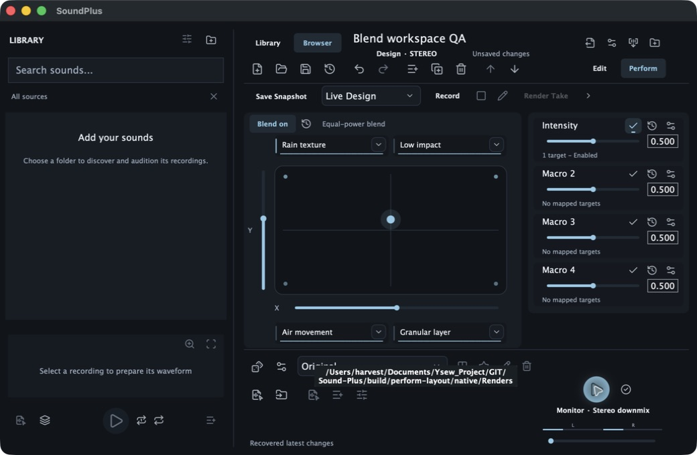
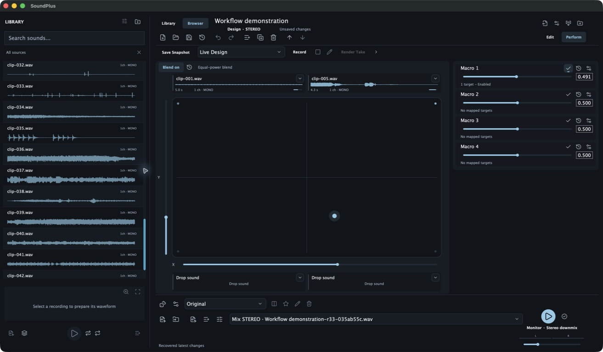

# Perform axes and source alignment

Starting HEAD **d14e23b**. The final layout uses a responsive rectangular pad, with **Y vertically left** and **X below**. The latest square-pad/footer rearrangement was rolled back at the user's request. The previous variation, output and playback positions are restored.

Source selectors occupy aligned rows above and below the pad. Names use 13-point text; cards range from 32 to 64 points high and omit the metadata row in short windows. Full source details remain available through tooltips/accessibility. The dropdowns have square 22-point borders aligned with the name row, with centred Lucide chevrons. The pad and all four selectors fit without a scroll area. The Blend/Macro drag handle is removed; the macro column automatically takes one third of the workspace, bounded to 240–400 points, ignoring stale manual-width preferences. The Library default is 400 points while existing saved Library widths remain respected. Theme tokens, cached vectors, session ownership and audio processing architecture are preserved.

Release arm64 build on **Apple M5 Pro / macOS 26.3.2 / JUCE 8.0.6**: **6/6 focused suites passed in 14.89 seconds** — performance_state, designer_view_commands, waveform_previews, source_pools, recorded_takes and icon_system. Checks cover bounds at narrow/laptop/desktop sizes, both axes, source-row alignment, dropdown geometry, actual-view assignment/drop commands, gesture cancellation/Undo and unchanged design state during resizing. [Test log](verification/perform-axes/tests.log), [artifact and preservation checks](verification/perform-axes/verification.json). The full plugin/release gate was not rerun for this UI change.

Native inspection used a byte-identical application copy, an isolated catalog/document and four generated 120-second sources. The final **1040×680** interface fits all selectors and axes without scrolling; Y mouse dragging and Up movement were checked. Native dropdown assignment commands worked. Playback remained active with changing pre-monitor levels after a live Y change; QA monitor gain was zero, so this is transport/control evidence, not human listening. Native source-card pointer dragging was attempted but not established; the actual-view drop-command regression passes. No receiving-application delivery qualification is claimed.

The latest **Workflow demonstration r3801** is reopened in place with Blend .608/.760, Macro 1 .491, monitor .25 and Library scroll 1802. Its payload matches the latest protected payload exactly, and all **37 protected source/output file hashes** match. No older session snapshot was restored over newer data.





Build and launch from the repository root:

```sh
.tools/cmake/data/bin/cmake --build build --target SoundPlus SoundPlusTests -j 6
build/SoundPlus_artefacts/Release/SoundPlus.app/Contents/MacOS/SoundPlus --data-dir "$PWD/build/gain-hover-native"
```

Close the running bundle before rebuilding it. The native app is already reopened with the working catalog.
