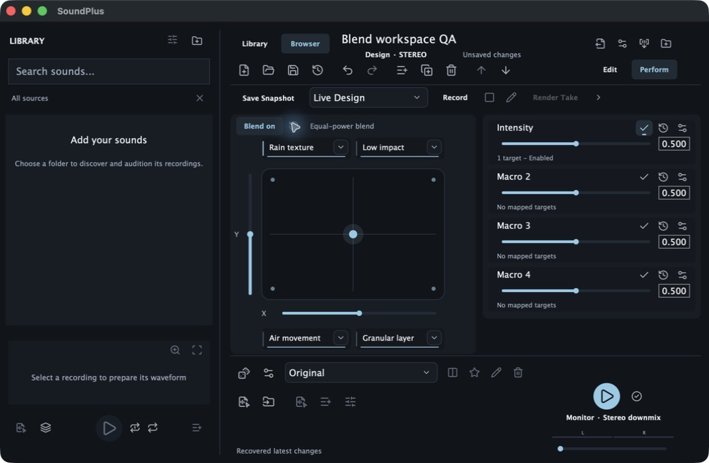
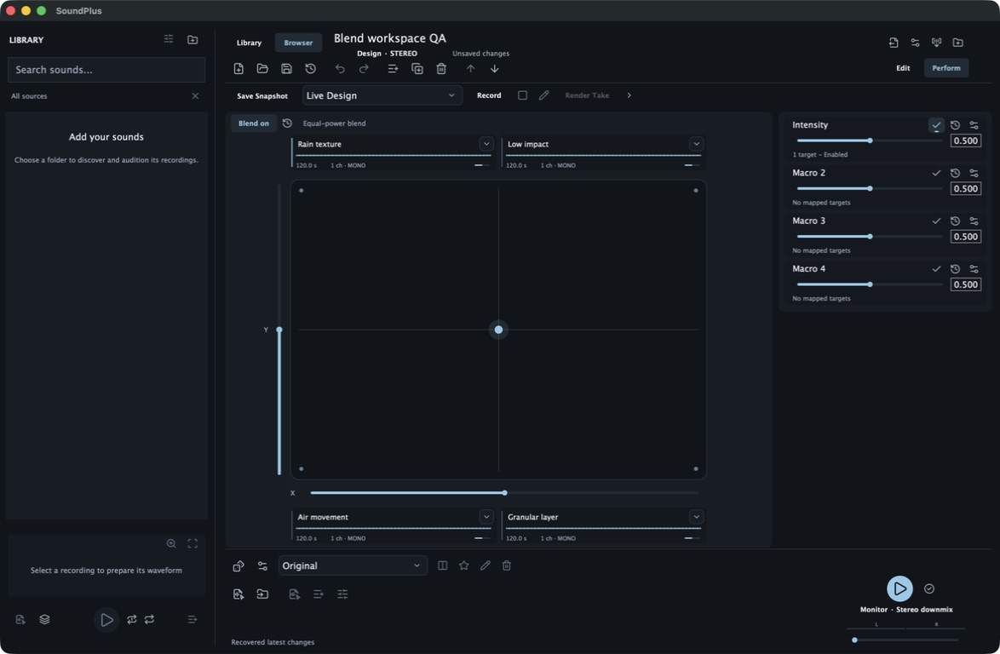

# Stable sidebars and bounded Blend pad

Starting HEAD **0a5eb94**. The Library sidebar and macro column now share a fixed **320 logical-point width**, independent of window size. The remaining Library resize gesture is removed, and old arbitrary width preferences cannot override the shared sizing policy. The full Library workspace retains its existing responsive layout.

The pad remains centred and responsive within limits: its outer bounds stop at **640 points per dimension**, with width/height between **2:3 and 3:2**. Excess space becomes balanced margins. The existing **1040×680** window minimum protects a usable **284×208** outer pad at minimum size. Source selectors remain aligned with the pad, and the axes stay fully visible. The previous footer, playback placement and theme are preserved.

Release arm64 verification on **Apple M5 Pro / macOS 26.3.2 / JUCE 8.0.6**: **5/5 focused suites passed in 9.95 seconds** — performance_state, designer_view_commands, waveform_previews, source_pools and pool_corrections. Actual-view checks cover minimum, wide and tall dimensions, both aspect limits, maximum-size saturation, centring, mapping controls, assignment/drop coordinates and unchanged design state during resizing. [Test log](verification/perform-sizing/tests.log), [source/binary identity and preservation evidence](verification/perform-sizing/verification.json). Audio/plugin release suites were excluded because processing and document formats are unchanged.

Native checks used a byte-identical QA bundle, isolated catalog/document and four generated 120-second sources. Matching sidebar widths, no overflow, Y mouse/Up control and the inactive Library divider were verified at minimum size. Desktop and tall windows retained the same widths; the tall window was fitted to the available macOS screen area. Native window zoom also kept the pad bounded. The QA document payload remained identical across the desktop/tall/zoom checks. Saved 3200-point legacy width preferences were deliberately present during these checks.

The newest **Workflow demonstration r4478** was protected before rebuilding and recovered correctly afterward. The latest retained payload matches the protected payload, and all **37 protected source/output hashes** match. The user's Library workspace, scroll 0 and monitor gain .25 are restored. No older r3801 session was copied over the newer edits.





[Tall-window view](verification/perform-sizing/tall.jpg), [live native zoom](verification/perform-sizing/zoomed.jpg), [restored Library workspace](verification/perform-sizing/restored-library.jpg).

Build from the repository root, with the running bundle closed:

```sh
.tools/cmake/data/bin/cmake --build build --target SoundPlus SoundPlusTests -j 6
build/SoundPlus_artefacts/Release/SoundPlus.app/Contents/MacOS/SoundPlus --data-dir "$PWD/build/gain-hover-native"
```

The native app is already reopened with the current working catalog.
