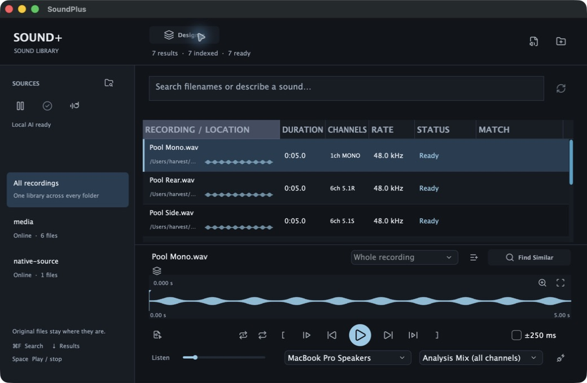
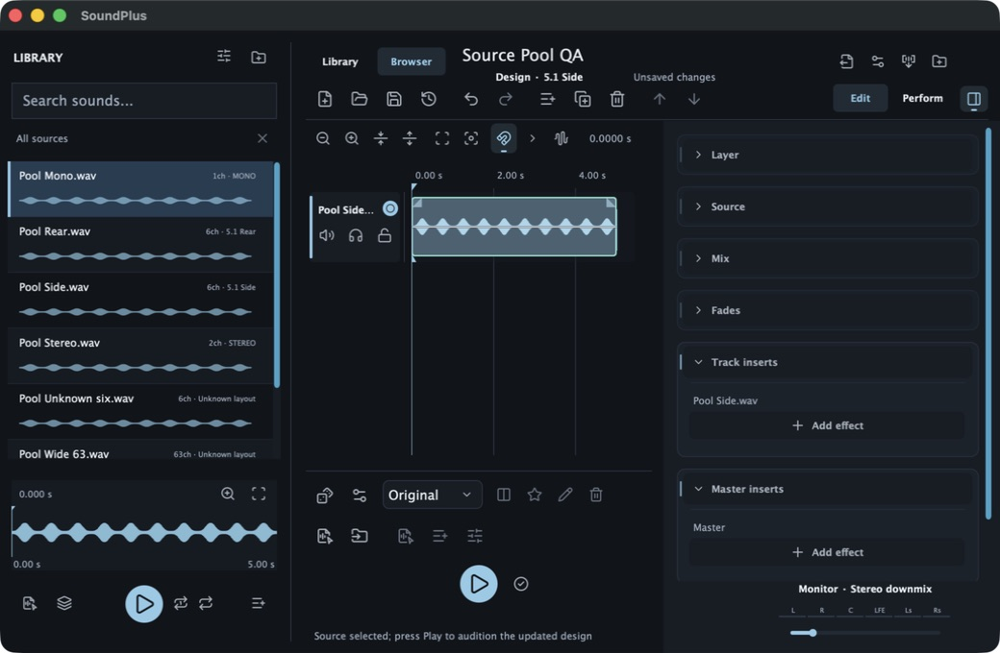
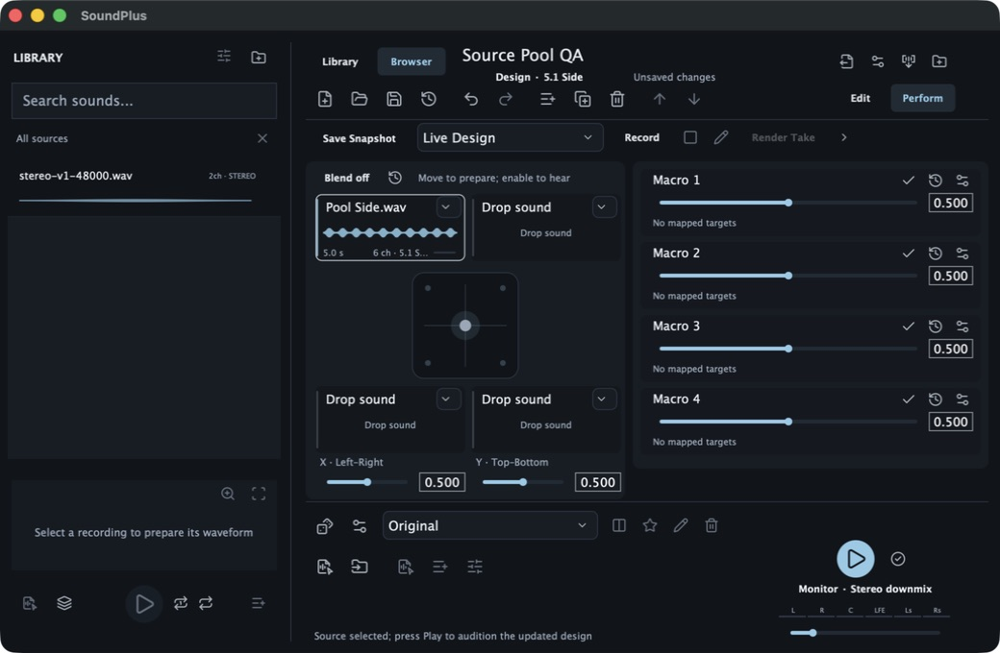
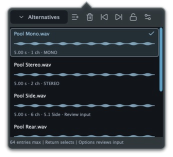

# Plugin Correctness and Discovery Recovery

Started at `ac6a4805a74d35e62614b356c121fb77e0d86b61`, the reviewed HEAD; the working tree was clean. Preserved the R26–R30 implementation, separate owners, Lucide/theme system, compact waveforms and existing timeline/fade gestures. No vendor bundle, signing, quarantine, opaque vendor state or JUCE adapter source was modified.

## Corrections and closure

| Requirement | Status | Implementation and evidence |
|---|---|---|
| TAL parameter-to-audio failure | **Diagnosed; audible-control acceptance OPEN** | Installed TAL 2.3.0 advertises ten duplicate native IDs shared by audio parameters and MIDI aliases. Its dispatcher routes those IDs to MIDI before audio lookup. General schema validation rejects ambiguity during discovery, state restoration and processing. TAL remains visible with its reason; no substitution or renumbering. See diagnosis below. |
| Full Rescan | Fixed | Actual chooser callback requests full configured-root/AU discovery. Owned A selected → B introduced → actual Rescan discovers B. Regression and native screenshot. Bundles are opaque: embedded implementation bundles no longer appear as independent installations. |
| Targeted AU retry | Fixed | Refresh current registration and actual bundle/fingerprint before the selected probe; worker still verifies expected identity. Apple AUDelay regression starts with obsolete fingerprint, unresolved bundle and previous failure, then recovers. Other entries/roots unchanged; cancelled retry leaves published bytes unchanged. |
| Processor-class selection | Fixed | Compound format/canonical bundle-component identity/JUCE processor identifier. Classless failure rows alone permit bundle fallback. Real owned two-class bundle and chooser callback retain selected class through cached refresh/search and instantiate that class. Missing class disables insertion. |
| Current recovery diagnostics | Fixed | Successful probe clears obsolete `failureStage`/`failureKind`, error and quarantine; bounded `failureHistory` retains prior failures separately. Actual native repaired-bundle Retry: one probe, roots retained, all unrelated entries identical. |
| Large parameter surfaces | Fixed and bounded | Owned fixture places meaningful gain above index 580 after nonautomatable aliases. PCM gain, stable-ID rejection, legacy compatibility, 16,384 declaration limit, 512 inline cap and same-count reordered schema covered. |
| Program/opaque restore and unchanged controls | Fixed | New captures retain a value/identity baseline. Program/state restores before explicit changed controls; unchanged controls preserve restored native values. Persistent requests compare with previous requested values rather than native readback. Indices and native/legacy IDs are revalidated after preparation before initializing the request cache, rejecting a processor that changes its schema during preparation. Program and PCM regressions verify restore behavior. Legacy jobs retain explicit override behavior. |
| Stale widgets | Fixed | Ordered schema signature drives both inline editors; callbacks hold safe slider references and reject changed schemas. Actual hosted widget rebuild, delayed stale callback and correct gain-vs-invert targeting verified. |
| Names and owner panels | Preserved, clarified | Unique names remain name-only. Collisions add restrained format/vendor/ordinal detail. Bypass/unavailability remains visible. Track and Master stay separate. |
| Ordered channel contracts | Preserved | Full channel/layout suites and finite-plugin suite cover role impulses, Side/Rear distinction, LFE isolation, mono-before-surround and explicit incompatibility. No silent conversion or automatic multi-mono added. |
| VST2 / AUv3 | **OPEN dependencies/qualification** | VST2 discovery remains visible, but lawful SDK/distribution and adapter path remain unresolved. AUv2 Apple AUDelay executes; AUv3 runtime qualification remains open. |

## TAL: exact failure and protective correction

Actual installed processor: `VST3-TAL-Reverb-3-29a99d5-45487f22`, TAL-Reverb-3 **2.3.0**, bundle architecture **arm64+x86_64**, fingerprint `a7c34b4f78cae6f452d4a7d6efd9c35edb098c3fba305c9bfd4d939a8565ab6f`. Execution was native arm64.

Read-only full-schema inspection found **2,092** parameters. Audio IDs **48–57**, including dry ID49 and wet ID50, also identify MIDI aliases at numeric indices 48–57. For example, audio wet (index2) and `MIDI CC 0|38` (index50) both advertise native ID50. [Duplicate evidence](verification/plugin-correctness/tal-duplicate-native-ids.json).

Disassembly of this installed arm64 executable shows `JuceVST3Component::processParameterChanges` reads the native queue ID and checks the MIDI alias range before looking up audio parameters. Its unmanaged mapping starts after the 12 ordinary declared parameters; IDs48–57 fall inside that range. The [dispatcher](verification/plugin-correctness/tal-parameter-disassembly.txt), [mapping setup](verification/plugin-correctness/tal-midi-map-disassembly.txt) and [controller setup](verification/plugin-correctness/tal-controller-disassembly.txt) are retained. Combined with the actual duplicated schema and PCM results, this supports a processor-side native-identity collision, rather than a bus rejection or missing queue event. Prior queue/controller tracing remains separately documented in [the supplied investigation](verification/vendor-loading/tal-inline-investigation.json); it is not presented as a new audio pass.

The immutable pre-change app copied from the reviewed build reproduced the original failure using deterministic Stereo role impulses, identical opaque starting state/program, normalized dry=0 and wet=0 versus .8, repeated no-change control and four-second finite tails. Both Track and Master documents were saved and reloaded before rendering.

| Baseline production path | Wet-change maximum PCM difference | No-change difference |
|---|---:|---:|
| Finite Process, 1-second input + 4-second tail | 0 | 0 |
| Track recalled full-design render | 0 | 0 |
| Master recalled full-design render | 0 | 0 |
| Track persistent client | 0 | 0 |
| Master persistent client | 0 | 0 |

Persistent runs processed 262,144 frames each, changing wet after 65,536 frames and measuring after another 65,536 settling frames against an equivalent no-change client. A later zero-input window exercised retained tails. Track and Master bypass differed from the wet baseline by **0.05915291165**, confirming that plugin processing itself occurred. These are offline/producer measurements, **not live interaction latency**. [Raw records and render paths/hashes](verification/plugin-correctness/tal-baseline.json).

General rejection is a safe correction, not a claim that TAL now responds audibly. Fixing the advertised collision requires a corrected processor contract or a supported upstream resolution. No product-specific opaque-state rewrite, fake rendered gain, AU substitute or weakened fingerprint/layout checks was introduced. Temporary queue instrumentation is absent; the bounded read-only schema inspection mode remains a useful diagnostic.

Independent comparison: Resolve Studio **21.1.2.10** was queried read-only. Its current effect catalog exposes builtin Fairlight and Apple AU processors, **no TAL VST3**, so same-binary reference processing was **not tested**. GarageBand's AU path would not establish this VST3 result. No Resolve project was changed. [Exact catalog](verification/plugin-correctness/reference-host.json).

## Verification matrix

The final full CTest gate passed **27/27 in 185.48 seconds** on Apple M5 Pro / macOS 26.3.2. It runs with `SOUNDPLUS_VENDOR_QUALIFICATION=$PWD/build/plugin-correctness/vendors-delivery` and `SOUNDPLUS_QUALIFY_AU=1` on the plugin-processing test. Evidence is tied to [source and executable hashes](verification/plugin-correctness/build-identity.json), rather than a claim about an unbuilt tree.

| Qualification | Actual scope | Result |
|---|---|---|
| Focused correctness suite | Production callbacks, actual two-class bundle, high-index PCM, program/native restoration, stale widgets, AU retry/cancellation and TAL guard | **71 focused assertions passed**; [summary](verification/plugin-correctness/focused-summary.json) |
| Full gate | All registered native suites, optional MIDI/auxiliary negative/positive cases and exact ordered layouts | **27/27 passed, 185.48 s**; [log](verification/plugin-correctness/ctest-final.log) |
| LV50A 1.0.0 | `VST3-LV50A-175fed7d-f3a1a62e`; native universal; Mono and Stereo | Two persistent-client control cases; four independent Track/Master/layout recalled renders |
| OldSkoolVerb 2.14 | `VST3-OldSkoolVerb-c2dd90f-10700a49`; native universal; Mono and Stereo | Two persistent-client control cases; four independent Track/Master/layout recalled renders, impulse tails |
| Apple AUDelay AUv2 | Current registered component, Mono/Stereo/5.1 Side/Rear plus retry | Executed in native worker/session suites |
| Portable generated PCM | 5.1 Side role order, gain/polarity/latency, retained copy/splits/state/source checks | 505 checks; zero independent PCM error |
| Concurrent bounded workload | One ordinary audition while scanning/processing owned fixture, indexing/search/waveform demands | 16/16 searches published, p95 12.64 ms, zero reported underruns; [audit](verification/plugin-correctness/workload-audit.json); not maximum product capacity |
| Native UI gestures | Rescan/Retry, class selection/insertion, owner separation, bypass, save/reopen, render | Separate native evidence below |
| Human listening | No human ratings collected | **Not tested** |
| Physical surround outputs | No channel-by-channel listening on surround hardware | **Not tested** |
| Receiving application delivery | No new native drag/import/placement/save/quit/reopen qualification | **Not tested** |

There are **four persistent-client control cases** and **eight vendor/layout/owner render cases**. These counts do not mean twelve native editor gestures. [Control records](verification/plugin-correctness/inline-controls.json) and [render records with exact identities](verification/plugin-correctness/numerical-results.json) retain the distinction. Settling-window execution times are not knob-to-ear latency.

## Native evidence and usability

Native verification uses a copied app, isolated QA catalog, generated media and `build/plugin-correctness/native/Native QA.soundplus`. The user's working design is separate. The supported minimum outer window is **1040×680**; Browser and Inspector are visible. Final screenshots and actual operations are recorded under [native evidence](verification/plugin-correctness/native/).

Rescan: existing A selected, a new owned multi-class bundle introduced to the configured folder, actual Rescan pressed, new classes discovered while selection remained A. Retry: invalid owned `Recoverable.vst3` replaced with an owned valid fixture, actual Retry selected pressed; exactly one probe, current Available/scan-complete status, same roots and byte-equivalent unrelated entries. [Screenshot](verification/plugin-correctness/native/retry.jpg), [catalog comparison](verification/plugin-correctness/native/retry-evidence.json).

Final native class/owner check: the first class from the actual two-class bundle remained selected through Rescan and changed search, then inserted as `SoundPlus QA Effect` on Track. `SoundPlus QA Stereo`, the second class from that same outer bundle, inserted on Master. Track bypass showed Off/“bypassed” while Master remained On. Save, quit and direct relaunch restored document revision 18, both distinct processor IDs/owner slots, bypass flags and durable output; the selected slot initially returns to the first slot, so each last slot was deliberately selected to inspect recall. [Reopened UI](verification/plugin-correctness/native/reopened.jpg), [native owner/render audit](verification/plugin-correctness/native/render-audit.json).

The final helper additionally completed another native render after the preparation guard was added; the frontend executable is byte-identical to the earlier native UI run. [Post-guard render audit](verification/plugin-correctness/native/post-guard-render-audit.json), [native UI build identity](verification/plugin-correctness/native/ui-build-identity.json).

The final native WAV is **Stereo, 48 kHz, signed 24-bit, 96,000 frames**. Finalized output/raw-pass checksums match the saved document; maximum float-to-24-bit quantization error is **5.96046448e-8**. This checks durable native output authority; it is not a listening or receiving-app test.

At 1040×680, actual Mono, Stereo and six-channel 5.1 Side sources showed Ready waveforms in Perform cards; alternative rows showed their real source envelopes and role labels. Selecting Side required and passed an explicit “Complete source / 5.1 Side / Match named roles” review, including LFE→LFE. Library and compact Browser displayed real generated mono/stereo/six-channel pulse envelopes, with no default full-range selection overlay. The inspector scrolls above fixed output monitoring; controls remained reachable, and source-card keyboard focus stayed inside its border. Resizing to a larger window and back retained usable controls. This is a native Retina Mac run, not qualification of every display/scaling combination.






The latest user catalog was restored **in place**: Workflow demonstration **r34**, unsaved changes retained, playhead 2.112 s, clip-005 selected and monitor 0.25. All **191 protected files** remained byte-identical before and after relaunch. No older QA/recovery snapshot was copied over the working session. [Preservation evidence](verification/plugin-correctness/user-preservation.json).

A launch through LaunchServices stalled in macOS `open` while reading the QA settings file; samples were retained locally. Direct execution of the same native bundle with the explicit isolated data directory succeeded. No security/TCC/signature settings were changed. Native operation evidence uses that direct launch.

## Reproduction

Quit SoundPlus before rebuilding its running bundle. From the repository root:

```sh
.tools/cmake/data/bin/cmake -S . -B build -DCMAKE_BUILD_TYPE=Release -DCMAKE_OSX_ARCHITECTURES=arm64
.tools/cmake/data/bin/cmake --build build --target SoundPlus SoundPlusTests --parallel 6
SOUNDPLUS_VENDOR_QUALIFICATION="$PWD/build/plugin-correctness/vendors-repeat" \
  .tools/cmake/data/bin/ctest --test-dir build --output-on-failure
.tools/cmake/data/bin/ctest --test-dir build -R '^plugin_correctness$' --output-on-failure
build/SoundPlus_artefacts/Release/SoundPlus.app/Contents/MacOS/SoundPlus \
  --data-dir "$PWD/build/gain-hover-native"
```

The installed vendor versions must match the matrix for that optional branch. Without `SOUNDPLUS_VENDOR_QUALIFICATION`, vendor cases do not execute; that is not vendor qualification.

The retained local pre-change app permits the failing TAL reproduction without reverting the checkout:

```sh
build/SoundPlusTests_artefacts/Release/SoundPlusTests --tal-baseline \
  "$PWD/build/plugin-correctness/tal-repeat" \
  "$PWD/build/plugin-correctness/baseline/SoundPlus.app/Contents/MacOS/SoundPlus"
python3 scripts/audit_plugin_processing.py \
  docs/verification/plugin-correctness/portable-evidence.zip
python3 scripts/audit_plugin_workload.py \
  "$(cat build/plugin-processing-test-output/latest.txt)/load.json"
```

`--tal-baseline` is a diagnostic reproducer and records open acceptance, not a positive test. A fresh checkout needs the reviewed pre-change app built separately for that command; the corrected current helper intentionally rejects TAL's ambiguous schema.

## Changed files and boundaries

- `src/PluginProcessing.{h,cpp}`: discovery/retry/canonical identity/current diagnostics, schema signatures and restrained name disambiguation.
- `src/HostedRackView.h`: real full-Rescan callback, class-stable chooser, owned embeddable chooser construction, stale-widget protection and state-baseline propagation.
- `src/PluginProcessPanel.cpp`, `src/PluginSession.cpp`: schema-aware controls, minimal disambiguated names and state baseline capture.
- `src/PluginWorkerMain.cpp`, `src/HostedRackService.h`, `src/HostedRack.cpp`: native-ID validation, read-only schema diagnostics, changed-request restore/live policy and stable-ID rejection.
- `tests/PluginFixture.cpp`, `tests/PluginMultiFactory.cpp`, `tests/PluginCorrectnessTests.inc`, `tests/PluginProcessingTests.cpp`, `tests/Tests.cpp`, `CMakeLists.txt`: owned parameter/program/multi-class fixtures and focused registered suite.
- This report, checklist, hosting contract and retained evidence describe actual boundaries.

Native editors still use **separate instances and apply on close**. Same-instance live editing, actual meter response, arbitrary stock/plugin interleaving, hosted take capture and Expanded Perform remain future work. No listening, physical-surround or receiving-app qualification is implied by numerical or native UI checks.
