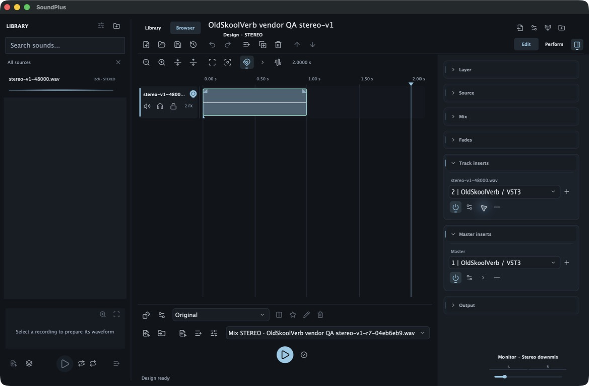
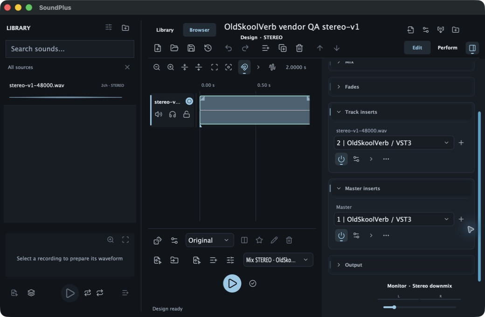
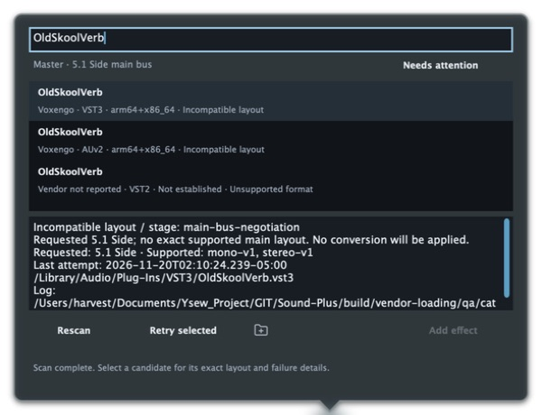
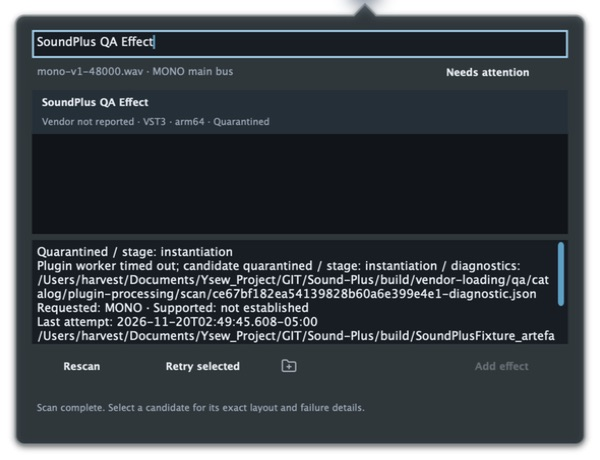
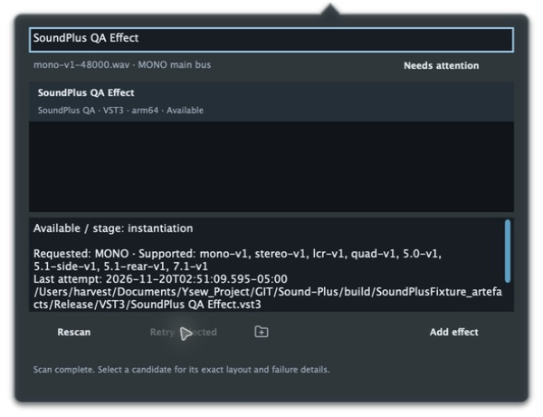
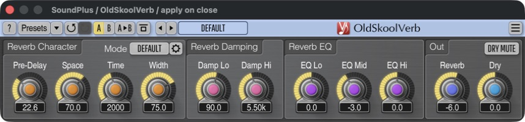

# Real vendor loading correction — R26–R30

Started at `056ff389025f40e895e1f7891cfe47eaeca0e2c4`, after reviewed `3e09c9d`. Preserved the later unified/contextual insert selector, separate Track/Master cards, Lucide styling, stock/hosted stage order and raw-pass output authority.

The host corrections pass the full automated gate. Installed **LV50A 1.0.0** and **Voxengo OldSkoolVerb 2.14** passed Mono/Stereo Track/Master processing, inline-control, saved-state and render checks. Their real editors opened and recalled settings. This is **not** blanket vendor compatibility certification: TAL's inline processing remains unresolved, Youlean's meter response is unqualified, and custom gestures inside Voxengo's editor were not established by automation.

## Findings closure

| Finding | Status and implementation | Fresh verification |
|---|---|---|
| R26: overly broad MIDI/bus rejection | Fixed. [Worker classification/negotiation](../src/PluginWorkerMain.cpp#L158) and [shared policy](../src/PluginBusPolicy.h) retain declared buses, disable optional auxiliaries and require exact main roles/active counts. MIDI input stays empty; unused output is discarded per block/slot. Instruments/MIDI-only and genuinely unsupported topology remain rejected. | Owned VST3 optional-MIDI and optional-sidechain factories processed finite and retained two-slot PCM; negative instrument/MIDI-only/unsupported-topology cases passed. A [required-auxiliary processor](../tests/PluginBusFixture.h) refuses deactivation through the **same production policy**. JUCE's VST3 client wrapper can mask processor-level deactivation refusal by supplying silence, so that wrapper is not misrepresented as the mandatory-bus negative oracle. |
| R27: cached class rejection never retried | Fixed. [Catalog](../src/PluginProcessing.cpp#L367) separates enclosing and class failures, uses probe-policy version 2, and explicitly re-probes selected unchanged bundles. Other entries/roots and atomic cancellation behavior remain intact. | Starts with empty enclosing error/nonempty class reason; transient failure removed without changing bytes; targeted probe clears rejection. Policy invalidation and existing crash/hang/cancellation tests pass. Native chooser retained an actual timeout across restart; **Retry selected** recovered the unchanged owned fixture. |
| R28: failed/incompatible candidates hidden | Fixed. [Candidate rows](../src/PluginProcessing.cpp#L668) and [chooser](../src/HostedRackView.h#L577) show searchable Available/Needs attention results, vendor/format/architecture, requested/supported buses, stage, reason, attempt time and diagnostic/log paths. Add stays unavailable for rejected buses. | Native Track/Master choosers exposed cached TAL rejection, Intel-only EnveLover, VST2 dependency status, missing slot, actual owned timeout and OldSkoolVerb's explicit 5.1 Side rejection. No silent conversion. |
| R29: unrelated actions cancel editor | Fixed. [Per-editor tasks](../src/HostedRackView.h#L327) own document incarnation/variation/owner/slot cancellation separately from scan/load epochs. [Interactive supervision](../src/PluginProcessing.cpp#L234) replaces the finite 20-minute deadline: 30-second startup grace, 15-second stalled heartbeat, existing memory guard and two-second recovery checkpoints. Editor instances now use **interactive**, not offline-render, mode. | [Actual view commands with controlled worker](../tests/PluginProcessingTests.cpp#L1348): A remains alive when B is selected/removed; A completion applies to A; removing actual A cancels it. Native helpers produced recovery presets and returned state. Voxengo's offline-render overlay disappeared after the mode correction. A 20-minute elapsed soak and direct Voxengo custom-control gestures were **not** verified. |
| R30: parameter height fails to relayout parent | Fixed. [Stock](../src/StockRackView.h#L438) and [hosted](../src/HostedRackView.h#L306) views report preferred-height changes. | Actual Gain → Reverb → Gain selector callbacks on Track and Master, plus hosted parameterless ↔ parameterized selection, pass. Native expanded controls and minimum-size inspector scrolling were inspected. |

Large processors may declare up to 16,384 parameters while the bounded inline surface remains at most 512. For large surfaces, non-automatable aliases are omitted; TAL exposes 12 controls rather than 2,080 MIDI aliases. Complete opaque state remains bounded and retained. Hosted stable parameter IDs are recorded/validated alongside legacy numeric IDs. Redundant program restoration is avoided when opaque state owns that program; live snapshots apply changed values rather than repeatedly notifying unchanged controls.

## Installed vendor outcomes

Actual execution platform: Apple M5 Pro / Mac17,8 / 48 GiB, macOS 26.3.2, Release arm64, JUCE 8.0.6, SDK 26.5. Universal bundle architecture is recorded separately from the executed arm64 host. [Final installed inventory](verification/vendor-loading/final-installed-inventory.json), [numerical identities/results](verification/vendor-loading/numerical-results.json) and [artifact hashes](verification/vendor-loading/artifact-identity.json) retain exact versions/classes/binary identity. OldSkoolVerb appeared in the installed directory during this task; SoundPlus did not install or activate it.

| Product / exact class ID | Discovery/layout | Processing, recall and output | Editor / limitation |
|---|---|---|---|
| LV50A 1.0.0 / `VST3-LV50A-175fed7d-f3a1a62e` | Native universal bundle; Mono/Stereo. Baseline timed out during macOS bundle loading; captured stack was in code-signature loading, **not** layout rejection. After the user's OS approval, scan completed in 0.61 s. No signatures/quarantine protections were modified. | Passed generated Mono/Stereo, separately on Track and Master. Persistent Trim reduction lowered peak 0.03362645 → 0.00640739. Saved recipes recalled and durable float renders matched graph PCM within 1e-6. Native Track/Master insertion, inline editing, editor return and save/reopen were observed. 5.1 Side is a valid negative. | Actual editor opened on both owners and returned state, including edited Trim. Separate apply-on-close instance; no live native-editor claim. |
| OldSkoolVerb 2.14 / `VST3-OldSkoolVerb-c2dd90f-10700a49` | Native universal bundle; Mono/Stereo; reported `Fx|Reverb`. | Passed the same four independent owner/layout cases; expected impulse tail present. Persistent RevGain reduction lowered settled peak 0.11750273 → 0.00206020. Native chooser added it to both owners; Track PreDly 0.2 and Master 0.3 remained independent after save/reopen. Native finalized Stereo render and raw-pass quantization audit passed. 5.1 Side rejection was visible before insertion. | Actual Track/Master windows displayed restored 15.6/22.6 ms values and returned state. Offline-mode overlay fixed. Attempts to alter its custom controls did not establish a change; **custom-editor gesture qualification remains open**. |
| TAL-Reverb-3 2.3.0 / `VST3-TAL-Reverb-3-29a99d5-45487f22` | Baseline incorrectly rejected optional MIDI; then hit the old 512-declared-parameter rejection. Both loading barriers corrected. Native Track/Master insertion and editor state return observed. | **Partial / inline not qualified.** Final helper reproduces identical PCM for dry=0 with wet=0 versus 0.8. Development instrumentation observed advertised IDs/values in VST3 queues and processor `getPoint` reads, while component state/PCM stayed unchanged. Root cause unresolved; no product-specific state rewrite or substitute format was added. Earlier “different consecutive blocks” evidence was insufficient and is not used as a pass. | [Investigation](verification/vendor-loading/tal-inline-investigation.json). Temporary SDK tracing and speculative workarounds were removed; original vendored JUCE bytes were restored and hashed. |
| Youlean Loudness Meter 2 2.5.15 / `VST3-Youlean Loudness Meter 2-1caa29dc-8eadedc1` | Enumerates; advertises Mono/Stereo and some named surround layouts, including Rear rather than Side 5.1. | **Unqualified meter response.** Enumeration or transparent PCM alone does not prove actual metering. Not counted toward the two processing products. | Native audible-instance meter response remains open. |
| EnveLover 1.0.3 | Actual binary is x86_64-only. | Unsupported architecture, visible with specific reason; no Intel bridge or invented arm64 qualification. | Not loaded. |

The inline measurements include a 65,536-frame settling window and fast offline block processing; their 169–189 ms wall time is **not** an end-to-end live gesture latency claim. [Retained controls](verification/vendor-loading/inline-controls.json) and the separate owned [continuous-control measurements](verification/vendor-loading/continuous-host-controls.json) state their respective bounds.

## Native and automated evidence

- Full **26/26 CTest** gate passed in **175.27 s**, including eight real-vendor owner/layout render cases. [Log](verification/vendor-loading/ctest-final.log).
- Fresh AddressSanitizer frontend/core driver passed **157,697 checks**. Leak detection disabled; vendor/helper binaries are not claimed instrumented. [Log](verification/vendor-loading/asan-final.log).
- Portable owned 5.1 Side archive passed **505 checks**, zero independent gain/polarity/latency/channel-order error, exact split/copy/state/source identity. [Archive](verification/vendor-loading/portable-evidence.zip), [audit](verification/vendor-loading/portable-audit.json).
- Concurrent fixture workload audit: 16/16 searches published, p95 12.27 ms, zero reported underruns. Bounded fixture workload, not maximum product capacity. [Audit](verification/vendor-loading/workload-audit.json).
- Native finalized outputs were Stereo / 48 kHz / signed 24-bit / 96,000 frames. Float raw-pass authority hashes matched; maximum quantization error ≤ 5.961e-8. [Paths and audit](verification/vendor-loading/native-renders.json). No new human listening, physical surround, or receiving-app acceptance is claimed.
- Browser and Inspector remained usable at the supported **1040×680 outer window** and a larger window; compact inspector scroll exposed Track, Master and Output above the fixed monitor. This is not every possible display-scale configuration. Existing icon suite passed; no icon family/rendering changes were made.








The chooser uses compact candidate rows with details on selection. The existing single insert selector per owner is retained; parameter disclosures and More actions avoid adding another inspector hierarchy.

## Preservation and remaining requirements

All **178** protected current-catalog files and **11** previously recorded original media files matched before relaunch. Reopened the current catalog **in place**, without restoring an older snapshot: **Workflow demonstration r34**, unsaved edits, playhead 2.112 s, monitor 0.25, latest r33 render retained. [Restoration record](verification/vendor-loading/restoration.json).

VST/VST2 remains required as the user clarified. Its adapter is **blocked by the missing lawful SDK/distribution dependency** in this checkout; no SDK was fetched, requirement removed, or legacy bundle presented as loadable. AUv2 retains fresh Apple AUDelay production regressions, including exact named layouts. AUv3 runtime qualification remains open. Cross-application delivery was not repeated and is not inferred from any internal drop or render. Live native editing of the retained audible instance, arbitrary stock/hosted interleaving, plugin-aware takes and Expanded Perform remain later work.

## Reproduce

Quit SoundPlus before rebuilding its running bundle.

```sh
.tools/cmake/data/bin/cmake -S . -B build -DCMAKE_BUILD_TYPE=Release -DCMAKE_OSX_ARCHITECTURES=arm64
.tools/cmake/data/bin/cmake --build build --target SoundPlus SoundPlusTests --parallel 6
.tools/cmake/data/bin/ctest --test-dir build --output-on-failure
open -n build/SoundPlus_artefacts/Release/SoundPlus.app --args --data-dir "$PWD/build/gain-hover-native"
```

With the same installed vendor versions, the optional native-vendor numerical branch runs with:

```sh
SOUNDPLUS_VENDOR_QUALIFICATION="$PWD/build/vendor-qualification" \
  .tools/cmake/data/bin/ctest --test-dir build -R '^plugin_processing$' --output-on-failure
```

For a brief manual check, use a separate QA design/catalog: Add effect → Plug-in, search a vendor, inspect requested bus/status, add on Track then Master, expand parameters and change one while playing. Open/close each editor, save, quit and reopen; verify independent values. Render and inspect its durable WAV. Choose 5.1 Side on the QA design to confirm a Stereo-only effect remains visible with Add unavailable. To review a missing processor, move only an owned QA copy of its bundle after saving, then reopen; retain its slot/state and expect processing to block. Never move installed/user source bundles for that check. Listening and external receiver save/quit/reopen remain separate manual evidence.
