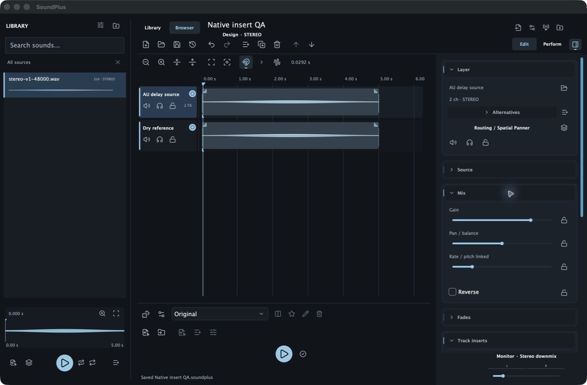
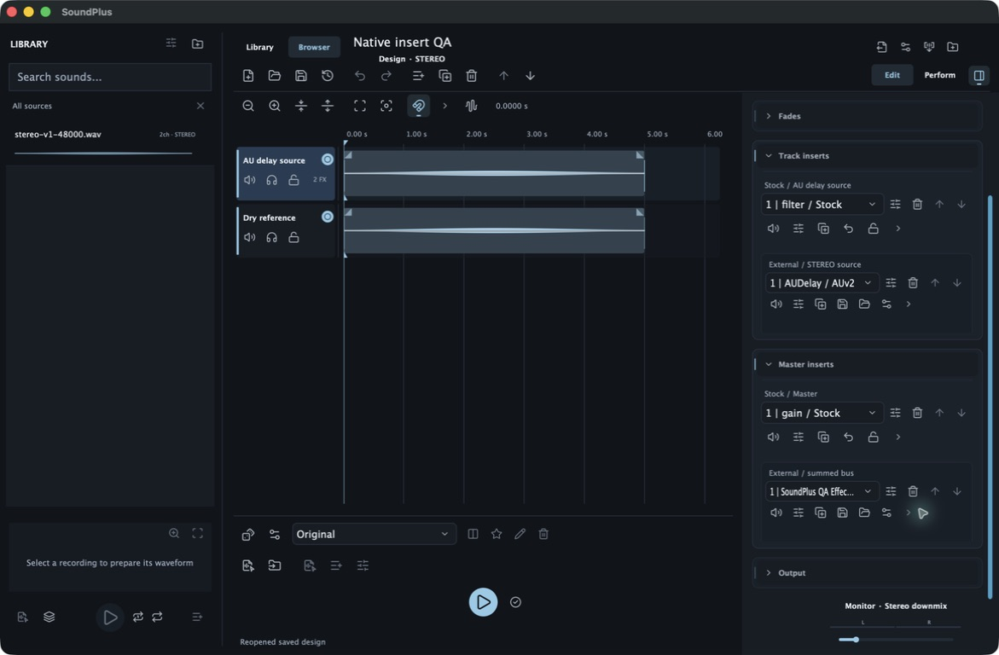
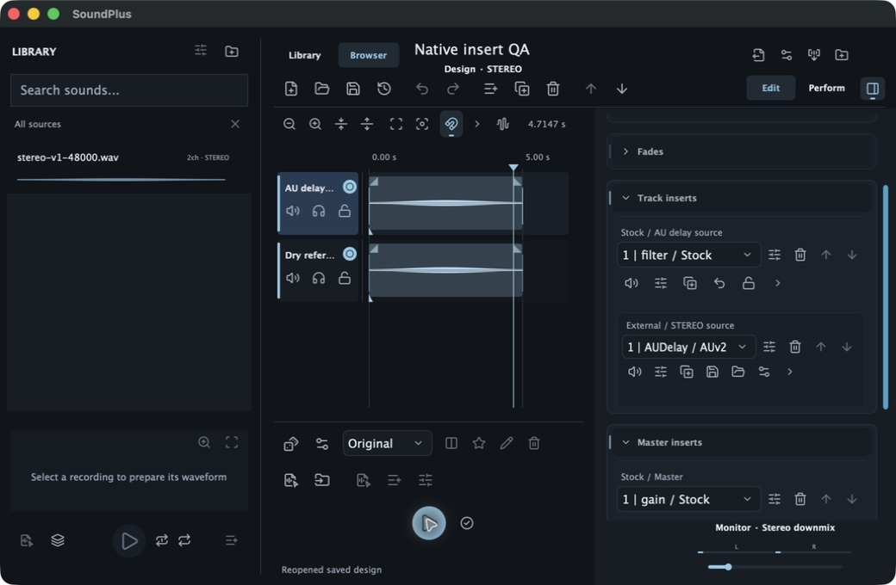

# Saved-job recovery and independent insert foundations

Baseline `53f4fab47fb6a0c0ed01caf3f17bb9eb2f84e83c`, initially clean. Recovery is separately committed as `5da93c2`. The subsequent feature work preserves that correction and the existing Library, fades, stock DSP and frozen take contracts. This is a bounded, incomplete multi-format foundation, not completion of every required format or Expanded Perform.

## Changes

Details groups now have separate theme-based cards, subtle accent markers/outlines, aligned short headers and larger group/body spacing. Group collapse preferences persist. Stock and external parameter disclosures collapse independently, allowing Track and Master inserts to remain visible together without a shared target selector. Lucide vector rendering and the current Designer color system remain.

Track/master stock editors bind delayed commands and gestures to document incarnation and stable owner/slot IDs. External slots retain separate opaque state, format/class/fingerprint, bus and parameter identity; independent copy/move, bypass, order, generic controls, presets and isolated editor access are provided. External stages follow stock stages. There is no arbitrary stock/external interleaving.

Persistent rack services retain processor history and run configuration/DSP/destruction on their serviced helper message thread. The sole device owner consumes its existing PCM ring; it never waits on a plugin helper. Fixed shared audio/control exchange is producer-side. Compact live controls omit opaque state. Failure stops requested processing rather than certifying bypassed/stale audio. Parallel PDC and aligned bypass preserve reported delay; creative delay stays content. Retired hosted graphs are reclaimed by a bounded cleanup worker after callback hazard release, keeping process shutdown waits off the active producer. The device regression deliberately delays fixture release to exercise this handoff.

Hosted offline output executes one graph pass into retained float PCM with graph/hash provenance. Normalization and final delivery encode from that pass. Hosted Render Selection is an explicitly labeled pre-master selected-layer stem. Original files and previous outputs remain untouched.

## Closure and limits

| Requirement | Result / evidence |
|---|---|
| R25 saved normalized job raw authority | Fixed in separate recovery commit; full saved-job matrix and panel checks repeated in the feature suite. See [R25 report](R25_SAVED_JOB_REPORT.md). |
| Independent Track and Master stock racks | Implemented in [StockRackView](../src/StockRackView.h); actual view commands cover delayed selection, independent master, history, stable IDs and bounds. Stock bulk bypass changes per-slot flags; it is not a separate non-destructive rack-bypass mode. |
| Hosted slot ownership / serialization | [HostedRackView](../src/HostedRackView.h) / [model](../src/DesignModel.cpp) implemented; owned fixture graph/state, reorder, bypass and owner checks. Native duplicate/transfer/preset dialogs are not fully qualified. |
| VST3 persistent chains | [Service](../src/HostedRackService.h), [producer](../src/DesignAudio.cpp) and [retirement](../src/AudioStream.cpp) implemented; owned fixture PCM, exact layouts, PDC, retained controls, failure and single-pass render tests. |
| AUv2 | [Registered discovery](../src/RegisteredAudioUnits.h) / [worker](../src/PluginWorkerMain.cpp): Apple AUDelay adapter exercised in production finite/persistent/state paths; other vendors remain unqualified. |
| AUv3 | Registration/async adapter path implemented; runtime processing/editor/render qualification remains open because no suitable runtime fixture has been qualified here. |
| Required VST2.x | Blocked: no lawful SDK/host-distribution dependency established. No adapter advertised; required format remains incomplete. |
| Native plugin editor | Separate isolated instance; state applies on close. This does not edit the persistent live DSP instance. |
| Dynamic plugin latency / bus changes | Fail closed and require Stop/reprepare; seamless graph replacement is not implemented. |
| Plugin-aware take capture | Deferred pending a new authoritative plugin-aware event/PCM contract; disabled for hosted mixes. Existing stock takes remain unchanged. |
| Expanded Perform | Following milestone, not implemented in this foundation. |
| Physical surround / human listening | Not qualified; numerical and device status evidence are separate. |
| Cross-application delivery | Not qualified by this work; no receiving-app native import/place/save/quit/reopen pass is claimed. |

Detailed limits and dependency references are in the [hosting contract](PLUGIN_HOSTING_CONTRACT.md); actual format/layout scope is in the [qualification matrix](PLUGIN_FORMAT_MATRIX.md).

## Verification

The final [CTest gate](verification/saved-job-racks/ctest-final.log) passed **26/26 suites in 161.64 seconds**, including plugin processing in **53.88 seconds**. The [AddressSanitizer driver](verification/saved-job-racks/asan-final.log) passed **157,631 assertions across eight exact named buses**. Its [instrumentation manifest](verification/saved-job-racks/sanitizer-artifact.json) describes instrumented core/JUCE/UI/session coverage; process-boundary Release helpers and plugins are not instrumented. Leak detection was disabled; no memory-error suppression was used. [Detailed CTest output](verification/saved-job-racks/ctest-details.log.gz) is retained.

The [artifact manifest](verification/saved-job-racks/artifact-identity.json) binds **219 source/resource/test files and 8 Release binary artifacts**. Compiled source-tree SHA256: `3494da69b7e4c4fd25e2a9e5d9be080c1afd948f0693a86d42e1dd81e16539b0`. No compiled source changed after these tests or the final native checks.

[Production tests](../tests/PluginProcessingTests.cpp) cover saved authority/fallback races, all eight named VST3 layouts, actual mono/source-vs-master buses, PDC/bypass/master delay once, noncommuting reorder after serialization, crash/hang/corrupt-state rejection, sustained controls, accurate/live tail history and nondeterministic single-pass normalization/provenance. [IPC tests](../tests/AudioHealthTests.cpp) preserve the ordinary 64 KiB limit while exercising a larger hosted-control frame. Stock-only/take canonical and PCM regression suites pass unchanged.

A development gate initially rejected sub-`1e-7` float round-trip bias in a strict-zero tail assertion; the test now uses a numerical floor below the delayed impulse. A device check also exposed intermittent underruns around graph handoff. Retirement previously could wait for process shutdown on the producer; the final path moves retired hosted graph cleanup to a bounded worker. The final device test deliberately adds 250 ms fixture release delay and reports zero underruns. These earlier failures are not represented as passing evidence.

| Final bounded measurement | p50 ms | p95 ms | p99 ms |
|---|---:|---:|---:|
| 64 persistent control+127-frame PCM blocks, one retained service | 1.456 | 2.654 | 2.782 |
| Process-workload UI tick | 0.050 | 0.084 | 0.096 |
| Search to observed UI publication | 11.139 | 11.471 | 11.471 |
| Waveform request to UI adoption | 26.565 | 71.060 | 71.060 |

[Raw control records](verification/saved-job-racks/continuous-host-controls.json) and [independent nearest-rank recomputation](verification/saved-job-racks/control-audit.json) retain each step. [Actual device records](verification/saved-job-racks/hosted-device.json) show 12 edits without an additional preparation request (one preparation throughout); latest control heard at **40.87 ms**. Pending seek adopted the next generation and its latest sequence, with **686.45 ms** measured through preparation in the deliberately slow-release fixture case. Both continuous and pending-seek records report zero underruns. This is a short bounded run, not an endurance or general low-latency guarantee.

[Workload records](verification/saved-job-racks/load.json), [independent summary](verification/saved-job-racks/workload-audit.json) and [four negative auditor mutations](verification/saved-job-racks/workload-auditor-negative.json) retain the concurrent index/search/playback scope. There were 16 published searches, 10 total waveform decodes (2 during load), 167936 advancing audio frames and zero underruns. Polls/assertions are not independent listening trials.

The fresh [portable archive](verification/saved-job-racks/portable-evidence.zip) passes **505 independent checks**, with gain/polarity and expected PCM maximum error **0**, exact 37-frame latency removal and matching six-channel master/role-named splits. [Package](verification/saved-job-racks/package.json) and [audit](verification/saved-job-racks/portable-audit.json) bind generated evidence only; no plugin binaries or user recordings are redistributed. [Apple AUv2 wet-delay evidence](verification/saved-job-racks/au-wet.json) additionally verifies changed, nonzero delayed PCM through the final production helper; dry/state tests alone are not its effect-content claim. The native QA app and all four relevant children are byte-identical to the normal Release bundle (see [native records](verification/saved-job-racks/native-workflow.json)).

Native checks used a separate catalog and generated five-second Stereo / 48 kHz source. Both Browser and Inspector were visible at **1040 × 680** and at the normal 1360-wide window. Headers, toolbar, track controls, parameter entries and monitor controls remained usable; long bodies scroll inside the inspector. Group and stock/external disclosures independently returned from On to Off. Keyboard focus reached a bounded track header. No overlaps were observed in the inspected states; this is not a claim that every possible vendor UI or scaling configuration was tested.

The Apple AUDelay native window opened as its own GUI helper. Changing wet mix, selecting the other track before close, and applying state edited only the original owner. Save/Open, Undo/Redo, native parameter recall and Command-S after close were observed. The owned VST3 fixture has no vendor editor: its isolated JUCE generic fallback opened and applied a gain change on close. Inline AU parameters updated while the Designer transport remained active. Native preset-file dialogs and external copy/move gestures were not separately exercised. Their controls are implemented; these native acceptance sequences remain open.

The real Process panel opened a saved normalized job after the generated derivative was retained aside. It showed Raw with normalization still requested, auditioned and explicitly stopped, normalized again and created a finalized durable copy. [Native R25 evidence](verification/saved-job-racks/native-r25.json) confirms generation/state/raw hashes retained and **zero process-mode requests** in that native panel. The generated derivative was restored. The new QA copy is retained at `~/Music/SoundPlus/Processed/Processed-93166d32ca05471d9d013a7b0b15d899/Mix.wav`; its original inputs were never overwritten.

A native standard-location scan also surfaced actual unavailable candidates: EnveLover VST3 was rejected as incompatible, LV50A timed out and was quarantined, and some Apple AudioDSP bundle candidates exceeded the fingerprint file-count bound. They are not advertised as runtime-qualified. Broader vendor compatibility remains open.

### Layout evidence

Short left-aligned headers and restrained accent marks identify separate groups; body padding and gaps separate settings without adding more navigation. Stock and external stages have distinct inset surfaces. Collapsed parameter lists let both rack owners stay accessible.







[Minimum Library](verification/saved-job-racks/library-minimum.jpg), [expanded parameters](verification/saved-job-racks/parameters-minimum.jpg), [native Apple editor](verification/saved-job-racks/au-native-editor.jpg) and [VST3 generic fallback](verification/saved-job-racks/vst3-generic-editor.jpg) provide additional inspected states. Human listening, physical surround and receiving-app delivery were not performed.

## Build and repeat

Close SoundPlus processes using this bundle first, retaining the latest session. From the repository root:

```sh
.tools/cmake/data/bin/cmake --build build --parallel 6
.tools/cmake/data/bin/ctest --test-dir build --output-on-failure
open "$PWD/build/SoundPlus_artefacts/Release/SoundPlus.app"
```

For isolated native checks, use `open -n ... --args --data-dir /absolute/QA/catalog --disable-ai`, generated media, and a QA document. Expand/collapse each details header; show Track and Master together, change tracks, edit one stock/external parameter, Undo/Redo, save/reopen, and test the minimum window with Browser/Inspector visible. Missing processors must retain state and visibly refuse requested processing. Native editor state applies only after its window closes.


## Session retention and remaining acceptance

[Restoration evidence](verification/saved-job-racks/restoration.json) confirms 178 protected catalog/recovery/media files and eleven known original recording hashes unchanged before user relaunch. The regular app reopened **Workflow demonstration r33**, recovered unsaved changes in place, Edit / Browser visible, monitor 0.25 and playhead 2.112 s. No older snapshot replaced later edits. The original catalog and saved Rain glass design remain in place. The new native QA copy is retained separately as documented above.

Required VST2 and AUv3 runtime qualification remain incomplete. Native editor use is apply-on-close, not live-instance editing. Plugin-aware take capture, arbitrary stock/external interleaving and seamless dynamic-latency replacement are not implemented. Stock bulk bypass has per-slot semantics. External transfer/preset and editor removal/document-change native sequences need additional qualification; no receiving-app delivery pass is claimed. Expanded Perform remains a following milestone while these foundations are incomplete.
