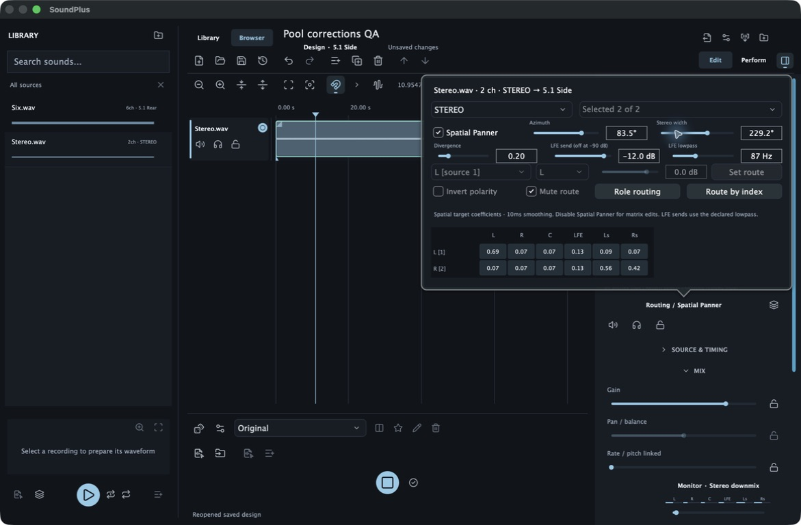
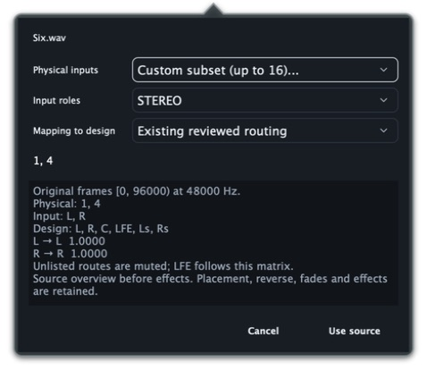
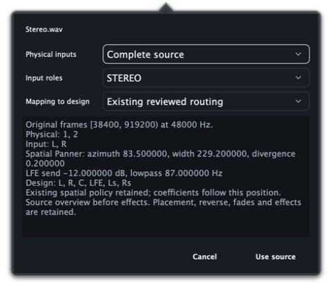
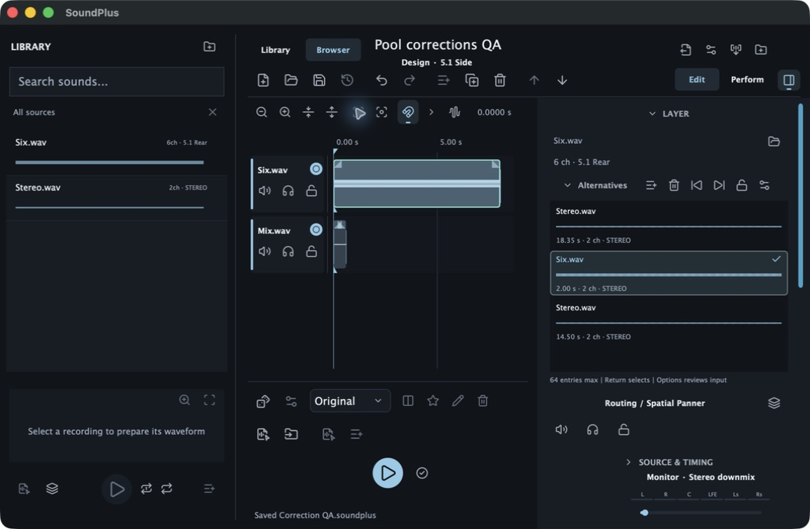
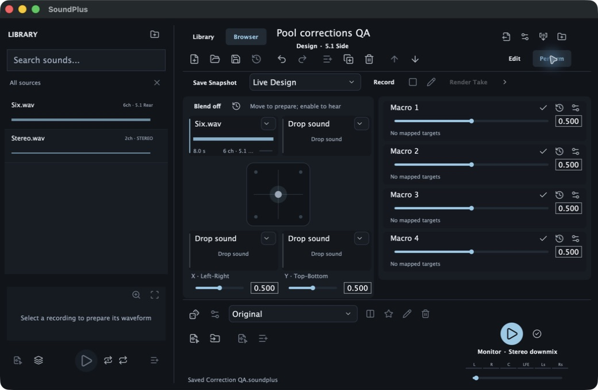
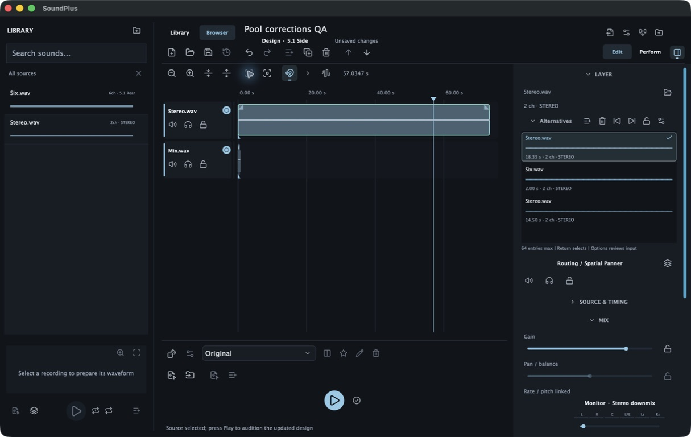

# Source Pools v1.5.1 — R18/R19 correction report

Starting/reviewed HEAD: `5ab604837cc6d82e123fca6f367f9c773b8f72b6`. There were no newer commits or unrelated working changes. The supplied [review](reviews/Review_5ab6048_Source_Pools_v1_5.md), full attached prompt, repository guidance and compatibility/take contracts were read. This correction preserves the shared JUCE/session/audio architecture, optional pools, Library repeat/similarity/range behavior, existing theme/Lucide controls and pinned 10-point fades.

## Closure

| Finding | Disposition | Correction and evidence |
|---|---|---|
| R18: pooled same-source Live edits stop playback | **Fixed** | [SourcePools.cpp](../src/SourcePools.cpp) `pooledSourcesDiffer` retains entry/source/stamp/path, physical-pair, bus/version and structural routing checks. It excludes current-entry trim bounds and uses [DesignLive.cpp](../src/DesignLive.cpp) `liveRoutingStructure`, shared with the existing graph signature, to exclude only qualified azimuth/width parameters. Actual entry selection, same-file/different-range entry changes, relocation and structural remapping retain stop/reprepare. Real session/panner/canvas callbacks and Undo/Redo retain ownership, stop count, generation and expected graph PCM. Native drags/history and real-helper background-work checks passed. |
| R19: unchanged review changes physical inputs or spatial/LFE settings | **Fixed** | [PoolMappingReview.cpp](../src/PoolMappingReview.cpp) initializes Complete source only for the exact full ordered list, pair presets only for exact physical pairs/valid odd final channels, and every other selection as exact Custom. Existing reviewed routing includes implicit spatial routing and precise explicit matrices. Inputs/roles/mean/destination must match before existing routing is reusable; incompatible edits disable it and require a new validated mapping. [DesignerPools.cpp](../src/DesignerPools.cpp) constructs the same production component/Use callback used by tests. [DesignPoolSession.cpp](../src/DesignPoolSession.cpp) treats a verified unchanged active review as observational: no revision/history/seeded-provenance or playback rewrite. Native 1,4 and spatial/LFE round trips passed. |

The review component was extracted from its anonymous inline definition into a reusable component and factory without adding a new toolbar or engine. Mapping settings remain entry-owned. A changed mapping still requires explicit confirmation. Two garbled menu strings observed during native testing were made readable; no cosmetic redesign was introduced.

## Reproduction and regression coverage

Both defects were reproduced before repair through production paths, after behavior-preserving component extraction: the actual panner callback stopped the controlled Live session, and the actual review constructor lost the ordered custom inputs. [R18 failure](verification/source-pools-v151/baseline-r18.log), [R19 failure](verification/source-pools-v151/baseline-r19.log), [reproduction source/test identity](verification/source-pools-v151/baseline-reproduction-identity.json). These are executed Mac component/session tests, distinct from the supplied review's portable stand-ins.

[PoolCorrectionTests.cpp](../tests/PoolCorrectionTests.cpp) exercises:

- Real azimuth/width slider callbacks and canvas IN/OUT pointer gestures, including Undo/Redo; unchanged playback stop count/generation; actual graph parameter adoption and settled PCM versus the expected recipe, tolerance 1e-6. Trims keep the head inside audible material.
- Same-file/different-range entry switching still stops; failed missing-source activation preserves source/intent; structural mapping changes still stop; parked Library/reference ownership and Arming/Recording/Finalizing remain protected.
- Actual review constructor, both refresh paths and the production Use callback for 1,4; 1,3,5; a single nonfinal input; reordered inputs; a standard pair; complete source; an odd final channel; and the qualified 64-input arithmetic Mono mean.
- Precise explicit gain/inversion/mute, Stereo and Mono initial-entry implicit spatial mode, azimuth/width/divergence and nondefault LFE send/cutoff. Unchanged active review preserves the complete document and seeded-choice provenance, including while playing. Deliberate edits, Undo/Redo, save/reopen and stale-context rejection pass. Independent per-channel tags check physical selection after the actual callback.
- A genuinely untagged six-channel WAV requires explicit ordered interpretation. Obsolete-bus reviews do not offer an existing-routing shortcut. No six-channel count is treated as evidence of surround.
- Frozen take capture/replay/render/split and actual Print callback, later Live pool edits, saved/reopened immutable identity, durable selected output sets and underlying portable bytes.

Full existing suites retain no-pool canonical behavior, manifest 4/5/6/7 dispatch, `sourcePoolMetadataVersion:1`, `stock-takes-v1`, frozen `stock-layout-takes-v1`, `stock-layout-takes-v2`, correction lineage, fingerprints, old recipe/event hashes and receipts. No historical fixture was rewritten. Scheduler/cache code and real-time callbacks were not changed.

## Exact build and test identity

Executed on MacBook Pro M5 Pro / 48 GiB, macOS 26.3.2 (25D2150), arm64 Release, JUCE 8.0.6, native CoreAudio requested at 48 kHz / 512 frames. [Artifact/source manifest](verification/source-pools-v151/artifact-identity.json) records the actual compiled source-tree digest and app, bundled audio/AI helper and test binary SHA256 values. The compiled source-tree SHA256 is `54f139a80149f5e3f512195d366ac0a043ae24a3f93b441d4a4534135dc7deb1`. Its per-file inventory was rechecked against the completed source bytes, and each actual executable was rehashed after testing.

The **final full integrated CTest run passed 25/25 in 109.22 seconds**: [summary](verification/source-pools-v151/ctest-final.log), [detailed output](verification/source-pools-v151/ctest-final-details.log.gz). The final focused correction run also passed: [log](verification/source-pools-v151/corrections-final-3.log). This includes the native-helper corrected-control workload and newly added production-path regressions.

An earlier full run passed 25/25 in 109.35 seconds. Native testing then prompted a small menu-text correction and stronger Mono/actually-untagged fixture coverage; the final run supersedes that earlier result. Failed test-fixture setup attempts were investigated (the native harness needed an initialized isolated catalog), not counted as passes. No broad new pressure campaign was warranted because scheduling/cache behavior was unchanged.

Close SoundPlus before rebuilding its bundle. From the repository root:

```sh
.tools/cmake/data/bin/cmake --build build --parallel 6
.tools/cmake/data/bin/ctest --test-dir build --output-on-failure
open build/SoundPlus_artefacts/Release/SoundPlus.app
```

## Bounded corrected-control workload

The real session/helper test executes 100 paired panner-update iterations (200 azimuth/width value changes), five canvas trims with Undo/Redo/Undo, shared real-source preview requests, and eight incoming batches totaling 256 generated real WAV files. This specifically exercises the missing Live-edit workflow; the old v1.5 run merely scrolled pool preview focus.

The final workload ran for 3.344 seconds, retaining 100 timestamped status samples, 74 distinct heard-edit sequences and 42 samples overlapping indexing. First-observed adoption latency p50/p95/p99 was **43.31 / 52.67 / 53.82 ms**. Playback generation and graph preparations both remained **1 → 1**, underruns were **0**, the source clock advanced from 97024 to 259840, and the active-end snapshot was still playing. Latency uses the first observed status for each distinct heard-edit sequence; status samples are not independent PCM observations or human listening.

[Raw native controls](verification/source-pools-v151/native-controls.json), [counts/latencies](verification/source-pools-v151/native-controls-summary.json). This short targeted workload is neither a maximum-capacity nor full semantic-index test. Decoder work was requested through the shared pool; this harness is not a measurement of a painted Library viewport. Normal native waveform/layout checks are separate.

## Native workflow

All actions used generated sources in `build/source-pools-v151/native-qa`, separate from the user's catalog. Actual native drags changed azimuth from −130° to 83.5° and width from 75° to 229.2°. Live remained playing through both controls, both clip trims and their Undo/Redo. A missing Six alternate failed while Stereo continued playing; reconnecting it allowed the explicit reviewed entry switch and stopped owned Live as intended.

The native custom editor reopened as Custom `1, 4`, Stereo, Existing reviewed routing. Accepting unchanged retained revision 35 and a byte-equivalent saved payload. The initial Stereo entry retained spatial mode, azimuth 83.5°, width 229.2°, divergence 0.2, LFE −12 dB and 87 Hz cutoff. Its current entry snapshot agrees with the saved settings. Mono initial-entry round-trip is additionally covered through the production component/session/Use tests on this Mac.

A short 0.608-second take was explicitly stopped, rendered to 48 kHz/six-channel/32-bit interleaved output and a six-member split set with multichannel Print master, then printed into Live as a six-channel layer. Interleaved and split-master PCM match exactly; each role-labelled stem matches its corresponding channel. Later Live source selection left both existing takes and receipts unchanged. An earlier 40.949-second QA capture is retained but is not substituted for the short-take check.

The save acknowledgement was checked before copying comparison documents. Initial immediate file copies had caught asynchronous saves in progress; those copies are excluded. The acknowledged before/after custom payloads are equal. [Native saved-state/output audit](verification/source-pools-v151/native-workflow-audit.json) and [78 timestamped native observations](verification/source-pools-v151/native-events.json.gz) distinguish UI observations from numerical checks.

After the final build, the saved r35 QA document reopened with Take 2 ready, its frozen Stereo source intact and the selected split output online while Live used Six. The actual custom review again accepted unchanged at r35. A further deliberate Live azimuth change to 90° and Undo/Redo preserved playback; saved r39 still contains exactly the same two takes and receipts as acknowledged r33. Frozen Take 2 remains at 83.5°. All eight output files rehashed successfully: [final reopen audit](verification/source-pools-v151/native-reopen-audit.json). The earlier native pointer drags preceded the final menu-text/test-only adjustments; the final executable additionally passed the real callback workload, full suite and this native reopen/control/history check.

Minimum 1040×680 and normal layouts retain Browser, Inspector, controls, keyboard focus, real source waveforms, Edit/Perform and the four Blend cards. Fit Design is applied deliberately; resizing does not reset saved timeline zoom.








## Portable generated evidence

[portable-evidence.zip](verification/source-pools-v151/portable-evidence.zip) contains the actual two generated source WAVs, checksummed saved design, consumed capture/replay WAVs, both finalized multichannel masters, all six split members, exact source/artifact manifest, relative-path inventory and independent Python-stdlib auditor. The archive is 1,497,078 bytes with 17 members and contains no user's session or media. Referenced source paths retain their immutable saved meaning; `index.json` maps them to relative archive members. The audit never reads those originating Mac paths.

The auditor passed **322 checks**: member hashes, stored payload checksum, raw-token frozen recipe/event checksums, exact source ID/revision/stamps/rate/range/mapping/origin, source fingerprints, output hashes, selected set, Print channel identity, ordered stem roles and PCM. The fixture consumes 8192 frames at 48 kHz from original range `[1200, 22000)`, physical inputs `[0, 3]`, with precise gain/polarity/mute routes. Capture/replay and both finalized masters have maximum PCM differences of **0**. A separate literal physical-channel/gain/polarity/mute oracle has maximum error **6.4154e-9**, below tolerance 1e-6; it does not simply compare two paths through the app's own renderer.

```sh
python3 scripts/audit_pool_corrections.py \
  docs/verification/source-pools-v151/portable-evidence.zip
```

The same auditor is included inside the ZIP. [Audit result](verification/source-pools-v151/portable-audit.json) and [archive checksum/inventory count](verification/source-pools-v151/package.json) retain the final execution. The package was regenerated from the final build's controlled fixture; old fixtures remain intact. The artifact manifest declares actual Mac binary hashes; the archive does not contain those Mach-O executables, so a receiver without them cannot rehash their binary bytes. Source bytes can be compared against the included per-file inventory in the repository.

## User session retention

The latest actual native session was identified before rebuilding: Rain glass design r17543, Variation 5, in `build/gain-hover-native`. Its recovery documents, settings, catalog and nine referenced source/render files were protected; the running bundle was closed before rebuilding. All QA used a separate catalog. The original catalog stayed in place, and no older backup or QA snapshot was restored over it.

The final application is left open on that same r17543/Variation 5 in Perform, with monitor volume 0.70 and the previous Blend coordinates retained. Recovery document bytes and settings match the protected post-quit state; all 43 asset identities/metadata, the one indexed root and nine media hashes remain unchanged. [Restoration evidence](verification/source-pools-v151/user-restoration.json). Protected user bytes remain outside tracked delivery under `build/source-pools-v151`.

## Separate open qualifications

No new human listening score or physical surround loudspeaker result is claimed. Native monitoring used the Mac's stereo output; numerical multichannel checks are separate. Real external-volume unplug/reconnect and cross-volume relocation were not exercised in this correction pass.

Native SoundPlus→Resolve receiving-project qualification remains **unverified**. It still requires the actual native drop/import of each intended original/full/selection delivery, track placement, filename/rate/channels/duration/content check, save, SoundPlus exit, receiving-project close/reopen and online-media verification, recording copied versus referenced storage. Neither historical API import nor drag initiation establishes acceptance. No Resolve automation, plugin hosting, live source triggering or new engine was added.
