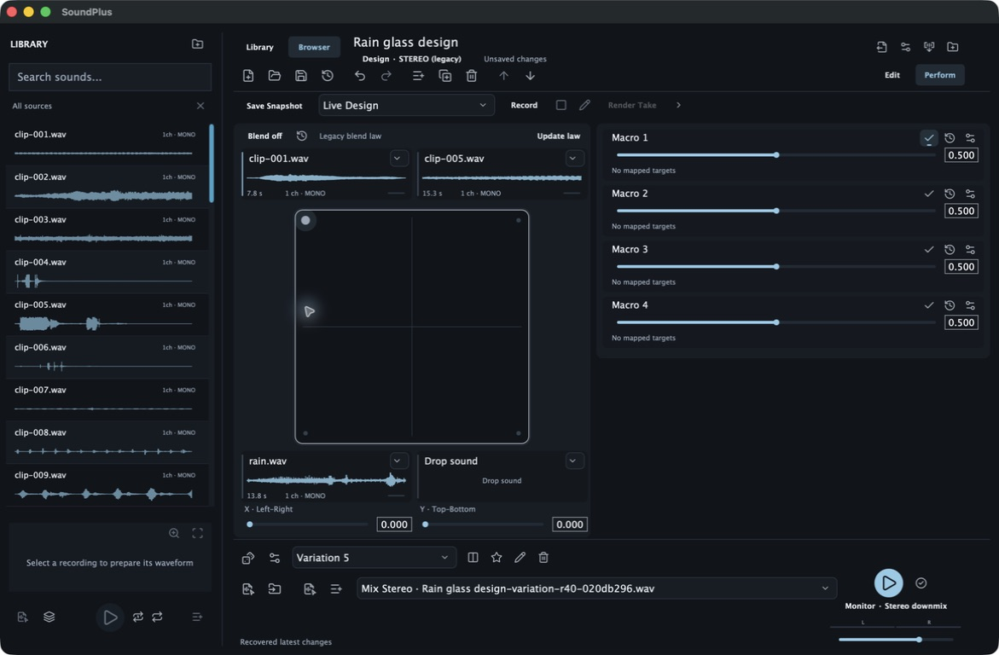
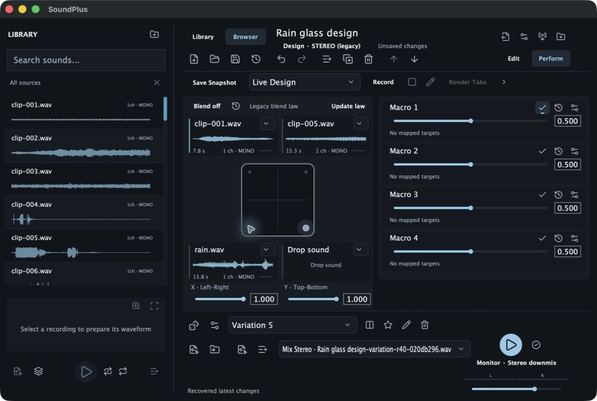
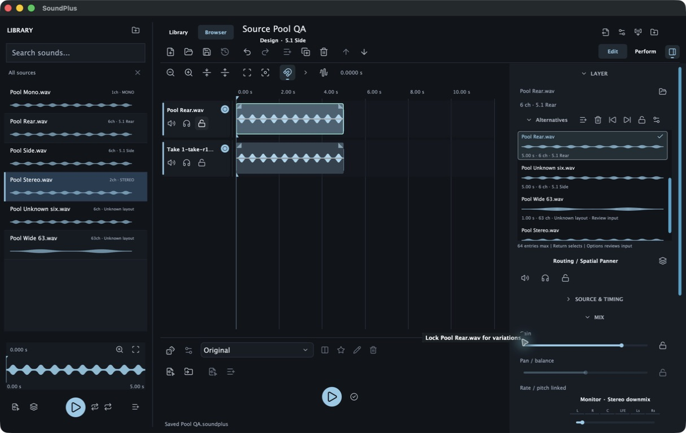
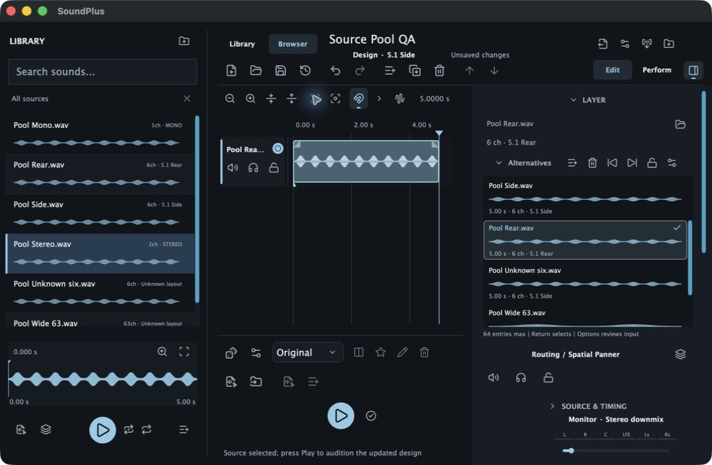
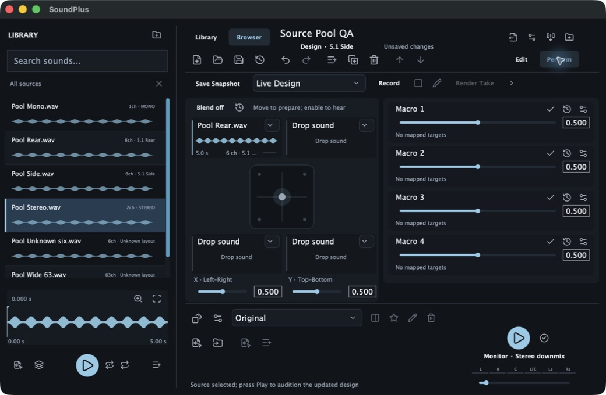
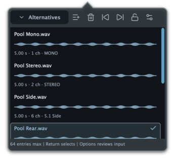
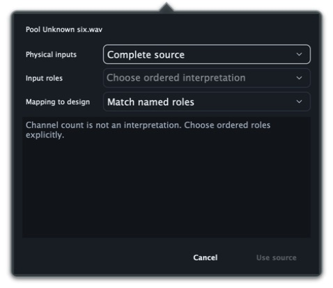

# Source Pools v1.5 — implementation and verification

Implemented from **6c3e18a60a8bd088de3aa03c9265782e900379e7**, newer than reviewed 6331a72. Its Library Repeat One/All, strict similarity cutoff/order, conditional manual range highlight and aligned playhead are retained. The existing shared JUCE/session/audio architecture, Lucide/theme tokens, four Blend cards and pinned 10-point fade controls remain.

## Delivered behavior and closure

| Requirement | Implementation and executed evidence |
|---|---|
| Optional bounded source pools | `DesignModel.h`, `SourcePools.cpp`: stable pool/entry/source identities; 1–64 entries; source frames, rate, fingerprint, detected layout/confidence, explicit physical selection, interpretation and destination mapping. Single-source layers need no setup. |
| Explicit atomic selection/history | `DesignPoolSession.cpp`, `DesignSession.cpp`: worker header/hash verification, per-layer generations, context/history invalidation, mid-stream cancellation, separate accepted imports. Controlled A→B→C, failed activation, Undo/Redo, document switch and exactly-once additions pass. Successful source changes stop owned Live audition; failed changes retain it. |
| Source-rate/range/reverse | `SourcePools.cpp`, `SourcePoolView.cpp`: elapsed sync converts/clamps; layer rate/reverse/placement/gain/fades/effects persist. Distinct Library regions remain distinct entries. Tests use 44.1/48k sources, reverse and long overlapping fades. |
| Alternatives UI/previews | `SourcePoolView.*`, `DesignerPools.cpp`: compact disclosure, Add/Remove/Previous/Next, independent lock, explicit remove-and-replace, mapping review, enable/reorder/content relocation. Edit inspector and contextual Perform card reuse one view and shared waveform cache/painting. Return commits the focused row; Next/Previous and lock callbacks are exercised. Actual Library payload/drop preserves its marked range. |
| Deterministic source variation | `SourcePools.cpp`, `DesignPoolSession.cpp`, `DesignerView.cpp`: opt-in source parameter; versioned FNV1a/SplitMix finalizer, lexicographic stable-ID candidates, persisted seed/ordinal/result. Literal independently computed expected vectors include 0, 1, 42, UINT64_MAX. Disabled candidates excluded; missing candidates never reroll. Source lock is independent from other parameter locks. |
| Compatibility/canonical identity | Manifest7 / sourcePoolMetadataVersion1 retain existing DSP tags. No-pool mix canonical JSON and PCM are unchanged. Full existing historical manifest 4/5/6 and empty-layout fixtures, frozen v1/v2 dispatch, corrected-copy lineage and receipts pass. `audioSourceProjection` strips only pool metadata, preserving takes and dependent output preferences. |
| Multichannel alternate correctness | New source-pool suite checks Mono, Stereo, 5.1 Side/Rear, Quad and discrete physical ordering against independent per-channel tags, including explicit LFE. Unknown 6 rejects until interpreted.63/64 inputs require explicit subset or qualified all-channel Mono mean; literal expected means/final-channel values pass. Existing full named-layout/legacy pair/Analysis Mix suites also pass. |
| Frozen takes and outputs | `PerformTake.cpp`, `SourcePools.cpp`, `DesignAudio.cpp`, `DesignTakeSession.cpp`: frozen recipe has no mutable pool; versioned exact origin accompanies immutable source provenance and receipts. Six-channel consumed capture/replay/offline maximum error **0** (required tolerance 1e-6). Split PCM/roles/paths/hashes, explicit stereo downmix and selected-member loss pass. Later pool deletion/Live bus and gain edits preserve take hashes/origin/PCM. |
| Capture guards | Arming/Recording/Finalizing block pool changes and rerolls; existing capture reservation/ownership suites pass. No source triggers or extra voices were introduced. |
| Recovery and failure | Missing chosen source fails atomically; original reconnect succeeds. Identical-content copy to a distinct inode/location retains stable identity; different content is rejected. Invalid save leaves the previous document byte-identical. Selected missing split set does not fall back. This is controlled local missing-file/content relocation evidence, not real external-drive or cross-volume qualification. |

See [the user guide](SOURCE_POOLS_V1_5.md) and [algorithm/ownership contract](SOURCE_POOLS_V1_5_CONTRACT.md).

## Baseline and session protection

Before feature edits, current 6c3e18a was independently configured/built on this Mac and fresh `performance_state` passed in 3.61s. [Baseline identity](verification/source-pools-v15/baseline-identity.json), [fresh log](verification/source-pools-v15/baseline-performance-state.log), [native notes](verification/source-pools-v15/baseline-native-status.txt). While the user was still editing, implementation proceeded against the separately retained baseline binary. After explicit release for restart, native baseline checks used that unchanged binary: normal/minimum pad corner drags, exact serialized 0/1 endpoints, keyboard focus, Home and Undo. Native Escape after release preserved state; held-drag Escape is verified by production component handlers in the fresh suite, not claimed as a manual held-pointer action.

The actual working Rain glass design advanced from r12754 to **r17543** while testing was pending. The newer document, Variation 5, catalog/preferences and all nine referenced source/render hashes were protected. Graceful quit advanced only its parked playhead from 356864 to 781712; revision, mixes, variation and outputs remained identical. The post-quit r17543 snapshot is the restoration baseline. [Protection audit](verification/source-pools-v15/session-protection.json). No older QA snapshot was restored over it.

## Test and artifact evidence

The initial integrated full suite passed24/24 in 104.12s. The first pool pressure run then exposed a real admission defect: new Alternatives owners 6/7 were outside the scheduler's accepted 0–5 range. Only the separately prioritized focused preview loaded. That run's apparent overall transport success does **not** qualify pool performance (one selected preview, zero complete viewports). The scheduler now admits both bounded surfaces without increasing the 48 full-source / 160 summary / 96 geometry cache ceilings. A real-WAV admission regression plus existing waveform suites passes. The workload also now fails if pool preview/viewport samples are insufficient. A second diagnostic found its ListBox call explicitly suppressed scrolling to the focused row; automatic focus/active selection now scrolls into view. Neither incomplete measurement is used for latency qualification. Excluded diagnostics remain in the build folder and are retained as [admission failure](verification/source-pools-v15/excluded-admission-native.json.gz) and [suppressed scrolling](verification/source-pools-v15/excluded-scroll-native.json.gz).

**Final complete CTest: 24/24 in 101.86 s**, after the scheduler and selection-scroll corrections. [Full log](verification/source-pools-v15/ctest-final.log), [detailed test output](verification/source-pools-v15/ctest-final-details.log.gz), [build log](verification/source-pools-v15/build-final.log). The source-pool suite includes 49,426 assertions (most are per-sample split PCM checks); this count is not a number of independent scenarios. [Exact source/artifact identity](verification/source-pools-v15/artifact-identity.json): compiled source-tree SHA256 `880dc2c3c24102d047554aeade9db9ec0cfd2f946498e5e67027b4539edf8d8a`, based on the recorded parent plus the per-file digest manifest. The local commit includes this same compiled source tree; report-only edits do not change it. Private UI/helper IPC advances to9; old audio/DSP receipt dispatch remains unchanged.

Executed on Apple Silicon MacBook Pro M5 Pro, 48 GiB, macOS 26.3.2 (25D2150), arm64 Release, JUCE 8.0.6, CoreAudio 48k/512. The binary identity file includes app, audio helper, AI helper and test SHA256 values. Per-tone icon viewport/antialiasing tests remain unchanged and pass. No hashing, decoding, database access or SVG parsing was added to paint/audio callbacks; painting writes only existing numeric observation fields. All graph/source preparation remains off the real-time callback.

## Final native workflow

The isolated `build/source-pools-v15/native-qa` catalog/document was used throughout. Native checks covered Browser drag into Alternatives (six→seven entries without retargeting the active source), reviewed source selection, explicit unknown-six-channel interpretation, deliberate Rear→Side physical-order mapping, source Undo/Redo, Edit/Perform and the contextual Alternatives popup. The minimum **1040×680** window retained Browser and Inspector, usable toolbar/track/output controls, real waveforms and keyboard focus; normal-size resizing also passed. Fit Design was applied deliberately after resizing rather than resetting the user's timeline zoom implicitly.

Native Record froze the selected Rear entry, completed a five-second take, rendered it to a finalized **48kHz / six-channel / 32-bit WAV**, then the actual **Add completed output as layer** callback imported the multichannel file into Live Design. The independent saved-file audit confirms the Print layer is six-channel 5.1 Side, the frozen pool origin/recipe/event identity is retained, and maximum per-sample error against the selected source under its reviewed physical-order matrix is **0**. The QA document reopened at r12 with seven alternatives, both layers, the frozen take and its durable receipt. These are native callback/save/reopen and numerical PCM results, not human listening scores.

[Native action/state evidence](verification/source-pools-v15/native-events.json.gz), [saved document/output/PCM audit](verification/source-pools-v15/native-workflow-audit.json). Final WAV: `build/source-pools-v15/native-qa/renders/Take 1-take-r10-6edbebc4.wav`, SHA256 `0bc579d8c0dbbd1ed057c3be8ee88bcfcaf0229e488c958059ed05cc76987f09`.

Alternatives stays in the source inspector or a contextual card popup, keeping the creative canvas and four-card organization intact. Advanced physical roles/matrices appear only in the review popup. The active checkmark differs from row keyboard focus, and original theme/Lucide/fade controls remain consistent.

The latest actual **Rain glass design r17543 / Variation 5** has been reopened in `build/gain-hover-native`. Native AX confirms the revision and variation; its recovery envelope is byte/structure-identical to the protected post-quit state, and all nine referenced media/render hashes match. [Restoration audit](verification/source-pools-v15/restoration.json). The QA document did not replace the user's working design.

## Bounded performance evidence

Final control and pool runs use the same compiled artifacts, M5 Pro/48 GiB Mac, fresh processes/catalog copies from the owned warm v1.4.1 derivatives, 10,000 real WAV files /1,253,073,116 bytes, 45 seconds active, 48kHz/512, eight layers, 5.1 Side, continuous stock performance-control changes, background indexing/inference, two incoming batches, and controlled offline/reconnect. OS file-cache state is uncontrolled. This is a bounded workload, not a maximum library capacity or completed semantic-index claim.

The control retains Perform plus per-channel detail like the historical v1.4.1 run. The pool run deliberately adds Edit + expanded Alternatives with 33 entries (original plus 32 real short files, 0.125–1s, 8–96kHz, mono/stereo/4ch) and scrolls focus through 32 entries while the original design plays unchanged. Its newly imported entry identities start with cold pool derivatives, over warm Library derivatives; neighboring/revisited rows can be warm. Cold and warm individual observations are not separated into statistical populations. Whole-viewport timing requires every visible waveform to have actually painted. Preview focus does not activate another source; actual activation uses the separately tested stop/reprepare path.

| Measurement (p50/p95/p99 ms) | Retained v1.4.1 | Final control | Pool run |
|---|---:|---:|---:|
| Library query→paint | 5.54/12.52/16.39 (n=30) | 5.62/12.06/16.48 (n=30) | 6.57/21.24/24.64 (n=30) |
| Library selected waveform | 23.74/49.80/52.95 (n=30) | 21.75/52.28/54.74 (n=30) | 24.30/55.27/58.74 (n=30) |
| Library whole viewport | 166.46/195.07/208.28 (n=30) | 158.90/200.07/204.59 (n=30) | 185.76/266.49/275.67 (n=30) |
| Alternatives focused preview→paint | — | — | 59.82/85.72/134.32 (n=32) |
| Alternatives complete viewport→paint | — | — | 109.06/252.45/298.35 (n=32) |

| Audio/cache observation | Final control | Pool run |
|---|---:|---:|
| Active duration, ms | 45002.27 | 45002.24 |
| Producer maximum, ms | 2.25 | 2.83 |
| Graph preparations start→active end | 1→1 | 1→1 |
| Underruns / helper restarts | 0 / 0 | 0 / 0 |
| Nonzero / total pre-monitor status observations | 15923 / 15923 | 11046 / 11046 |
| Waveform cancellations / priority preemptions | 63 / 36 | 64 / 36 |
| Full sources / geometries / peak-array bytes | 48 / 96 / 687544 | 48 / 96 / 590968 |
| UI / audio / AI peak RSS, bytes | 196411392 / 56426496 / 459210752 | 193183744 / 56279040 / 455983104 |

The pool view retained four row previews at active end. The shared hard bounds remain 48 full sources, 160 display summaries (≤2048 peak pairs each), 96 geometries and one serial decoder; telemetry buffers retain at most 512 preview observations. Peak-array byte accounting excludes containers/geometry/process overhead. Final counts and raw observations include cache hits/decodes/fair admissions and source-ID-specific timing records.

[Final control summary](verification/source-pools-v15/control-summary.json), [raw control](verification/source-pools-v15/control-native.json.gz), [pool summary](verification/source-pools-v15/pools-summary.json), [raw pool](verification/source-pools-v15/pools-native.json.gz), [control plan](verification/source-pools-v15/control-plan.json), [pool plan](verification/source-pools-v15/pools-plan.json). The raw reports have real `audioAtStop` snapshots captured **while playing**, unlike the historical null field. [Timestamped observations](verification/source-pools-v15/audio-observations.json) retain 177 periodic status samples in the pool run, with additional immediate retention for every observed peak≤1e-8 or underrun; no such low sample or underrun occurred in that qualified run. All 11,046 status checks were above threshold. Repeated helper statuses are not independent PCM samples and do not establish human listening quality. The earlier excluded run's nine low readings are retained with their timestamps; no cause is inferred. The historical v1.4.1 two untimestamped low readings remain unexplained.

At pool-run end, semantic coverage was 1,499 files complete / 8,534 pending, with 1,535 regions; background work remained active. This is not a full-corpus semantic-search completion claim. Historical metadata enrichment and uncontrolled OS/thermal/cache state limit causal performance comparisons.

## Open qualifications

- Numerical PCM/channel/receipt checks are automated evidence. No new human listening scores or physical surround loudspeaker listening are claimed. This Mac's native audition uses stereo monitoring of the multichannel bus.
- Real external-volume disconnect/reconnect and cross-volume relocation were not exercised. Controlled missing-file/reconnect plus same-content new-inode copy were exercised explicitly.
- **SoundPlus→Resolve receiving-app qualification remains unverified in this milestone.** No Resolve automation was added. A native receiver pass still requires dragging a finalized original/full-design/selection output into the actual Resolve Media Pool, placing it on an audio track, checking rate/channels/duration/content, saving, quitting SoundPlus, closing/reopening the receiving project and verifying online media. Record copied versus source-referenced location for each. Existing API import, Finder checks or drag callbacks cannot replace these steps.
- Ordinary Live seek remains a 250ms history approximation; Accurate audition rebuilds from zero. Forward-grain scrubbing remains separately qualified under its existing policy. Source switching during a take is deliberately outside this milestone's event contract.
