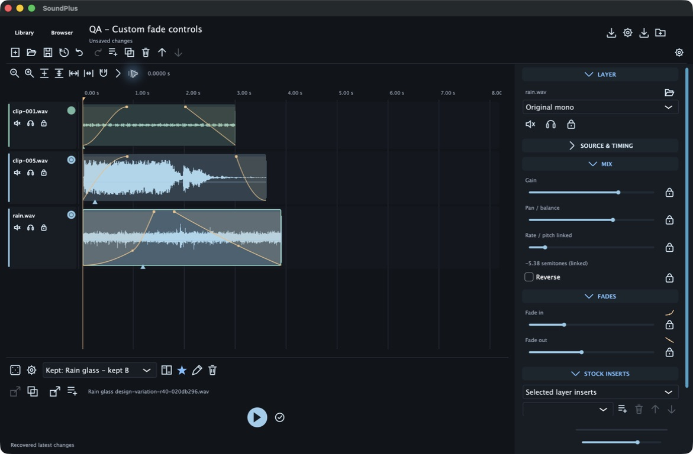
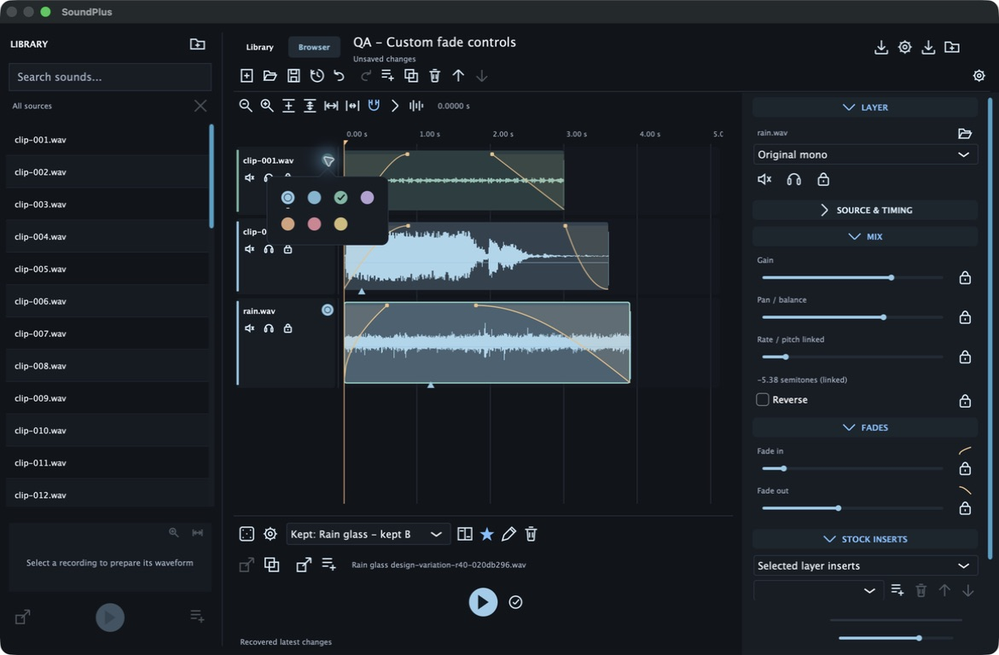
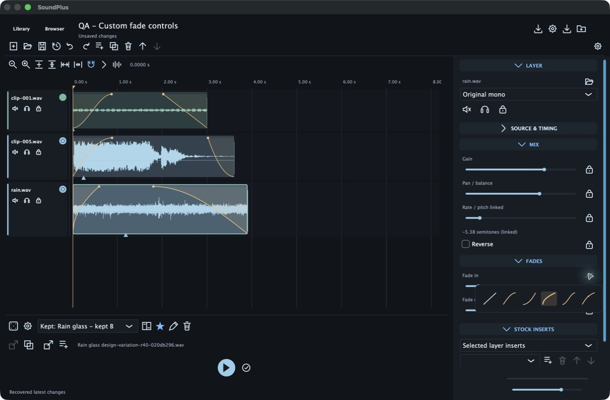
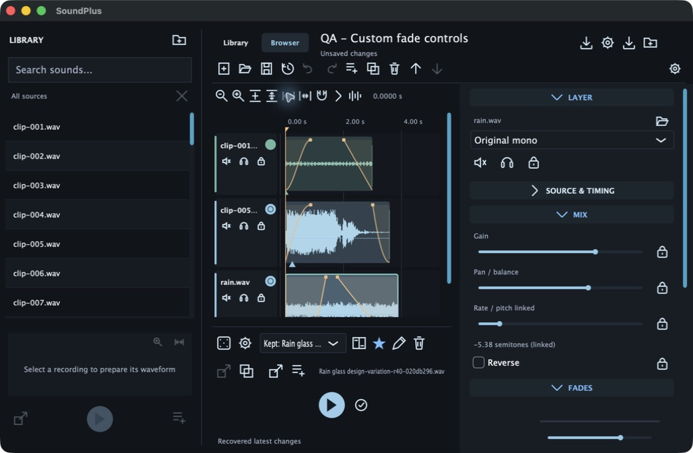
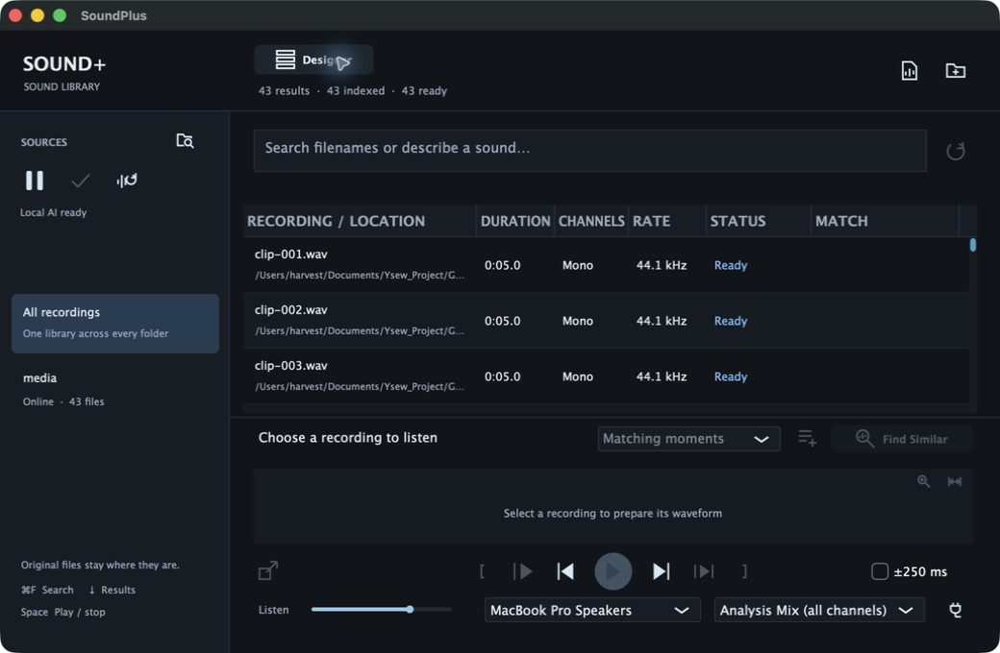

# Track controls and editable fade curves

Implemented on top of `0da4592`, preserving the Designer v1.1.1 correction pass and Library selection-follow audition. The architecture remains DesignDocument / DesignSession plus the shared stock audio graph. Library stays independently usable. This report covers the subsequent track, fade and navigation requests; the earlier correction closure and R01–R14 table remain in [Designer v1.1.1](DESIGNER_V1_1_1.md).

## Request closure

| Request | Status and evidence |
| --- | --- |
| Actual track colors instead of palette glyph and printed color names | Fixed. Each header shows its current circular swatch; the picker contains seven actual colored circles. Names remain available through tooltips/accessibility. Saved color and Undo/Redo use the existing document field. Native picker selection and keyboard Undo passed. |
| Transparent track background, opaque clips | Fixed. Lane surfaces use 48% opacity over the grid. Headers and clips remain opaque. Actual canvas pixel checks distinguish the grid under a lane from the unchanged clip fill. |
| Mute, Solo and variation Lock in track labels | Fixed. All three controls operate on their own layer, preserve selection and mirror the inspector through session refresh. Actual command callbacks, history tests and native clicks passed. |
| Fade shapes and retained presets | Fixed. Independent IN/OUT choices offer Linear, Equal power, Slow, Fast and S curve, plus Custom. Canvas and audio evaluate the same amplitude law. All 25 preset pairings pass independent sample-value checks. |
| Double-click to add freely movable fade points | Fixed. Double-click the curve, then drag the new point horizontally/vertically. Curves interpolate every point, including rises/dips, without exceeding unity. Native IN/OUT add and drag, keyboard Undo/Redo, preset-to-Custom restoration and restart passed. Actual pointer-handler tests also cover removal, cancellation and overlapping points. |
| Smaller points and matching fade colors | Fixed. Duration grips are 5-point squares; custom nodes are 4.5-point circles, enlarged subtly on hover. Invisible hit targets remain larger. Both fade directions use the same warm amber line and tint. |
| Mode highlight remains after switching off | Fixed in the shared IconButton. Active blue now depends on the toggle state; keyboard focus has neutral ink. Native focused Mute/Solo/Lock, Snap and audible-preview on/off checks passed. Browser styling follows its actual visibility. |
| Text for the two Designer navigation actions | Fixed. **Library** opens the full Library; **Browser** toggles the adjacent browser. Both are text-only buttons, with tooltip/accessibility names. Native navigation and resizing passed. |
| Preserve previous corrections | Preserved. All ten current suites passed, including session recovery, independent imports, pending-seek parameter adoption, live stock edits, selection history, long Fit Design, coincident duration handles and Library selection audition. Earlier findings retain their documented scope and limitations. |

Implementation references: [reusable controls](../src/DesignControls.h), [canvas commands and drawing](../src/DesignerCanvas.cpp), [point hit testing and edits](../src/CanvasEditing.cpp), [curve preparation](../src/FadeCurve.h), [stock DSP](../src/DesignAudio.cpp), [live parameters](../src/DesignLive.cpp), [document validation/serialization](../src/DesignModel.cpp), [shared icon styling](../src/IconButton.h), and [text navigation layout](../src/DesignerView.cpp).

## Editing

- Double-click a fade **curve** to insert one point at the clicked time and gain. A preset becomes Custom. Up to 32 interior points are supported per fade; endpoints remain silence/unity, and points cannot cross in time.
- Drag a point to reshape; Control-drag provides fine adjustment. Option-click removes a point. Escape cancels a drag; Command-Z and Shift-Command-Z undo/redo a complete gesture.
- Hold Shift to address OUT when custom IN/OUT points coincide. The existing duration grips remain separately reachable when they coincide.
- Right-click a curve or duration grip, double-click a duration grip, or click the inspector curve glyph to choose a shape. Switching to a preset preserves saved custom nodes; choosing Custom restores them. Choosing Custom for the first time seeds a midpoint.
- Color, mute, solo and lock live in the fixed header. Track and clip selection retain distinct presentation; header/lane selection and clip-only selection remain separate. Lower-edge resizing, vertical/horizontal zoom, snapping, trim/slip, Fit and drag placement remain implemented.

Prepared PCHIP segments produce smooth custom curves through all nodes without gain overshoot. IN evaluates the rising curve; OUT mirrors it on the existing half-open frame clock. Overlapping fades multiply. Curve preparation and decoding run on the producer/worker path; the device callback consumes prepared PCM. Live curve changes use the parameter path with a 5 ms crossfade and do not replace the playback generation.

Legacy version-one designs without shape metadata retain linear fades. Saved nonlinear curves or stored custom nodes use DSP capability `stock-sinc32-v2` inside the existing version-one document envelope. This build reads v1 and v2; older builds reject v2 rather than silently auditioning a different envelope. Original audio, source identities, range semantics and document checksums remain unchanged.

## Verification

Built the native arm64 Release application and inspected it on the supported Apple M5 Pro MacBook Pro, macOS 26.3.2, built-in Retina display. Core Audio used MacBook Pro Speakers at 48 kHz / 512 frames. All **10 CTest suites passed in 47.87 seconds**. The new fade suite passed **1,137 checks** (the JSON records 1,136 before its final publication assertion). See the [full test log](verification/designer-fades-ctest.log) and [artifact/evidence record](verification/track-controls-fades.json).

The generated fixture is two seconds of constant stereo PCM at 48 kHz, allowing independent envelope checks. Tests cover all preset pairings, nonmonotonic custom points, malformed nodes, legacy recall, independent fades, overlap, zero duration, live parameter classification, undo/redo, saved recall, WAV rendering and real helper callback capture. **Maximum offline PCM error: 0.0. Maximum native callback PCM error: 0.0.** One tagged live custom-point update reached the callback in **40.82 ms**, preserving its playback generation, with **0 underruns**. This is producer-to-callback evidence from one update, not acoustic latency or a sustained-edit percentile benchmark. The prior continuous stock-effect measurement remains in the v1.1.1 report.

Native CUA checks used an isolated copy named **QA - Custom fade controls**. They covered swatches, presets/Custom, independent curve insertion and dragging, focused mode-off styling, Undo after a picker closes, point Undo/Redo, browser visibility, full Library navigation, desktop/compact/minimum layouts and quit/reopen at retained revision 3468. The minimum window was 1040 × 680 including its title bar; the 350-point inspector and compact browser remained available, with normal timeline/row scrolling. Option-removal, Shift-overlap targeting, Control-fine adjustment and Escape were verified through actual canvas event handlers in the gesture suite; those modified-pointer gestures were not repeated through native CUA.

The working **Rain glass design** at r3449 was retained separately, with byte-identical SHA-256 before/after QA, and reopened at the end. No QA recipe was written over that working session. The final app is left running with that catalog.

No additional display scale, external monitor or audio interface was qualified. Human listening/physical speaker audibility was not measured. **Cross-application drag remains explicitly unverified** until a receiving-app save/exit/reopen workflow passes. Audible scrubbing retains its separately verified forward-grain PCM behavior and approximate history policy; these controls do not change it.

## Build and quick check

Quit the running application before rebuilding its bundle. From the repository root:

```sh
.tools/cmake/data/bin/cmake --build build --parallel 6
.tools/cmake/data/bin/ctest --test-dir build --output-on-failure
open "$PWD/build/SoundPlus_artefacts/Release/SoundPlus.app"
```

To reopen the current working catalog explicitly:

```sh
open -n "$PWD/build/SoundPlus_artefacts/Release/SoundPlus.app" --args \
  --data-dir "$PWD/build/fade-ui/native-ui"
```

Use a separate design for a five-minute check:

1. Add two sounds, click a header then a clip, resize a row and zoom. Choose an actual color swatch. Toggle header Mute/Solo/Lock on and off; compare the inspector and focused icon styling.
2. Drag the IN/OUT duration grips. Try each preset through a right-click, then double-click each curve and drag the small nodes. Both directions should stay amber.
3. Add another node, create a dip, Option-click it away, Undo and Redo. Switch to a preset and back to Custom: your nodes return. Try Shift on coincident IN/OUT nodes.
4. Play while reshaping, search in Browser, then switch to full Library and back. Stopped selection stays silent; active Library audition follows the selected result. Check the minimum window and hide/show Browser.
5. Save, quit and reopen: colors, curve points, audio parameters and workspace preferences should remain. Use Accurate audition when assessing long delay/reverb tails.

## Native captures

The fixed track headers keep identity and state separate from the timeline. Translucent lanes expose the grid while opaque clips keep waveforms readable. Small amber curves/nodes sit over the waveform without adding permanent numeric inputs. Text navigation disambiguates the full Library and adjacent browser.










