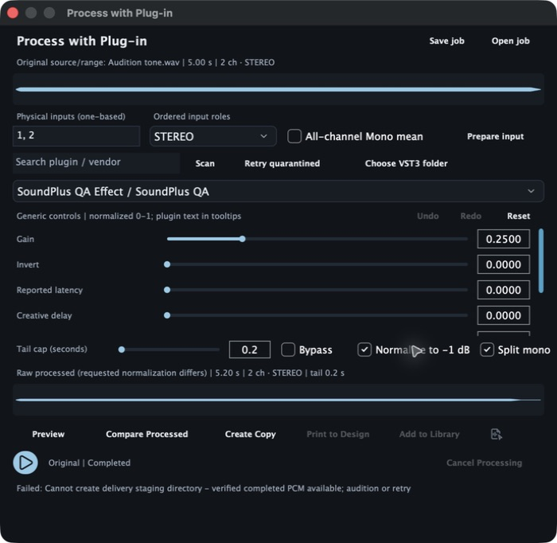
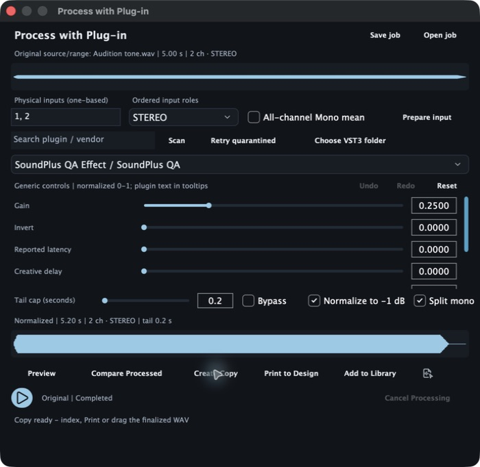
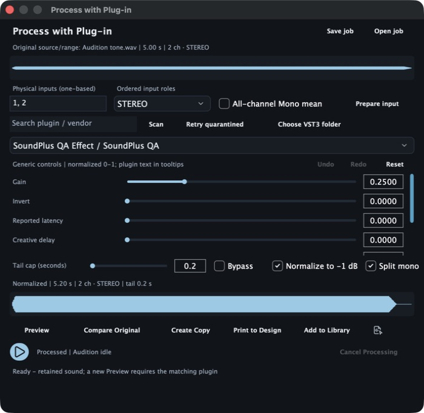
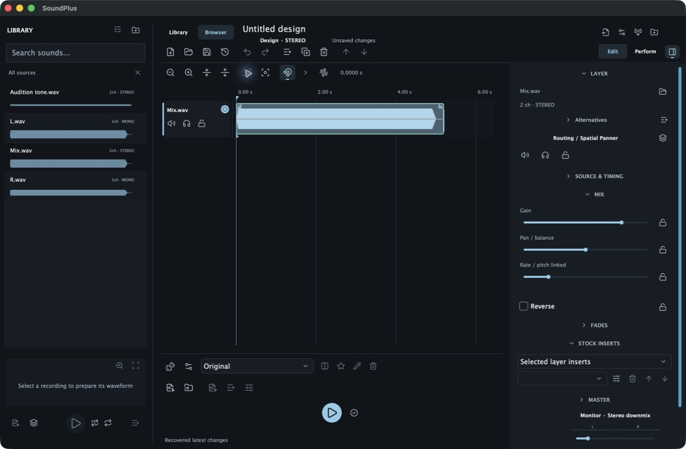
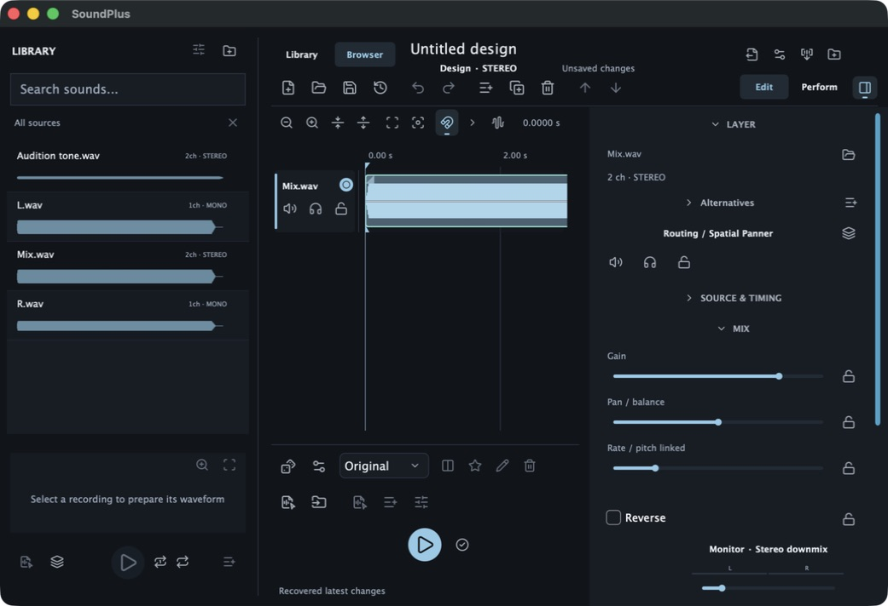

# VST3 v1.6.1 — workflow reliability and audition controls

Baseline/current starting HEAD: `5b0fb5c6098ebdcb18f434816719eded1527ea61`. Clean checkout; no intervening changes to reconcile. The complete user prompt, AGENTS.md, v1.6 contracts/compatibility/report and production session/panel/worker tests were inspected.

## Finding-to-test matrix

| Finding | Before (review and source inspection) | Correction | Production evidence |
|---|---|---|---|
| [R20](../src/PluginProcessing.cpp) | Cancellation could become cached quarantine; per-candidate writes replaced complete entries/roots with partial snapshots | Cancellation escapes candidate handlers; only a completed atomic snapshot replaces the registry | Actual constructor-marked supervised first/last child cancellation, byte-identical prior registry, multiple entries/custom roots, reopen/normal retry; genuine crash/hang tests retained |
| [R21](../src/PluginSession.cpp) | Copy/normalization launch discarded completed PCM before delivery could fail | Completed pass, operation and receipt are separate; failure/cancel reverifies current/raw PCM in background; generation/context gates prevent resurrection | Mono/Stereo/5.1 Side/Rear fail/retry; nondeterministic pass, staging-gated cancellation, normalization fallback/retry, source/settings/context change and corrupted-PCM rejection; no extra worker requests |
| [R22](../src/PluginProcessPanel.cpp) | Equal staged hashes also suppressed original source/selection adoption | Input selection binding and visible source summary are independent of waveform content reuse | Prepared-only equal-PCM Save/Open/Prepare with distinct paths/ranges/physical order/scope; mean recall, empty/error states, queued Open, late-waveform/changed-content checks and equal-content reprepare after an old stage becomes unavailable |
| [R23](../src/AudioIPC.cpp) | A/B always restarted; no Stop/Space; remembered action was mistaken for current playback | Separate Lucide Play/Stop and Cancel Processing; exact ID/generation ownership; pending/natural completion/error/transfer feedback | Actual component mouse/key handlers; long original/processed, pending Stop, A/B, natural end, text Space, other owner/capture protection and destruction; no plugin rerun |
| [R24](../src/WaveformPreview.cpp) | Raw tick/search/adoption vectors and header deltas were omitted, and decode count prose was wrong | Retain IDs/timestamps/durations/statuses, exact overlap operands and bounded raw waveform timing records; independent nearest-rank auditor | Fresh bounded workload plus independently recomputed summary; final raw records and source/binary manifest linked below |

The reviewed before-behaviors were confirmed in baseline source inspection; no separate baseline runtime pass is claimed. Targeted production checks and the final instrumented correction run pass. The latter includes rapid repeated Cancel and focused-button Space peer dispatch. Final full-suite, native UI and artifact qualification are recorded below. All R20–R24 findings are fixed within the stated qualification limits. Per-sample PCM assertions and status polls are not independent audio experiments.

All matrix sequences run in the production [plugin processing suite](../tests/PluginProcessingTests.cpp), with owned [VST3 fixtures](../tests/PluginFixture.cpp). Raw workload recomputation uses the independent [Python auditor](../scripts/audit_plugin_workload.py).

## Contracts and UX

Verified completed PCM remains auditionable/copyable after delivery failure. Failed/cancelled delivery exposes no receipt or partial set. Corrupt raw authority invalidates the pass even if a normalized file survives. Requested normalization and the actual raw/normalized representation are displayed separately; recovery never silently runs the plugin again. A new Preview remains an explicit new pass.

Audition uses the existing shared transport. Play/Stop and Space are separate from Cancel Processing; Space stays text in text/numeric editors. A/B restarts each aligned representation at frame zero and preserves the finite-tail difference. Stop and panel destruction check the exact local intent ID/generation atomically, including pending starts, and cannot stop another owner or a capture reservation.

Source scope/path/frame range/physical order/roles/Mono mean follow the adopted job. Identical verified content can keep existing peaks. Different content replaces demands; old asynchronous completions cannot become the new job's waveform. No decode, file parsing or plugin loading occurs in paint/audio callbacks. Job-record writing and recovery verification run on background workers.

The bounded finite-plugin model, exact latency/creative-delay/tail policy, opaque state, ordered named layouts/LFE, original files, source pools and stock canonical take formats remain unchanged. No broad Designer rewrite. [Agreed next Expanded Perform direction](EXPANDED_PERFORM_DIRECTION.md) is preserved as future work; four current assignments remain a real limit.

## Qualification limits

No third-party VST3 was found in the standard system/user folders or checked application tree. No untrusted binaries were downloaded. Owned fixtures do not qualify arbitrary vendors. Untyped discrete VST3 4/8/16 remains unavailable in pinned JUCE 8.0.6; stock discrete support is unchanged.

Native Resolve receiving-app delivery remains open/blocked: the prior drag initiated but produced no imported media. An empty saved/reopened timeline is not a pass. This correction does not substitute API/Finder import for actual native acceptance/placement/rate-channel-content/save/quit/reopen persistence. Human listening, physical surround and real external-volume removal remain distinct and unperformed unless explicitly recorded below.

## Additional discovery request

The user subsequently requested standard audio-plugin folder scanning and DAW-style effect-type groups. This pass adds automatic background reconciliation of standard system/user VST3 locations plus remembered custom roots, retains incremental/quarantine semantics, and groups effects by their actual reported categories (with unknown/generic categories under Other effects). Search includes names, vendors and categories. No filename-based type inference. The current worker is VST3-only; AU hosting is deferred beyond this correction milestone. The local inventory contains nine AU component bundles, which are not listed as usable effects. VST2 headers are absent from the pinned checkout. Discovery does not pretend unsupported formats are loadable or silently add an architecture bridge.

## Reproduce

Close app/helper processes executing from the bundle before rebuilding. From the repository root:

```sh
.tools/cmake/data/bin/cmake --build build --parallel 6
.tools/cmake/data/bin/ctest --test-dir build --output-on-failure
build/SoundPlus_artefacts/Release/SoundPlus.app/Contents/MacOS/SoundPlus \
  --data-dir "$PWD/build/gain-hover-native"
```

The last command names the actual retained user catalog, not the isolated QA catalog. No push is requested or performed.

The optional `SOUNDPLUS_BUILD_PLUGIN_ASAN_QA=ON` target `SoundPlusPublicationDebug` instruments a dedicated core, JUCE and production UI/session components consistently with AddressSanitizer. Actual plugin/audio helpers and VST3 fixture modules remain Release children across the real process boundary. `ASAN_OPTIONS=detect_leaks=0` excludes framework/global leak reporting; memory-access/container checks stay enabled. No suppression is used. This is not a leak or real-time callback instrumentation claim. The final diagnostic executable/child worker hashes accompany the Release manifest.

Earlier development checks are not counted as final passes. Native inspection caught and corrected punctuation encoding and independent Space dispatch handling; added regressions also cover repeated Cancel and recovery from an unavailable staged waveform. The final gate/evidence supersedes earlier timings.

## Final verification and artifact binding

Verified on Apple Silicon M5 Pro (48 GiB), macOS 26.3.2, arm64 Release, JUCE 8.0.6. The final [CTest log](verification/vst3-v161/ctest-final.log) passes **26/26 suites in 145.78 seconds**; plugin integration took 36.31 seconds. The [ASan run](verification/vst3-v161/asan-final.log) passes **156747 assertions across eight named bus layouts**, with the instrumentation scope described above. These are assertion counts, not independent listening trials.

The [source/executable manifest](verification/vst3-v161/artifact-identity.json) binds 212 compiled source/resource/test files and seven Release executables. Compiled source-tree SHA256: `e70ef58e911bd294cd4b7aadee9d7c9d2395492d187c056d52bc07dfb6368073`. The native QA app/helper copies were byte-identical to those final binaries. The [diagnostic manifest](verification/vst3-v161/sanitizer-artifact.json) separately records the instrumented executable and Release children. No source changed after final verification.

[R20–R23 correction records](verification/vst3-v161/corrections.json), [raw workload](verification/vst3-v161/load.json), [independent summary](verification/vst3-v161/workload-audit.json) and [negative auditor checks](verification/vst3-v161/workload-auditor-negative.json) provide the finding closure evidence. R24 also corrects the historical v1.6 report's seven requests/seven decodes without modifying its original raw artifact.

One bounded concurrent workload indexed 256 generated WAVs while shared playback, filename searches, waveform demands and actual helper scan/processing ran. The owned plugin deliberately sleeps 2 ms/block to maintain overlap. It retained 19 scan and 160 processing observations, 160 individual tick durations, 16 published searches and ten waveform adoptions. Nearest-rank percentiles use `sorted[ceil(p*N)-1]`:

| Measurement | p50 ms | p95 ms | p99 ms |
|---|---:|---:|---:|
| Poll/update tick | 0.04254 | 0.07958 | 0.10329 |
| Search to observed UI publication | 13.03346 | 15.19737 | 15.19737 |
| Waveform adoption | 66.66879 | 76.30488 | 76.30488 |

Search times include polling delay. Waveform records cover this pool's fixture lifetime, not just the load interval. Total waveform requests/decodes were **11/10**, with **2/2 during load**. Three indexing-overlap intervals are reconstructible from worker/backlog/header deltas; all 160 processing observations overlapped active processing. The shared clock advanced **192512 frames**, retaining ownership/generation and Playing state, with **zero reported underruns**. Plugin child elapsed time was **3725.223 ms**, peak resident bytes **21446656**. Bounded cache assertions retain at most 48 sources, 96 geometries, 160 display sources and 2048 geometry pairs. These results do not establish maximum capacity. Four deliberately altered records/summaries were independently rejected.

The regenerated [portable archive](verification/vst3-v161/portable-evidence.zip) passes **497 independent audit assertions**: gain/polarity and expected PCM maximum error **0**, exact 37-frame latency removal, a generated 4099-frame/48 kHz 5.1 Side case, and matching master/six role-named splits. [Package identity](verification/vst3-v161/package.json) and [audit output](verification/vst3-v161/portable-audit.json) bind the archive. It redistributes generated evidence, not plugin binaries or user recordings.

```sh
python3 scripts/audit_plugin_workload.py docs/verification/vst3-v161/load.json
python3 scripts/audit_plugin_processing.py docs/verification/vst3-v161/portable-evidence.zip
```

## Native workflow and retained session

[Native observations](verification/vst3-v161/native-workflow.json) record actual pointer/key actions in a separate QA catalog using a generated five-second stereo/48 kHz fixture.

| Native acceptance item | Actual result |
|---|---|
| Automatic standard/custom-root scan | Cached fixture available; one cache hit, zero child launches on reopen |
| Play/Stop and repeated Space | Playing → Stopped → Playing → Stopped; also verified with Compare focused |
| Completion and editing | Natural completion returns Play; text/numeric editor Space does not start audio |
| Failure recovery | Forced normalization destination failure retains verified Raw and requested normalization state; retry/copy keeps worker request count **3 → 3** |
| Deliberate new Preview | Explicitly starts request 4; finalized copy saved successfully |
| Index and Print | Four QA files indexed; printed ordinary source saved/reopened online in revision 2 |
| Normal/resized UI | 1360×860 normal; near-minimum **1041×680** with Browser/Inspector visible; Process content 700×650 |

The native resize stopped one pixel above the registered 1040-wide clamp; Library component checks execute exactly 1040×680. Designer layout is unchanged from v1.6. Primary controls, waveform strips, keyboard focus and inspector scrolling remained usable in the inspected sizes. Category mapping/menu population is production-tested; a separate native popup screenshot was not captured.

The final durable QA copy is `/Users/harvest/Music/SoundPlus/Processed/Processed-1330bf95900543beb9c3c026c6aa7155/Mix.wav`: 249600 frames, 48000 Hz, two-channel float32, 5.20 seconds including the configured tail. Independent checks: gain error 0, silent-tail sample maximum 0, normalization maximum error 5.649e-8, split error 0. Failure/retry retained the authoritative raw hash. No human listening result is claimed.

Final interface evidence:







The existing theme/Lucide controls and compact waveforms remain; audition feedback sits beside its transport, while processing cancellation stays a separate action. Source identity and actual available representation remain visible through errors.

[Session protection/restoration evidence](verification/vst3-v161/restoration.json) confirms all eleven original media and nine recovery files unchanged, settings and both saved designs retained, and the actual catalog still containing 43 assets/one root. No older snapshot was restored. The final regular app was relaunched on `build/gain-hover-native`: **Workflow demonstration r31 / Take 2 Ready**, Perform, Browser visible, monitor 0.25; the saved Rain glass r19992 remains intact.

All R20–R24 corrections are **Fixed**. Automatic VST3 discovery and reported-category grouping are implemented and fixture-qualified. AU/VST2 hosting, third-party VST3 qualification, human listening, physical surround/external-drive removal and native Resolve delivery remain outside this verified result. Resolve acceptance remains **Blocked**, with no new receiving-app persistence pass claimed.
