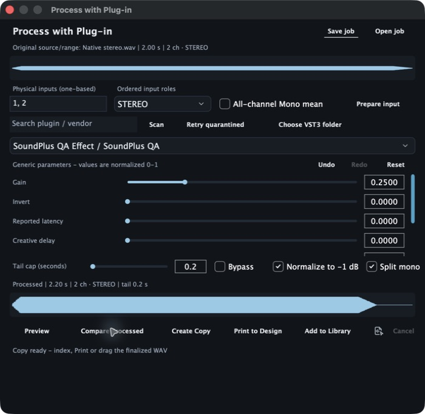
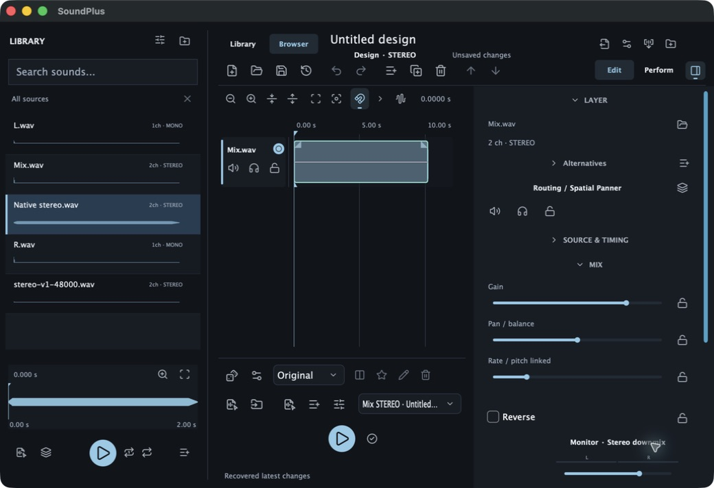
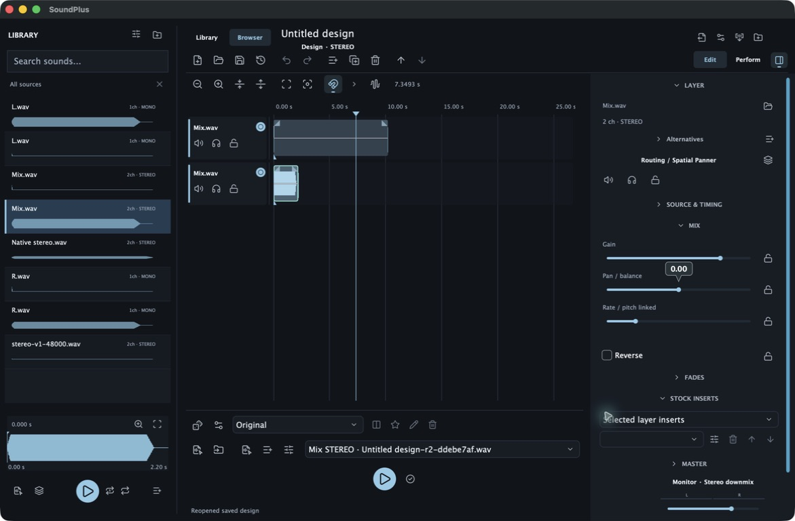
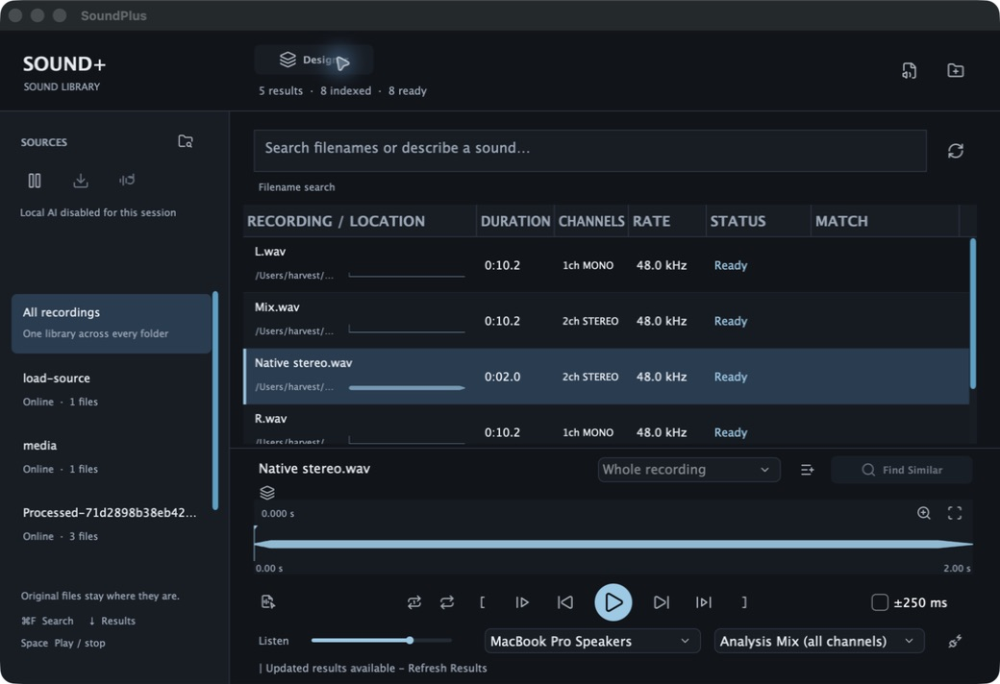

# VST3 Processing and Print-back v1.6

Starting HEAD: `502e94fcd53b8ad77662f92df0982eaeaa78d765`; no intervening commits or unrelated work. The full attached request, AGENTS.md, architecture/requirements, Source Pool/take/multichannel contracts and pinned JUCE headers were inspected. The work uses the existing JUCE/session/shared-audio architecture. No stock DSP recipe or historical take format was changed.

## Delivered feature

- [PluginProcessing](../src/PluginProcessing.cpp): versioned finite-input staging, exact source/range/physical/layout identity, incremental registry/cache, explicit scan quarantine/retry, supervised disposable workers and atomic master/split copy publication.
- [PluginWorkerMain](../src/PluginWorkerMain.cpp): the only VST3 loader. Separate scan, describe/state and finite-processing modes; exact same-layout negotiation; generic parameters and opaque state; reset history, reported-latency compensation, finite tail, non-finite/clipping checks and post-run identity validation. No audio device, live insert or vendor editor.
- [PluginSession](../src/PluginSession.cpp): background operations, cancellation/generation/context gates, gesture history, bypass/reset, saved checksummed jobs and retained completed sounds. Input edits require preparation; parameter changes require a new Preview. Opening a job does not require its plugin to remain installed when its completed PCM is valid.
- [PluginProcessPanel](../src/PluginProcessPanel.cpp), [Library](../src/LibraryView.cpp), [Designer](../src/DesignerView.cpp) and [Workstation](../src/Workstation.h): contextual Process entry points, explicit input scope/subset/roles, plugin/vendor search, generic value entry, tails, actual input/processed mini-waveforms, shared A/B audition, Create Copy, index, multichannel master Print and finalized file drag. The Process surface has a bounded two-source WaveformPool owner; decoder/cache limits remain unchanged. Existing Library/alternative/Perform mini-waveforms are retained.

Normalization is applied to completed PCM before that representation becomes Ready/auditionable; toggling it later derives from the verified raw PCM without another plugin request. Copy, split export, metering and delivery never run the plugin again. `DesignAudio.cpp`'s existing stock two-pass normalization remains separate. Opaque state is not placed in StockEffect's four-value array. See [architecture/limits](VST3_PROCESSING_CONTRACT.md) and [compatibility](VST3_COMPATIBILITY.md).

## Requirement scope and qualifications

| Area | Outcome |
|---|---|
| FX-01 discovery/isolation | Implemented and exercised with actual VST3 workers, incremental cache, corrupt candidate, crash/hang quarantine and explicit retry |
| FX-02 edit/recall subset | Finite effect generic parameters, opaque state, bypass/reset and Undo/Redo; live racks, chains and vendor editors remain outside this bounded milestone |
| FX-03 failure isolation | Scan/process crashes and hangs leave the parent/shared stock transport alive; missing/changed effects block new runs |
| FX-04 preserve a sound | Completed float PCM/hash is authoritative; copy, index, Print/pool/take reuse and playback after plugin removal are exercised |
| DSP-03/DSP-04 finite path | No plugin code in the real-time callback; bounded background buffers, exact latency compensation and creative-delay retention |
| EXP-02/EXP-03 finite path | Explicit capped tails, delivered clipping/peak, staged normalization, atomic durable master/splits and receipts |
| Named bus compatibility | Mono, Stereo, LCR, Quad, 5.0, 5.1 Side/Rear and 7.1 pass independent role/PCM/mask/split checks |
| Discrete VST3 buses | **Unavailable:** pinned JUCE cannot represent untyped Discrete 4/8/16 arrangements. They are rejected, never relabeled/downmixed. General stock discrete support is unchanged |
| Real installed vendor effect | **Blocked by availability:** none found in the checked standard folders/application tree. Owned fixtures do not qualify arbitrary vendors |
| Human/physical qualification | No new human listening score, physical surround or actual external-volume removal claimed |

This is not a claim that the broader architecture's complete FX/live-hosting or release gates are fulfilled. Finite VST3 now and later live inserts, vendor editors, AU/MIDI/sidechains/source triggers are distinct features.

## Automated evidence

[PluginProcessingTests](../tests/PluginProcessingTests.cpp) runs actual owned [VST3 fixtures](../tests/PluginFixture.cpp) through production workers and panel/session commands. It covers incremental scan/cache, actual crash/hang, quarantine/retry, corrupt/changed/missing plugins, incompatible buses; ordered tagged impulses; known gain/polarity; exact reported-latency removal versus retained creative delay; explicit finite/unknown tails; 44.1/48/96 kHz and block/frame boundaries; bypass, non-finite output and changing latency; opaque-state recall and grouped parameter history; input/settings/context stale rejection, cancel and failed publication; nondeterministic separate-run differences with unchanged copy/normalization/splits from one pass; actual waveforms, index/Print/pool/future stock-take reuse and missing-plugin playback.

The final corrected Release run passed **26/26 registered suites in 134.56 seconds**, including the plugin qualification in 27.19 seconds. [Full CTest result](verification/vst3-v16/ctest-final.log), [detailed log](verification/vst3-v16/ctest-final-details.log.gz), [build log](verification/vst3-v16/build-final.log) and [plugin summary](verification/vst3-v16/summary.json) are retained. Its 156,588 assertions include per-sample/structural checks; this count is not a count of independent audio experiments. Existing suites cover old canonical manifests/takes, R18 continuous editing, R19 mappings/reopen, fades, source selection, ownership and stock/native export parity.

A native/component extension exposed a short-fixture heap overwrite in the owned test generator: its second impulse was outside 513/1027-frame buffers. Both writes are now bounded. The final fully instrumented core/JUCE/UI/session sanitizer run passes the same 156,588 checks. The earlier mixed-instrumentation diagnostic was not counted as a pass; no container-overflow suppression is used. Framework/global leak reporting is excluded, so this is memory-access evidence, not leak qualification. [Before/after evidence and reproduction](verification/vst3-v16/SANITIZER.md). All final Release/portable evidence was regenerated after this correction and the normalization no-rerun regression; earlier development passes are superseded.

A separate [actual architecture check](verification/vst3-v16/architecture-check.json) exercises native arm64, Intel-only x86_64 and a private universal owned VST3. Native/universal load and negotiate; Intel-only is unavailable with an explicit no-bridging reason. This caught and corrected a registry-label bug: JUCE can discover metadata without loading an incompatible binary, so architecture is now read from the actual thin/fat Mach-O executable. This is separate from installed-vendor qualification. The main native UI remained unchanged by that helper-only correction; final smoke/reopen observations are bound to the final bundle below.

The [artifact manifest](verification/vst3-v16/artifact-identity.json) binds **212 source/resource files and seven actual Release executables**, including the bundled plugin helper and both owned fixture binaries. Compiled source-tree SHA256: `77f9a7ee98afae5119ab48f453df1d849272d820a3a4904a0a254ac3e1a2834b`. The separate native QA bundle was verified byte-identical to the final app/helpers. Hardware: **MacBook Pro M5 Pro / 48 GiB, macOS 26.3.2, arm64 Release, JUCE 8.0.6**. Recorded hashes are separate from binary redistribution.

## Bounded concurrent workload

**v1.6.1 review correction:** this historical record retained tick/search/adoption distributions but omitted their individual durations, and omitted `headersRead` deltas used by the overlap counter. Those old percentiles and all three overlap intervals cannot be independently reconstructed from this artifact. The decode prose is corrected to its actual seven requests/seven decodes. Fresh auditable records supersede these claims in the [v1.6.1 report](VST3_V1_6_1_REPORT.md); the original v1.6 data are not retroactively changed.

The real plugin child is scanned and processed alongside one ordinary looped 48 kHz stereo audition, 256 generated WAVs being indexed, search publication and shared waveform demands. The owned effect deliberately sleeps 2 ms per block to keep the finite process active. This is not vendor or maximum-capacity qualification.

[Raw workload](verification/vst3-v16/load.json) retains 160 process-phase observations and scan-phase observations, 16 search-publication timings, index work/progress intervals, source/audio generation/underrun telemetry and child resource measurements. Timestamped status observations are not independent PCM samples. Numerical channel/timing oracles are separate.

The final Release workload measured tick/API work p50/p95/p99 **0.0383/0.0720/0.0937 ms** (160), search publication **11.79/12.72/12.72 ms** (16), finite plugin processing **3211.74 ms**, and plugin-child peak RSS **21,479,424 bytes**. There are 22 scan-phase and 160 process-phase observations. All process observations were in flight; three intervals observed active/backlogged indexing or newly completed header work. Playback generation stayed unchanged, its source clock advanced from 512 to 168,448, and underruns stayed **zero**. Five waveform-adoption samples measured p50/p95/p99 12.58/76.23/76.23 ms; seven requests and seven decodes, 83 memory hits and 32,824 retained peak bytes were recorded. These are a small bounded workload, not vendor, maximum-capacity or latency guarantees. The 1 GiB child-footprint polling rule is not an instantaneous memory sandbox.

## Portable numerical evidence

[portable-evidence.zip](verification/vst3-v16/portable-evidence.zip) contains only generated QA source/input, checksummed processing document, complete opaque state/job/result/receipt, authoritative processed PCM, finalized master and six role-named split outputs, an independently generated expected WAV, relative-path map, source/artifact manifest, fixture source and Python auditor. No third-party plugin binaries, licensed recordings or user media are included.

The [independent audit](verification/vst3-v16/portable-audit.json) passed 497 structural/hash/format assertions, including decoded opaque-state checksum, stored raw payload checksum, exact input/range/layout/generation/plugin lineage, master/stem hashes and ordered roles. This is one retained six-channel numerical case, not 497 independent audio experiments. Its 4099-frame, 48 kHz 5.1 Side output discards 37 reported latency frames. The independent gain/polarity and separately generated expected-PCM errors are both **0**; master copy and splits preserve the authoritative sound. [Archive identity](verification/vst3-v16/package.json).

```sh
python3 scripts/audit_plugin_processing.py \
  docs/verification/vst3-v16/portable-evidence.zip
```

The included auditor reads archive-relative bytes, never the originating Mac paths. Actual executable hashes are recorded but their Mach-O bytes are not in this archive; another machine needs those binaries to rehash them. The repository source inventory can be checked independently.

## Native workflow, receiving app and restoration

The complete native UI workflow used `build/vst3-v16/native-qa/catalog`, generated media and `VST3 Print QA.soundplus`; the user's catalog/design was never used for QA. [Structured native record](verification/vst3-v16/native-workflow.json).

| Native action | Actual outcome |
|---|---|
| Full/compact Library Process | Visible, enabled after selection, raw source/range scope explicit |
| Prepare + owned VST3 selection | Explicit Stereo/physical inputs 1,2, actual native folder chooser and scanner; cached candidate reused |
| Generic value entry | Gain 0.2500, tail 0.2 s; parameter history/reset/bypass also exercised by production component tests |
| Preview + real waveforms | Two-second input and 2.20-second result displayed from shared WaveformPool |
| Normalize after Ready | Ready representation changed; total child requests stayed **5 → 5**, including prior QA work; no new request |
| Audition/A/B | Next actions changed Original/Processed; shared transport starts each at frame zero; tail difference explicit |
| Copy + index + Print | Durable stereo master and L/R files; all three indexed; ordinary master printed as a new layer |
| Save/Open processing job | Recalled state, normalization/split choices, Ready result and finalized copy |
| Save/quit/reopen design | Revision 4 reopened, processed source online; playback meter L −7.0/R −9.9 dBFS |
| Finalized design input | Separate “Finalized design/take output” scope observed; original editable recipe unchanged |
| Minimum/normal layout | 1040×680 and 1360×860 content, Browser and Inspector visible, controls/focus/waveforms usable |

The native generated-sine case independently measured gain PCM error **0**, normalization error **4.54e−8**, exact master/stem samples and 105,600 frames / 48 kHz / 2 channels. These are numerical checks and native playback state, **not human listening evidence**.






After the helper-only architecture correction, the final bundle again reopened revision 4 and the saved processing job, recalled Gain 0.2500/tail 0.2/normalization/split settings, rendered a new Ready preview and auditioned it. [Final bundle smoke screenshot](verification/vst3-v16/process-final-smoke.jpg). The structured native record distinguishes the complete preceding workflow artifact from this exact-final-bundle smoke; the UI code is unchanged.

The Process panel is contextual rather than another permanent Designer toolbar row. Input roles/scope stay above the generic scrolling controls; the small before/after waveforms and output actions share the existing theme and transport. [Finalized input scope](verification/vst3-v16/finalized-input-scope.jpg).

### Resolve delivery: Blocked, not qualified

Receiving application **DaVinci Resolve Studio 21.1.2.10**, throwaway project `SoundPlus VST3 Native QA 20261119`, timeline `Processed delivery`. Finalized source:

`/Users/harvest/Music/SoundPlus/Processed/Processed-8910b5759d5945e0ba8506bec1814f8b/Mix.wav`

SHA256 `e6c5a2df69e436b3854af96c20ccaad8592d41ea2e2f811c25b79c377901e7ca`; file exists, finalized 2.20 s / 48 kHz / stereo float32 and retained. The real SoundPlus file-drag action recorded mouse-down, drag and **native-started**. Resolve's Media Pool still contained only its empty timeline; no WAV was imported. The end callback was recorded after Escape during cleanup; it does not establish acceptance. [Gesture trace](verification/vst3-v16/native-drag.jsonl), [receiver screenshot](verification/vst3-v16/resolve-no-import.jpg).

This establishes drag initiation only. The native-control gesture did not achieve a confirmed receiving drop; evidence does **not** establish receiver rejection. Import/placement/rate/channel/content checks and media persistence are **Blocked**, copying versus referencing **undetermined**. The QA project saved/closed/reopened successfully but remained empty, which does not qualify delivery. No API import, Finder or internal drop was substituted. The previous Resolve project was restored. No implementation change was made merely because the automated drag failed.

Manual completion: open that QA project and SoundPlus's QA catalog; open `build/vst3-v16/native-qa/Sine processing.soundplus-process` in Process. Drag its finalized file icon with a physical mouse into Resolve's Media Pool. Confirm an actual `Mix.wav` item, place it on stereo A1, verify path/48 kHz/2 channels/2.20 s and expected content, save, quit SoundPlus, close/reopen the receiving project and audition/check media online. Record whether Resolve references the durable source or copied it. Only that result can close receiver qualification.

### Actual session restoration

[Restoration record](verification/vst3-v16/restoration.json): all **11 protected media hashes**, **nine recovery files**, settings and both saved designs matched their retained copies before relaunch. The actual catalog still had 43 assets/one root. Nothing was restored from an older snapshot. The final app reopened **Workflow demonstration revision 31 / Take 2 Ready**, Perform, Browser visible, monitor **0.25**, with normal AI settings; saved Rain glass revision **19992** retained. Protected bytes stay local outside the evidence archive.

## Reproduce

Close every process running from the app bundle before rebuilding it.

```sh
.tools/cmake/data/bin/cmake --build build --parallel 6
.tools/cmake/data/bin/ctest --test-dir build --output-on-failure
open build/SoundPlus_artefacts/Release/SoundPlus.app
```

The Process workflow is documented in [README](../README.md#process-a-sound-with-a-vst3-effect). Use a separate catalog/document for tests. Build fixtures are selected through Choose VST3 folder; they are never installed automatically.

The actual retained user catalog was relaunched with:

```sh
build/SoundPlus_artefacts/Release/SoundPlus.app/Contents/MacOS/SoundPlus \
  --data-dir "$PWD/build/gain-hover-native"
```

### Five-minute effect check with your library

1. Select an online Mono/Stereo recording, optionally mark I/O, and open **Process with Plug-in**. Confirm raw source/range, physical inputs and ordered roles, then **Prepare input**.
2. **Scan** standard VST3 folders or choose an existing effect folder. Select a compatible native effect; unavailable entries explain their limitation. No plugin is installed by SoundPlus.
3. Adjust a generic value and finite tail, then **Preview**. Audition Processed and Compare Original; each begins at zero, and the processed duration includes the tail. Change normalization after Ready and audition that represented sound.
4. **Create Copy**; use **Add to Library** and **Print to Design**. If Library shows updated results available, refresh. Source files remain unchanged; output goes under `~/Music/SoundPlus/Processed/Processed-<id>/`.
5. Save the processing job/design, quit/reopen the same catalog and confirm the ordinary printed/indexed sound remains usable. Keep the source and durable output paths. Receiver drag qualification requires the separate Resolve steps above.
