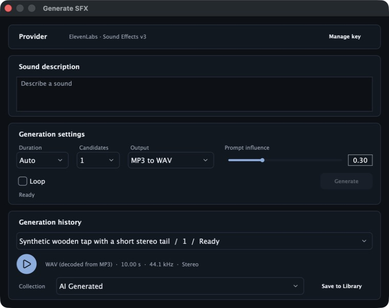

# Preview a generated sound before saving

In Generate SFX, select a ready result and click the circular play icon below its title. The control switches to pause during playback. Click play again to resume from the paused position. Choosing another result clears the prior audition. **Save to Library** is a separate action.

The dialog is 760 logical points wide. The prompt has more room for text, and the candidate selector, transport and publication actions have separate rows. The playback icon carries an accessible name and tooltip.

## Native verification

- Verified play, pause, resume, and return to the play icon on Apple Silicon macOS 26.3.2. A ten-second fixture was paused about 4.7 seconds after Play. After Resume it reached completion in 6.1 seconds of observed UI time.
- Verified the 1040 × 680 QA workspace with both key settings and the published result actions visible. The largest observed dialog, including macOS title bar, measured 760 × 676 logical points.
- Published one synthetic candidate in the isolated catalog and verified that the saved WAV matched the candidate SHA-256. The second sound remained available to audition before saving.
- Release CTest passed 4/4 in 6.28 seconds across `sfx_generation`, `audio_transform_jobs`, `icon_system` and `native_view_scale`. Playback verification used a local fixture and native transport observations.

Baseline `0a7f45f01887788662fae0af182673684694885f`. Tested arm64 Release executable SHA-256 `16cfc79699ddff925d1987c656fbcc83907614cb8cd05aa3380243a0a7463dec`.

[Pause icon during playback](roomy-preview-playing.jpg) · [Expanded dialog after publication](roomy-preview-expanded.jpg)
