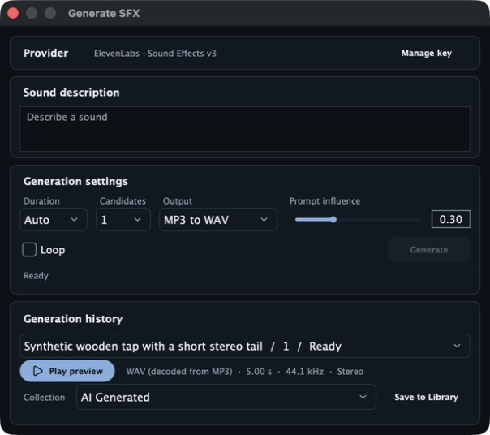

# Preview a generated sound before saving

In Generate SFX, select a ready result and click **Play preview** below its title. The button shows **Stop preview** while that sound plays. Choosing another result stops the prior audition. **Save to Library** remains a separate action.

I verified Play, Stop, changing candidates and playing the new selection on Apple Silicon macOS 26.3.2. Both candidates remained unpublished and the isolated catalog had zero assets after the checks. CTest passed 4/4 in 6.60 seconds across `sfx_generation`, `audio_transform_jobs`, `icon_system`, and `native_view_scale`. This is native transport and UI evidence.

The follow-up starts at `6510c4eb914f19f5a49dc2ab0b1d2eda2e9747e7`. The tested arm64 Release executable SHA-256 is `d6f1286eb96f489283f995bfd254b43f5f324680b9807906f04dfb58d2ce76ea`. The Candidate B full-gate attempts used their own detached builds.
