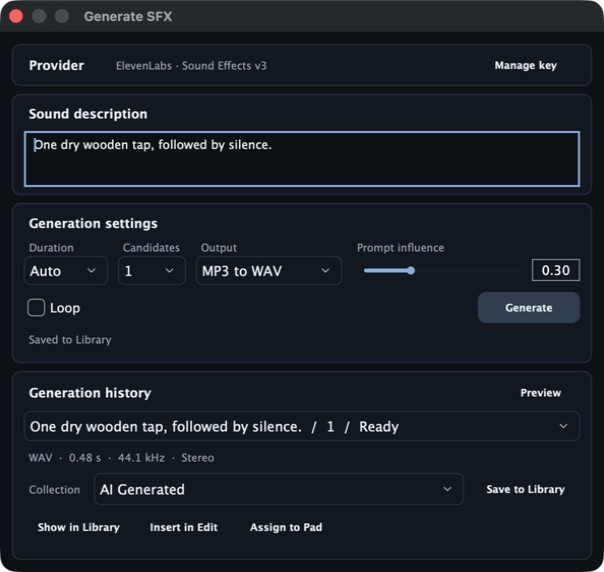

# Generate SFX panel

The panel groups provider access, the sound description, generation settings and candidate history. Key management opens automatically when a key is missing. Preview and publication sit with the selected result. The window grows to show destination actions after publication.

## Verified on macOS 26.3.2, Apple Silicon

- Opening the Release panel showed the saved ElevenLabs provider and the existing ready candidate. Startup only queried whether the Keychain item exists. The earlier build had waited inside a secret-data read.
- Activating Manage key exposed the masked field and key controls. Activating the disclosure again hid them. Entering a description enabled Generate.
- Preview switched to Stop during playback of the existing candidate. The candidate summary showed WAV, 0.48 s, 44.1 kHz, stereo. This was a transport check.
- Save to Library opened the native folder picker. Saving into the isolated publication folder created one indexed asset and revealed Show in Library, Insert in Edit and Assign to Pad. The source and published WAV both had SHA-256 `c8f3224d807c5d985fc383f5924ccf6b6d8f6c67055646c37bf099d8f900f523`.
- Release CTest passed 3/3 in 6.12 s across `sfx_generation`, `audio_transform_jobs` and `native_view_scale`. The credential regression checks opening history without a secret read and presence before save, after replacement and after deletion in an isolated Keychain account.

Baseline `09254c73285af3d9e669790aae47ea0ded567129`. UI Release executable SHA-256 `e89af4e71bad21a92ab1d0cf063d70af0486875847761c54940a6151988a6a00`. Verification used a separate application bundle and QA Library with a copy of the Phase 1B candidate. The user’s working application and projects stayed open. This UI check made zero live generation requests.

## Completed tasks

- ✓ Inspect the panel, provider, candidate and publication states.
- ✓ Group the controls and resolve the startup credential wait.
- ✓ Build Release and verify native disclosure, preview and publication.
- ✓ Capture the resulting panel and verify the published audio identity.
